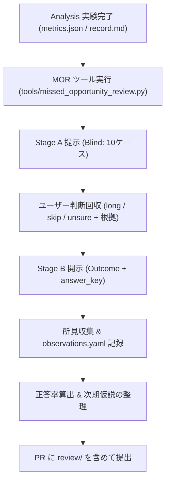

# Missed Opportunity Review (MOR) Skill

本スキルは、Analysis 実験完了時に「シグナルが出なかったのに大きく動いた場面（見逃しエントリー：M1）」と「似ているのに伸びなかった対照群（C1/C2）」をブラインドで提示し、人間の視点・所見を安全に仮説生成へと繋げる Human-in-the-Loop レビュー手順を規定します。

---

## 1. 目的と基本原則

1. **数値探索の限界突破**:
   - バックテスト数値だけの過剰適合を避け、人間がチャートから感知する直感・文脈（サポレジ、移動平均線の収束/拡散、出来高推移など）を抽出する。
2. **後知恵バイアスの完全排除（2段階ブラインド提示）**:
   - **Stage A（判断時点）**: 判断時点 $t$ 以前のデータのみを描画。未来の値動きを完全に遮断した状態でレビュアーの判断（`long` / `skip` / `unsure`）と根拠を記録する。
   - **Stage B（結末開示）**: Stage A の回答完了後に結末（72hの値動き、MFE、真の分類）を開示し、所見を収集する。
3. **対照群（Controls）の混在**:
   - 伸びた場面（M1）だけでなく、特徴量が酷似しているのに伸びなかった場面（C1）やシグナル発生後の負けトレード（C2）をシャッフルして提示し、無根拠なポジティブバイアスを抑制する。
4. **知見登録の厳格な分離（仮説生成 $\neq$ 知見確定）**:
   - レビュアーの所見は「仮説候補（Candidate Hypotheses）」であり、直接 `K-xxx`（知見）に登録してはならない。必ず新しい Analysis Issue を起票し、事前登録 $\rightarrow$ 検証を経て検証する。

---

## 2. 標準ワークフロー



### ステップ 1: レビュースイートの自動生成
Analysis 実験の集計完了後、以下を実行して `review/` 配下にファイルを生成する。
```bash
uv run python tools/missed_opportunity_review.py --experiment <N> --signal <signal_id> --seed 42
```
生成物:
- `review/case_01_stageA.png` 〜 `case_10_stageA.png` (判断時点)
- `review/case_01_stageB.png` 〜 `case_10_stageB.png` (結末)
- `review/gallery_stageA.md` (ブラインド質問票)
- `review/gallery_stageB.md` (結末ギャラリー)
- `review/answer_key.json` (正解ラベル: 非公開)
- `review/cases.json` (特徴量スナップショット)
- `review/observations.yaml` (回答記録テンプレート)

### ステップ 2: Stage A ブラインド提示・2段階エスカレーション判定（サブエージェント先行試行 ＆ 人間差分レビュー対応）
1. **標準提示情報（主軸階層）**:
   - エージェントは `gallery_stageA.md` および `case_01_stageA.png` 〜 `case_10_stageA.png` を用いて、判断時点 $t$ の多角的な客観情報を確認する：
     - 日時（`UTC` および `JST`、始値時刻および `t0 + 1h` の 1h足確定時刻）
     - OHLCV 数値（始値・高値・安値・終値・出来高）
     - 価格レンジ（過去 24h レンジ、過去 120h レンジ）
     - テクニカル指標（ATR 24、BB 幅/バンド位置、AFS Stoch_D 7/9/11/13 および Order Score、Macro Age Ratio）
     - 主軸 SMA（21, 34, 55, 89, 144, 233）の確定値と傾き
2. **判断に迷いがある場合の条件付き上位階層参照と「利益余地（Profit Room）」の対称評価**:
   - [00_GOVERNANCE/principles.md](../../../00_GOVERNANCE/principles.md) §3.4 および [01_CONCEPTS/mtf-framework.md](../../../01_CONCEPTS/mtf-framework.md) §4.3〜§4.4 に基づき、「入らない理由を探す減点法（リスク回避偏重）」に陥ることを防ぎ、**利益を取れる余地（Profit Room / 空白地帯）**を対称的に評価した上で2段階判定を実施する：
     - **Stage A1（主軸階層での1次判定 ＋ 利益余地チェック）**:
       - 標準チャートと主軸階層（`21〜233`）の情報で評価する際、単に「上位SMAが下向きだから」「大陽線だから」という理由だけで即決 `skip` にしてはならない。
       - **① 空白地帯（Vacuum）による回帰余地**: 上位SMA（144/233等）が下向きでも、短期SMA（21/34）を奪還しており、次の長期SMAとの間に **`3 ATR` 以上の空白地帯（抵抗のない空間）** が開いていれば、頭上の長期SMAへ近づく回帰利益を狙える候補（`long` または `unsure`）として扱う（直上 `0〜1.5 ATR` に複数SMAが密集して蓋をしている場合のみ即 `skip`）。
       - **② 収束・調整後の初動ブレイクと1m足サポレジ維持**: 数十時間の横ばい調整・SMA密集から放たれた大陽線であり、1m足が直近高値ブレイクラインや短期SMAの上で下げ止まって再浮上している場合は、高値掴みと即断せず `long` または `unsure`（上位レンジ位置確認）とする。
     - **Stage A2（迷いケースに対する上位階層参照）**: `unsure` となったケースに対してのみ、**1〜2段階上の階層（上位SMA・過去30日レンジ位置等）の傾き・位置・乖離度・空白幅**を確認し、最終判断（`long` / `skip`）と「どの上位情報で迷いが解消したか」を記録する。
3. **進行モード（サブエージェント先行試行 ＋ 人間による差分レビュー）**:
   - **サブエージェント先行試行**: 人間の回答を待たずに進める場合、メインエージェントは正解（`answer_key.json` / `stageB`）を一切知らない独立コンテキストのサブエージェント（`invoke_subagent`）を起動し、上記 Stage A1 $\rightarrow$ Stage A2 の2段階ブラインド判定を全10ケースに対して実行させる。
   - **人間による個別回答・差分レビュー**: レビュアー（人間）は1ケースずつ任意の順序で回答することも、サブエージェントの先行試行結果（特にエージェントが迷ったケースや Stage B 正解と食い違った難問ケース）を対象に差分所見を回答することもできる。
   - 回答受領時は `tools/missed_opportunity_review.py --update-case <ID>` で `observations.yaml` に即時保存する：
     ```bash
     uv run python tools/missed_opportunity_review.py --experiment <N> --update-case <ID> --call <long|skip|unsure> --rationale "..."
     ```
4. **厳格な制約**: Stage A の判定完了前に、対象ケースの正解ラベル（M1/C1/C2）や未来のチャート・価格推移（Stage B）を決して参照・開示してはならない。

### ステップ 3: Stage B 結末開示と所見収集
1. Stage A の回答完了後、Stage B（結末チャート、MFE 到達点、真のラベル）を開示し、予想と結末のギャップを検証する：
   ```bash
   uv run python tools/missed_opportunity_review.py --experiment <N> --update-case <ID> --reveal --comment "..."
   ```
2. 各ケースについて以下を確認・記録する：
   - 予想と結末のギャップ（なぜ伸びたのか / なぜ失速したのか）
   - 主軸階層で迷ったケースにおいて、上位階層（1〜2段上）のどの情報が有効な決定打となったか（または上位を見ても騙された場合は何が決定的に違ったか）

### ステップ 4: 記録と正答率の算出
1. `review/observations.yaml` に回答・根拠・所見・正解ラベルを逐次記録する。
2. 回答済みケースに基づき Stage A 識別能力（正答率）を算出・記録する：
   $$\text{Accuracy} = \frac{\text{True M1 identified as } long + \text{True Controls (C1/C2) identified as } skip}{\text{Total Answered Cases}}$$
3. 全件（または回答対象）のレビュー完了後、`summary.candidate_hypotheses` に次期事前登録仮説候補を整理する。

### ステップ 5: 課題化
得られた仮説候補のうち有望なものを、次期 Analysis Issue のドラフトとして提案する。

---

## 3. ブラインド・サブエージェントへの標準指示文テンプレート

サブエージェントに Stage A のブラインド先行試行を委譲する際は、後知恵バイアス（未来リーク）および「過度なリスク回避（減点法）バイアス」を防ぐため、以下の指示文テンプレートを使用する。

```markdown
あなたは Missed Opportunity Review (MOR) のブラインド・レビュアー（Stage A 判定エージェント）です。
対象ディレクトリ: `03_KNOWLEDGE/experiments/<EXP_DIR>/review/`

### 【絶対厳守ルール（カンニング・未来リークの禁止）】
1. **閲覧を許可するファイル**:
   - `gallery_stageA.md`
   - `case_01_stageA.png` 〜 `case_10_stageA.png`
   - 判断時点 $t$ 以前（`<= t`）の過去データおよび上位階層指標（迷いが生じた場合の1〜2段上のSMA/上位足情報）
2. **閲覧・参照を一切禁止するファイル・データ**:
   - `answer_key.json`、`gallery_stageB.md`、`case_01_stageB.png` 〜 `case_10_stageB.png`、`cases.json`、`observations.yaml`
   - 判断時点 $t$ より未来（`> t`）の価格・ローソク足データすべて

---

### 【あなたのタスク：利益余地（Profit Room）の見極めと2段階エスカレーションによる Stage A ブラインド判定】

**重要原則（減点法バイアスの禁止）**:
「上位SMAが下向きだから」「大陽線が出た後だから」といった表層的な減点法（入らない理由探し）だけで安易に `skip` にしてはなりません。トレーディングの目的は「無傷の完璧な形を探すこと」ではなく、**「下値リスク（ストップまでの距離）に対して、3〜5+ ATR の利益を取れる余地（Profit Room / 空白地帯）がある場面を見極めること」** です。

Case 01 〜 Case 10 の全10ケースについて、以下の2段階プロセスでエントリー判断を行ってください。

#### Step 1: 主軸階層（Stage A チャート & `gallery_stageA.md` 記載の `SMA 21〜233`・AFS・Slope・1m足）による1次判断
各ケースの Stage A チャート画像（`case_XX_stageA.png`）と `gallery_stageA.md` の数値を観察し、**「リスク」と「利益を取れる余地（Profit Room）」の両面**から1次判断（`call_step1`）を下してください：

- **`long`**: 以下のいずれかで、下値ストップ幅（直近押し安値や `SMA 21` 割れ）に対して十分な上値余地（3+ ATR）が明確に見込める場合：
  - **順張り初動**: 主軸SMA群の収束・支持から上放れし、1m足も底堅く推移している場合。
  - **頭上長期SMAへの回帰ラリー（空白地帯の活用）**: たとえ `SMA 144` や `SMA 233` が頭上で下向きであっても、二番底切り上げや強い下ヒゲ反発から短期SMA（`21/34`）を上抜けており、**直上のSMAを越えた先に次の長期SMA（`144/233`）まで `3 ATR` 以上の広大な「空白地帯（Vacuum / 抵抗のない空間）」が開いている場合**（頭上の長期SMAへ近づこうとする回帰引力でその空白地帯を埋める値幅を狙える）。
- **`skip`**: 利益余地が物理的に閉ざされているか、モメンタムが完全に死んでいる場合のみ即決 `skip` とする：
  - **複数SMAの直上密集キャップ**: 頭上すぐ（`0.5〜1.8 ATR` 以内）に `SMA 89, 144, 233` 等の複数ラインが隙間なく密集して三重の蓋をしており、空白地帯が存在しない場合。
  - **モメンタム完全消失**: 実体のない極小コマ足・AFS急落・Slope完全フラット化で初動の勢いが皆無の場合。
- **`unsure`（上位階層へのエスカレーション対象）**: 主軸階層（`21〜233`）だけでは「利益余地とリスクのどちらが勝るか」迷いがある場合。特に以下のいずれかに該当する場合は即決 `skip` にせず必ず `unsure` とすること：
  1. **【パターン① 頭上抵抗の突破/空白地帯の迷い】**: 頭上に中期SMA（34/89等）があるが、その上に広い空白地帯がある、または上位階層の支持があれば跨ぎ抜けて大化けする可能性がある場合
  2. **【パターン② 主軸全突破後の上値目標 vs 過伸長の迷い】**: `SMA 233` までをすべて上抜ける陽線が出た場合（それが「長期調整・SMA密集からの初動ブレイクで1m足もブレイクラインを維持している好機」なのか、「30日高値圏で上位親ラインからも極端に浮き上がった過伸長トラップ」なのかを上位階層で確認する）
  3. **【パターン③ 主軸ライン割れ時の押し目 vs 崩壊の迷い】**: `SMA 233` 等を割り込んでいるが、さらに上位トレンドの深い押し目なのか構造的な下落なのか迷う場合

#### Step 2: 判断に迷いがあるケース（`unsure`）に対する上位階層（1〜2段上）の確認と最終決着
Step 1 で `unsure` となったケースについて、メインエージェントへ照会して判断時点 $t$ における **1〜2段階上の階層（`SMA 377 / 610 / 987` の位置・距離・傾き、および過去30日間レンジでの現在位置 `%`）** を確認し、最終判断（`final_call`: `long` または `skip`）を下してください：
1. **頭上親ラインの引力と空白地帯**: すぐ上に未突破の親ラインが控えていればそこへ近づく・跨ごうとする引力が働くため `long`、また頭上長期SMAまでに `3〜4 ATR` 以上の空白地帯があり下値ストップ距離（`< 1 ATR`）に対してリスクリワードが良好なら回帰狙いの `long`（到達後の反落警戒を付記）。
2. **初動ブレイク vs 高値圏過伸長の識別**: 過去30日レンジの中腹〜安値圏（または40時間以上の十分な押し目・SMA収束後）からのブレイクで、1m足が直近高値突破水準でサポレジ転換して維持していれば `long`。逆に、すでに何日も上昇し続けて過去30日レンジの最上辺（`88〜100%`）に達し、かつ上位親ラインからも `+10〜+25 ATR` 浮き上がって頭上目標がない場合は過伸長として `skip`。
3. **上位押し目の確認**: `SMA 233` を割っていても、1〜2段上の親ラインが下で上向きに支えており30日レンジ中腹の押し目であれば `long`。

---

### 【出力フォーマット】
Case 01 〜 Case 10 のそれぞれについて、以下の項目を構造化して返答してください：
- `case_id`: `01` 〜 `10`
- `call_step1`: 主軸階層のみでの1次判断（`long` / `skip` / `unsure`）
- `profit_room_vs_risk`: 下値リスク距離（Stop目安）に対する上値利益余地（空白地帯・目標ラインまでのATR幅）の評価
- `step1_rationale`: 1次判断の根拠
- `escalated`: 上位階層（1〜2段上）を参照したか（`true` / `false`）
- `higher_order_observation`: （参照した場合）1〜2段上の階層の観測事実と、それによって迷いがどう解消したか
- `final_call`: 最終判断（`long` / `skip`）
- `exit_caution`: （`long` の場合）どの目標ライン・空白上限で利確／撤退すべきかの具体的なエグジット条件
```

---

## 4. 禁止事項 (Prohibitions)

- **未来リークの禁止**: Stage A 提示・判定段階で、MFE、到達価格、ラベル名（M1/C1/C2）、シグナル発生有無を決して漏洩・参照してはならない。
- **直接知見化の禁止**: MOR で得られた直感や所見を、単独で `03_KNOWLEDGE/` に知見（K-xxx）として登録してはならない。
- **Holdout 期間の汚染禁止**: MOR で抽出するケースは必ず Discovery 期間（`< 2025-05-01`）内に限定し、Holdout 期間のチャートを提示してはならない。
