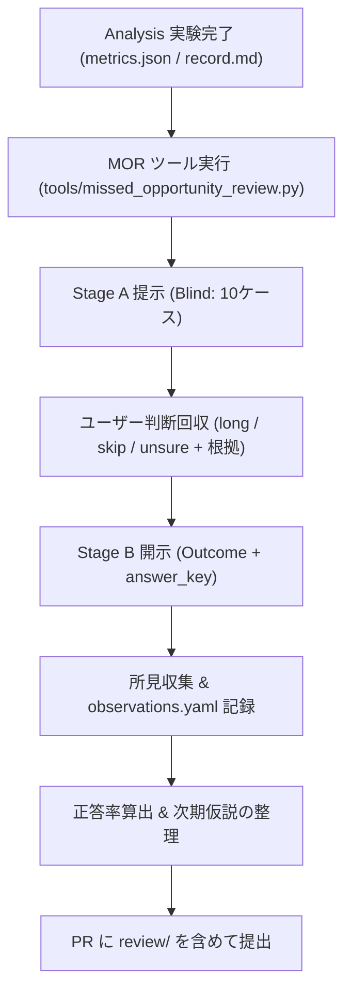

# Missed Opportunity Review (MOR) Skill

本スキルは、Analysis 実験完了時に「シグナルが出なかったのに大きく動いた場面（見逃しエントリー：M1）」と「似ているのに伸びなかった対照群（C1/C2）」をブラインドで提示し、人間の視点・所見を安全に仮説生成へと繋げる Human-in-the-Loop レビュー手順を規定します。

---

## 1. 目的と基本原則

1. **数値探索の限界突破**:
   - バックテスト数値だけの過剰適合を避け、人間がチャートから感知する直感・文脈（サポレジ、移動平均線の収束/拡散、出来高推移など）を抽出する。
2. **後知恵バイアスの完全排除（2段階ブラインド提示）**:
   - **Stage A（判断時点）**: 判断時点 $t$ 以前のデータのみを描画。未来の値動きを完全に遮断した状態でレビュアーの判断（`long` / `skip` / `unsure`）と根拠を記録する。
   - **Stage B（結末開示）**: Stage A の回答完了後に結末（72hの値動き、MFE、真の分類）を開示し、所見を収集する。
3. **対照群（Controls）の混在**:
   - 伸びた場面（M1）だけでなく、特徴量が酷似しているのに伸びなかった場面（C1）やシグナル発生後の負けトレード（C2）をシャッフルして提示し、無根拠なポジティブバイアスを抑制する。
4. **知見登録の厳格な分離（仮説生成 $\neq$ 知見確定）**:
   - レビュアーの所見は「仮説候補（Candidate Hypotheses）」であり、直接 `K-xxx`（知見）に登録してはならない。必ず新しい Analysis Issue を起票し、事前登録 $\rightarrow$ 検証を経て検証する。

---

## 2. 標準ワークフロー



### ステップ 1: レビュースイートの自動生成
Analysis 実験の集計完了後、以下を実行して `review/` 配下にファイルを生成する。
```bash
uv run python tools/missed_opportunity_review.py --experiment <N> --signal <signal_id> --seed 42
```
生成物:
- `review/case_01_stageA.png` 〜 `case_10_stageA.png` (判断時点)
- `review/case_01_stageB.png` 〜 `case_10_stageB.png` (結末)
- `review/gallery_stageA.md` (ブラインド質問票)
- `review/gallery_stageB.md` (結末ギャラリー)
- `review/answer_key.json` (正解ラベル: 非公開)
- `review/cases.json` (特徴量スナップショット)
- `review/observations.yaml` (回答記録テンプレート)

### ステップ 2: Stage A ブラインド提示と回答収集
1. エージェントはユーザーに `gallery_stageA.md` の閲覧を案内するか、チャット上に Case 01 〜 10 の判断時点チャートを提示する。
2. ユーザーに対して各ケース以下の2点を質問する：
   - **判断**: `long`（入る）/ `skip`（見送る）/ `unsure`（判断不能）
   - **根拠**: 何を見てそう判断したか（インジケータ、移動平均線、直近高安、ボラティリティなど）
3. **厳格な制約**: ユーザーが全ケース（または回答対象ケース）の判断を終えるまで、正解ラベル（M1/C1/C2）や未来のチャート・価格推移を開示・示唆してはならない。

### ステップ 3: Stage B 結末開示と所見収集
1. ユーザーの Stage A 回答を受領後、Stage B チャートおよび `answer_key.json` の真の分類（M1 / C1 / C2）を開示する。
2. 各ケースについて以下を確認する：
   - 予想と結末のギャップ（なぜ伸びたのか / なぜ失速したのか）
   - M1 と C1 を見分ける手がかりとなりそうな視点

### ステップ 4: 記録と正答率の算出
1. `review/observations.yaml` に回答・根拠・所見・正解ラベルを記録する。
2. レビュアーの Stage A 識別能力（正答率）を算出・記録する：
   $$\text{Accuracy} = \frac{\text{True M1 identified as } long + \text{True Controls (C1/C2) identified as } skip}{\text{Total Evaluated Cases}}$$
3. `summary.candidate_hypotheses` に、次期実験で検証可能な事前登録仮説候補を整理する。

### ステップ 5: 課題化
得られた仮説候補のうち有望なものを、次期 Analysis Issue のドラフトとして提案する。

---

## 3. 禁止事項 (Prohibitions)

- **未来リークの禁止**: Stage A 提示段階で、MFE、到達価格、ラベル名（M1/C1/C2）、シグナル発生有無を決して漏洩してはならない。
- **直接知見化の禁止**: MOR で得られたユーザーの直感や所見を、単独で `03_KNOWLEDGE/` に知見（K-xxx）として登録してはならない。
- **Holdout 期間の汚染禁止**: MOR で抽出するケースは必ず Discovery 期間（`< 2025-05-01`）内に限定し、Holdout 期間のチャートを提示してはならない。
