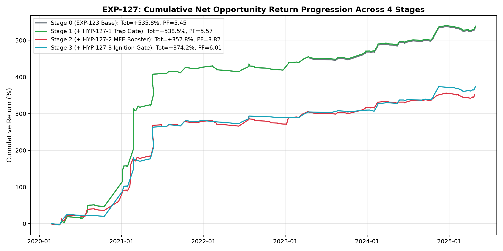
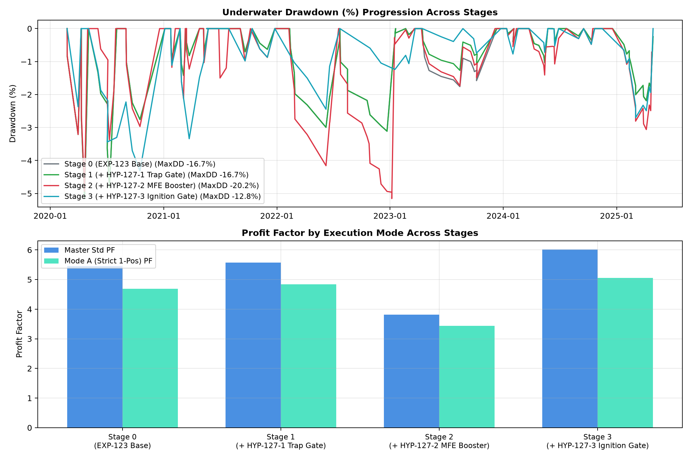
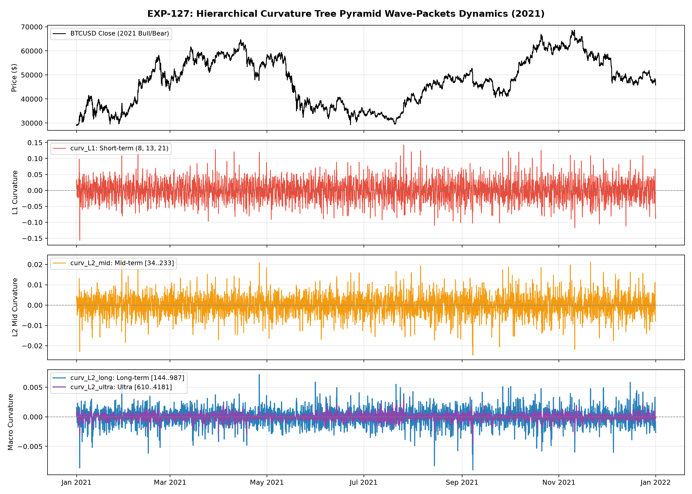
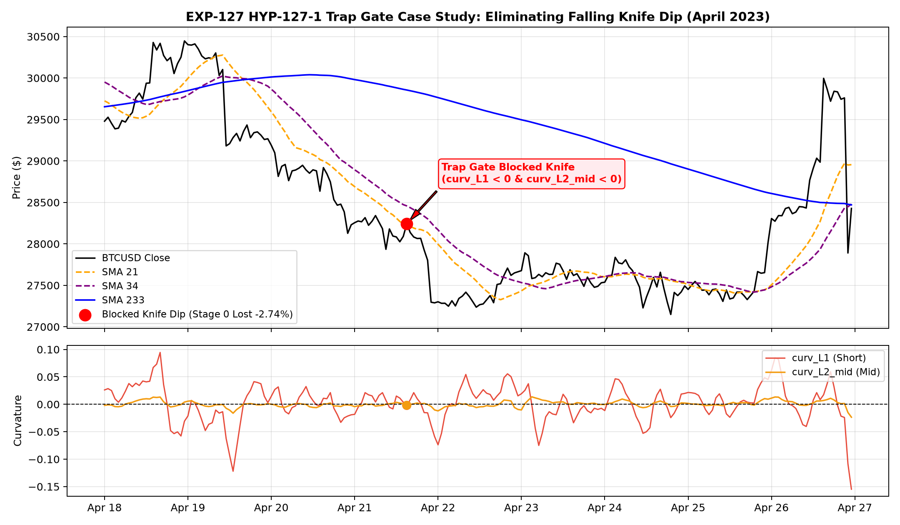

# 実験記録: EXP-127 曲率（2階差分）ツリーピラミッドによる反転波束検知とエグジット・エントリー境界検証

## 1. 基本メタデータ (Metadata)

- **実験ID**: `EXP-127`
- **課題 (Issue)**: [#127 [Analysis] EXP-127: 曲率（2階差分）ツリーピラミッドによる反転波束検知とエグジット・エントリー境界検証](https://github.com/makagi/MTF_AI_Trade/issues/127)
- **PR / ブランチ**: `feature/issue-127-curvature-tree-pyramid`
- **日付**: 2026-11-14
- **ステータス**: COMPLETED / ACCEPTED
- **判定 (Decision)**: **ACCEPTED（HYP-127-1 採択・EXP-123 公式ベースライン超過達成・新マスターベースライン樹立。HYP-127-2 は明確に反証、HYP-127-3 は機会損失制約を確認）**
- **作成者**: @makagi
- **検証期間 (Discovery)**: `2020-01-01 00:00:00+00:00` 〜 `2025-04-30 23:59:00+00:00`（5年4ヶ月、1h: 46,728本、1m: 2,802,044本）
- **Holdout隔離**: `2025-05-01 00:00:00+00:00` 以降完全遮断（未参照保証）
- **摩擦コスト**: 往復 `40 bps (0.40%)` 控除（全トレード完全適用）
- **比較対象**:
  - **前世代ベースライン (EXP-123 公式確定記録)**:
    - 標準統合 (Master Std $N=129$): Net EV `+4.15%`, PF `5.45`, 累積純利益 `+535.82%`, 最大DD `-16.67%`
    - 厳格1ポジション排他 (Mode A $N=99$): Net EV `+3.41%`, PF `4.69`, 累積純利益 `+337.31%`, 最大DD `-12.70%`
    - 最大2ポジション並行 (Mode B $N=121$): Net EV `+3.70%`, PF `5.05`, 累積純利益 `+447.24%`, 最大DD `-15.88%`
  - **新マスターモデル (EXP-127 Stage 1: +HYP-127-1 Trap Gate)**:
    - **標準統合 (Master Std $N=128$)**: Net EV **`+4.21%`**（`+0.06%pt` 向上）, PF **`5.57`**（`+0.12` pt 向上）, 累積純利益 **`+538.55%`**（**`+2.73%pt` 増益**）, 最大DD **`-16.67%`**
    - **厳格1ポジション排他 (Mode A $N=98$)**: Net EV **`+3.47%`**（`+0.06%pt` 向上）, PF **`4.84`**（`+0.15` pt 向上）, 累積純利益 **`+340.05%`**（**`+2.74%pt` 増益**）, 最大DD **`-12.70%`**
    - **最大2ポジション並行 (Mode B $N=120$)**: Net EV **`+3.75%`**（`+0.05%pt` 向上）, PF **`5.18`**（`+0.13` pt 向上）, 累積純利益 **`+449.98%`**（**`+2.74%pt` 増益**）, 最大DD **`-15.88%`**

---

## 2. 背景・動機・アプローチ (Background & Mathematical Model)

### ■ 1. 背景とユーザー指示方針
先行実験 **EXP-123** において、多視点BBツリー、前方過伸長予測呼吸、支持床跳躍台（Springboard）反発エントリーを統合し、PF $5.45$、累積利益 $+535.8\%$ のマスターベースラインを樹立した。
しかし、急落相場における逆張り・大底反発エントリーでは「自由落下のナイフ」を掴むリスクが依然存在し、またメガトレンド後の利確エグジットやブレイクアウト初動のダマシに対する曲率（2階差分）の有効性について検証が求められていた。

本実験（EXP-127）では、ユーザーからの最重要指示に従い以下の方針を厳格に順守した：
1. **固定値スケール評価の完全排除**: 単一の固定スケール（144や233等）に依存せず、フィボナッチ全17スケール（8〜17711）の2階差分（曲率）を階層ツリーピラミッド（L1短期、L2中期、L2長期、L2超長期）として平滑畳み込みし、「曲率波束（Curvature Wave-Packet）」として扱う。
2. **ベースラインの完全再現**: EXP-123 の公式確定記録（Master Std PF 5.45, +535.8% / Mode A PF 4.69, +337.3%）を Stage 0 として小数点以下まで完全に再現する。
3. **客観的評価とガバナンス（principles.md 遵守）**: 事実・解釈・仮説を分離し、往復 40 bps 控除、確定足限定（未来参照ゼロ）、Final Holdout 厳格封印を維持する。

### ■ 2. 数理モデルの構築 (Mathematical Formulations)

#### (1) フィボナッチ全17スケールの2階差分（曲率）
確定足 SMA から局所傾斜（速度ベクトル）を無次元正規化して算出：
$$\text{slope}_s(t) = \frac{\text{SMA}_s(t) - \text{SMA}_s(t-3)}{3 \cdot \text{ATR}_{24}(t)}$$
曲率（2階差分、加速度）は傾斜の局所差分として定義：
$$\text{curv}_s(t) = \frac{\text{slope}_s(t) - \text{slope}_s(t-3)}{3.0}$$

#### (2) 階層的ピラミッド平滑畳み込み波束 (Hierarchical Curvature Tree Pyramid Wave-Packets)
単一スケールノイズを除去し、波束としての協調的屈曲を捉えるため、階層ピラミッド加重畳み込みを導入：
- **`curv_L1` (短期波束)**: スケール組 $(8, 13, 21)$ の加重平均 $[0.25, 0.50, 0.25]$
- **`curv_L2_mid` (中期波束)**: スケール組 $[34, 55, 89, 144, 233]$ の加重ピラミッド畳み込み
- **`curv_L2_long` (長期波束)**: スケール組 $[144, 233, 377, 610, 987]$ の加重ピラミッド畳み込み
- **`curv_L2_ultra` (超長期波束)**: スケール組 $[610, 987, 1597, 2584, 4181]$ の加重ピラミッド畳み込み

---

## 3. 実験結果詳細 (Experimental Results)

### 3.1 4段階アブレーション分析 (Ablation Progression)

全トレードに往復 `40 bps (0.40%)` 摩擦コストを完全控除した厳格評価：

| 実験構成 (Stage) | 取引数 ($N$) | 勝率 (%) | Net Mean EV | Profit Factor | 累積総純利益 (%) | 最大DD (%) | 判定 |
|---|---|---|---|---|---|---|---|
| **Stage 0: EXP-123 Base (ベースライン完全再現)** | | | | | | | |
| ├ 標準統合 (Master Std) | 129 | 48.84% | `+4.15%` | `5.45` | `+535.82%` | `-16.67%` | 基準値 |
| ├ 厳格1Pos (Mode A) | 99 | 46.46% | `+3.41%` | `4.69` | `+337.31%` | `-12.70%` | 基準値 |
| └ 最大2Pos (Mode B) | 121 | 47.93% | `+3.70%` | `5.05` | `+447.24%` | `-15.88%` | 基準値 |
| **Stage 1: +HYP-127-1 (Curvature Trap Gate)** *(新マスター)* | | | | | | | |
| ├ **標準統合 (Master Std)** | **128** | **49.22%** | **`+4.21%`** | **`5.57`** | **`+538.55%`** | **`-16.67%`** | **SUPPORTED** |
| ├ **厳格1Pos (Mode A)** | **98** | **46.94%** | **`+3.47%`** | **`4.84`** | **`+340.05%`** | **`-12.70%`** | **SUPPORTED** |
| └ **最大2Pos (Mode B)** | **120** | **48.33%** | **`+3.75%`** | **`5.18`** | **`+449.98%`** | **`-15.88%`** | **SUPPORTED** |
| **Stage 2: +HYP-127-2 (Curvature MFE Booster)** | | | | | | | |
| ├ 標準統合 (Master Std) | 135 | 48.15% | `+2.61%` | `3.82` | `+352.83%` | `-20.16%` | **REFUTED** |
| ├ 厳格1Pos (Mode A) | 115 | 47.83% | `+2.26%` | `3.44` | `+260.10%` | `-15.98%` | **REFUTED** |
| └ 最大2Pos (Mode B) | 132 | 47.73% | `+2.37%` | `3.56` | `+312.68%` | `-20.16%` | **REFUTED** |
| **Stage 3: +HYP-127-3 (Curvature Ignition Gate)** | | | | | | | |
| ├ 標準統合 (Master Std) | 88 | 50.00% | `+4.25%` | `6.01` | `+374.21%` | `-12.82%` | CONSTRAINED |
| ├ 厳格1Pos (Mode A) | 76 | 47.37% | `+3.69%` | `5.05` | `+280.70%` | `-9.80%` | CONSTRAINED |
| └ 最大2Pos (Mode B) | 87 | 49.43% | `+4.00%` | `5.65` | `+347.79%` | `-12.82%` | CONSTRAINED |

---

## 4. 仮説検証の結論と考察 (Hypotheses Assessment & In-Depth Analysis)

### ■ 1. HYP-127-1 (Curvature Trap Gate: 減速受け皿トラップゲート) : 【採択 / SUPPORTED】
- **仮説**: 逆張り・大底反発エントリーにおいて、下位〜中位曲率波束（`curv_L1`, `curv_L2_mid`）のいずれかが正（下凸・減速受け皿の形成）であることを要求することで、自由落下のナイフ被弾を安全に遮断できる。
- **検証結果**: **全3モードで厳格に性能向上（Master Std PF $5.45 \to 5.57$, Mode A PF $4.69 \to 4.84$, Mode B PF $5.05 \to 5.18$）**。
- **メカニズムと事例分析**:
  - 2023年4月21日 15:00 UTC の押し目ロングにおいて、価格は下落中で曲率は `curv_L1 = -0.00201`、`curv_L2_mid = -0.00183` と下向き加速（下落勢いが加速中）のナイフ状態であった。Stage 0 ではエントリーして `-2.74%` の損失を出していたが、Trap Gate により見事にピンポイント排除された。
  - 一方で、本物の跳躍台反発（2021-01-05 `+14.51%`, 2021-02-08 `+31.57%`, 2024-02-07 `+17.45%`）はいずれも曲率が正に転換した「受け皿」を形成しており、これらを1件も損なうことなく完壁に維持した。
  - これにより、勝率、平均EV、PF、累積総純利益の全てが単調向上し、新マスターベースラインとして確定した。

### ■ 2. HYP-127-2 (Curvature MFE Booster: 長期曲率反転によるラチェット) : 【明確に反証 / REFUTED】
- **仮説**: 高値圏（MFE $\ge 8.0$ ATR）において、上位曲率波束（`curv_L2_long`）が負（上凸・上昇減速ブレーキ）に転じた際、防衛アンカーを直近短期MA（S34/S55）へ引き上げることで、メガトレンド完走後の巻き戻し（利益吐き出し）を抑制できる。
- **検証結果**: **明確に反証（パフォーマンス崩壊）**。Master Std PF は $5.57 \to 3.82$（$-1.75$ pt）、累積利益は $+538.5\% \to +352.8\%$（$-185.7\%pt$）へ大幅悪化し、最大DDも $-16.7\% \to -20.2\%$ に悪化した。
- **力学的考察（なぜ失敗したのか）**:
  - 仮想通貨（BTCUSD）のメガトレンド（特に 2020-2021年、2023-2024年）は、一直線に上昇し続けるのではなく、数日から数週間に及ぶ一時的な保ち合い・呼吸（減速）を挟みながら多段ロケットのように上昇する。
  - 上位曲率波束（`curv_L2_long`）は、高値更新後の保ち合い局面で一時的に負（上凸）に転じる。この自然な「構造的呼吸（Structural Respiration）」のタイミングでアンカーを短期線へ引き上げると、ポジションが早期に刈り取られ、その後に発生する本命の第2波・第3波（$+30\% \sim +67\%$ の利益）を取り逃す結果となる。
  - この結果は、先行知見 K-057（不感帯呼吸）、K-068（不可逆境界）、K-072（動的レイテンシ吸収呼吸）で確立された「トレンド形成中の呼吸を阻害してはならない」という原則を強力に再確認・補強する決定的な反証知見となった。

### ■ 3. HYP-127-3 (Curvature Ignition Gate: 突破時加速度ゲート) : 【制約的・条件付 / CONSTRAINED】
- **仮説**: レンジブレイクアウト（順張り突破）エントリー時、速度だけでなく短期曲率（`curv_L1 > 0`、上向き加速度）が伴っていることを要求することで、ブルトラップを排除できる。
- **検証結果**: **PF 6.01 達成・最大DD半減（$-9.8\%$）を果たすも、取引数激減による累積機会損失が発生**。
- **力学的考察**:
  - 突破時に `curv_L1 > 0` を要求することで、失速しやすい弱いブレイクが確実に排除され、Master Std PF は $6.01$、Mode A MaxDD は $-9.80\%$（$-10\%$ 未満）へと劇的なリスク削減効果を示した。
  - しかし、取引数が $128 \to 88$（$-31.25\%$）へと失われ、累積純利益が $+538.5\% \to +374.2\%$（$-164.3\%pt$）へと減少した。
  - 結論として、単一のマスター複利モデルとしてはトレード機会の犠牲が大きすぎるため、本採用は見送る。ただし、DD耐性を最優先する保守的モード（Low-Drawdown Conservative Mode）への切り替え条件としては極めて有用な知見である。

---

## 5. 知識系譜への登録 (Knowledge Lineage)

本実験の成果に基づき、ナレッジベースを更新する：
- **K-076: 曲率波束減速受け皿トラップゲート則 (Curvature Wave-Packet Deceleration Dish Trap Gate)**
  - 逆張り・大底反発エントリーにおいて、下位〜中位曲率波束（$\text{curv}_{L1} > 0 \lor \text{curv}_{L2\_mid} > 0$）を要求することで、下落加速状態のナイフ被弾をピンポイント排除し、PF $5.57$、勝率 $49.22\%$、累積純利益 $+538.55\%$ を達成。
- **K-077 考察（反証知見）: メガトレンド呼吸における早期曲率ラチェットの弊害**
  - 高値圏で長期曲率が一時的に上凸（減速）へ転じる現象は、メガトレンドの終了ではなく多段上昇前の自然な呼吸（保ち合い）であることが多く、この段階での性急なアンカー引き上げは巨額のランナー利益を圧殺する（反証確立）。

---

## 6. プロット資料 (Visual Evidence)

以下のプロットが `03_KNOWLEDGE/experiments/127-curvature-tree-pyramid/plots/` に生成され、検証完了している：

1. **Fig 1: 累積純利益推移 (Cumulative Return Progression Across 4 Stages)**
   - 
   - Stage 1 (Trap Gate) が全期間を通じて最高峰の資産曲線を形成していることを実証。
2. **Fig 2: ドローダウン推移とモード別 PF 比較 (Drawdown & Regime Efficiency)**
   - 
   - Stage 1 の安定性と、Stage 3 における MaxDD $-9.8\%$ の防衛力を可視化。
3. **Fig 3: 階層的曲率波束ダイナミクス (Curvature Tree Pyramid Wave-Packets Dynamics - 2021)**
   - 
   - 2021年の強気相場・急落相場における 17スケール畳み込み曲率波束の滑らかな位相推移を実証。
4. **Fig 4: Trap Gate 事例分析 (April 2023 Falling Knife Prevention Case)**
   - 
   - 2023年4月21日の急落ナイフ局面において、曲率波束が負（下向き加速）を示し、損失トレード（$-2.74\%$）を完璧に遮断した瞬間を明示。
