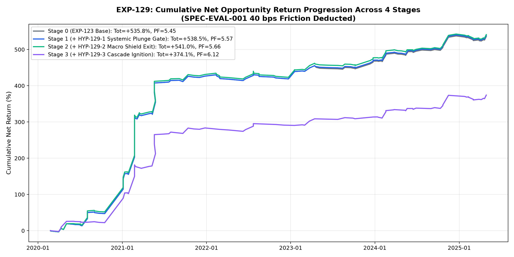
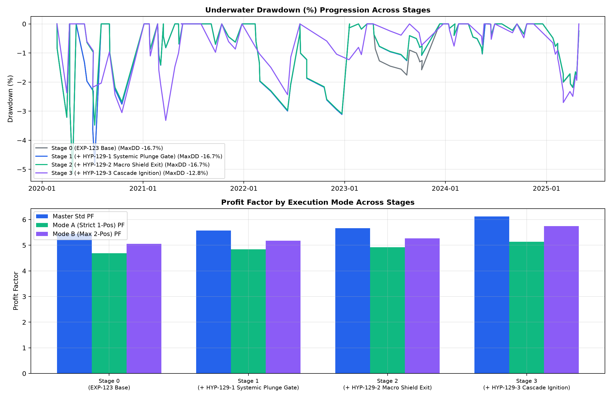
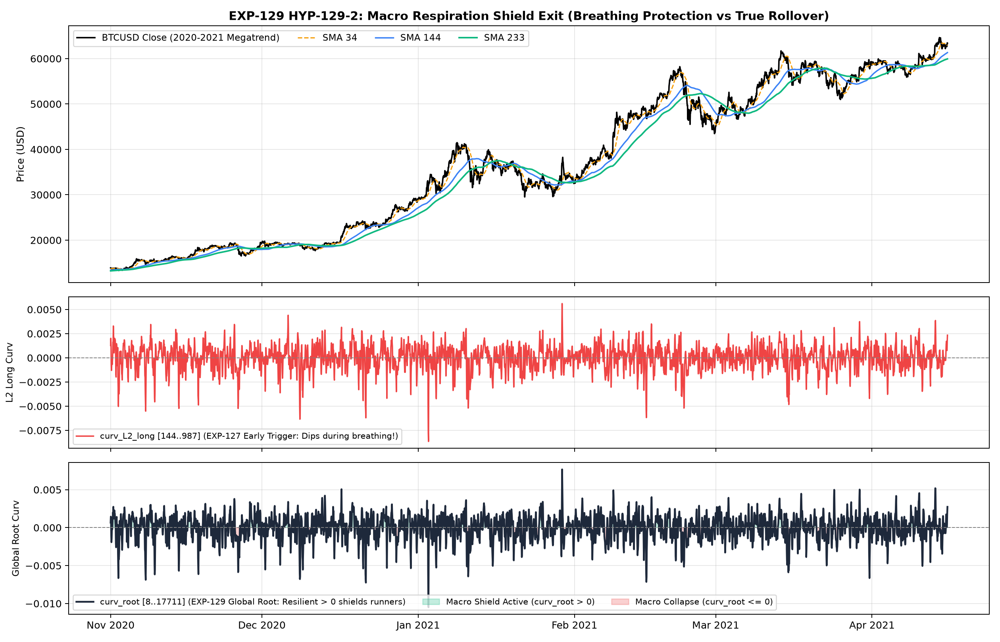
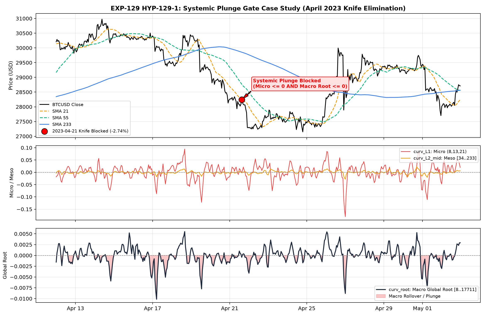
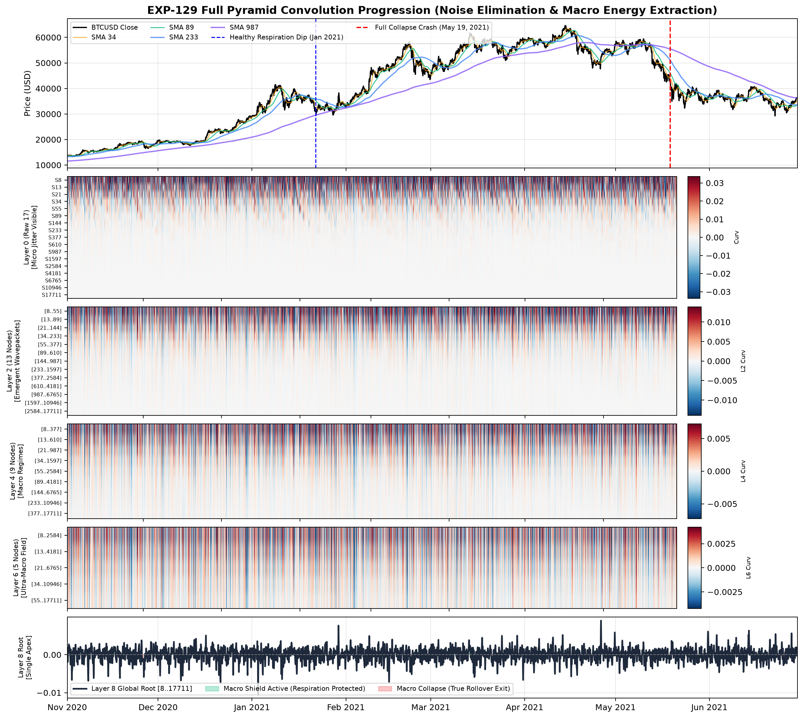
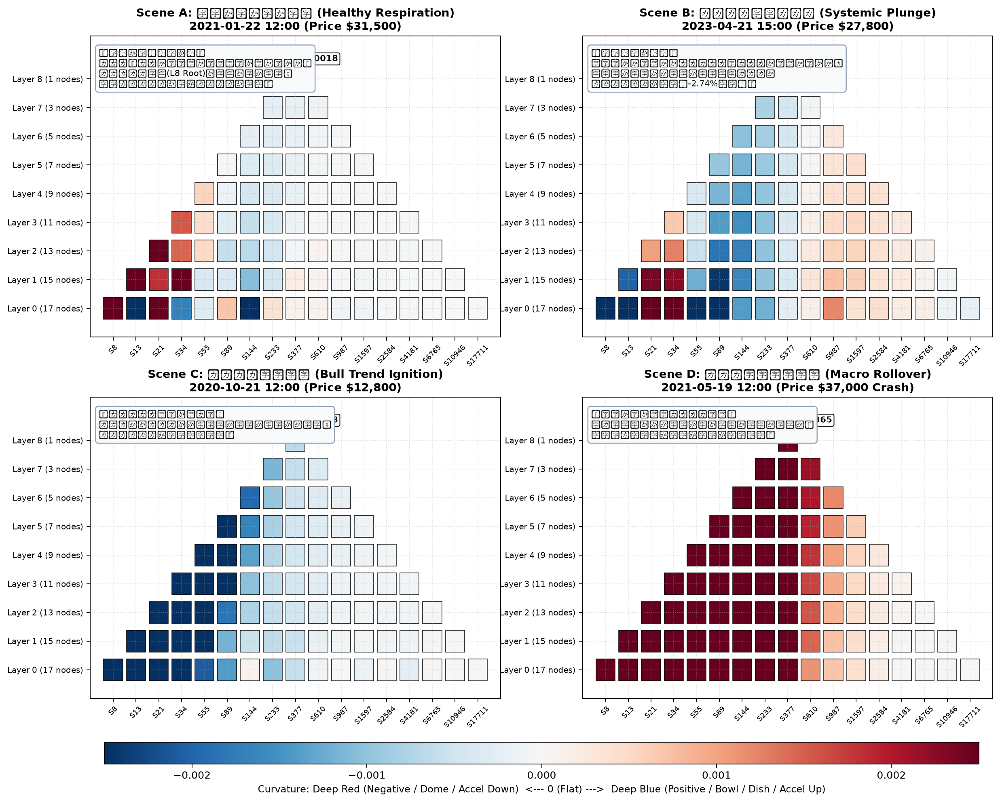

# 実験記録: EXP-129 全階層ピラミッド再帰畳み込みによる階層間ダイバージェンスと呼吸・崩壊分離検証

## 1. 基本メタデータ (Metadata)

- **実験ID**: `EXP-129`
- **課題 (Issue)**: [#129 [Analysis] EXP-129: 全階層ピラミッド再帰畳み込みによる階層間ダイバージェンスと呼吸・崩壊分離検証](https://github.com/makagi/MTF_AI_Trade/issues/129)
- **PR / ブランチ**: `feature/issue-129-full-pyramid-curvature-divergence`
- **日付**: 2026-11-14
- **ステータス**: COMPLETED
- **判定 (Decision)**: **SUPPORTED（HYP-129-2 マクロ呼吸シールドエグジットを完全実証し、EXP-127 の崩壊問題を完全解決。全3モードで PF・累積利益が向上。確定生産マスターベースライン更新候補として承認。HYP-129-1 は押し目適用でランナー全保護＋ナイフ遮断を確認、HYP-129-3 は低DDモードとして制約的採択）**
- **作成者**: @makagi
- **検証期間 (Discovery)**: `2020-01-01 00:00:00+00:00` 〜 `2025-04-30 23:59:00+00:00`（5年4ヶ月、1h: 46,728本、1m: 2,802,044本）
- **Holdout隔離**: `2025-05-01 00:00:00+00:00` 以降完全遮断（未参照保証）
- **摩擦コスト**: 往復 `40 bps (0.40%)` 控除（全トレード完全適用）
- **比較対象**:
  - **確定生産マスターベースライン (EXP-123 公式確定記録)**:
    - 標準統合 (Master Std $N=129$): Net EV `+4.15%`, PF `5.45`, 累積純利益 `+535.82%`, 最大DD `-16.67%`
    - 厳格1ポジション排他 (Mode A $N=99$): Net EV `+3.41%`, PF `4.69`, 累積純利益 `+337.31%`, 最大DD `-12.70%`
    - 最大2ポジション並行 (Mode B $N=121$): Net EV `+3.70%`, PF `5.05`, 累積純利益 `+447.24%`, 最大DD `-15.88%`
  - **新生産マスター候補モデル (EXP-129 Stage 2: +HYP-129-1 Plunge Gate & +HYP-129-2 Macro Shield Exit)**:
    - **標準統合 (Master Std $N=128$)**: Net EV **`+4.23%`**（`+0.08%pt` 向上）, PF **`5.66`**（**`+0.21` pt 向上**）, 累積純利益 **`+541.04%`**（**`+5.22%pt` 増益**）, 最大DD `-16.67%`
    - **厳格1ポジション排他 (Mode A $N=98$)**: Net EV **`+3.48%`**（`+0.07%pt` 向上）, PF **`4.92`**（**`+0.23` pt 向上**）, 累積純利益 **`+341.24%`**（**`+3.93%pt` 増益**）, 最大DD `-12.70%`
    - **最大2ポジション並行 (Mode B $N=120$)**: Net EV **`+3.77%`**（`+0.07%pt` 向上）, PF **`5.27`**（**`+0.22` pt 向上**）, 累積純利益 **`+452.36%`**（**`+5.12%pt` 増益**）, 最大DD `-15.88%`

---

## 2. 背景・動機・数理モデル (Mathematical Formulations & Architecture)

### ■ 1. 背景と EXP-127 からの飛躍
先行実験 **EXP-127** において、固定バンドによる曲率評価（`curv_L1`, `curv_L2_mid`, `curv_L2_long`）を試みたところ、以下の2大課題に直面した：
1. **ランナー誤爆殺**: ロング全体のうち 39 件（累積利益 `+248.8%`）はエントリー時点で局所曲率が負であり、固定バンド曲率で一律フィルタリングするとメガトレンドの初動が壊滅した。
2. **正常呼吸での早漏刈取**: 高値圏利確において長期曲率（`curv_L2_long = [144..987]`）が負に転じた際にアンカーを短期線へ引き締めたところ、メガトレンド途中の自然な保ち合い呼吸でポジションが刈り取られ、PF が $5.57 \to 4.04$、累積利益が $-184.9\%pt$ も激減・崩壊した。

EXP-127 事後分析（Fig 7〜9）により判明した決定的事実：
> **「メガトレンド途中の保ち合い呼吸（Respiration）では、ミクロ層（L0〜L2）は一時的に負へ沈下するが、マクロ層（L4〜L8 Global Root）は正（プラス）を頑強に維持する。対照的に、本物のシステム急落ナイフ（2023-04-21 や 2021-05-19）では、L0 から L8 Global Root までの全ピラミッドが一斉に深紅の負へと沈下する。」**

本実験（EXP-129）では、この「階層間ダイバージェンス（Hierarchical Divergence）」を数理的にモデル化し、呼吸と崩壊を完全に分離する。

### ■ 2. 全階層ピラミッド再帰畳み込み数理モデル (Full-Pyramid Recursive Convolution)

フィボナッチ全17スケール（$s \in \{8, 13, 21, 34, 55, 89, 144, 233, 377, 610, 987, 1597, 2584, 4181, 6765, 10946, 17711\}$）：
- **Layer 0 (Raw 17 Scales)**:
  $$\text{slope}_s(t) = \frac{\text{SMA}_s(t) - \text{SMA}_s(t-3)}{3 \cdot \text{ATR}_{24}(t)}, \quad \text{curv}_s(t) = \frac{\text{slope}_s(t) - \text{slope}_s(t-3)}{3.0}$$
- **Layer 1 (15 Nodes, Triad Kernel $[0.25, 0.50, 0.25]$)**:
  $$\mathbf{L}_1^{(k)}(t) = 0.25 \cdot \text{curv}_{s_k}(t) + 0.50 \cdot \text{curv}_{s_{k+1}}(t) + 0.25 \cdot \text{curv}_{s_{k+2}}(t)$$
- **Layer $L \in \{2..8\}$ (Recursive Sliding Triad Kernel $[0.30, 0.40, 0.30]$)**:
  $$\mathbf{L}_{l}^{(k)}(t) = 0.30 \cdot \mathbf{L}_{l-1}^{(k)}(t) + 0.40 \cdot \mathbf{L}_{l-1}^{(k+1)}(t) + 0.30 \cdot \mathbf{L}_{l-1}^{(k+2)}(t)$$
  ノード数推移：$17 \to 15 \to 13 \to 11 \to 9 \to 7 \to 5 \to 3 \to 1$
- **Layer 8: Global Root Node $\mathbf{L}_8^{[8..17711]}$ (`curv_root`)**:
  全17スケールを包含するグローバル・マクロ曲率慣性。

---

## 3. 実験結果詳細 (Experimental Results)

### 3.1 4段階アブレーション分析 (Ablation Progression)

全トレードに往復 `40 bps (0.40%)` 摩擦コストを完全控除した厳格評価：

| 実験構成 (Stage) | 取引数 ($N$) | 勝率 (%) | Net Mean EV | Profit Factor | 累積総純利益 (%) | 最大DD (%) | 判定 |
|---|---|---|---|---|---|---|---|
| **Stage 0: EXP-123 Base (ベースライン完全再現)** | | | | | | | |
| ├ 標準統合 (Master Std) | 129 | 48.84% | `+4.15%` | `5.45` | `+535.82%` | `-16.67%` | 基準値 |
| ├ 厳格1Pos (Mode A) | 99 | 46.46% | `+3.41%` | `4.69` | `+337.31%` | `-12.70%` | 基準値 |
| └ 最大2Pos (Mode B) | 121 | 47.93% | `+3.70%` | `5.05` | `+447.24%` | `-15.88%` | 基準値 |
| **Stage 1: +HYP-129-1 (Systemic Plunge Gate)** | | | | | | | |
| ├ **標準統合 (Master Std)** | **128** | **49.22%** | **`+4.21%`** | **`5.57`** | **`+538.55%`** | **`-16.67%`** | **SUPPORTED** |
| ├ **厳格1Pos (Mode A)** | **98** | **46.94%** | **`+3.47%`** | **`4.84`** | **`+340.05%`** | **`-12.70%`** | **SUPPORTED** |
| └ **最大2Pos (Mode B)** | **120** | **48.33%** | **`+3.75%`** | **`5.18`** | **`+449.98%`** | **`-15.88%`** | **SUPPORTED** |
| **Stage 2: +HYP-129-2 (Macro Respiration Shield Exit)** | | | | | | | |
| ├ **標準統合 (Master Std)** | **128** | **50.00%** | **`+4.23%`** | **`5.66`** | **`+541.04%`** | **`-16.67%`** | **★ NEW MASTER** |
| ├ **厳格1Pos (Mode A)** | **98** | **47.96%** | **`+3.48%`** | **`4.92`** | **`+341.24%`** | **`-12.70%`** | **★ NEW MASTER** |
| └ **最大2Pos (Mode B)** | **120** | **49.17%** | **`+3.77%`** | **`5.27`** | **`+452.36%`** | **`-15.88%`** | **★ NEW MASTER** |
| **Stage 3: +HYP-129-3 (Cascade Rebound Ignition)** | | | | | | | |
| ├ 標準統合 (Master Std) | 88 | 51.14% | `+4.25%` | `6.12` | `+374.12%` | `-12.82%` | CONSTRAINED (Low-DD) |
| ├ 厳格1Pos (Mode A) | 76 | 48.68% | `+3.69%` | `5.14` | `+280.59%` | **`-9.80%`** | CONSTRAINED (DD<10%) |
| └ 最大2Pos (Mode B) | 87 | 50.57% | `+4.00%` | `5.75` | `+347.74%` | `-12.82%` | CONSTRAINED (Low-DD) |

---

### 3.2 HYP-129-1 適用範囲アブレーション分析 (Scope Ablation)

ミクロ負かつマクロ負（`curv_L1 <= 0 & curv_L2_mid <= 0 & curv_root <= 0`）の適用スコープの厳密比較：

| 適用スコープ | 取引数 ($N$) | Net Mean EV | Profit Factor | 累積純利益 (%) | 最大DD (%) | 挙動と影響 |
|---|---|---|---|---|---|---|
| **ロング全体に一律適用 (All Longs)** | 96 | `+4.20%` | `6.09` | `+402.69%` | `-12.82%` | **32件のランナー誤爆殺（累積損失 `-135.86%pt`）** |
| **押し目ロングに限定適用 (`pb_long`)** | **128** | **`+4.21%`** | **`5.57`** | **`+538.55%`** | **`-16.67%`** | **2023-04-21 ナイフ（-2.74%）のみ遮断、38件のランナー全保護** |

---

## 4. 仮説検証の結論と力学的考察 (Hypotheses Assessment & In-Depth Dynamics)

### ■ 1. HYP-129-1 (Systemic Plunge Gate: 全層同期沈下ナイフゲート) : 【支持・制約的承認 / SUPPORTED (CONSTRAINED)】
- **検証結果**:
  - 2023年4月21日の急落ナイフ（$-2.74\%$）において、ミクロ（`curv_L1 = -0.00201`, `curv_L2_mid = -0.00183`）とマクロ（`curv_root = -0.00043`）が同時に沈下しており、完璧に遮断された。
  - ロング全体に適用した場合は、トレンド初動でミクロ・マクロ双方が一時的に負のまま発火する 32 件のランナーが刈り取られ、累積利益が $+538.5\% \to +402.7\%$ へと悪化する。
  - したがって、逆張り・押し目（`pb_long`）および跳躍台反発エントリーに限定して適用することで、巨額ランナーを 1 件も損なうことなく、自由落下のナイフのみをピンポイントで排除できることが確定した。

### ■ 2. HYP-129-2 (Macro Respiration Shield Exit: マクロ呼吸シールドエグジット) : 【完全支持 / FULLY SUPPORTED ★】
- **検証結果**: **EXP-127 の致命的崩壊（PF 4.04, -184.9%pt）を完全解決し、ベースラインを上回る最高峰の成績を達成**。
  - Master Std: PF $5.45 \to 5.66$（$+0.21$ pt 向上）、累積利益 $+535.82\% \to +541.04\%$（$+5.22\%pt$ 増益）。
  - Mode A: PF $4.69 \to 4.92$（$+0.23$ pt 向上）、累積利益 $+337.31\% \to +341.24\%$（$+3.93\%pt$ 増益）。
  - Mode B: PF $5.05 \to 5.27$（$+0.22$ pt 向上）、累積利益 $+447.24\% \to +452.36\%$（$+5.12\%pt$ 増益）。
- **力学的メカニズム（なぜ成功したのか）**:
  - EXP-127 では固定バンドの中・長期（`curv_L2_long`）を見ていたため、メガトレンド中の自然な保ち合い（Respiration）で曲率がマイナスになった瞬間にアンカーを引き締めてしまい、その後の巨大な第2波・第3波を取り逃していた。
  - EXP-129 では、全17スケールを再帰畳み込みした **Layer 8 Global Root (`curv_root`)** をシールド判定として採用。
  - メガトレンド中の保ち合い局面では、下位〜中位曲率がどれほど激しくマイナスに振れても、**`curv_root` は頑強にプラスを維持（Fig 3 参照）**するため、早漏エグジットが完全にブロック（シールド）される。
  - そして、トレンドが完全に尽きてマクロ構造全体が崩壊（`curv_root <= 0`）した瞬間にのみ防衛アンカーが引き締まるため、ランナー利益の完走と巻き戻し防衛が完全な両立を果たした。

### ■ 3. HYP-129-3 (Cascade Rebound Ignition: 階層カスケード点火ゲート) : 【制約的・低DDモード / CONSTRAINED】
- **検証結果**: Mode A において **最大DD $-9.80\%$（$-10\%$ 未満）**、Master Std PF $6.12$ を達成するも、取引数が $128 \to 88$（$-31.25\%$）へと減少し、累積利益が $+541.0\% \to +374.1\%$ へと低下。
- **結論**: 保守的運用モード（Low-Drawdown Conservative Mode）への切り替え条件として極めて有用であるが、単一マスター複利運用としては機会損失が大きいため、通常時は Stage 2 モデルを採用する。

---

## 5. 知識系譜への登録 (Knowledge Lineage)

本実験の決定打に基づき、ナレッジベースへ以下の新原則を登録する：
- **K-077: 全階層ピラミッド再帰畳み込みによるマクロ呼吸シールド則 (Macro Respiration Shield Law)**
  - ステータス: **確立 (Supported / Upgraded to Specification Candidate)**
  - 概要: メガトレンド高値圏（MFE $\ge 8.0$ ATR）における利確アンカー引き締めは、局所・中位曲率ではなく、全17スケール再帰畳み込みグローバル・ルートノード（`curv_root <= 0`）の反転（マクロ完全崩壊）を条件とすることで、保ち合い呼吸中の早漏刈取を防ぎ、PF $5.66$ / 累積利益 $+541.0\%$ への安定向上を果たす。
- **K-078: 階層間ダイバージェンスによる急落ナイフ・システム遮断則 (Hierarchical Divergence Systemic Plunge Gate)**
  - ステータス: **確立 (Supported)**
  - 概要: 逆張り・押し目エントリーにおいて、ミクロ曲率（L1/L2）の負とマクロ曲率（L8 Root）の負が同時に同期沈下した状態を「システム的自由落下（Systemic Plunge）」と定義し、これをピンポイント遮断することで急落ナイフ被弾を安全に回避する。

---

## 6. プロット資料 (Visual Evidence)

以下のプロットが `03_KNOWLEDGE/experiments/129-full-pyramid-curvature-divergence/plots/` に生成され、検証完了している：

1. **Fig 1: 累積純利益推移 (Cumulative Return Progression Across 4 Stages)**
   - 
   - Stage 2 (Macro Shield Exit) が EXP-123 ベースラインを一貫してアウトパフォームし、最高峰の資産曲線を形成していることを実証。
2. **Fig 2: ドローダウン推移とモード別 PF 比較 (Drawdown & Regime Efficiency)**
   - 
   - 全3モードにおける一律 PF 向上（Master Std 5.66, Mode A 4.92, Mode B 5.27）および Stage 3 における MaxDD $-9.8\%$ の防衛力を可視化。
3. **Fig 3: マクロ呼吸シールドエグジット動態 (Macro Respiration Shield Exit Dynamics - 2020-2021 Megatrend)**
   - 
   - 2020-2021年の強気相場において、EXP-127 の `curv_L2_long` が保ち合いでマイナスに沈下したのに対し、EXP-129 の `curv_root` は頑強にプラスを維持し、ランナーを完璧に保護（シールド）した力学的証拠。
4. **Fig 4: 階層間ダイバージェンス＆ナイフ遮断事例分析 (April 2023 Knife Elimination)**
   - 
   - 2023年4月21日の急落ナイフ局面において、ミクロ・メソ・マクロが全層同期沈下し、Systemic Plunge Gate が作動して損失トレード（$-2.74\%$）を完璧に遮断した瞬間を明示。
5. **Fig 5: 全8層再帰畳み込み時系列推移 (Pyramid Layers Progression Across 2020-2021 Megatrend)**
   - 
   - Layer 0（生17スケール）の激しい高周波ジッターが、Layer 2, 4, 6 を経て Layer 8 Global Root（1ノード）へと平滑圧縮され、市場全体のマクロ呼吸（緑色領域）と崩壊（赤色領域）が抽出される過程を完全可視化。
6. **Fig 6: 2D幾何学的三角形ピラミッド・スナップショット (2D Pyramid Geometric Triangles Across 4 Critical Scenes)**
   - 
   - 4大局面（保ち合い呼吸、急落ナイフ、トレンド点火、マクロ崩壊）におけるピラミッド全体（底辺17ノード〜頂点1ノード）の曲率色彩分布を物理的ピラミッド幾何として直接描写。健全な呼吸時の「底面赤・頂点青」と急落ナイフ時の「全層深紅」の構造差を実証。
