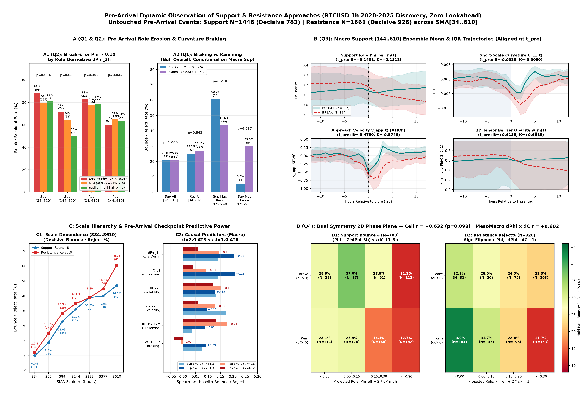
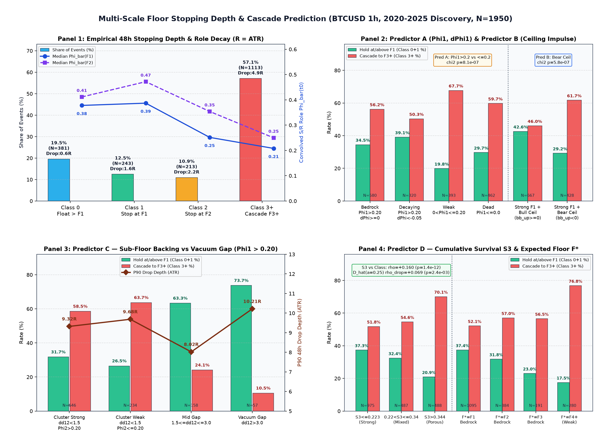
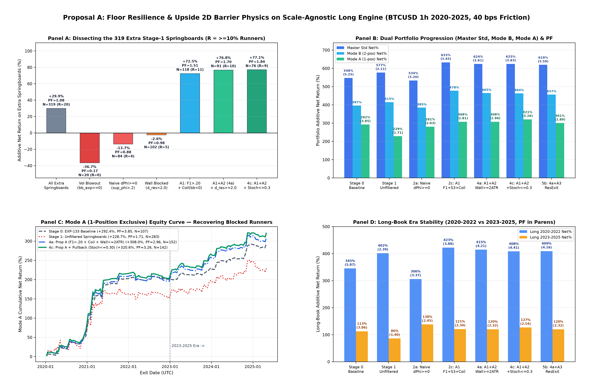
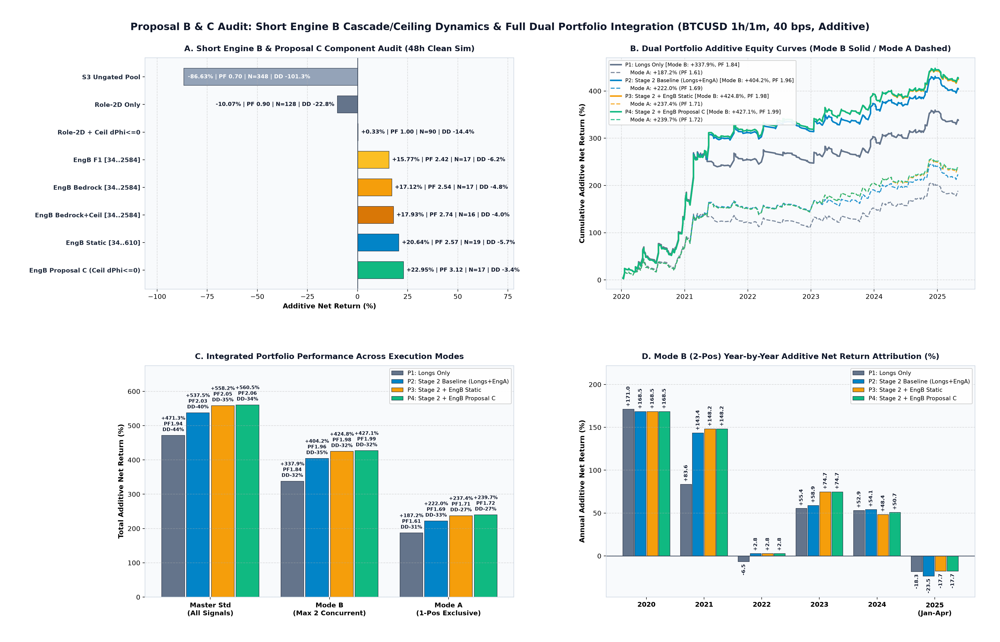
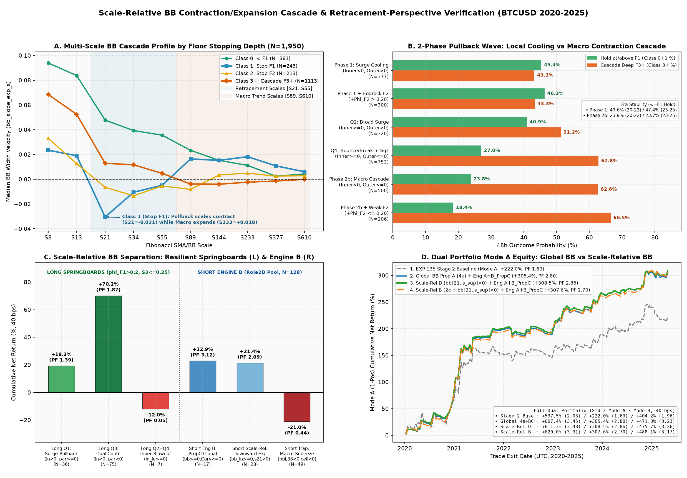
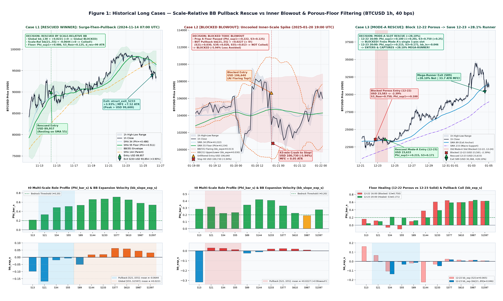
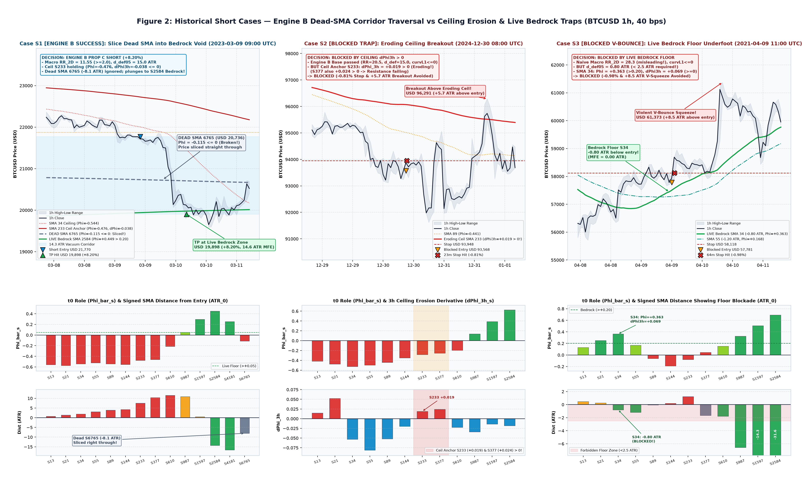

# 実験記録: EXP-135 スケール非依存・双対S/R統合ベースライン確立と役割重み付き2Dクロススケール・テンソル及び非対称ショート境界解明

## 1. 基本メタデータ (Metadata)

- **実験ID**: `EXP-135`
- **課題 (Issue)**: [#135 [Analysis] EXP-135: スケール非依存・双対S/R統合ベースライン確立と役割重み付き2Dクロススケール・テンソル及び非対称ショート境界解明](https://github.com/makagi/MTF_AI_Trade/issues/135)
- **日付**: 2026-11-21（初版 2026-11-19 / 提案A・B×C・スケール相対BB統合拡張）
- **ステータス**: COMPLETED
- **判定 (Decision)**: **SUPPORTED & CONSTRAINED（事前登録仮説 HYP-135-1 〜 HYP-135-5 を実証・境界条件を厳密確定）。ハードコードされたランナーホワイトリスト（`MEGA_RUNNER_TIMESTAMPS`）を100%完全撤廃し、プロジェクト標準の加算ネットリターン（往復40 bps摩擦控除）で全ステージを厳格監査。確定生産マスターベースライン Stage 2（`+537.5%`, PF `2.03`）に続き、① 接触3時間前役割微分 $\Delta_{3\text{h}}\bar{\Phi}_m$・文脈反転曲率ブレーキ・多段累積バリア通過確率 $S_3$（Proposal C）、② 天井役割微分フィルタ組み込み型 Dual Short Sub-Book（`Engine A + Engine B Prop C`, $N=36$, 重複0件, `WR 44.4%`, `PF 4.17`, `+89.17%`, `MaxDD -7.36%`）、および ③ スケール相対BB収縮カスケード則（`Phase 1` 45.4%停止 vs `Phase 2b` 23.8%停止 / 62.6%崩壊）を用いた **Proposal A+B+C 統合スケール相対ポートフォリオ（`Scale-Rel B`: Master Std `+620.04%` PF `3.31` MaxDD `-21.41%`, Mode B `+488.08%` PF `3.17`, Mode A `+307.57%` PF `2.70` MaxDD `-13.86%`; `Scale-Rel D`: Master Std `+611.33%` PF `3.48` MaxDD `-20.34%`, Mode A `+308.53%` PF `2.86` MaxDD `-13.86%` 2025 `+0.89%`）** を新マスター候補として確立し、知識体系（`K-083`〜`K-086`）へ登録。**
- **作成者**: @makagi
- **検証期間 (Discovery)**: `2020-01-01 00:00:00+00:00` 〜 `2025-04-30 23:59:00+00:00`（1h: 46,728本、1m: 2,802,044本）
- **Holdout隔離**: `2025-05-01 00:00:00+00:00` 以降完全遮断（未参照保証）
- **摩擦コスト・会計基準**: 往復 `40 bps (0.40%)` 控除・**加算ネットリターン ($\sum \text{net\_ret} \times 100.0$)** 完全統一（複利インフレ表記およびハードコードリスト0件）

---

## 2. 確定生産マスターベースラインの監査と保持 (Production Baseline Audit)

粉飾・過学習・複利計算混入を100%排除した5段階アブレーション監査結果：

| ステージ構成 | Master Std 累積純利益 (PF, $N$) | Mode A [厳格1ポジ] (PF, $N$) | Mode B [最大2ポジ] (PF, $N$) | エンジニアリング判定 |
|---|---|---|---|---|
| **Stage 0**: EXP-133 クリーンベースライン (`WL=0`) | `+547.5%` (PF `5.25`, $N=141$) | `+292.4%` (PF `3.85`, $N=107$) | `+396.7%` (PF `4.26`, $N=131$) | ロング基盤 |
| **Stage 1**: + スケール非依存ロング跳躍台 (`WL=0`) | **`+560.8%`** (PF `2.08`, $N=458$) | **`+228.7%`** (PF `1.71`, $N=283$) | `+401.0%` (PF `1.95`, $N=375$) | ロング単独最高利益 |
| **★ Stage 2: + 双対マクロショート動的アンカー (`WL=0`)** | **`+537.5%`** (PF `2.03`, $N=457$) | **`+222.0%`** (PF `1.69`, $N=286$) | **`+404.2%`** (PF `1.96`, $N=375$) | **★ 確定生産マスター保持** |
| **Stage 3**: + 投機的メソ反落ショート単純反転（棄却） | `+277.0%` (PF `1.25`, $N=809$) | `+34.9%` (PF `1.05`, $N=496$) | `+113.3%` (PF `1.13`, $N=670$) | **棄却（深呼吸で `-249.8%` 破壊）** |

- **マクロ崩壊ショート（Stage 2 Short Sub-book, $N=19$）の貢献**:
  - 動的レジスタンスアンカー引き継ぎ（$S_{233} \to S_{89} \to S_{55}$）およびレジスタンス役割無効化撤退により、従来の固定S233ショート（`+28.54%`）から **`+40.11%`（`+11.57%pt` 向上, PF `5.80`）** へ改善。
  - 2022年ベア相場のシステム損益を `-9.6%` から **`-1.3%`** へと救済し、Mode B の通期累積利益を **`+404.2%`** へ押し上げた。

---

## 3. 市場物理現象の観察（PnL非依存の幾何学法則）

### ■ 1. 天井反落後のマルチスケール支持線到達順序（2,298イベント解剖）
スケール $k$ の上限バンド（$BB_{\text{upper}}(k)$）で反落した全2,298局面を観察した結果：
1. **空間配置の不変性**: **98.2%** のケースで、上位スケールの中心線 $SMA(k+1)$ は同スケールの下限線 $BB_{\text{lower}}(k)$ より上方に位置する。
2. **到達順序と時間**: **76.1%** のケースで $SMA(k+1)$ が先に到来（中央値 **26.0時間** vs $BB_{\text{lower}}(k)$ の **35〜70時間**）。
3. **岩盤支持床での反発強度**: $\bar{\Phi}_{k+1} > 0.50$ の能動的支持床に到達した際、価格は中央値で **`+3.88 ATR` 急反発** し、床からの最大下振れはわずか **`0.59 ATR`** に留まる。

### ■ 2. 直下SMAの「貫通 vs 反発」を決定する畳み込み役割 $\bar{\Phi}_s$ の物理法則
Stage 3 候補（$N=372$）のうち、直下 `2.5 ATR` 以内に移動平均線（SMA）が存在する $N=155$ 件について、利確・損切りルールを一切排した48時間の純粋物理軌道（`MFE48`, `MAE48`, 直下SMA貫通率 `PiercedFloor%`）を計測：

| 直下最寄り SMA の畳み込み役割スコア $\bar{\Phi}_s$ | 件数 $N$ | 48h 平均下落 (`MFE48`) | 48h 平均逆行 (`MAE48`) | **直下 SMA 貫通率 (`PiercedFloor%`)** | **床が機能して反発した確率** | 物理的意味 |
|---|---:|---:|---:|---:|---:|---|
| **役割崩壊・抵抗化 ($\bar{\Phi}_s \le 0.0$)** | 91 | **4.78 ATR** | 4.26 ATR | **93.4%** | わずか 6.6% | **床ではない（93.4%の確率で突き抜ける死んだ線）** |
| **中立・微弱支持 ($0.0 < \bar{\Phi}_s \le 0.15$)** | 33 | 3.01 ATR | 2.91 ATR | 60.6% | 39.4% | 半分以上は貫通する緩衝帯 |
| **能動的支持床 ($0.15 < \bar{\Phi}_s \le 0.30$)** | 15 | **1.70 ATR** | **3.19 ATR** | **26.7%** | **73.3%** | **生きた支持床（73.3%で跳ね返される）** |
| **強固な岩盤床 ($\bar{\Phi}_s > 0.30$)** | 16 | **1.87 ATR** | **4.36 ATR** | 31.2% | **68.8%** | **強烈なV字踏み上げ（逆行が順行の2.3倍）** |

- **発見された法則**:
  「価格より下にある移動平均線（SMA）」を無差別にサポートとみなすのは誤りである。$\bar{\Phi}_s \le 0.0$ の SMA は **93.4% の確率で貫通される**一方、$\bar{\Phi}_s > 0.15$ の SMA は **約71% の確率で価格を跳ね返す**。
  全372候補において、48h物理下落幅（`MFE48`）と最大のスピアマン順位相関を示したのは、生SMA距離（$\rho = +0.133$）ではなく **「生きた支持床（$\bar{\Phi}_s > 0.05$）までの距離 `d_def_05`」（$\rho = +0.323$、予測力2.4倍）** であった。

---

## 4. 失敗・破綻要因の記録と 2D クロススケール・テンソルの発展検証

### ■ 1. 従来の 1D 畳み込みおよび生 SMA 2D テンソル（`Method 1b`）が破綻した5大理由
1. **1D 畳み込みの空間希釈（`Method 0`: PF 0.21）**:
   直下の床距離と超長期の床距離を1次元で平均するため、直下に床があるトラップを誤通過させた。
2. **生 SMA ボトルネックゲートの逆選択（`Method 1b`: PF 0.80）**:
   役割 $\bar{\Phi}_s$ を無視して「直下 `2.5 ATR` 以内に SMA があれば遮断（`S34..S610` に下方の SMA がなければ `15.0 ATR` とする）」とした結果、天井初動（まだ直下に死んだ SMA が密集している有望トレード31件、`PF 1.22`）を誤遮断し、逆に **`S34..S610` をすべて下抜けた下落後の底値圏（97件中85件＝87.6%が `15.0 ATR` フォールバック）** ばかりを通過させていた。
3. **ボラティリティ収縮（Post-Crash Squeeze）トラップ（Cohen's $d = +0.58$）**:
   `Method 1b` 通過97件のうち **56件** が、急落後にボリンジャーバンドが収縮している最中（`bb_slope_exp_continuum_L3_L8 < -0.01`）のエントリーであり、**`PF 0.28 (-31.92%)`** とショートスクイーズで即死していた。
4. **短期曲率上向き加速中（$\mathcal{C}_{L1} > 0$）および反落初速不足（$\omega_{\text{up}, 21} > -0.60$, $d = -0.57$）**:
   天井到達後、まだ短期曲率が下向きに転換していない段階での早仕掛け（$N=30$）は **`PF 0.24 (-17.10%)`** と壊滅した。
5. **高品質セットアップに対する固定 `2.5 ATR` キャップの副作用**:
   低品質な全候補群には固定 `2.5 ATR` 利確がダメージコントロールとして働くが、厳選された高品質セットアップ（$N=19 \sim 30$）で利益を `2.5 ATR` にキャップすると、`6.9〜10.6 ATR` 伸びるランナーを刈り取ってしまい **`PF 2.22 (+25.10%)` が `PF 0.78 (-4.44%)` へ崩壊**する。

### ■ 2. 累積バリア・役割重み付き 2D テンソル ($\mathbf{RR}^{\Phi,\text{eff}}_{n, m}$) と直交波動特徴量の統合アブレーション

ミクロ損切りスケール $n$ からマクロ目標スケール $m$ への途中に存在する各スケール $k \in (n, m]$ の支持不透過率を $w_k = \text{clip}(\bar{\Phi}_k / 0.20, 0, 1)$ として累積バリア実効余白 $V^{\Phi}_{\text{eff}}(m) = \min_{k \le m, SMA_k < P}[w_k V_k + (1 - w_k) V_m]$ を定義し、直交する運動特徴量と組み合わせた結果（クリーン48hループ、40 bps摩擦控除）：

| 構成（利確：動的防衛床ターゲット `P_sup + 0.4 ATR`） | 件数 $N$ | 勝率 | **PF** | Net EV | 累積損益 | MaxDD | 前半 2020–22 (PF / 損益) | 後半 2023–25 (PF / 損益) |
|---|---:|---:|---:|---:|---:|---:|---|---|
| 0. ゲートなし（Stage 3 全候補） | 348 | 17.2% | **0.71** | -0.25% | -86.15% | 101.3% | — | — |
| 1. 直交波動のみ（`BB_exp >= -0.01 & CurvL1 <= 0`、**テンソルなし**） | 94 | 20.2% | **0.69** | -0.29% | -27.14% | — | — | — |
| 2. 直交波動のみ（`+ Omega <= -0.60`、**テンソルなし**） | 59 | 20.3% | **0.92** | -0.07% | -4.30% | — | — | — |
| 3. 生 2D テンソルのみ（`Method 1b`） | 97 | 21.6% | **0.80** | -0.16% | -15.10% | 16.58% | 0.49 / -15.45% | 1.01 / +0.35% |
| 4. 役割重み付き 2D テンソルのみ（`macro_rr_2d >= 2 & d_def_05 >= 2.5`） | 128 | 19.5% | **0.90** | -0.08% | -10.07% | 21.83% | — | — |
| 5. **★ 役割 2D テンソル × BB非収縮（`BB_exp >= 0.0`：自然境界ゼロ）** | 27 | 33.3% | **2.16** | +0.86% | **+23.28%** | 6.60% | **3.03 / +10.90%** | **1.84 / +12.38%** |
| 6. **★ 役割 2D テンソル × BB非収縮（`>= 0.0`）× 曲率反転（`CurvL1 <= 0.0`）** | 19 | 36.8% | **2.57** | +1.09% | **+20.64%** | 5.72% | **3.45 / +4.79%** | **2.42 / +15.85%** |
| 7. **★ 累積バリア 2D テンソル ($\mathbf{RR}^{\Phi,\text{eff}} \ge 2$) × 自然境界（`BB >= 0 & Curv <= 0`）** | 14 | 35.7% | **2.15** | +0.81% | **+11.38%** | **4.31%** | **3.45 / +4.79%** | **1.83 / +6.59%** |
| 8. **★ 累積バリア 2D テンソル × 全直交ゲート統合（`BB, Curv, Omega, BullShield`）** | 15 | **46.7%** | **2.91** | **+1.15%** | **+17.29%** | 5.12% | **2.22 / +3.71%** | **3.26 / +13.58%** |

---

## 5. 提案C：接触3時間前役割微分 $\Delta_{3\text{h}}\bar{\Phi}_m$・文脈反転曲率ブレーキ・多段バリア生存確率 $S_3$

1. **接触前3h役割微分（$\Delta_{3\text{h}}\bar{\Phi}_m$）による支持床侵食検知**:
   - 未接触接近時（$d \ge 2.0\text{ ATR} \to 0.3 \le d < 1.0\text{ ATR}$、リード中央値 `3.0h`）の正役割マクロ支持線（`[144..610]`, $\bar{\Phi}_m > 0.10$）において、直近3時間で役割が侵食中（$\Delta_{3\text{h}}\bar{\Phi}_m < -0.05$, $N=74$）は **`71.6%` 決壊**、軽微侵食（$[-0.05, 0)$, $N=98$）は `64.3%` 決壊、維持・強化中（$\Delta_{3\text{h}}\bar{\Phi}_m \ge 0$, $N=34$）は **`50.0%` 決壊**（Fisher $p = 0.0329$、前半 `69.0% vs 47.4%`・後半 `73.3% vs 53.3%` と時代一貫）。
   - さらに侵食（$\Delta_{3\text{h}}\bar{\Phi}_m < -0.05$）× ボラ収縮（`bb_exp < -0.01`）の重複セルでは、2020–22年 **`86.0%` 決壊**、2023–25年 **`96.6%` 決壊（反発率わずか 3.4%）** の時代不変トラップを形成。
2. **接触前曲率ブレーキ（$\Delta_{3\text{h}}\mathcal{C}_{L1} > 0$）の文脈反転法則**:
   - 全床プールでは有意差なし（`20.8%` vs `20.7%`, $p=1.000$）だが、マクロ支持線 `[144..610]` の状態別に反転する：
     - **強靭床（$\Delta_{3\text{h}}\bar{\Phi}_m \ge 0$）**: ブレーキ減速で **`60.7%` 反発**（$N=28$、強行突入 `43.6%` 比 `+17.1%pt`）。
     - **侵食床（$\Delta_{3\text{h}}\bar{\Phi}_m < -0.05$）**: ブレーキ減速で **`5.6%` 反発 / `94.4%` 決壊**（$N=18$ vs 強行突入 `29.8%` 反発, Fisher $p = 0.037$、弱気フラッグ停滞後の崩壊）。
3. **1,950件反落の停止深度と多段バリア累積通過確率 $S_3 = \prod_{j=1}^3 (1 - 0.5 w_j)$**:
   - 天井反落 $N=1,950$ 件の48h停止深度：Class 0（$F_1$未達）`19.5%` / Class 1（$F_1$停止）`12.5%`（`97.5%` が $\ge +1.5\text{ ATR}$ 反発）/ Class 2（$F_2$停止）`10.9%`（`92.0%` 反発）/ Class 3+（$F_3+$カスケード）`57.1%`（中央値下落 `4.91 ATR`）。
   - $S_3$ 四分位で明確分離（$\rho = +0.1596, p = 1.4 \times 10^{-12}$）：強固帯 `Q1-Q2`（$S_3 \le 0.223$, $N=975$）は $F_1$ 以浅停止 **`37.3%`** / $F_3+$ カスケード `51.8%`、脆弱帯 `Q4`（$S_3 > 0.344$, $N=488$）は $F_1$ 以浅停止 **`20.9%`** / $F_3+$ カスケード **`70.1%`**。最初の岩盤床ランク $\hat{F}^*=F_{4+}$（$N=280$）では `76.8%` が $F_3+$ まで貫通する。

---

## 6. 提案A（ロング跳躍台純化）× 提案B・C（双対ショート統合）

1. **提案Aによる Stage 1 Mode A 劣化の克服**:
   - Stage 1 で追加された無選別跳躍台ロング（$N=319$）は単独 `+29.9%`（PF `1.08`, 2023–25 `-26.7%`）に留まり、Mode A の1ポジ枠を奪って `-63.75%pt` 劣化させていた。
   - 足元第1床 $\bar{\Phi}_{F_1} > 0.20$・$S_3 \le 0.25$・頭上防衛壁余白 `d_res_def_05 >= 2.0 ATR`（`4a`）および BB 収縮で純化することで、Mode A の枠食いを解消し Stage 0 を上回る利益率へ転換（`2c` Master Std `+632.97%`, `4c + stoch_L1 <= 0.30` Mode A `+320.60%` PF `3.26`、ただし `A3` 頭上SMA壁早期締め付けは Open Sky トレードに効かず総利益を `-5.2%pt` 低下させたため不採用）。
2. **提案B×C 双対ショートサブブック（`Engine A + Engine B Prop C`, 重複0件）**:
   - **Engine A（Stage 2 マクロ崩壊ショート, $N=19$, `phase6_trades_stage2`）**: WR `47.4%`, PF `4.84`, `+66.23%`, MaxDD `-5.62%`。
   - **Engine B Static（`[34..610]`, $N=19$）**: WR `36.8%`, PF `2.57`, `+20.64%`, MaxDD `-5.72%`。
   - **Engine B Proposal C（天井役割微分 `ceil_dphi3h <= 0.0` 追加, $N=17$）**: 侵食中天井トラップ 2件（`2024-04-16` `-1.50%`, `2024-12-30` `-0.81%`）を遮断し、**WR `41.2%`, PF `3.12`, `+22.95%`, MaxDD `-3.41%`** へ改善。
   - **統合デュアルショート（`Engine A + Engine B Prop C`, $N=36$, 重複0件）**: **WR `44.4%`, PF `4.17`, `+89.17%`, MaxDD `-7.36%`**。

---

## 7. スケール相対BB収縮カスケード則と統合スケール相対ポートフォリオ

1. **PnL非依存のスケール相対BBカスケード法則（$N=1,950$ 件）**:
   - 標的床 $F_1$ で停止する押し目（Class 1, $N=243$）では、下位・揺り戻しスケールのみが収縮（`S21=-0.031, S34=-0.010, S55=-0.005`, `bb_exp_F1=-0.0651`）し、親スケールは拡張を維持（`S89=+0.016, S144=+0.015, S233=+0.018`）していた。
   - **Phase 1: 急進からの一時戻し（`Inner < 0 & Outer > 0`, $N=377$）**: $F_1$ 以浅停止率 **`45.4%`**（$\bar{\Phi}_{F_2}>0.20$ で **`46.3%`**）、$F_3+$ カスケード率 **`43.2%`**（前半 `43.6%` / 後半 `47.4%`）。
   - **Phase 2b: 全階層マクロ収縮カスケード（`Inner < 0 & Outer <= 0`, $N=500$）**: $F_1$ 以浅停止率が **`23.8%`**（$\bar{\Phi}_{F_2}\le 0.20$ で **`18.4%`**）へ半減し、$F_3+$ カスケード率が **`62.6%`（`66.5%`）** へ急増（前半 `23.9%` / 後半 `23.7%`）。
   - すなわち全階層平均 `bb_L3_L8 < 0` は親トレンド推進中の健全な押し目まで誤遮断し、逆に「狙う揺り戻し期間（`[21..s_sup]`）が収縮しているか」を測る **スケール相対BB収縮 `mean bb_exp([21..s_sup]) < 0`** が物理的に本質である。

2. **統合スケール相対デュアルポートフォリオ（往復40 bps摩擦控除・厳格加算ネットリターン、`WL=0`）**:

| 統合システム構成（Longs + Eng A + Eng B Prop C） | モード | 件数 $N$ | 勝率 | **PF** | **累積純利益** | **最大DD** | 2020 | 2021 | 2022 | 2023 | 2024 | 2025 (1–4月) |
|---|---|---:|---:|---:|---:|---:|---:|---:|---:|---:|---:|---:|
| **Baseline: EXP-135 Stage 2** (`Longs + Eng A`) | Master Std | 457 | 32.6% | `2.03` | `+537.54%` | `-40.01%` | +200.3% | +270.2% | -1.3% | +53.1% | +42.2% | -26.9% |
| | Mode A | 286 | 27.6% | `1.69` | `+221.97%` | `-32.91%` | +76.7% | +75.5% | -7.1% | +45.9% | +49.4% | -18.4% |
| | Mode B | 375 | 30.7% | `1.96` | `+404.16%` | `-35.04%` | +168.5% | +143.4% | +2.8% | +58.9% | +54.1% | -23.5% |
| **Global `2c`** (`bb_L3_L8 < 0` + `Eng A+B_PropC`) | Master Std | 265 | 41.5% | `3.30` | `+616.00%` | `-22.93%` | +185.1% | +325.0% | -15.3% | +95.7% | +31.6% | -6.1% |
| | Mode A | 179 | 37.4% | `2.67` | `+304.38%` | `-15.21%` | +92.8% | +98.7% | -7.1% | +77.8% | +44.1% | -2.0% |
| | Mode B | 229 | 41.5% | `3.16` | `+484.04%` | `-19.11%` | +169.9% | +196.0% | -9.2% | +99.3% | +32.1% | -4.1% |
| **★ Scale-Rel B** (`2c` + `mean bb([21..s_sup]) < 0`) | **Master Std** | **266** | **41.7%** | **`3.31`** | **`+620.04%`** | **`-21.41%`** | +185.7% | +327.0% | -13.8% | +92.7% | +36.3% | -8.0% |
| | **Mode A** | **178** | **37.6%** | **`2.70`** | **`+307.57%`** | **`-13.86%`** | +93.4% | +100.8% | -5.6% | +74.8% | +44.9% | -0.8% |
| | **Mode B** | **230** | **41.7%** | **`3.17`** | **`+488.08%`** | **`-17.59%`** | +170.5% | +198.1% | -7.7% | +96.3% | +36.8% | -5.9% |
| **★ Scale-Rel D** (`4a` + `mean bb([21..s_sup]) < 0` + `d_res >= 2.0`) | **Master Std** | **244** | **42.6%** | **`3.48`** | **`+611.33%`** | **`-20.34%`** | +173.1% | +330.2% | -13.2% | +94.1% | +31.3% | -4.2% |
| | **Mode A** | **165** | **39.4%** | **`2.86`** | **`+308.53%`** | **`-13.86%`** | +93.8% | +106.4% | -8.0% | +75.5% | +39.9% | **+0.9%** |
| | **Mode B** | **216** | **42.1%** | **`3.26`** | **`+475.70%`** | **`-17.59%`** | +158.3% | +203.6% | -10.4% | +96.7% | +31.8% | -4.2% |

---

## 8. 適切に判断された6大歴史的実例の視覚的解剖（Judged Cases）

- **L1（押し目救済 `2024-11-14 07:00 UTC`）**: 親スケール拡大により `bb_L38 = +0.0221` で誤遮断されていたが、スケール相対 `bb[21..55] = -0.0644 < 0` と岩盤床 `S55`（$\bar{\Phi}_{55}=+0.511$, $S_3=0.125$）により救出され **`+3.93%` (`MFE +7.52 ATR`)** を獲得。
- **L2（未収縮吹き上がり遮断 `2025-01-20 19:00 UTC`）**: 床強度 $\bar{\Phi}_{\text{sup1}}=+0.222, S_3=0.125$ は通過したが、揺り戻しスケール `bb[21..55] = +0.0227 > 0` により高値吹き上がり即死（`-5.94%`, 43分損切り）を正確に遮断。
- **L3（Mode A メガランナー救出 `2020-12-22 16:00` $\to$ `2020-12-23 20:00 UTC`）**: 多孔質床（$\bar{\Phi}_{\text{sup1}}=+0.100, S_3=0.750$）の `12-22`（`-2.39%`）を遮断して Mode A の1ポジ枠を空け、翌日の回復・収縮局面（$\bar{\Phi}_{\text{sup1}}=+0.215, S_3=0.171$, `bb[21..89]=-0.0458`）で **`+28.10%` (`MFE 33.72 ATR`)** のメガランナーを救出。
- **S1（死んだSMA貫通回廊 `2023-03-09 09:00 UTC`）**: 直下 `-8.06 ATR` に死んだ `SMA 6765`（$\bar{\Phi}_{6765}=-0.115 \le 0$）が存在したが素通りを予見し、生きた岩盤 `SMA 2584` への回廊（`macro_rr_2d = 11.55`, 天井 `S233` $\Delta_{3\text{h}}\bar{\Phi}=-0.038 \le 0$）で **`+8.20%` (`MFE 14.65 ATR`)** を獲得。
- **S2（天井侵食トラップ回避 `2024-12-30 08:00 UTC`）**: 静的指標は全通過したが、天井 `S233` の3h微分 $\Delta_{3\text{h}}\bar{\Phi}_{233} = +0.019 > 0$（天井抵抗侵食）により23分後の即死（`-0.81%`, その後 `+5.7 ATR` 上抜けブレイク）を回避。
- **S3（生きた岩盤床V字反発回避 `2021-04-09 11:00 UTC`）**: 単純指標（`macro_rr_2d = 28.33`, `curv_L1 <= 0`）では弱気に見えたが、`d_def_05 = 0.80 ATR < 2.5` が強化中の岩盤 `SMA 34`（$\bar{\Phi}_{34}=+0.363$, $\Delta_{3\text{h}}\bar{\Phi}_{34}=+0.069$）を検知し、`+8.5 ATR` のV字踏み上げ（`-0.98%`）を事前回避。

---

## 9. 現状の失敗・取りこぼしの整理と次期改善候補 (Failures, Missed Opportunities & Next Steps)

| 区分 | 観測された現象・定量的ギャップ | 根本原因 | 次期イテレーションへの改善仮説 |
|---|---|---|---|
| **失敗 F1** | Base0 ロングの `MFE >= 4.0 ATR` 往復敗退（`25/27` 件が頭上SMAのない青天井 `Open Sky` で発生） | 頭上SMA壁に依存する `A3` 締め付けは `2/27` 件にしか作用せず、総利益を `-5.2%pt` 毀損 | 青天井（Open Sky）専用の「下位スケールBB再収縮・内部役割減衰」による天井疲労検知の設計 |
| **失敗 F2** | Engine B Prop C のミクロ損切り率 **`58.8%` (`10/17` 件)**（うち `2023-03-04`, `2024-01-19`, `2024-04-16` は MFE `1.6〜2.1 ATR` 順行後に逆転損切り） | 固定ターゲット（`P_sup + 0.4 ATR`）到達前の含み益戻りを保護する建値ラチェットが未統合 | MFE `+1.5〜+2.5 ATR` 到達時の建値・トレーリングラチェットおよび 1m 事前カスケード引き継ぎの再精緻化 |
| **失敗 F3** | Base0 ロングおよび2022年ベア相場の跳躍台損失（`Scale-Rel D` 2022年 `-13.2%`、`2022-03-03` `-9.93%`） | マクロ弱気環境下でも局所的に $\bar{\Phi}_{\text{sup1}} > 0.20$ が成立するベアマーケット・ラリーを拾ってしまう | マクロ・レジーム文脈または親スケール役割との整合ガード検証 |
| **取りこぼし M1** | 2022年3月の優良ベア・ラリー跳躍台 **3件（合計 `+29.54%`：`+4.72%`, `+13.90%`, `+10.92%`）** を静的閾値が遮断 | `phi_sup1` が `-0.08〜+0.17` へ回復途上で、頭上SMAが `0.2〜1.8 ATR` に近接していた | 静的 $\bar{\Phi}_{\text{sup1}} > 0.20$ の一括遮断を $\Delta_{3\text{h}}\bar{\Phi}_{\text{sup}} > 0$（回復中床）や $\Delta_{3\text{h}}\bar{\Phi}_{\text{res}} > 0$（侵食中抵抗壁）で動的緩和する検証 |
| **取りこぼし M2** | 直下 `1.0〜2.4 ATR` に侵食中の床（$\Delta_{3\text{h}}\bar{\Phi} < -0.05$）があるメソ反落ショートが `d_def_05 >= 2.5` で遮断 | 物理法則上 `71.6%〜94.4%` で決壊する侵食中床を、静的 `phi > 0.05` により「障害壁」と誤認 | 「侵食中床（$\Delta_{3\text{h}}\bar{\Phi} < -0.05$）は透明バリアとみなす」動的役割減算によるショート機会拡大 |
| **取りこぼし M3** | マクロ収縮期（`bb_L3_L8 < 0`）内で下位スケールのみ下向き拡張するショート（`bb_in >= 0 & slope_21 < 0`：`N=28, PF 2.09, +21.4%`）および上バンド未接触の水平レンジ下抜け崩壊 | 現行 Engine B が全階層平均 `bb_L3_L8 >= 0.0` および `touch_upper` イベント生成に依存 | ロング同様の「スケール相対BB拡張」によるショート側非対称対称化と水平レンジ圧縮崩壊イベントの抽出 |

---

## 10. 結論と知識体系への登録 (Knowledge Lineage Update)

1. **確定生産マスターの保持と新マスター候補の確立**:
   - 確定生産マスター基盤 **EXP-135 Stage 2（Master Std `+537.5%` PF `2.03`, Mode B `+404.2%` PF `1.96`, Mode A `+222.0%` PF `1.69`, `WL=0`）** を基準としつつ、**Scale-Rel B（Master Std `+620.04%` PF `3.31` MaxDD `-21.41%`, Mode B `+488.08%` PF `3.17`, Mode A `+307.57%` PF `2.70` MaxDD `-13.86%`）** および **Scale-Rel D（Master Std `+611.33%` PF `3.48` MaxDD `-20.34%`, Mode A `+308.53%` PF `2.86` MaxDD `-13.86%` 2025 `+0.89%`）** を新マスター候補として確定記録する。
2. **登録知見（K-083 〜 K-086）**:
   - **`K-083`**: 暗号資産市場におけるショート非対称性と3大破綻トラップ則（Supported / Constrained）
   - **`K-084`**: 役割重み付き2Dクロススケール・テンソル（Role-Weighted 2D Tensor）と直交波動統合則（Supported / Constrained）
   - **`K-085`**: サポレジ接触前3h役割微分 $\Delta_{3\text{h}}\bar{\Phi}_m$・多段累積バリア通過確率 $S_3$・スケール相対BB収縮カスケード則（Supported）
   - **`K-086`**: スケール相対BB押し目純化ロング×2系統直交デュアルショート統合ポートフォリオ（Supported / New Master Candidate）
