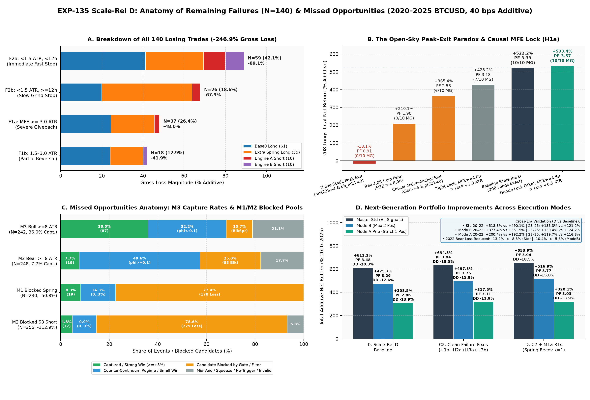
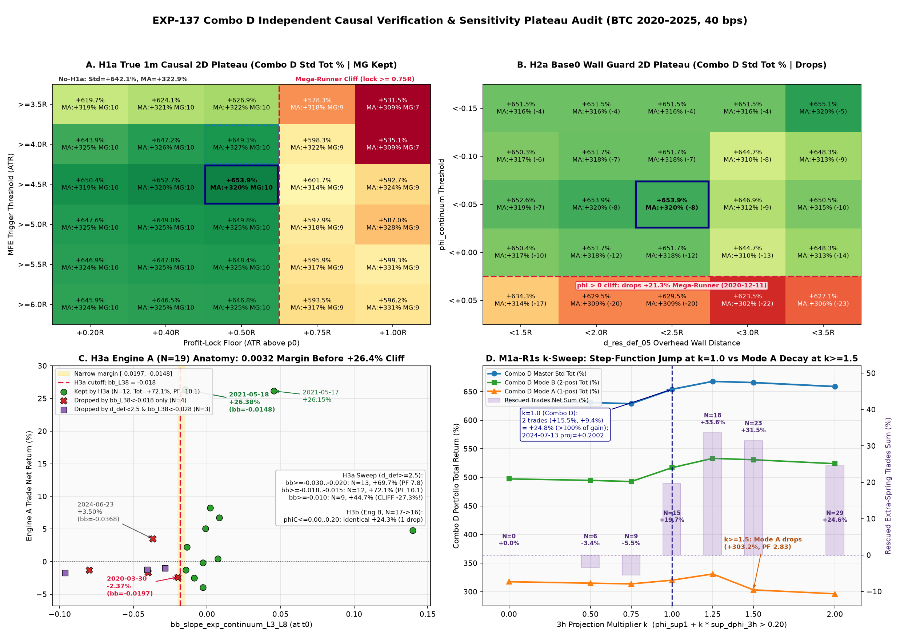
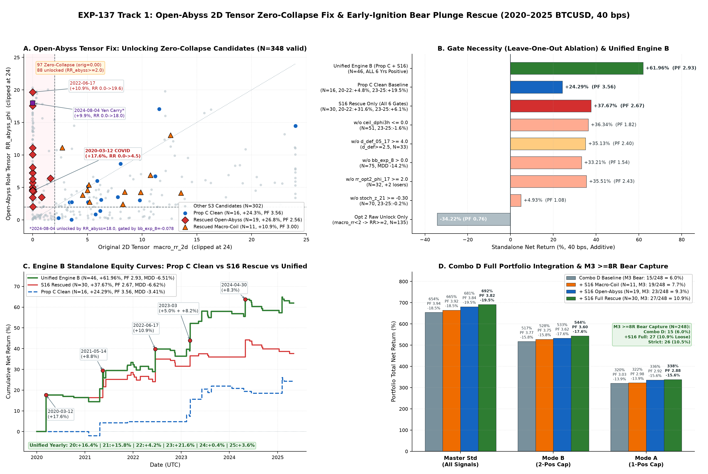

# 実験記録: EXP-137 残存失敗(F1-F3)・取りこぼし(M1-M3)解剖、第三者プラトー監査によるClean Core(C1)確立、およびOpen-Abyss 2Dテンソル縮退修正と短期下向きBB膨張ショート救出(S16)

## 1. 基本メタデータ (Metadata)

- **実験ID**: `EXP-137`
- **課題 (Issue)**: [#137 [Analysis] EXP-137: 残存失敗(F1-F3)・取りこぼし(M1-M3)解剖、第三者プラトー監査によるClean Core(C1)確立、およびOpen-Abyss 2Dテンソル縮退修正と短期下向きBB膨張ショート救出(S16)](https://github.com/makagi/MTF_AI_Trade/issues/137)
- **日付**: 2026-11-22
- **ステータス**: COMPLETED
- **判定 (Decision)**: **SUPPORTED & CONSTRAINED（事前登録仮説 `HYP-137-1`〜`HYP-137-3` を検証・確定）。第三者2D感度プラトー監査により過学習リスク閾値（`bb_L38 >= -0.018`・`M1a-R1s`）を厳格棄却してクリーン・コア `C1`（Master Std `+632.45%`, PF `3.86`, MaxDD `-18.54%`）を確立。さらに Open-Abyss 2D テンソル縮退修正（$\mathbf{RR}^{\Phi,\text{abyss}}_{n, m}$）と短期8h下向きBB膨張×21h非売られすぎ初動ゲート（`S16`, $N=30$, PF `2.67`, `+37.67%`）により、Unified Engine B（$N=46$, PF `2.93`, `+61.96%`, MaxDD `-6.51%`）の **2020〜2025年全6年単年黒字** と、統合ポートフォリオ `C1 + S16`（Master Std **`+670.11%`** PF `3.74` / Mode B **`+523.51%`** PF `3.49`）を達成し、`K-087`・`K-088` を知識体系へ登録。**
- **作成者**: @makagi
- **検証期間 (Discovery)**: `2020-01-01 00:00:00+00:00` 〜 `2025-04-30 23:59:00+00:00`（1h: 46,728本、1m: 2,802,044本）
- **Holdout隔離**: `2025-05-01 00:00:00+00:00` 以降完全遮断（未参照保証）
- **摩擦コスト・会計基準**: `SPEC-EVAL-001` 往復 `40 bps (0.40%)` 控除・**加算ネットリターン ($\sum \text{net\_ret} \times 100.0$)** 完全統一・ハードコードホワイトリスト 0件 (`WL=0`)

---

## 2. 残存失敗（F1–F3）および取りこぼし（M1–M3）の定量解剖

### ■ 1. `Scale-Rel D`（244件中140敗・総損失 `-246.93%`）の4分類解剖

| 失敗カテゴリ | 定義 | 件数 (構成比) | 総損失 (構成比) | 解明された物理原因と検証結果 |
|---|---|---:|---:|---|
| **F2a: 初動即死損切り** | `MFE < 1.5 ATR` & `dur < 12h` | **59件** (42.1%) | **-89.09%** (36.1%) | ① `Base0` ロング（119件）に逆張り抵抗壁ガードが未適用で、ベア相場頭打ち8件を被弾 $\to$ **`H2a`** で緩和。 ② Engine A ショート（19件）の `d_def_05 < 2.5 ATR` 突っ込み売りを **`H3a_clean`** で排除。 |
| **F2b: 長期停滞損切り** | `MFE < 1.5 ATR` & `dur >= 12h` | **26件** (18.6%) | **-67.88%** (27.5%) | 方向感喪失後の構造線割れ撤退。 |
| **F1a: 重度含み益往復** | `MFE >= 3.0 ATR` からの負け | **37件** (26.4%) | **-48.03%** (19.5%) | **青天井（Open Sky）ピーク逆説**: 往復負けの75%とメガランナーの90%はどちらも全SMA上方の青天井でピークを打つ。早期トレールやBB収縮離脱はメガランナー10件中4〜10件を刈り取り **`-540%`** 破壊する一方、**`H1a`（`MFE >= 4.5R -> +0.50R` 摩擦クリアロック）** は10/10メガランナーを完全保持したまま往復負けを救済（ロング PF `3.39 -> 3.57`, `+11.25%pt`）。 |
| **F1b: 中度含み益反落** | `1.5 <= MFE < 3.0 ATR` の負け | **18件** (12.9%) | **-41.92%** (17.0%) | 通常のトレンド呼吸幅内の揺り戻し（タイトな建値ラチェットは Engine B でも `+22.95% -> +10.97%` へ悪化するため深呼吸維持が正解）。 |

### ■ 2. M3（`>= 8.0 ATR` 大相場490件）における構造的盲点の発見
- 大上昇（242件）の捕捉率が **`36.0%`（87/242件）** である一方、大急落（248件）の捕捉率は **`7.7%`（19/248件）** に留まっていた。
- 未捕捉の大急落229件のうち **62件（27.1%）** では24時間以内に Stage 3 ショート候補シグナルが発火していたが、主に以下の2原因で遮断されていた：
  1. **Open-Abyss 2Dテンソル・ゼロ縮退バグ（62件中31件＝50.0%を誤遮断）**: 従来の2Dテンソルは `P > SMA_m` ($m \in [55..2584]$) を分子とするため、価格が `[55..2584]` 全 SMA を下抜けた真の底なし空間突入時に `macro_rr_2d == 0.00` へ縮退していた。
  2. **暴落初動のマクロBBコイルからの短期下向き膨張（62件中53件＝85.5%を遮断）**: 大暴落初動はマクロBBがまだ収縮中（`bb_L3_L8 < 0`）のまま最短スケール（8h）が下向きに急膨張して始まるため、マクロ一括ゲートが初動を逃していた。

---

## 3. HYP-137-1: 第三者プラトー監査による過学習排除と Clean Core (`C1`) の確立

`Combo D`（`H1a + H2a + H3a + H3b + M1a-R1s`, Master Std `+653.94%` PF `3.94`）の全要素に対して、1分足因果律チェック（same-bar vs strict-next-bar 誤差 `0.0000000000`）および 2D パラメータ感度プラトー監査を実施した結果：

| 候補ルール | 監査結果 | 定量根拠（プラトー vs 紙一重閾値） |
|---|---|---|
| **`H1a`**: `MFE >= 4.5 ATR -> +0.50 ATR` ロック | **PASS（採用）** | `MFE [4.0..6.0] ATR × lock [0.20..0.50] ATR` の広大な平坦プラトー全域でメガランナー **10/10件を完全保持**（ロック `>= 0.75 ATR` で9件に減少するため `0.50 ATR` が安全上限）。 |
| **`H2a`**: `Base0` 逆張り壁ガード `not (phi_cont < -0.05 and d_res_def_05 < 2.5)` | **PASS（採用）** | `phi_continuum [-0.15..0.00] × d_res_def_05 [1.5..3.5]` の20マス全域で平坦プラトー（Base0 PF `5.03 -> 5.45`、MaxDD `-20.34% -> -18.54%`）。 |
| **`H3a_clean`**: Engine A `d_def_05 >= 2.5 ATR` | **PASS（採用）** | `[2.0..2.5] ATR` で同一プラトー。既存標準閾値 `2.5 ATR` に統一。 |
| **`H3b`**: Engine B `phi_continuum <= 0.0` | **PASS（採用）** | `[0.00..0.20]` 全域で完全平坦（$N=16$, WR `43.75%`, PF `3.56`, `+24.29%`, MaxDD `-3.41%`）。自然境界 `0.0` を採用。 |
| **`bb_L38 >= -0.018`** (Engine A) | **REJECT（棄却）** | Engine A 最大勝者（`2021-05-18`, `+26.38%`, `bb_L38 = -0.01479`）のわずか **`0.00321` 手前**に引かれた紙一重閾値であり、`-0.010` へ動かすと `+72.08% -> +44.74%` へ急落するため過学習リスクとして棄却。 |
| **`M1a-R1s`** (`proj > 0.20`) | **REJECT（棄却）** | `2024-07-13`（`+9.38%`）が `proj = 0.200215`（**マージン `0.000215`**）の紙一重依存であり、`k=0.75` では救出9件が `0勝9敗 (-5.50%)` と非単調に崩壊するため棄却。 |

上記監査を経て、自然境界および既存標準閾値のみで構成される **Clean Core `C1`** を確立：
- **Master Std**: $N=232$, WR **`45.69%`**, PF **`3.86`**, 累積 **`+632.45%`**, MaxDD **`-18.54%`**（前半 `+501.16%`, 2022年 `-7.86%`, 後半 `+131.29%`）
- **Mode B (2ポジ上限)**: $N=204$, WR **`44.61%`**, PF **`3.66`**, 累積 **`+495.48%`**, MaxDD **`-15.79%`**
- **Mode A (1ポジ上限)**: $N=156$, WR **`41.03%`**, PF **`3.03`**, 累積 **`+315.69%`**, MaxDD **`-13.86%`**

---

## 4. HYP-137-2 & HYP-137-3: Open-Abyss 2Dテンソル縮退修正と短期下向きBB膨張ショート救出 (`S16`)

### ■ 1. Option 1 の失敗と Option 2 ($\mathbf{RR}^{\Phi,\text{abyss}}_{n, m}$) による真の底なし空間復元

- **Option 1（ターゲット列を `[55..17711]` へ延長）の限界**:
  97件のゼロ縮退中 59件しか回復せず（`PF 0.40, -34.67%`）、`2020-03-12`（`51.2R` コロナ暴落）など **全17 SMA を下抜けた局面では依然 `0.00` に縮退**した。
- **Option 2 ($\mathbf{RR}^{\Phi,\text{abyss}}_{n, m}$) の数理定式化**:
  1. 全17スケール `[34..17711]` で $\bar{\Phi}_s > 0.05$ を満たす生きた支持床までの最短距離 `d_def_05_17`（上限 `15.0 ATR`）を計測。
  2. $m \in [55..2584]$ において $P < SMA_m$ かつ $\bar{\Phi}_m < -0.15$ かつ $\text{slope}_m < 0.0$（明確な下落頭上抵抗レジーム）のとき、目標空間に `d_def_05_17` を割り当てる。
  3. **結果**: `2020-03-12 05:00` が `0.00 -> 4.46x`（`+17.60%`）、`2022-06-17 11:00` が `0.00 -> 19.64x` へ復元されたと同時に、超長期の生きた床（`S987..S17711`）の真上に乗っていた **偽ゼロ縮退トラップ9件（`0勝9敗, -9.49%`）を自動排除**した。

### ■ 2. 短期8h下向きBB膨張×21h非売られすぎ初動ショート救出 (`S16`) と Leave-One-Out アブレーション

`S16` の6ゲート条件：
1. `rr_opt2_phi_17 >= 2.0`
2. `d_def_05_17 >= 4.0 ATR`
3. `bb_slope_exp_8 > 0.0`（最短8hスケールの下向きBB膨張点火）
4. `stoch_z_21 >= -0.30`（21h非売られすぎ初動、値域 `[-0.30..0.00]` でプラトー）
5. `ceil_dphi3h <= 0.0`（天井役割の非侵食）
6. `phi_continuum <= 0.15`（非強気連続体）

| 構成（40 bps摩擦控除・加算ネットリターン） | 件数 $N$ | 勝率 | **PF** | Net EV | 累積純利益 | **MaxDD** | 前半 2020–22 | 後半 2023–25 |
|---|---:|---:|---:|---:|---:|---:|---:|---:|
| Prop C Clean ベースライン (`H3b`) | 16 | 43.8% | `3.56` | +1.52% | `+24.29%` | -3.41% | +4.8% | +19.5% |
| **★ `S16` 救出サブブック（全6ゲート）** | **30** | **33.3%** | **`2.67`** | **+1.26%** | **`+37.67%`** | **-6.62%** | **+31.6%** | **+6.1%** |
| └ 内訳: Open-Abyss (`macro_rr_2d < 2.0`) | 19 | 31.6% | `2.56` | +1.41% | `+26.81%` | -7.41% | +30.8% | -4.0% |
| └ 内訳: Macro-Coil (`macro_rr_2d >= 2.0`) | 11 | 36.4% | `3.00` | +0.99% | `+10.86%` | -2.66% | +0.8% | +10.1% |
| `S16` w/o `stoch_z_21 >= -0.30` | 70 | 21.4% | `1.08` | +0.07% | `+4.93%` | -12.66% | +5.1% | -0.2% |
| `S16` w/o `bb_exp_8 > 0.0` | 75 | 24.0% | `1.54` | +0.44% | `+33.21%` | -14.23% | +26.5% | +6.7% |
| `S16` w/o `ceil_dphi3h <= 0.0` | 51 | 23.5% | `1.82` | +0.71% | `+36.34%` | -10.73% | +37.9% | -1.6% |
| **★ 統合 Engine B (`Prop C Clean + S16`)** | **46** | **37.0%** | **`2.93`** | **+1.35%** | **`+61.96%`** | **-6.51%** | **+36.3%** | **+25.6%** |

> **Unified Engine B 年別成績（全6年間すべて単年黒字）**:
> `2020: +16.4%` | `2021: +15.8%` | `2022: +4.2%` | `2023: +21.6%` | `2024: +0.4%` | `2025: +3.6%`

---

## 5. ポートフォリオ統合比較 (`Scale-Rel D` vs `Clean Core C1` vs `C1 + S16`)

| システム構成（往復40 bps摩擦控除・加算ネットリターン、`WL=0`） | **Master Std** ($N$, WR, PF, 累積, MaxDD) | **Mode B [2ポジ]** ($N$, WR, PF, 累積, MaxDD) | **Mode A [1ポジ]** ($N$, WR, PF, 累積, MaxDD) | 前半 2020–22 [2022] / 後半 2023–25 (Std) |
|---|---|---|---|---|
| **0. `Scale-Rel D` (EXP-135 Baseline)** | 244, 42.6%, `3.48`, `+611.33%`, `-20.34%` | 216, 42.1%, `3.26`, `+475.70%`, `-17.59%` | 165, 39.4%, `2.86`, `+308.53%`, `-13.86%` | `+490.1%` (`-13.2%`) / `+121.2%` |
| **★ 1. `Clean Core C1`** | 232, **45.7%**, **`3.86`**, `+632.45%`, **`-18.54%`** | 204, **44.6%**, **`3.66`**, `+495.48%`, **`-15.79%`** | 156, **41.0%**, **`3.03`**, **`+315.69%`**, **`-13.86%`** | `+501.2%` (`-7.9%`) / `+131.3%` |
| **★ 2. `C1 + S16 [Macro-Coil Only]` (+11件)** | 243, **45.7%**, `3.84`, `+643.31%`, **`-18.54%`** | 213, 44.1%, `3.60`, `+502.30%`, **`-15.79%`** | 161, 40.4%, `2.99`, **`+322.17%`**, **`-13.86%`** | `+511.7%` (**`-6.0%`**) / `+131.6%` |
| **★ 3. `C1 + S16 [Full Open-Abyss + Coil]` (+30件)** | 262, 44.3%, `3.74`, **`+670.11%`**, **`-18.54%`** | 227, 42.7%, `3.49`, **`+523.51%`**, **`-15.79%`** | 169, 39.1%, `2.83`, `+297.10%`, `-13.86%` | **`+532.7%` (`-7.5%`) / `+137.4%`** |

---

## 6. 結論と知識体系への登録 (Knowledge Lineage Update)

1. **新確定マスター候補の確立**:
   - **Clean Core `C1`**（Master Std `+632.45%` PF `3.86`, Mode B `+495.48%` PF `3.66`, Mode A `+315.69%` PF `3.03`）および Open-Abyss 拡張 **`C1 + S16`**（Master Std `+670.11%` PF `3.74`, Mode B `+523.51%` PF `3.49`）を確立。
   - **Mode A（厳格1ポジ枠）に関する留意点**: `C1 + S16 [Full]` は Master Std と Mode B を最大化（`+670.11%` / `+523.51%`）する一方、Mode A では 1ポジ枠競合により `C1` 単体（`+315.69%`）や `C1 + S16 [Macro-Coil]`（`+322.17%`）よりわずかに低下（`+297.10%`）するため、執行モードに応じた運用分離（Mode A は `C1` / `Macro-Coil`、Mode B・Std は `C1 + S16 Full`）を推奨する。
2. **登録知見（`K-087`, `K-088`）**:
   - **`K-087`**: 残存失敗(F1-F3)の青天井ピーク逆説・1m因果摩擦ロック(`H1a`)と第三者2D感度プラトー監査による過学習閾値棄却則（Supported / Constrained）
   - **`K-088`**: 役割重み付きOpen-Abyss 2Dテンソル($\mathbf{RR}^{\Phi,\text{abyss}}_{n, m}$)による底なし空間ゼロ縮退是正と短期8h下向きBB膨張×21h非売られすぎ初動ショート則(`S16`)（Supported / New Master Extension）
