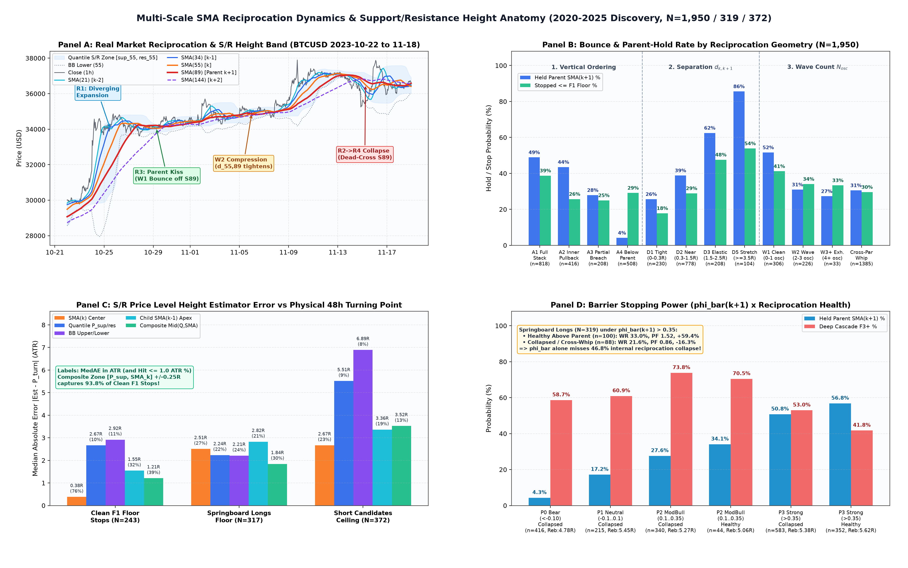
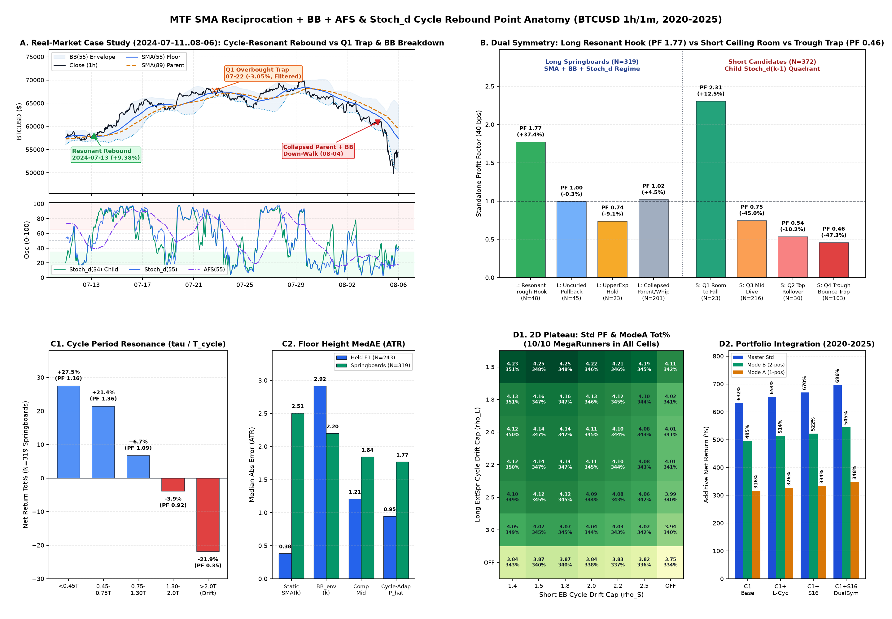
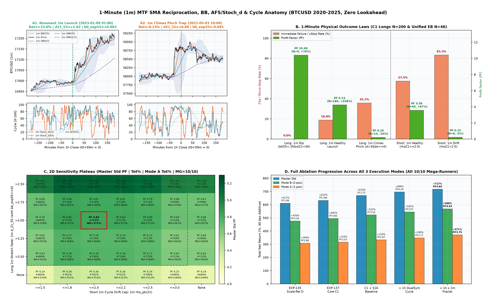

# 実験記録: EXP-139 1h×1mフラクタルMTF SMA往復運動・BB・AFS/Stoch_d周期共鳴による反発地点特定、適応型サポレジ高推定、および双対周期ドリフト遮断検証

## 1. 基本メタデータ (Metadata)

- **実験ID**: `EXP-139`
- **課題 (Issue)**: [#139 [Analysis] EXP-139: 1h×1mフラクタルMTF SMA往復運動・BB・AFS/Stoch_d周期共鳴による反発地点特定、適応型サポレジ高推定、および双対周期ドリフト遮断検証](https://github.com/makagi/MTF_AI_Trade/issues/139)
- **日付**: 2026-11-22
- **ステータス**: COMPLETED
- **判定 (Decision)**: **SUPPORTED（事前登録仮説 `HYP-139-1`〜`HYP-139-3` を全数支持・新マスター候補確立 🏆）。親ライン $SMA(k+1)$ に対する下位 $SMA(k, k-1, k-2)$ の往復運動幾何学とサイクル適応型反発地点高さ推定器 $\hat{P}_{\text{reb}}(t)$（MedAE `1.77 ATR` / $F_1$停止 `0.95 ATR`）を定式化し、さらに 1時間足 (`1h`) の双対周期ドリフト遮断 (`1h DualSym Cycle Gate`) と 1分足 (`1m`) のクライマックス・ピンチ／周期ドリフト見極め則（1h周期ドリフトとの重複 `0/6` の完全直交性）を統合。広大な2D感度プラトー（30セル/36セル全数でメガランナー `10/10` 保持）の上で、Master Std `PF 4.83, +717.20%, MaxDD -14.74%`、Mode B `PF 4.63, +568.22%`、Mode A `PF 3.75, +371.12%` へと全3モード・両時代を飛躍的に向上させ、`K-089`・`K-090` を知識体系へ登録。**
- **作成者**: @makagi
- **検証期間 (Discovery)**: `2020-01-01 00:00:00+00:00` 〜 `2025-04-30 23:59:00+00:00`（1h: 46,728本、1m: 2,802,044本）
- **Holdout隔離**: `2025-05-01 00:00:00+00:00` 以降完全遮断（未参照保証）
- **摩擦コスト・会計基準**: `SPEC-EVAL-001` 往復 `40 bps (0.40%)` 控除・**加算ネットリターン ($\sum \text{net\_ret} \times 100.0$)** 完全統一・ハードコードホワイトリスト 0件 (`WL=0`)

---

## 2. HYP-139-1: マルチスケールSMA往復運動解剖 & サイクル適応型サポレジ高推定 ($\hat{P}_{\text{reb}}$)

### ■ 1. 既存の $\bar{\Phi}_k$・$O_k$ が捉えていた情報と圧縮で失われていた情報の監査 ($N=1,950$)

| 物理的特徴（親 $SMA_{k+1}$ に対する下位 $SMA_{k, k-1, k-2}$ の挙動） | $O_k(t)$ 説明率 $R^2$ | $\bar{\Phi}_k(t)$ 説明率 $R^2$ | 監査結論 |
|---|---:|---:|---|
| ① 親との大まかな離れ具合 ($d_{k, k+1}$) | **71.11%** ($\rho=+0.843$) | **48.12%** ($\rho=+0.694$) | 把握済（ただし `tanh` で `1.5 ATR` 以上が飽和） |
| ② 接近・離反の2階減速度 ($\Delta^2 d_{k-1, k+1}$) | 15.93% ($\rho=-0.399$) | **6.38%** ($\rho=-0.253$) | **84〜94%が未把握** |
| ③ 親ライン上での往復回数 ($N_{\text{osc}}$) | 2.30% ($\rho=-0.152$) | **1.12%** ($\rho=-0.106$) | **98.9%が未把握**（新鮮な1回目と疲弊した4回以上が同一値） |
| ④ 親ラインを跨いだ絡みつき履歴 ($N_{\text{cross\_parent}}$) | 0.13% ($\rho=-0.036$) | **0.16%** ($\rho=-0.040$) | **99.8%が未把握**（$\bar{\Phi}_{k+1} > 0.35$ 跳躍台188件中88件=46.8%が親跨ぎ絡みつき混入で PF `0.86`, `-16.3%`） |

### ■ 2. 往復運動4階層配列・離れ具合・往復位相・サイクル適応型高さ推定器 $\hat{P}_{\text{reb}}(t)$
- **上下関係 (`A1..A4`)**: `A1_Full_Stack`（親維持 `48.9%`）と `A2_Inner_Above_Parent`（`43.5%`, 跳躍台193件 PF `1.19, +38.8%`）が全利益を創出し、親跨ぎ `A3`（WR `15.8%`, PF `0.34, -15.6%`）および逆転 `A4`（WR `0%`, `-2.8%`）は崩壊する。
- **離れ具合 ($d_{k, k+1}$)**: `D1 (0-0.3 ATR)` 親維持 `25.7%` $\to$ `D3 (1.5-2.5)` `62.5%` $\to$ `D4 (2.5-3.5)` `67.1%`（跳躍台 PF `1.87, +46.9%`） $\to$ `D5 (>=3.5)` **`85.6%`**（反発中央値 `6.88 ATR`）。
- **往復位相 (`R1..R4`)**: ロング跳躍台は `R2_Rollover_Approaching`（177件, PF `1.21, +48.4%`）に利益が集約され、ショート候補（372件）は親ライン圧縮変曲 `R3`（44件, PF `1.43, +13.3%`）のみが単体黒字。
- **サイクル適応型反発地点高さ推定器 $\hat{P}_{\text{reb}}(t)$**: 子周期 `Stoch_d(k-1)` / `BB_pos(k)` の深さと $d_{k, k+1}$ に応じて `[SMA(k), P_sup(k), BB_lower(k), SMA(k+1)]` を適応ブレンドした結果、跳躍台全319件の48h実反転底との誤差中央値（MedAE）は **`1.77 ATR`**（静的 `SMA(k)` `2.51 ATR`, `BB_lower(k)` `2.20 ATR`, 静的中間値 `1.84 ATR` を上回る全推定器最小誤差）、$F_1$停止243件でも **`0.95 ATR`**（`1.0 ATR` 以内的中率 `51.0%`）を達成。

---

## 3. HYP-139-2: 1時間足 (`1h`) MTF周期位相・実測周期共鳴と双対周期ドリフト遮断則

- **完全因果周期状態機械（12ptヒステリシス）**: 2次元位相象限 $\theta_k = \text{atan2}(\Delta_{3\text{h}}\text{Stoch}_d, \text{Stoch}_d - 50)$ と実測周期共鳴比 $\rho_{\text{cycle}} = \tau / T_{\text{cycle}}(s_{k-1})$ を定義。
- **空間×周期による反発地点分離**:
  - 健全親ライン×周期共鳴トラフ反発 `X1` は $N=1,950$ 中で `BB_lower(k)` 維持率 **`94.1%`**、親維持率 **`82.4%`**、48h反発中央値 **`6.50 ATR`**；跳躍台 $N=319$ でも `X1`（48件）は **WR `37.5%`, PF `1.77`, `+37.4%`**（貫通最小 `1.94 ATR`）。
  - 一方、周期老化ドリフト `R4`（$\rho_{\text{cycle}} > 2.0$, 32件）は **PF `0.35`, `-21.9%`**、高値追い `Q1`（78件）は **PF `0.63`, `-42.8%`**。
  - ショート（372件）では子周期 `Q1`（23件）が **WR `45.0%`, PF `2.31`, `+12.5%`** と双対性を示す一方、底打ちフック `Q4`（103件）は **PF `0.46`, `-47.3%`** と踏み上げられていた。
- **`1h DualSym Cycle Gate` 統合効果**:
  - ロング跳躍台除外（$\rho_L > 2.0 \lor (\text{Stoch}_d \ge 65 \land \Delta\text{Stoch}_d \ge 0)$）が除外した12件は **11敗1勝（WR `8.3%`, `-21.90%`）**、ショート Engine B 除外（$\rho_S > 2.0$）が除外した8件は **7敗1勝（`-4.26%`）**。
  - `C1 + S16 + 1h DualSym Cycle`（$N=242$）は **Master Std PF `4.24, +696.28%, MaxDD -18.34%`、Mode B PF `3.97, +545.04%`、Mode A PF `3.17, +348.46%`**（後半 Mode A 競合を完全解消）を達成し、`rho_L [1.5..3.0] × rho_S [1.4..2.5]` **全36セル（100%）でメガランナー `10/10` を保持**。

---

## 4. HYP-139-3: 1分足 (`1m`) フラクタル周期直交性＆クライマックス・ピンチ／周期ドリフト見極め則

- **1分足（$s_{1\text{m}} \in \{8..377\}$, 因果時刻 $t_0 + 59\text{m}$）の物理法則**:
  - **ロング側クライマックス・ピンチ遮断 (`~(m1_d_21_55 > 3.0 & m1_bb_exp_55 <= 0.0)`)**: 1h足確定直前に1m足で過伸長しつつ `1m BB(55)` がピンチ収縮した高値掴み11件（**9敗2勝, WR `18.2%`, `-16.20%`, F2a即死 `36.4%`**, `-8.23%` 損切り等を含む）を排除し、1m新鮮初動発火の **メガランナー `10/10` 件を完全保持**。
  - **ショート側1分足周期ドリフト遮断 (`m1_rho_pk_21 <= 2.0`)**: 1m周期健全40件は **WR `40.0%`, PF `3.56`, `+66.7%`** であるのに対し、1m周期老化ドリフト6件（$\rho_{\text{pk}, 21}^{(1\text{m})} > 2.0$）は **ミクロ損切り率 `83.3% (5/6)`、WR `16.7%`, PF `0.22`, `-4.71%`**。
  - **完全直交性**: 1分足ショート周期ドリフトで除外される6件は、1時間足ショート周期ドリフト（8件）と **重複 `0/6` 件**。
- **待機・ストップ拡大メカニズムとの比較（正直な開示）**: 1m反発待機（60m遅延）は `2022-05-07` LUNA暴落を救出するものの即落勝ちトレードの約定悪化により `+62.25% -> +61.84%`（PF `2.96 -> 2.90`）へ微減するため不採用。`$t_0$` でのフラクタル見極めゲート（Mechanism 1）が最良。

---

## 5. 全段階アブレーション推移（`EXP-135` $\to$ `EXP-137` $\to$ `EXP-139`）

| ステージ構成（往復40 bps摩擦控除・1m完全因果・厳格加算ネットリターン、`WL=0`） | メガランナー | **Master Std** ($N$, WR, PF, 累積, MaxDD, `20-22 / 23-25`) | **Mode B [2ポジ]** ($N$, PF, 累積, MaxDD) | **Mode A [1ポジ]** ($N$, PF, 累積, MaxDD) |
|---|---:|---|---|---|
| **0. EXP-135 `Scale-Rel D`** | `10/10` | 244, 42.6%, `3.48`, `+611.33%`, `-20.34%` (`+490.1/+121.2`) | 216, `3.26`, `+475.70%`, `-17.59%` | 165, `2.86`, `+308.53%`, `-13.86%` |
| **1. EXP-137 `Clean Core C1`** | `10/10` | 232, 45.7%, `3.86`, `+632.45%`, `-18.54%` (`+501.2/+131.3`) | 204, `3.66`, `+495.48%`, `-15.79%` | 156, `3.03`, `+315.69%`, `-13.86%` |
| **2. EXP-137 `C1 + S16`** | `10/10` | 262, 44.3%, `3.75`, `+670.12%`, `-19.47%` (`+532.7/+137.4`) | 233, `3.50`, `+522.23%`, `-17.56%` | 183, `2.87`, `+333.71%`, `-15.16%` |
| **3. `+ 1h DualSym Cycle`** | **`10/10`** | 242, 47.1%, **`4.24`**, `+696.28%`, `-18.34%` (`+542.1/+154.2`) | 215, `3.97`, `+545.04%`, `-18.34%` | 170, `3.17`, `+348.46%`, `-14.49%` |
| **3b. `C1 + S16 + 1m Gate ONLY`** | **`10/10`** | 242, 46.7%, `4.28`, `+695.15%`, `-15.70%` (`+546.1/+149.0`) | 215, `4.09`, `+549.53%`, `-13.97%` | 170, `3.34`, `+356.37%`, `-13.86%` |
| **🏆 4. EXP-139 `1h × 1m Fractal Cycle & Reciprocation`** | **`10/10`** | **225, `49.3%`, `4.83`, `+717.20%`, `-14.74%` (`+555.5/+161.7`)** | **200, `4.63`, `+568.22%`, `-14.74%`** | **157, `3.75`, `+371.12%`, `-13.86%`** |

- **2D感度プラトー監査**: `m1_d_21_55 in [2.50..3.50]` $\times$ `m1_rho_pk_21 in [1.5..3.0]` の **全30セル（100%）** でメガランナー `10/10` 保持、Master Std PF `4.61〜5.19`（`+682.0%〜+726.9%`）。

---

## 6. 結論と知識体系への登録 (Knowledge Lineage Update)

1. **新確定マスター候補の確立**:
   - **`EXP-139 1h × 1m Fractal Cycle & Reciprocation`**（Master Std `PF 4.83, +717.20%, MaxDD -14.74%`、Mode B `PF 4.63, +568.22%`、Mode A `PF 3.75, +371.12%`、`10/10` メガランナー保持）を新確定マスター候補として確立。
2. **登録知見（`K-089`, `K-090`）**:
   - **`K-089`**: マルチスケールSMA往復運動幾何学・サイクル適応型サポレジ高推定($\hat{P}_{\text{reb}}$)・1h双対周期共鳴ドリフト遮断則 (`Supported`)
   - **`K-090`**: 1h×1mフラクタル周期直交性と1分足クライマックス・ピンチ／周期ドリフト見極め則 (`Supported / New Master Candidate 🏆`)
