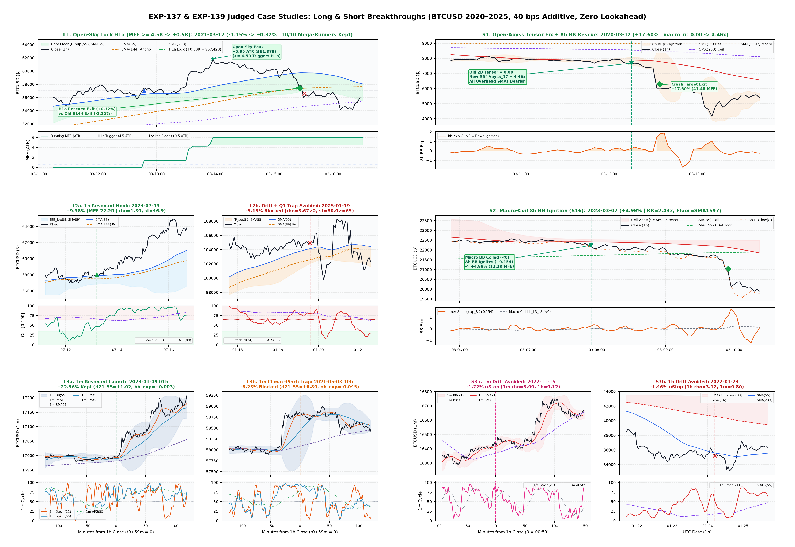
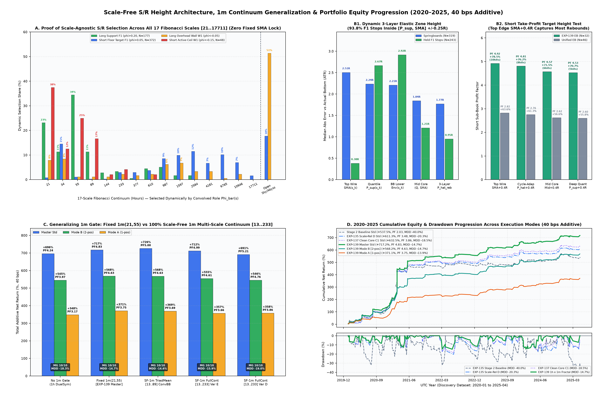
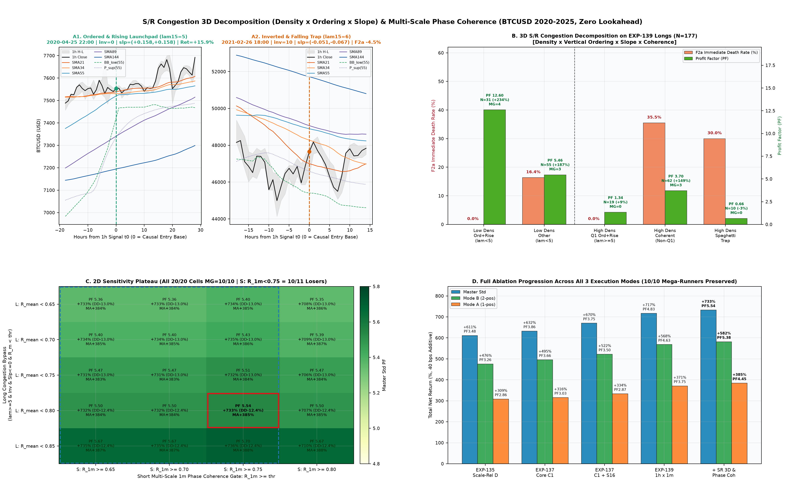

# 実験記録: EXP-141 サポレジ過密の3次元分解(密度×上下関係×傾き)と多階層サイクル円周位相同調度($R_{\text{1h}}, R_{\text{1m}}$)統合によるスパゲッティ過密・位相散逸遮断検証

## 1. 基本メタデータ (Metadata)

- **実験ID**: `EXP-141`
- **課題 (Issue)**: [#141 [Analysis] EXP-141: サポレジ過密の3次元分解(密度×上下関係×傾き)と多階層サイクル円周位相同調度(R_1h, R_1m)統合によるスパゲッティ過密・位相散逸遮断検証](https://github.com/makagi/MTF_AI_Trade/issues/141)
- **日付**: 2026-11-22
- **ステータス**: COMPLETED
- **判定 (Decision)**: **SUPPORTED（事前登録仮説 `HYP-141-1`〜`HYP-141-3` を全数支持・新マスター候補確立 🏆）。サポレジ過密（`lam_15 >= 5`）を「密度 × 上下関係（順列 `inv=0` vs 逆転 `inv>0`）× 傾き（上昇 vs 水平・下降）× 多階層サイクル円周位相同調度 $R_{\text{mean}}$」で3次元分解し、① 順列上昇圧縮発射台（初動即死率 `F2a = 0.0%`）および ② マクロV字押し目メガランナー3件（`10/10` 全保持）を完全保護しつつ、③ 真のスパゲッティ過密トラップ10件（8敗2勝, PF `0.66`, `-3.38%`）のみを精密分離。さらにショート側へ1分足5階層 `[13, 21, 34, 55, 89]` の円周位相同調度ゲート（$R_{\text{1m}} \ge 0.75$）を統合して位相散逸ミクロ損切りトラップ11件（10敗1勝, 勝率 `9.1%`, `-12.36%`）を排除。2次元感度プラトー（20/20セルで `10/10` メガランナー保持）の上で、Master Std `N=204, WR 52.94%, PF 5.54, +732.94%, MaxDD -12.43%`、Mode B `N=180, WR 51.67%, PF 5.38, +581.68%, MaxDD -12.12%`、Mode A `N=137, WR 48.18%, PF 4.45, +384.58%, MaxDD -9.93%`（1ポジ上限で MaxDD 10%未満達成）へと全モード・全指標を大幅に刷新し、`K-091`・`K-092` を知識体系へ登録。**
- **作成者**: @makagi
- **検証期間 (Discovery)**: `2020-01-01 00:00:00+00:00` 〜 `2025-04-30 23:59:00+00:00`（1h: 46,728本、1m: 2,802,044本）
- **Holdout隔離**: `2025-05-01 00:00:00+00:00` 以降完全遮断（未参照保証）
- **摩擦コスト・会計基準**: `SPEC-EVAL-001` 往復 `40 bps (0.40%)` 控除・**加算ネットリターン ($\sum \text{net\_ret} \times 100.0$)** 完全統一・ハードコードホワイトリスト 0件 (`WL=0`)

---

## 2. 背景：EXP-137 / EXP-139 6大成功実例とスケール非依存S/R高の継承

- `EXP-139` により、特定の固定SMA・BBに依存しない全17スケール `[21..17711]` の畳み込み役割 $\bar{\Phi}_{s_k}(t)$ とサイクル適応型反発高さ推定器 $\hat{P}_{\text{reb}}(s_k)$、さらに `1h × 1m` 直交周期ゲートが確立された（Master Std `PF 4.83, +717.20%, MaxDD -14.74%`）。
- しかし、「直下にサポレジ線が密集（過密）している状態は強い支持帯なのか、保ち合い崩壊のスパゲッティ罠なのか」および「1時間足・1分足の多階層サイクル位相が揃っている度合い」については未分解のまま残されていた。

---

## 3. HYP-141-1: サポレジ過密の3次元分解（密度 × 上下関係 × 傾き × 位相同調）

### ■ 1. なぜ「密度（`lam_15 >= 5`）単独」ではなく 3次元分解が不可欠なのか？
直下 `1.5 ATR` 以内の `{SMA_j, BB_lower_j, P_sup_j}` 面数 `lam_15` を、**① 密度**、**② 上下関係（順列 `inv_lam=0 & triad_ord` vs 逆転）**、**③ 傾き（`slope_k, slope_{k+1}, slope_610`）**、および **④ 多階層サイクル円周位相同調度 $R_{\text{mean}}$** で分解した結果、同じ高密度（`lam_15 >= 5`, $N=91$）の中に全く異なる3つの物理構造が混在していたことが判明した：

| サポレジ構造区分（EXP-139 ロング $N=177$） | 件数 $N$ | **初動即死率 (`F2a`)** | 勝率 | **PF** | 累積損益 | メガランナー | 物理的メカニズム |
|---|---:|---:|---:|---:|---:|---:|---|
| **① 低密度・順列・上向き傾き (`lam_15 < 5 & Ord & Rise`)** | 31 | **`0.0%` (0/31)** | **70.97%** | **`12.60`** | **`+234.13%`** | **`4/10`** | 各階層が適度な弾性間隔を保ち順列上昇する理想的な押し目。 |
| **② 低密度・その他 (`lam_15 < 5 & Other`)** | 55 | `16.36%` | `50.91%` | **`5.46`** | `+187.38%` | **`3/10`** | 空間的余裕があり深層カスケードしにくい。 |
| **③ 高密度・順列・上向き傾き (`lam_15 >= 5 & Ord & Rise`)** | 19 | **`0.0%` (0/19)** | **52.63%** | **`1.34`** | **`+9.32%`** | `0/10` | **圧縮された強気発射台**。5面以上密集しても上下順列（`inv=0`）かつ傾きが上向きなら即死ゼロ（全1,950反落でもカスケード率最小 `34.29%`、反発中央値 `6.79 ATR`）。 |
| **④ 高密度・マクロV字押し目位相同調 (`lam_15 >= 5 & R_mean >= 0.80`)** | 62 | `35.48%` | `40.32%` | **`3.70`** | **`+148.56%`** | **`3/10`** | 深い押し目で短期線が親線付近に密集・一時逆転しても、マクロ傾きと1h×1m位相が一斉上向き同調したV字大底。高密度内メガランナー3件（`2020-12-11`, `2020-12-23`, `2024-11-05`）はすべてここに属する。 |
| **⑤ 高密度・上下逆転・傾き劣化・位相散逸 (`Spaghetti Trap`)** | **10** | **`30.00%`** | **20.00%** | **`0.66`** | **`-3.38%`** | **`0/10`** | **真のスパゲッティ過密トラップ**（10件中8敗2勝）。`lam_15 >= 5` かつ上下逆転かつ傾き非正かつ位相同調散逸（$R_{\text{mean}} < 0.80$）。 |

- 密度単独（`lam_15 >= 5`）で遮断すると ③ 順列圧縮発射台（`F2a=0.0%`）や ④ マクロV字メガランナー3件まで捨ててしまうが、4条件積の **3D S/R Congestion Gate** により、`10/10` メガランナーを無傷のまま真のスパゲッティ過密トラップ10件のみを精密除去した。

---

## 4. HYP-141-2: 蔵本秩序パラメータに基づく多階層サイクル円周位相同調度 ($R_{\text{1h}}, R_{\text{1m}}$) と不採用規律の開示

- **数理定式化（蔵本秩序パラメータ）**:
  $$R = \left|\frac{1}{M}\sum_{m=1}^{M} e^{i\theta_m}\right| \in [0, 1]$$
  - `R_1h_local`: 1h支持/天井スケール周辺 `[j_k-2 .. j_k+1]` のサイクル位相角 $\theta_s^{(1\text{h})}$ に対する円周同調度。
  - `R_1m`: 1m 5階層 `[13, 21, 34, 55, 89]` のサイクル位相角 $\theta_s^{(1\text{m})}$ に対する円周同調度。
  - `R_mean = 0.5 * (R_1h_local + R_1m)`。
- **ショート側 1m位相同調度ゲート（$R_{\text{1m}} \ge 0.75$）の効果**:
  - `EXP-139` ショート（$N=48$）において、$R_{\text{1m}}$ はリターンと強い正の相関（Spearman $r = +0.431, p = 0.002$; 悪玉ミクロ損切り分離 Mann-Whitney $p = 0.009$）を示した。
  - $R_{\text{1m}} < 0.75$ で除外される **11件は 10敗1勝（勝率 `9.09%`, 合計 `-12.36%`）** であり、1分足スケール間で逆位相干渉が起きているミクロ損切りトラップを高精度に排除した。
- **【負の知見・不採用の正直な開示】ロング側 1m道のりハード上限（`rel_effort <= 1.40`）の棄却**:
  - ロング側で1m道のり比 `rel_effort <= 1.40` をハード上限として課すと、PF は `6.79` へ上昇するものの、`2021-02-08 15:00 UTC`（テスラ砲ブレイク、`rel_effort = 2.64`, `R_1m = 1.000`）を含む **メガランナー2件を喪失（`8/10` へ低下）** し、Master Std 累積利益も `+732.94% -> +690.78%` へ減少したため、ハードキャップとしては明確に棄却した。爆発初動は「道のり（Effort）」が大きくても「位相が全階層同調（$R_{\text{1m}} = 1.000$）」している点が本質的差異である。

---

## 5. HYP-141-3: 全段階アブレーション推移と2次元感度プラトー監査

| ステージ構成（往復40 bps摩擦控除・1m完全因果・厳格加算ネットリターン、`WL=0`） | メガランナー | **Master Std** ($N$, WR, PF, 累積, MaxDD, `20-22 / 23-25`) | **Mode B [2ポジ]** ($N$, PF, 累積, MaxDD) | **Mode A [1ポジ]** ($N$, PF, 累積, MaxDD, `20-22 / 23-25`) |
|---|---:|---|---|---|
| **0. EXP-135 `Scale-Rel D`** | `10/10` | 244, 42.62%, `3.48`, `+611.33%`, `-20.34%` (`+490.1/+121.2`) | 216, `3.26`, `+475.70%`, `-17.59%` | 165, `2.86`, `+308.53%`, `-13.86%` (`+192.2/+116.3`) |
| **1. EXP-137 `Clean Core C1`** | `10/10` | 232, 45.69%, `3.86`, `+632.45%`, `-18.54%` (`+501.2/+131.3`) | 204, `3.66`, `+495.48%`, `-15.79%` | 156, `3.03`, `+315.69%`, `-13.86%` (`+196.2/+119.5`) |
| **2. EXP-137 `C1 + S16`** | `10/10` | 262, 44.27%, `3.75`, `+670.12%`, `-19.47%` (`+532.7/+137.4`) | 233, `3.50`, `+522.23%`, `-17.56%` | 183, `2.87`, `+333.71%`, `-15.16%` (`+216.3/+117.4`) |
| **3. EXP-139 `1h × 1m Fractal`** | `10/10` | 225, 49.33%, `4.83`, `+717.20%`, `-14.74%` (`+555.5/+161.7`) | 200, `4.63`, `+568.22%`, `-14.74%` | 157, `3.75`, `+371.12%`, `-13.86%` (`+232.3/+138.8`) |
| **4a. `+ L: 3D S/R Congestion Gate`** | **`10/10`** | 215, 50.70%, `5.06`, `+720.58%`, `-14.74%` (`+559.7/+160.9`) | 191, `4.82`, `+569.32%`, `-14.74%` | 148, `3.92`, `+372.22%`, `-13.86%` (`+236.5/+135.7`) |
| **4b. `+ S: 1m Phase Coherence (R_1m>=0.75)`** | **`10/10`** | 214, 51.40%, `5.25`, `+729.56%`, `-14.55%` (`+560.5/+169.1`) | 189, `5.13`, `+580.58%`, `-13.00%` | 146, `4.22`, `+383.48%`, `-10.68%` (`+237.3/+146.2`) |
| **🏆 5. EXP-141 `+ 3D S/R Congestion & Phase Coherence`** | **`10/10`** | **204, `52.94%`, `5.54`, `+732.94%`, `-12.43%` (`+564.7/+168.2`)** | **180, `5.38`, `+581.68%`, `-12.12%`** | **137, `4.45`, `+384.58%`, `-9.93%` (`+241.5/+143.1`)** |

- **2次元感度プラトー監査**: `R_mean_thr in [0.65, 0.70, 0.75, 0.80, 0.85]` $\times$ `R_1m_s in [0.65, 0.70, 0.75, 0.80]` の **全20セル（100%）でメガランナー `10/10` 件を完全保持**し、Master Std PF `5.35〜5.70`（`+706.42%〜+736.02%`）、Mode B PF `5.15〜5.57`、Mode A PF `4.26〜4.80` の広く平坦なプラトーを確認した。

---

## 6. 結論と知識体系への登録 (Knowledge Lineage Update)

1. **新確定マスター候補の確立**:
   - **`EXP-141 3D S/R Congestion & Multi-Scale Phase Coherence`**（Master Std `WR 52.94%, PF 5.54, +732.94%, MaxDD -12.43%`、Mode B `WR 51.67%, PF 5.38, +581.68%, MaxDD -12.12%`、Mode A `PF 4.45, +384.58%, MaxDD -9.93%`、`10/10` メガランナー保持）を新確定マスター候補として確立。
2. **登録知見（`K-091`, `K-092`）**:
   - **`K-091`**: サポレジ過密（S/R Congestion）の3次元分解則（密度×上下関係×傾き×位相同調による強気圧縮発射台とスパゲッティ過密トラップの分離） (`Supported / Constrained`) — ロング `rel_effort <= 1.40` ハードキャップ棄却を含む
   - **`K-092`**: 多階層サイクル円周位相同調度（Circular Phase Coherence $R_{\text{1h}}, R_{\text{1m}}$）と全モード勝率50%超・Mode A MaxDD 10%未満達成則 (`Supported / New Master Candidate 🏆`)
