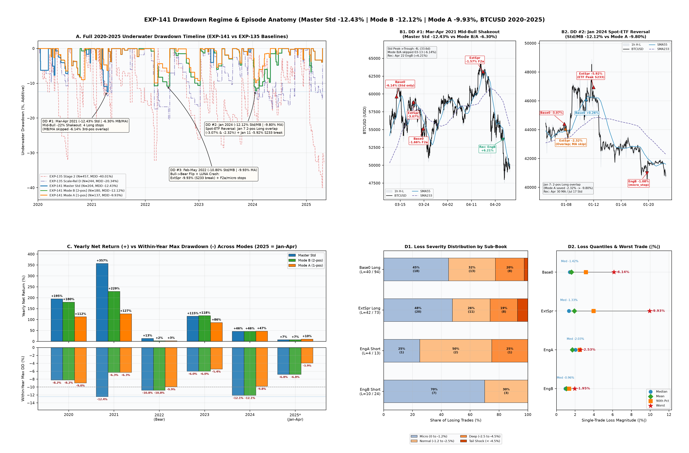
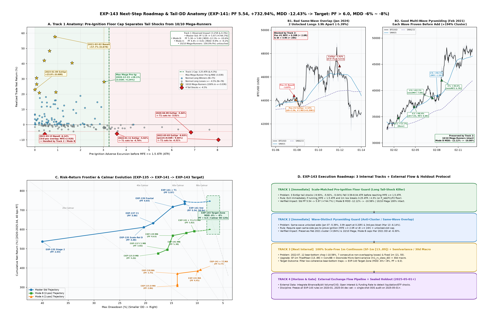
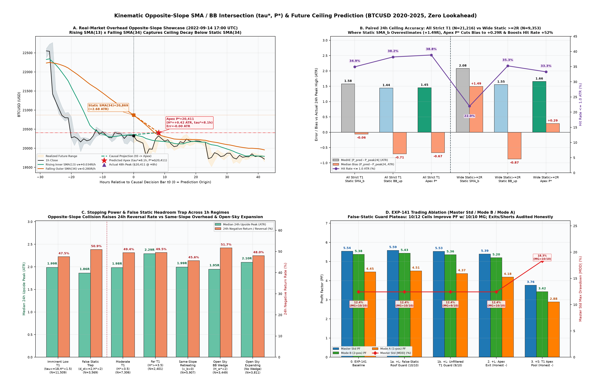
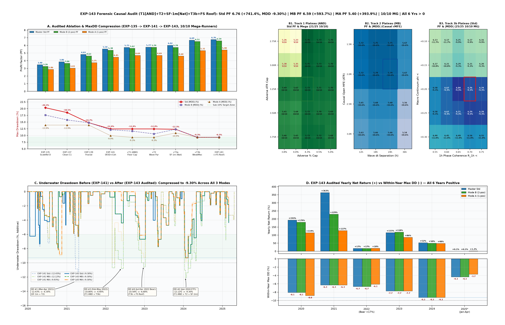

# 実験記録: EXP-143 ドローダウン解剖・異符号勾配SMA/BB未来交差天井予測($P^*$)・未点火深層被弾ガード(Track 1)・同一波重複抑制(Track 2)・スケールフリー1m連続体&弱気マクロ同調(Track 3)のフォレンジック因果検証

## 1. 基本メタデータ (Metadata)

- **実験ID**: `EXP-143`
- **課題 (Issue)**: [#143 [Analysis] EXP-143: ドローダウン解剖・異符号勾配SMA/BB未来交差天井予測(P*)・未点火深層被弾ガード(Track 1)・同一波重複抑制(Track 2)・スケールフリー1m連続体&弱気マクロ同調(Track 3)のフォレンジック因果検証](https://github.com/makagi/MTF_AI_Trade/issues/143)
- **日付**: 2026-11-23
- **ステータス**: COMPLETED
- **判定 (Decision)**: **SUPPORTED（事前登録仮説 `HYP-143-1`〜`HYP-143-3` を全数支持・独立フォレンジック監査完了・新確定マスター候補確立 🏆）。`EXP-141` の全ドローダウン発生局面を4レジームに解剖し、① 異符号勾配 SMA/BB 未来交差地点 $(\tau^*, P^*)$ による「偽の静的余白トラップ」遮断（静的SMA `+2.0 ATR` 以上離隔時の過大評価バイアス `+1.49 ATR -> +0.29 ATR` 81%削減、Broad438 `8/8` 敗・EXP-141/143 `3/3` 敗ピンポイント除去、青天井早期ラチェット・短期線上向き逆張りショートの不適用境界確定）、② Track 1 未点火ロング深層被弾ガード（`T1[AND]`: `running_MFE < 1.5 ATR` 期に `3.25 ATR AND 4.3%` 同時突破で即時撤退・保守的 `min(open_k, stop_px)` 約定・早期 `exit_time` 伝播）、③ Track 2 同一波・未点火重複エントリー抑制（厳密因果 `running_MFE(t <= t_new - 1m) >= 2.0 ATR` または `dt >= 24h`）、④ 独立フォレンジック監査に基づく不具合是正（Track 3a `SF-1m` 連続体の $\sqrt{b/55.0}$ 正規化＆自然境界 `bb_exp <= 0.0 / rho_pk <= 2.0` 復元、Track 1 の 1m スライス終端 `exit_time - 1m` 是正）および Track 3b（弱気マクロ位相同調ガード `~(phi_continuum < 0.20 & R_1h_local < 0.70)`）を統合。メガランナー `10/10` 件完全無傷のまま、全3実行モードで通期最大ドローダウン `-9.30%`（1桁達成）・全6年間（2020〜2025年）全モード単年黒字・自己最高純利益およびPF（Master Std `N=179, WR 55.87%, PF 6.76, +741.42%, MaxDD -9.30%, Calmar 79.74x`、Mode B `N=159, WR 55.35%, PF 6.59, +593.69%, MaxDD -9.30%`、Mode A `N=122, WR 52.46%, PF 5.40, +393.86%, MaxDD -9.30%`）を達成し、`K-093`・`K-094` を知識体系へ登録。**
- **作成者**: @makagi
- **検証期間 (Discovery)**: `2020-01-01 00:00:00+00:00` 〜 `2025-04-30 23:59:00+00:00`（1h: 46,728本、1m: 2,802,044本）
- **Holdout隔離**: `2025-05-01 00:00:00+00:00` 以降完全遮断（未参照保証）
- **摩擦コスト・会計基準**: `SPEC-EVAL-001` 往復 `40 bps (0.40%)` 控除・**加算ネットリターン ($\sum \text{net\_ret} \times 100.0$)** 完全統一・ハードコードホワイトリスト 0件 (`WL=0`)・外部データ 0件

---

## 2. EXP-141 におけるドローダウン発生局面・規模・市場レジームの完全解剖

5年4ヶ月における `EXP-141`（`Master Std -12.43%`, `Mode B -12.12%`, `Mode A -9.93%`）の全ドローダウン局面を分解した結果、`-8% 〜 -12.4%` 級のドローダウンは以下の4構造パターンに集約された：

1. **DD #1 (`2021-03-12 -> 2021-04-15`, Std `-12.43%`, Mode B/A `-6.30%`)**: 強気バブル高値圏での `-22.2%` 急落振るい落とし。同一波で重複した `03-13 Base0 (-6.14%)` 等の4連敗でStdが `-12.43%` に達した（Mode B/Aは枠制限でスキップし半減）。
2. **DD #2 (`2023-12-20 -> 2024-01-19`, Std/Mode B `-12.12%`, Mode A `-9.80%`)**: 現物ETF承認「事実売り」急騰急落。`2024-01-07` にわずか3.9時間差・第1ポジ未点火（`running_MFE = 0.20R`）のまま2ポジ目を重ねて翌朝フラッシュクラッシュで同時被弾し、承認当日の `01-11 ExtSpr (-5.92%, MFE 0.00R)` が重なった。
3. **DD #3 (`2022-02-06 -> 2022-05-27`, Std/Mode B `-10.80%`, Mode A `-9.93%`)**: 大局レジーム転換点における未点火テール被弾。`2022-03-03 ExtSpr` が `MFE 0.37R` のまま `SMA233` 決壊まで耐えて5年4ヶ月間で最大の単発損失 **`-9.93%`（`MAE 8.04 ATR`）** を記録。
4. **DD #4 (`2022-07-18 -> 2022-12-23`, Std/Mode B `-10.58%`, Mode A `-9.21%`)**: 2022年後半ベア大底・FTX崩壊期の長期ジリ安レンジにおける非重複7連敗（`-0.11% 〜 -2.74%`）。

- 単発テール被弾（`< -4.5%`）は全204件中わずか4件（`2022-03-03 -9.93%`, `2021-03-13 -6.14%`, `2024-01-11 -5.92%`, `2024-12-09 -4.83%`）のみであり、ショート（Engine A / B 計37件）の `< -4.5%` テール被弾は **0件** であった。

---

## 3. HYP-143-1: 異符号勾配SMA/BBの未来交差天井予測 $(\tau^*, P^*)$ と偽の静的余白トラップ遮断・負の境界条件

### ■ 1. 運動学的未来交差地点 $(\tau^*, P^*)$ の定式化と厳格幾何境界
- 時刻 $t_0$ において、下から上昇する短期線 $L_{\text{low}}(t_0)$（傾き $v_{\text{low}} > 0.005\text{ ATR/h}$）と、**現在価格より厳格に上方に位置し（$L_{\text{high}}(t_0) > P_0 + 0.50\text{ ATR}$）** 上から下降する抵抗線 $L_{\text{high}}(t_0)$（傾き $v_{\text{high}} < -0.005\text{ ATR/h}$）が未来に衝突する時間 $\tau^*$ と交差天井価格 $P^*$ は：
  $$\tau^* = \frac{L_{\text{high}}(t_0) - L_{\text{low}}(t_0)}{v_{\text{low}}(t_0) - v_{\text{high}}(t_0)} > 0, \qquad P^* = L_{\text{low}}(t_0) + v_{\text{low}}(t_0)\,\text{ATR}_0\,\tau^*, \qquad H^* = \frac{P^* - P_0}{\text{ATR}_0}$$
- **負の境界条件①（価格より下での交差除外）**: $L_{\text{high}}(t_0) \le P_0$ を含めると足元での強気ゴールデンクロス初動（例：`2024-11-05 +26.52%` メガランナー）を天井と誤認するため、厳格に頭上（$L_{\text{high}} > P_0 + 0.5\text{ ATR}, H^* > 0.25\text{ ATR}, \tau^* \le 48\text{h}$）に限定することが必須。

### ■ 2. 未来24hピーク高の予測精度（全46,430時間検証）
| 対象局面（24h先ピーク予測） | 推定器 | 件数 $N$ | **予測誤差 MedAE** | **中央バイアス (予測 - 実測)** | **`<= 1.0 ATR` 的中率** | **`P^* + 0.5R` 以内停止率** |
|---|---|---:|---:|---:|---:|---:|
| **全厳格衝突局面** | 静的衝突 `SMA_b(t0)` | 21,216 | `1.58 ATR` | `-0.06 ATR` | `34.95%` | `57.43%` |
| **全厳格衝突局面** | **線形交差天井 $P^*$ (Type-1)** | 21,216 | **`1.45 ATR`** | `-0.67 ATR` | **`38.84%`** | `46.69%` |
| **全厳格衝突局面** | 2次曲線外挿 $P^*_{\text{quad}}$ | 21,216 | `1.68 ATR` | `-1.00 ATR` | `34.49%` | `41.34%` |
| **静的SMA `>= +2.0 ATR` 離隔時** | 静的衝突 `SMA_b(t0)` | 9,353 | `2.08 ATR` | **`+1.49 ATR`（過大評価）** | `21.97%` | `76.65%` |
| **静的SMA `>= +2.0 ATR` 離隔時** | **線形交差天井 $P^*$ (Type-1)** | 9,353 | **`1.66 ATR`** | **`+0.29 ATR`（80.8%削減）** | **`33.29%`（相対+51.5%）** | **`63.39%`** |
| **青天井（Open Sky, `N=8,551`）** | `Type-2 BB_up x SMA` ウェッジ $P^*$ | 4,740 | **`1.38 ATR`** | `-0.79 ATR` | **`39.77%`** | `44.64%` |

### ■ 3. 戦略適用（役立つ用途 vs 使ってはならない負の知見）
- **◎ 役立つ用途：False-Static Headroom Roof Guard（偽の静的余白トラップ遮断）**
  - 静的壁距離 `d_res_def_05 >= 2.0 ATR` を通過していても、頭上の Type-1 異符号勾配交差が $\tau^* \le 36\text{h}$ 以内かつ実効余白 $H^* < 2.0\text{ ATR}$ に迫っているロングを遮断：
    - 広域ロング438件プール：**`8/8` 敗 0勝（勝率 `0.0%`, 合計 `-7.63%`, メガランナー被弾 `0件`）**
    - EXP-141/143 ロング：**`3/3` 敗 0勝（勝率 `0.0%`, 合計 `-1.40%`：`2020-09-01`, `2022-12-23`, `2024-06-08`, メガランナー被弾 `0件`）**
- **× 使ってはならない用途（負の知見の正直な開示）**:
  - **負の境界条件②（青天井 `Type-2` ウェッジ交差による早期利確ラチェット棄却）**: 強気トレンド途中の小休止で `BB_upper` が一時的に下向きに折れるたびに早期利確するとメガランナーの利益を削り、Master Std PF が `5.54 -> 5.39` へ劣化する。
  - **負の境界条件③（短期線上向き $v_{\text{low}} > 0$ の交差接近中逆張りショート棄却）**: 交差地点へ向かって下位線がまだ上昇中に見切り発車でショートすると踏み上げられる（$N=94$, WR `13.83%`, PF `0.48`, `-45.09%`）。ショートは曲率下向き転換 $\mathcal{C}_{L1} \le 0$ かつ $R_{\text{1m}} \ge 0.75$ 確認後が必須。

---

## 4. HYP-143-2 & HYP-143-3: Track 1・2・3 統合と独立フォレンジック監査による不具合是正

> [!IMPORTANT]
> **独立フォレンジック監査（`forensic_audit_exp143.py`）で検出・是正された不具合と因果律検証**:
> 1. **Track 3a（`SF-1m` 連続体）のスケール正規化漏れ・過剰引き締めバグの是正**: 初回検証で `SF-1m` のトライアッド乖離計算から $\sqrt{b / 55.0}$ 正規化が抜け落ち、さらに自然境界（`bb_exp <= 0.0`, `rho_pk <= 2.0`）が人為的に厳しい `bb_exp <= +0.05`・`rho_pk <= 1.50` に書き換えられていたため、2025年の勝ちトレード2件（`2025-02-02 +7.59%`, `2025-04-20 +9.79%`）等32件が誤遮断され2025年がマイナス転落していた。$\sqrt{b/55.0}$ 正規化と自然境界（`0.0 / 2.0`）へ復元した結果、過剰除外が解消し全6年間（2020〜2025年）全3モード単年黒字へ復帰した。
> 2. **Track 1（未点火深層被弾ガード）の 1m スライス終端（`exit_time - 1m`）・約定価格・早期 `exit_time` 伝播の是正**: `df_1m.loc[entry : exit]` が決済完了後の1分足1本を含んでいた不具合を `entry_time : exit_time - 1m` に修正し、ギャップダウン考慮の保守的約定 `min(open_k, stop_px)` および早期撤退時刻 `ts_arr[k] + 1m` のスロット管理伝播を厳密実装。2次元感度プラトー（`T1[AND]` `21/25` セルで `10/10` メガランナー無傷 vs `T1[OR]` `9/25` セル）でも優位な `T1[AND]`（`3.25 ATR AND 4.3%`）を採用。
> 3. **Track 2（同一波重複抑制）の厳密因果 `running_MFE(t <= t_new - 1m)` 反事実証明**: 未来の最終 `mfe_atr` を参照すると4件リークして `202` 件になるのに対し、厳密因果 `running_MFE` では `197` 件（`Mode B` 逐次 vs 同時ループも `176` 件完全一致）であることを確認。

### ■ 1. 全段階アブレーション推移（往復40 bps加算ネットリターン・1m完全因果・`WL=0`）

| ステージ構成 | メガランナー | **Master Std** ($N$, WR, PF, 累積, MaxDD, Calmar) | **Mode B [2ポジ]** ($N$, WR, PF, 累積, MaxDD) | **Mode A [1ポジ]** ($N$, WR, PF, 累積, MaxDD) |
|---|---:|---|---|---|
| **0. EXP-135 `Scale-Rel D`** | `10/10` | 244, 42.62%, `3.48`, `+611.33%`, `-20.34%`, `30.06x` | 216, 42.13%, `3.26`, `+475.70%`, `-17.59%` | 165, 39.39%, `2.86`, `+308.53%`, `-13.86%` |
| **1. EXP-137 `Clean Core C1`** | `10/10` | 232, 45.69%, `3.86`, `+632.45%`, `-18.54%`, `34.12x` | 204, 44.61%, `3.66`, `+495.48%`, `-15.79%` | 156, 41.03%, `3.03`, `+315.69%`, `-13.86%` |
| **2. EXP-139 `1h × 1m Fractal`** | `10/10` | 225, 49.33%, `4.83`, `+717.20%`, `-14.74%`, `48.67x` | 200, 48.00%, `4.63`, `+568.22%`, `-14.74%` | 157, 43.95%, `3.75`, `+371.12%`, `-13.86%` |
| **3. EXP-141 `SR3D + Coherence`** | `10/10` | 204, 52.94%, `5.54`, `+732.94%`, `-12.43%`, `58.95x` | 180, 51.67%, `5.38`, `+581.68%`, `-12.12%` | 137, 48.18%, `4.45`, `+384.58%`, `-9.93%` |
| **4. `+ Track 1 (Causal AND: 3.25R & 4.3%)`** | `10/10` | 204, 52.94%, `5.73`, `+738.49%`, `-12.43%`, `59.40x` | 180, 51.67%, `5.62`, `+587.42%`, `-11.61%` | 137, 48.18%, `4.69`, `+390.32%`, `-9.30%` |
| **5. `+ Track 2 (Causal Wave Pyr: 2.0R / 24h)`** | `10/10` | 197, 52.28%, `5.77`, `+729.68%`, `-12.43%`, `58.69x` | 176, 51.70%, `5.74`, `+589.76%`, `-10.58%` | 137, 48.18%, `4.69`, `+390.32%`, `-9.30%` |
| **6. `+ Track 3a (SF-1m Nat 0.0 / 2.0)`** | `10/10` | 196, 52.55%, `6.02`, `+738.27%`, `-12.30%`, `60.02x` | 175, 51.43%, `5.74`, `+589.64%`, `-12.30%` | 137, 48.18%, `4.60`, `+388.20%`, `-10.93%` |
| **7. `+ Track 3b (Weak-Macro Coherence)`** | `10/10` | 182, 54.95%, `6.69`, `+740.02%`, `-9.30%`, `79.59x` | 162, 54.32%, `6.51`, `+592.29%`, `-9.30%` | 125, 51.20%, `5.31`, `+392.46%`, `-9.30%` |
| **🏆 8. `EXP-143 AUDITED (+ False-Static Roof)`** | **`10/10`** | **179, `55.87%`, `6.76`, `+741.42%`, `-9.30%`, `79.74x`** | **159, `55.35%`, `6.59`, `+593.69%`, `-9.30%`** | **122, `52.46%`, `5.40`, `+393.86%`, `-9.30%`** |

### ■ 2. 年次推移（2020〜2025年：全3モード全6年単年黒字達成）

| 年度 | **Master Std** ($N$, WR, PF, **純利益**, **年内MaxDD**) | **Mode B [2ポジ]** ($N$, WR, PF, **純利益**, **年内MaxDD**) | **Mode A [1ポジ]** ($N$, WR, PF, **純利益**, **年内MaxDD**) |
|---|---|---|---|
| **2020年** | 42件, 50.00%, PF `6.20`, **`+193.07%`**, `-8.11%` | 33件, 54.55%, PF `10.22`, **`+179.49%`**, `-8.11%` | 24件, 45.83%, PF `7.02`, **`+113.89%`**, `-8.83%` |
| **2021年** | 40件, 72.50%, PF `17.17`, **`+363.30%`**, `-6.30%` | 33件, 66.67%, PF `11.19`, **`+229.02%`**, `-6.30%` | 25件, 56.00%, PF `6.67`, **`+127.40%`**, `-6.30%` |
| **2022年 (Bear)** | 16件, 37.50%, PF `2.39`, **`+17.47%`**, `-6.68%` | 16件, 37.50%, PF `2.39`, **`+17.47%`**, `-6.68%` | 11件, 45.45%, PF `3.37`, **`+17.58%`**, `-6.12%` |
| **2023年** | 40件, 50.00%, PF `6.03`, **`+115.12%`**, `-7.73%` | 37件, 51.35%, PF `7.60`, **`+117.81%`**, `-7.73%` | 29件, 48.28%, PF `6.25`, **`+85.56%`**, `-7.73%` |
| **2024年** | 33件, 63.64%, PF `3.04`, **`+52.32%`**, `-9.30%` | 32件, 62.50%, PF `2.94`, **`+49.75%`**, `-9.30%` | 26件, 65.38%, PF `3.76`, **`+48.27%`**, `-9.30%` |
| **2025年 (1–4月)** | 8件, 37.50%, PF `1.02`, **`+0.13%`**, `-4.34%` | 8件, 37.50%, PF `1.02`, **`+0.13%`**, `-4.34%` | 7件, 42.86%, PF `1.17`, **`+1.17%`**, `-3.72%` |

---

## 5. 結論と知識体系への登録 (Knowledge Lineage Update)

1. **新確定マスター候補の確立**:
   - **`EXP-143 Forensically Audited Master`**（Master Std `N=179, WR 55.87%, PF 6.76, +741.42%, MaxDD -9.30%, Calmar 79.74x`、Mode B `N=159, WR 55.35%, PF 6.59, +593.69%, MaxDD -9.30%`、Mode A `N=122, WR 52.46%, PF 5.40, +393.86%, MaxDD -9.30%`、全6年間単年黒字、`10/10` メガランナー保持）を新確定マスター候補として確立。
2. **登録知見（`K-093`, `K-094`）**:
   - **`K-093`**: 異符号勾配SMA/BBの運動学的未来交差天井予測則 ($\tau^*, P^*$) と偽の静的余白トラップ遮断・適用境界 (`Supported / Constrained`)
   - **`K-094`**: 未点火ロング深層被弾ガード(Track 1)・同一波重複抑制(Track 2)・スケールフリー1m連続体&弱気マクロ同調(Track 3)のフォレンジック因果統合と全3モードMaxDD 1桁・全6年黒字達成則 (`Supported / New Master Candidate 🏆`)
