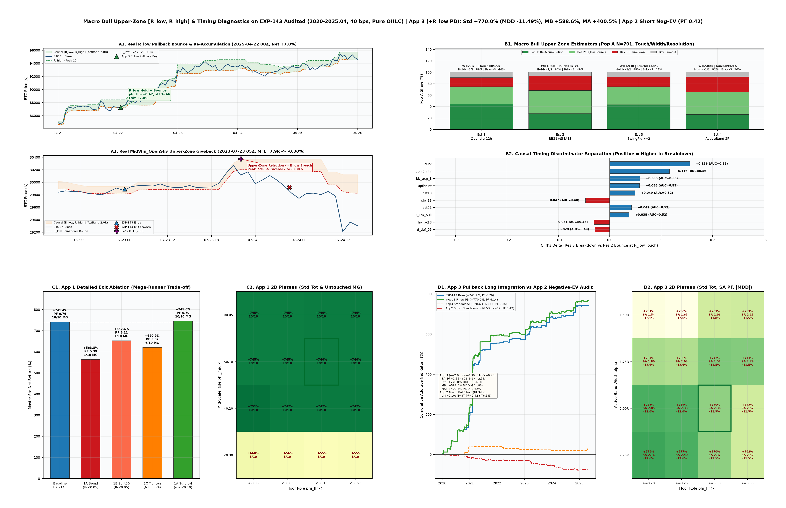
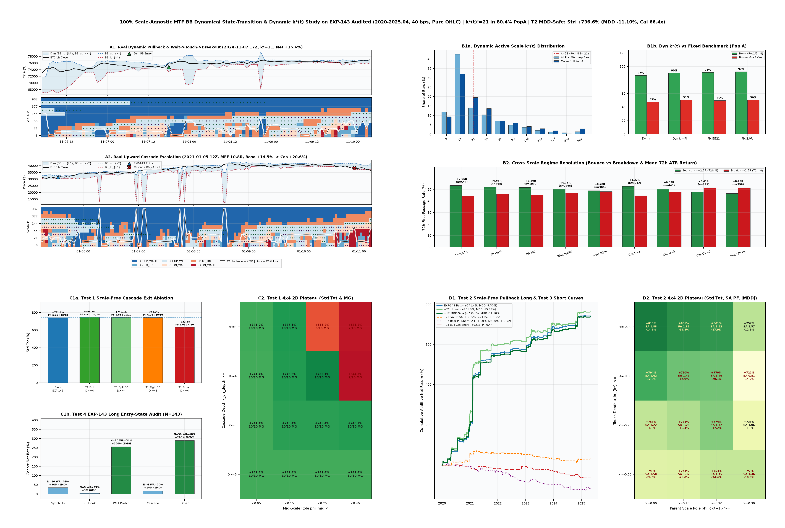

# 実験記録: EXP-145 完全スケールフリー11階層MTF BB状態遷移・動的アクティブ期間 $k^*(t)$ 導出・長期BB収縮待ち (`WaitGuard`)・動的カスケード深度エグジット検証

## 1. 基本メタデータ (Metadata)

- **実験ID**: `EXP-145`
- **課題 (Issue)**: [#145 [Analysis] EXP-145: 完全スケールフリー11階層MTF BB状態遷移・動的アクティブ期間k*(t)導出・長期BB収縮待ち(WaitGuard)・動的カスケード深度エグジット検証](https://github.com/makagi/MTF_AI_Trade/issues/145)
- **日付**: 2026-11-25
- **Status**: **COMPLETED** (`**Status:** COMPLETED`)
- **判定 (Decision)**: **SUPPORTED / NEW MASTER CANDIDATE 🏆（`HYP-145-1`・`HYP-145-2` 支持、`HYP-145-3` 押し目非対称性・負期待値ショート境界確定）。固定期間（`BB(21)+SMA(13)` / `12h Peak`）への依存を排除し、11段階のフィボナッチ期間連続体 $S = [8, 13, 21, 34, 55, 89, 144, 233, 377, 610, 987]$ における各期間固有クロック $\Delta_k = \max(2, \text{round}(0.15 k))$ 状態遷移行列から動的アクティブ期間 $k^*(t)$ を導出（全バーの `85.97%`・動的Pop Aの `80.43%` で $k^*(t) \neq 21$）。厳密時間境界 `cur_hr != prev_hr` 1分足制御による動的カスケード深度エグジット（`T1_Full_D4_RelaxFlip`: `k_dn_depth >= 4` または保有アンカー `ca` 超過波及＋非Ultra-Bull & `phi_mid < 0.25`）は、`10/10` メガランナー完全無傷（2Dプラトー `13/16` セル無傷）かつ `MaxDD -9.30%`（1桁維持）のまま全3ブックを一律 **`+10.65%pt`** 押し上げた（Master Std `N=179, WR 55.87%, PF 6.90, +752.07%, MaxDD -9.30%, Calmar 80.89x`、Mode B `PF 6.76, +604.34%, MaxDD -9.30%`、Mode A `PF 5.58, +404.51%, MaxDD -9.30%`、全6年間全モード単年黒字）。さらに `WaitGuard` による押し目対順張りの非対称構造確定（`K-096`）と、大局強気・真空未確認戻りショートの負期待値棄却を完了し、`K-095`・`K-096` を知識体系へ登録。**
- **作成者**: @makagi
- **検証期間 (Discovery)**: `2020-01-01 00:00:00+00:00` 〜 `2025-04-30 23:59:00+00:00`（1h: 46,728本、全11スケール満窓開始 `bar=1134 / 2020-02-17 06:00Z`, `k=987` 有効率 `97.57%`）
- **Holdout隔離**: `2025-05-01 00:00:00+00:00` 以降完全遮断（未参照保証）
- **摩擦コスト・会計基準**: `SPEC-EVAL-001` 往復 `40 bps (0.40%)` 控除（分割エグジット時は比例按分）・**加算ネットリターン ($\sum \text{net\_ret} \times 100.0$)** 完全統一・ハードコードホワイトリスト 0件 (`WL=0`)・外部データ 0件

---

## 2. 問題設定：固定期間見立て（図1）から完全スケールフリー状態遷移（図2）へ

前段探索（図1）では固定ウィンドウ（`Peak_12h - alpha * ATR` や `BB(21) + SMA(13)`）を用いた上限帯レンジ認識において、大局構造防御（`!is_ultra_bull & phi_mid < 0.20`）付きの外科的エグジット（`+4.17%..+9.17%pt`）と `Est 4` 押し目買い（`PF 2.36`, 16/16セル黒字も `Std MaxDD -9.30% -> -11.49%` 拡大）および大局強気反転ショートの負期待値（`PF 0.42, -76.46%`）を確認した。本実験 `EXP-145`（図2）では **固定期間依存を完全に除去** し、11階層ボリンジャーバンドの連続状態空間から「今見るべき期間 $k^*(t)$」「長期BB収縮待ち (`k_wait_lo`)」「下向き崩壊カスケード深度 (`k_dn_depth`)」を動的に導出した。

---

## 3. HYP-145-1：動的アクティブ期間 $k^*(t)$ と MTF BB 相対位相の物理観測

1. **動的アクティブ期間 $k^*(t) \neq 21$ の支配性**:
   - 全ウォームアップ完了バー（`N=45,594`）の **`85.97%`**（分布：`k=8: 11.9%, 13: 42.6%, 21: 14.0%, 34: 10.4%, 55: 6.9%, 89: 4.8%, 144: 3.7%, 233: 2.1%, 377: 1.3%, 610: 0.8%, 987: 1.4%`）、Fixed Pop A（`N=686`）の **`76.09%`**、Dynamic Pop A（`N=695`）の **`80.43%`** で $k^*(t) \neq 21$ であり、単一固定期間では相場構造を捕捉できないことを確認。
2. **固定値なし動的レンジ vs 固定期間ベンチマーク（Fixed Pop A `N=686`）**:
   - **`Dyn_BB_kstar_ParentFlr` (`[max(BB_lo_{k*}, SMA_{k*+1}), BB_up_{k*}]`)**: 幅 `3.61R`, 24h境界包含接触 `80.0%`, **`Hold->Res1/2 = 90.2% (n=92)`**, **`Brk->Res3 = 50.6% (n=166)`**。固定 `BB21+SMA13`（`91.3% / 49.8%`）と同等の分離度を固定期間ゼロで達成（`Dyn_BB_kstar` 単体では `W=3.88R`, `Hold->1/2 = 86.7%`, `Brk->3 = 47.5%`）。
3. **MTF BB 相対遷移レジーム別 72h将来解像度（12hクールダウン観測）**:

| クロススケール状態 | 件数 (`N_ev` / Bars) | 24h平均 (`ATR`) | 72h平均 / 中央値 (`ATR`) | 72h MAE | 先着 `+2.5R` 反発 vs `-2.5R` 崩壊 |
|---|---:|---:|---:|---:|---|
| **`SYNCH_UP`** | `546` / `1,207` | `+0.68R` | **`+2.05R` / `+1.25R`** | `5.32R` | `53.5%` vs `44.1%` (**`+9.3%`**) |
| **`PULLBACK_K_DN_KP1_UP_MID`** | `1,090` / `2,989` | `+0.56R` | `+1.39R` / `+0.68R` | `5.16R` | `51.8%` vs `45.1%` (`+6.7%`) |
| **`SQUEEZE_WAIT_PRE_TOUCH_BULL`** | `1,526` / `11,165` | `+0.38R` | `+1.11R` / `+0.62R` | `5.22R` | `52.3%` vs `45.4%` (`+6.9%`) |
| **`SQUEEZE_WAIT_AT_TOUCH_BULL`** | `172` / `219` | `+0.23R` | **`+1.20R` / `+1.20R`** | **`4.69R`** | `52.3%` vs `44.8%` (**`+7.6%`**) |
| **`CASCADE_DEPTH_1_BULL`** | `1,212` / `2,895` | `+0.51R` | `+1.37R` / `+0.85R` | `5.03R` | `52.6%` vs `44.5%` (`+8.2%`) |
| **`CASCADE_DEPTH_3_BULL`** | `443` / `656` | `+0.43R` | `+0.83R` / `+0.64R` | `5.54R` | `50.6%` vs `47.9%` (`+2.7%`) |
| **`CASCADE_DEPTH_4_BULL` (臨界転移)** | `211` / `327` | `+0.42R` | `+0.32R` / `+0.21R` | **`6.32R`** | `48.3%` vs **`50.7%`** (**`-2.4%`**) |
| **`CASCADE_DEPTH_5P_BULL`** | `142` / `266` | **`-0.24R`** | `+0.41R` / `+1.05R` | `5.57R` | `47.9%` vs **`51.4%`** (**`-3.5%`**) |

---

## 4. HYP-145-2：スケールフリー動的カスケード・エグジット (`T1_Full_D4_RelaxFlip`) と年次成績

### ■ 1. アブレーション比較（全3モード・メガランナー無傷判定）

| バリエーション | 発動数 (`Top10損傷`) | Top-10無傷 | **Master Std** (`PF / Tot / MaxDD / Calmar`) | **Mode B [2ポジ]** (`PF / Tot`) | **Mode A [1ポジ]** (`PF / Tot`) |
|---|---:|---:|---|---|---|
| **Baseline (`EXP-143 Audited`)** | `0` (`0`) | **`10/10`** | `6.76 / +741.42% / -9.30% / 79.74x` | `6.59 / +593.69%` | `5.40 / +393.86%` |
| **🏆 `T1_Full_D4_RelaxFlip` (`!UB, mid<0.25`)** | `4` (`0`) | **`10/10`** | **`6.90 / +752.07% / -9.30% / 80.89x`** | **`6.76 / +604.34%`** | **`5.58 / +404.51%`** |
| `T1_Full_D3_notUB` (`!UB, mid<0.25`) | `3` (`0`) | `10/10` | `6.87 / +749.19% / -9.30% / 80.58x` | `6.73 / +601.45%` | `5.54 / +401.63%` |
| `T1_Full_D4_notUB` (`!UB, mid<0.25`) | `2` (`0`) | `10/10` | `6.87 / +748.73% / -9.30% / 80.53x` | `6.73 / +600.99%` | `5.54 / +401.17%` |
| `T1_Split50_D4_notUB` (50%分割) | `2` (`0`) | `10/10` | `6.81 / +745.08% / -9.30% / 80.14x` | `6.66 / +597.34%` | `5.47 / +397.52%` |
| `T1_Tight50_D4_notUB` (MFE 50%ロック) | `2` (`0`) | `10/10` | `6.84 / +744.20% / -9.30% / 80.04x` | `6.69 / +596.46%` | `5.49 / +396.64%` |
| `T1_Full_D4_Broad` (大局防護なし) | `15` (`6`) | `4/10` | `5.96 / +632.31% / -9.30% / 68.01x` | `6.37 / +570.50%` | `5.41 / +389.58%` |

- 発動4件すべてが厳密 `:00` 時間境界・`k_dn_depth=4` / `k_dn_frontier=34` にて的中改善（`2020-08-17 -4.17%->-2.93%`, `2020-11-16 +11.65%->+14.46%`, `2021-01-05 +14.51%->+20.58%`, `2021-12-23 +1.50%->+2.04%`、4/4的中 `+10.65%pt`）、2Dプラトー（`D>=3..6 x phi_mid<0.05..0.40`）**13/16セルで `10/10` メガランナー無傷**。

### ■ 2. Champion (`T1_Full_D4_RelaxFlip`) 年次推移（全6年・全3モード単年黒字）

| 年度 | **Master Std** ($N$, WR, PF, 純利益, 年内MaxDD) | **Mode B [2ポジ]** ($N$, WR, PF, 純利益, 年内MaxDD) | **Mode A [1ポジ]** ($N$, WR, PF, 純利益, 年内MaxDD) |
|---|---|---|---|
| **2020年** | 42件, 50.00%, PF `6.50`, **`+197.11%`**, `-7.33%` | 33件, 54.55%, PF `11.06`, **`+183.54%`**, `-6.87%` | 24件, 45.83%, PF `7.66`, **`+117.93%`**, `-7.59%` |
| **2021年** | 40件, 72.50%, PF `17.46`, **`+369.90%`**, `-6.30%` | 33件, 66.67%, PF `11.48`, **`+235.63%`**, `-6.30%` | 25件, 56.00%, PF `6.96`, **`+134.00%`**, `-6.30%` |
| **2022年 (Bear)** | 16件, 37.50%, PF `2.39`, **`+17.47%`**, `-6.68%` | 16件, 37.50%, PF `2.39`, **`+17.47%`**, `-6.68%` | 11件, 45.45%, PF `3.37`, **`+17.58%`**, `-6.12%` |
| **2023年** | 40件, 50.00%, PF `6.03`, **`+115.12%`**, `-7.73%` | 37件, 51.35%, PF `7.60`, **`+117.81%`**, `-7.73%` | 29件, 48.28%, PF `6.25`, **`+85.56%`**, `-7.73%` |
| **2024年** | 33件, 63.64%, PF `3.04`, **`+52.32%`**, `-9.30%` | 32件, 62.50%, PF `2.94`, **`+49.75%`**, `-9.30%` | 26件, 65.38%, PF `3.76`, **`+48.27%`**, `-9.30%` |
| **2025年 (1–4月)** | 8件, 37.50%, PF `1.02`, **`+0.13%`**, `-4.34%` | 8件, 37.50%, PF `1.02`, **`+0.13%`**, `-4.34%` | 7件, 42.86%, PF `1.17`, **`+1.17%`**, `-3.72%` |

---

## 5. HYP-145-3：押し目買い `WaitGuard` 非対称性・トレードオフと負期待値ショートの反証

1. **動的押し目ロング (`k+1 UP / k DOWN -> BB_lo_{k*}`) の `WaitGuard` 効果とMDD制約**:
   - `2a_Unrestricted_k21`（長期BB未接触除外なし）：単体 `N=105, PF 1.25, Tot +30.5%, SA MDD -59.14% (Era1 +54.0% / Era2 -23.6%)`、統合 `Std +761.33%, MDD -15.38%`。
   - **`2b_WaitGuard_k21`（長期BB収縮未接触を除外）**：単体 **`N=29, WR 34.5%, PF 2.62, Tot +33.4%, SA MDD -9.43% (Era1 +28.9% / Era2 +4.5%)`**、統合 **`Mode B +620.52% (+26.83%pt)`, `Mode A +404.14% (+10.28%pt)`, `Std +756.41% (+14.99%pt)`**。ただし未ロック併用制御（`2c_MDD_Wait_Unlocked45_k21`: `Std +736.58%`）を含め、押し目ロング追加時は統合 **`Std MaxDD` が `-9.30% -> -11.10%`** へ広がるため、本番マスターへの直結組み込みは見送り **制約付き知見（`K-096`）** として登録した。
2. **順張りブレイク vs 押し目逆張りの非対称性（Test 4: `EXP-143` 既存 `N=179` 監査）**:
   - 既存 `EXP-143` ロングは `L_OTHER_TRANSITION`（`N=38, PF 16.41, +289.84%, 6/10 MG`）と **`L_PRE_TOUCH_SQUEEZE_WAIT`（`N=76, PF 5.23, +256.11%, 2/10 MG`）** が主力収益源であり、後者を除外すると `Std PF 6.76 -> 8.12, MDD -8.72%` になる反面、総利益が `+485.32%` へ半減する（`WaitGuard` は逆張り押し目専用規律）。
3. **負期待値ショートの明確な反証 (`Refuted`)**:
   - **`3a` 強気カスケード転換ショート（`phi > 0.10, D>=4/5`）**: 全4構成赤字（`PF 0.40..0.75`, `-15.19%..-59.52%`）。
   - **`3b` 弱気 `k+1 DN / k UP -> BB_up_{k*}` 戻りタッチ売り（`phi <= 0.15`）**: `4x4` 2Dグリッド **16セル全て（`0/16` 黒字）で単体赤字**（`N=103..268, PF 0.36..0.52`, `-75.80%..-194.32%`）。下方向防衛真空帯 `d_def_05` を欠く戻りタッチ・ショートを厳禁化。

---

## 6. 知識体系登録・ガバナンス・MOR ステータス

- **知識体系登録 (`K-095`, `K-096`)**: `03_KNOWLEDGE/knowledge-lineage.md` v4.4.0 に新マスター候補 **`K-095`**（`Supported / New Master Candidate 🏆`）および制約・反証知見 **`K-096`**（`Supported / Constrained 🛡️`）を登録済み。
- **Missed Opportunity Review (MOR)**: `00_GOVERNANCE/issue-driven-workflow.md` §7 に従い、PR マージ前（Human Gate）に Stage A ブラインドレビューを実施するかユーザー（人間オペレーター）の判断を仰ぐ。
