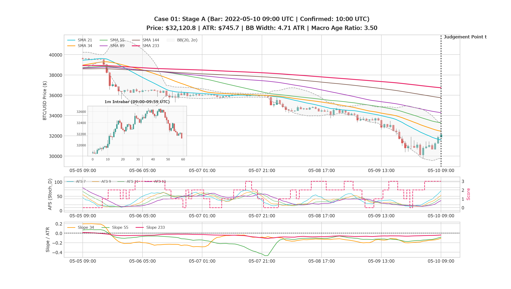
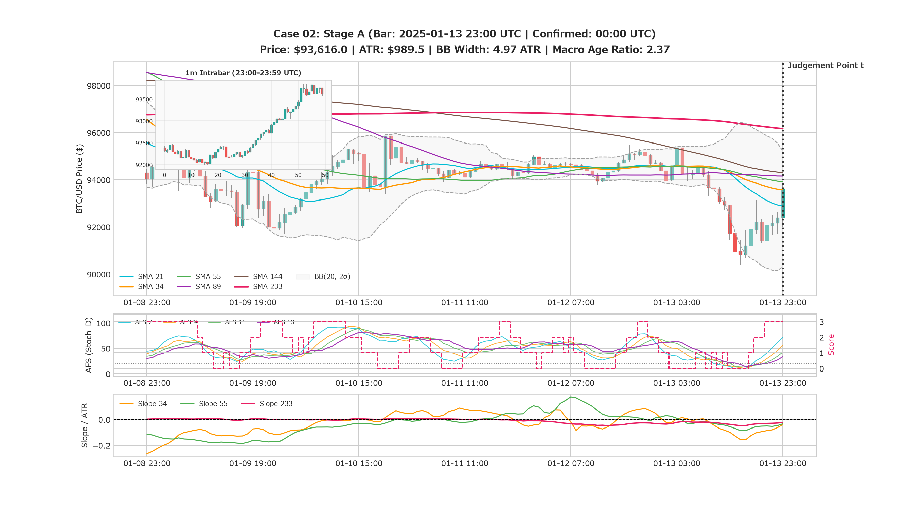
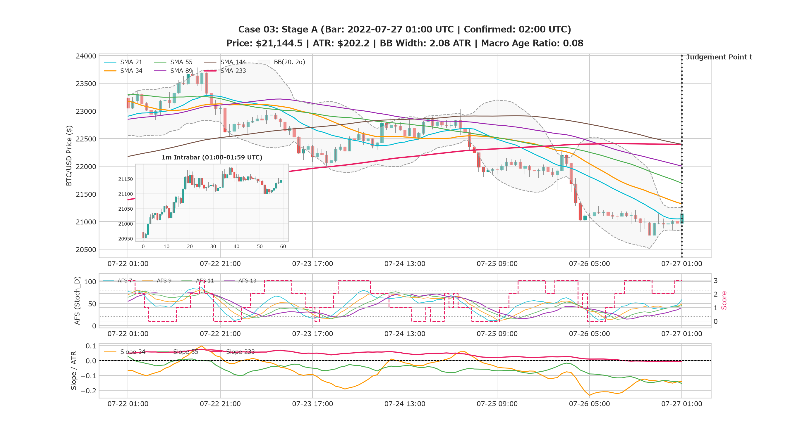
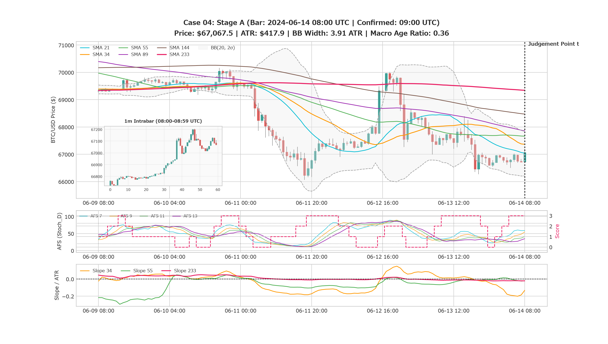
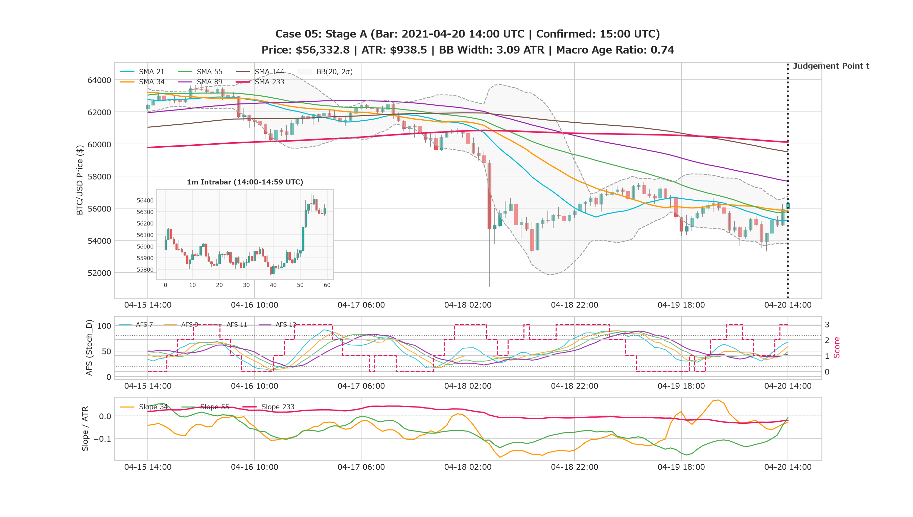
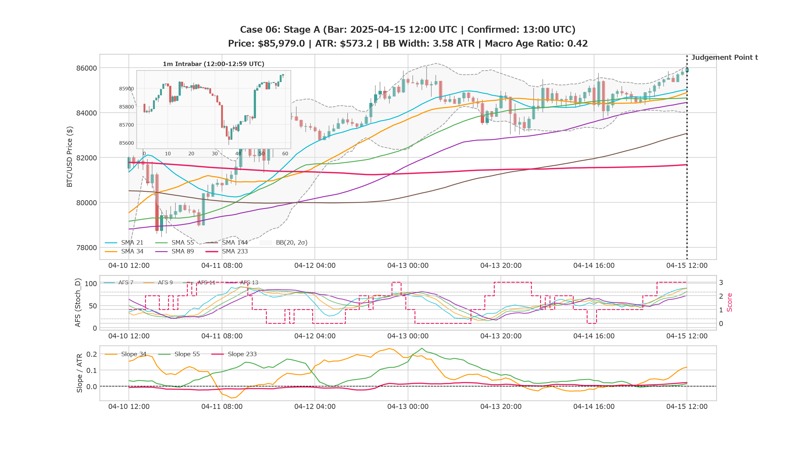
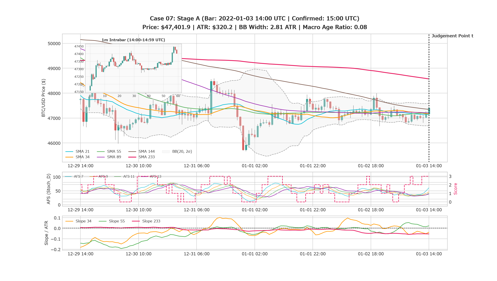
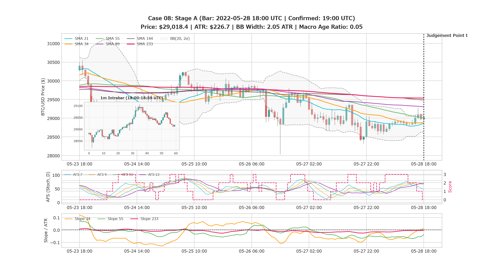
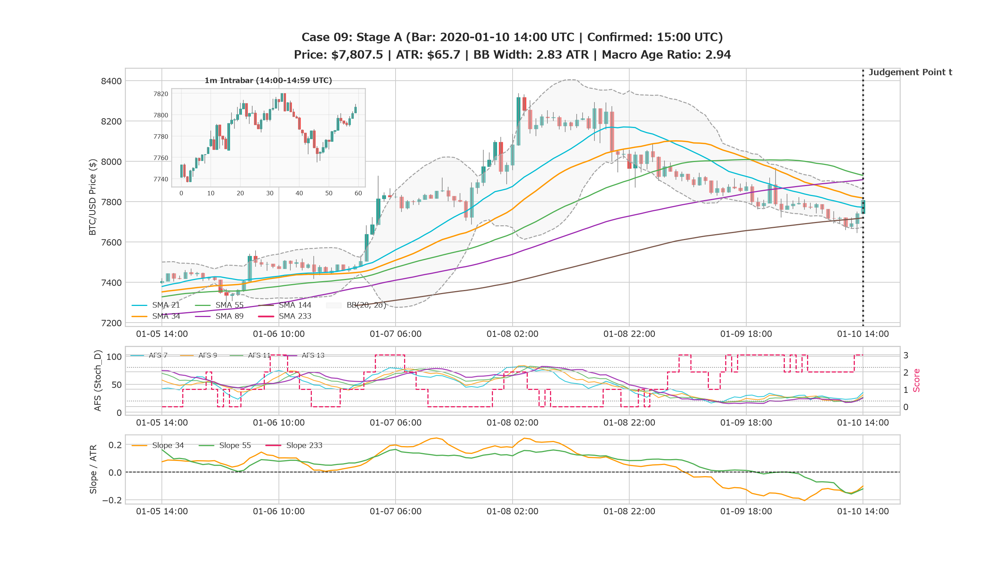
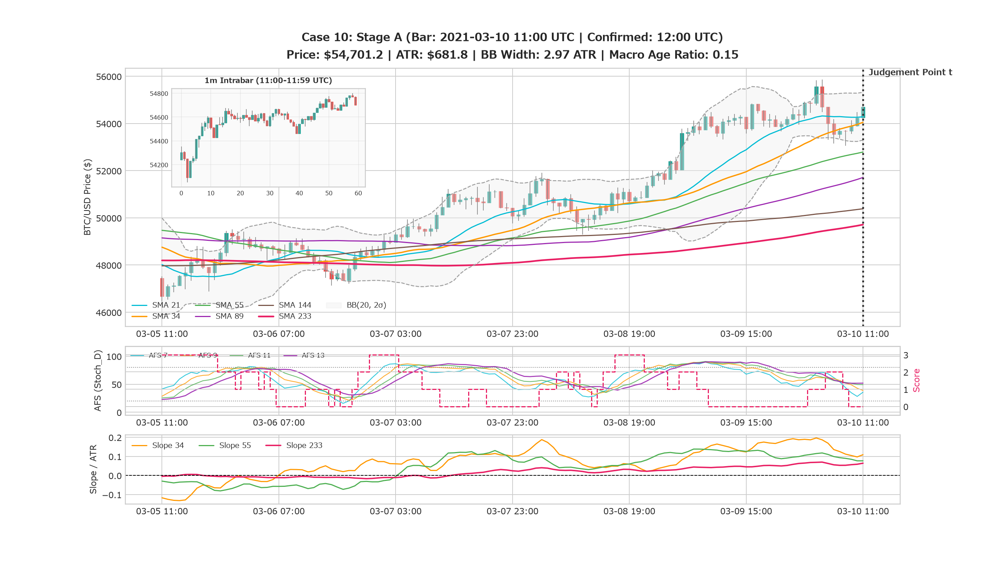

# Missed Opportunity Review: Stage A (判断質問票 - EXP-145)

**Review ID:** `MOR-145-01`  
**Experiment:** EXP-145 (K-043 Selective (K-038 MVC + K-043 Pullback))  
**実施日:** 2026-10-30  
**レビュアー:** @makagi  

---

## 1. 概要と回答手順 (Instructions)

本レビューは、定量的バックテストでは拾いきれなかった「急騰の取りこぼし（見逃し）」と「対照群（伸びなかった場面・負けトレード）」をブラインドで混在させ、人間の視点を仮説生成のインプットとして取り込む工程（Human-in-the-Loop Review）です。

### 回答ルール
1. 各ケースの **Stage A チャート（判断時点 $t$ までの過去 120時間ローソク足および指標）** を観察してください（未来の情報は一切含まれていません）。
2. **個別回答（1件ずつ）に対応**: 全10件を一度に回答する必要はありません。多角的に分析するため外部ツール等を参照しながら、1ケースずつ判断を進めることができます。
3. あなた自身がこの瞬間にチャートの前に立っていたとして、以下の3択から直感・判断を選択してください：
   - **`long`**: 買いでエントリーしたい（上値余地があり、勢い・構造が良好）
   - **`skip`**: 見送り・見送るべき（頭上抵抗がある、ダマシっぽい、勢いが鈍い）
   - **`unsure`**: 迷う・どちらとも言えない
4. **判断の根拠（何を見てそう感じたか）** を簡潔に記入してください（例：「SMA 34 の下値支持が強固」「頭上 SMA 89 に抑え込まれそう」「直前で急伸しすぎていて過熱感」など）。
5. 回答完了後、エージェントが Stage B（72時間の結末チャートと正解ラベル）を開示します（ケースごとの即時開示も可能です）。

---

## 2. ケース別 Stage A チャートと質問票

### Case 01

- **日時**: 始値 `2022-05-10 09:00 UTC` → 確定 `2022-05-10 10:00 UTC` (`2022-05-10 19:00 JST` BTC/USDT 1h足確定)
- **価格・OHLCV**: Open: `$31,858.8` | High: `$32,658.4` | Low: `$31,843.8` | Close: `$32,120.8` | Volume: `0.0`
- **価格レンジ**: 過去24h: `$29,726.0` 〜 `$33,799.7` | 過去120h: `$29,726.0` 〜 `$39,725.1`
- **テクニカル指標**: ATR(24): `$745.7` | BB 幅: `4.71 ATR` | Macro Age Ratio: `3.50` | AFS (7/9/11/13): `69.0/52.5/42.6/34.5` (Score: `3`)
- **主要 SMA**: SMA 21: `$31,588.2` | SMA 34: `$32,447.1` | SMA 55: `$33,263.0` | SMA 89: `$34,279.2` | SMA 144: `$35,746.7` | SMA 233: `$36,733.3`

#### 【あなたの判断】
- [ ] **`long`**（エントリー推奨）
- [ ] **`skip`**（見送り推奨）
- [ ] **`unsure`**（判断保留）
- **判断理由・着目したポイント**:
  > （ここに理由を記入）

---

### Case 02

- **日時**: 始値 `2025-01-13 23:00 UTC` → 確定 `2025-01-14 00:00 UTC` (`2025-01-14 09:00 JST` BTC/USDT 1h足確定)
- **価格・OHLCV**: Open: `$92,389.0` | High: `$93,833.6` | Low: `$91,984.2` | Close: `$93,616.0` | Volume: `0.0`
- **価格レンジ**: 過去24h: `$89,529.4` 〜 `$95,958.2` | 過去120h: `$89,529.4` 〜 `$95,958.2`
- **テクニカル指標**: ATR(24): `$989.5` | BB 幅: `4.97 ATR` | Macro Age Ratio: `2.37` | AFS (7/9/11/13): `71.3/55.5/42.0/33.2` (Score: `3`)
- **主要 SMA**: SMA 21: `$92,888.1` | SMA 34: `$93,579.1` | SMA 55: `$93,924.9` | SMA 89: `$94,156.3` | SMA 144: `$94,302.9` | SMA 233: `$96,163.7`

#### 【あなたの判断】
- [ ] **`long`**（エントリー推奨）
- [ ] **`skip`**（見送り推奨）
- [ ] **`unsure`**（判断保留）
- **判断理由・着目したポイント**:
  > （ここに理由を記入）

---

### Case 03

- **日時**: 始値 `2022-07-27 01:00 UTC` → 確定 `2022-07-27 02:00 UTC` (`2022-07-27 11:00 JST` BTC/USDT 1h足確定)
- **価格・OHLCV**: Open: `$20,970.6` | High: `$21,187.8` | Low: `$20,951.9` | Close: `$21,144.5` | Volume: `0.0`
- **価格レンジ**: 過去24h: `$20,747.5` 〜 `$21,782.3` | 過去120h: `$20,747.5` 〜 `$23,787.0`
- **テクニカル指標**: ATR(24): `$202.2` | BB 幅: `2.08 ATR` | Macro Age Ratio: `0.08` | AFS (7/9/11/13): `58.5/48.4/45.2/40.5` (Score: `3`)
- **主要 SMA**: SMA 21: `$21,049.4` | SMA 34: `$21,319.9` | SMA 55: `$21,694.8` | SMA 89: `$22,003.3` | SMA 144: `$22,397.0` | SMA 233: `$22,393.0`

#### 【あなたの判断】
- [ ] **`long`**（エントリー推奨）
- [ ] **`skip`**（見送り推奨）
- [ ] **`unsure`**（判断保留）
- **判断理由・着目したポイント**:
  > （ここに理由を記入）

---

### Case 04

- **日時**: 始値 `2024-06-14 08:00 UTC` → 確定 `2024-06-14 09:00 UTC` (`2024-06-14 18:00 JST` BTC/USDT 1h足確定)
- **価格・OHLCV**: Open: `$66,719.9` | High: `$67,203.2` | Low: `$66,719.9` | Close: `$67,067.5` | Volume: `0.0`
- **価格レンジ**: 過去24h: `$66,267.2` 〜 `$68,397.1` | 過去120h: `$66,065.6` 〜 `$70,167.6`
- **テクニカル指標**: ATR(24): `$417.9` | BB 幅: `3.91 ATR` | Macro Age Ratio: `0.36` | AFS (7/9/11/13): `58.7/54.7/41.3/34.8` (Score: `3`)
- **主要 SMA**: SMA 21: `$67,041.5` | SMA 34: `$67,366.0` | SMA 55: `$67,663.6` | SMA 89: `$67,857.4` | SMA 144: `$68,471.9` | SMA 233: `$69,343.1`

#### 【あなたの判断】
- [ ] **`long`**（エントリー推奨）
- [ ] **`skip`**（見送り推奨）
- [ ] **`unsure`**（判断保留）
- **判断理由・着目したポイント**:
  > （ここに理由を記入）

---

### Case 05

- **日時**: 始値 `2021-04-20 14:00 UTC` → 確定 `2021-04-20 15:00 UTC` (`2021-04-21 00:00 JST` BTC/USDT 1h足確定)
- **価格・OHLCV**: Open: `$55,970.5` | High: `$56,456.5` | Low: `$55,748.9` | Close: `$56,332.8` | Volume: `0.0`
- **価格レンジ**: 過去24h: `$53,321.1` 〜 `$57,252.8` | 過去120h: `$51,079.0` 〜 `$63,842.3`
- **テクニカル指標**: ATR(24): `$938.5` | BB 幅: `3.09 ATR` | Macro Age Ratio: `0.74` | AFS (7/9/11/13): `67.4/58.6/48.4/43.9` (Score: `3`)
- **主要 SMA**: SMA 21: `$55,255.6` | SMA 34: `$55,862.9` | SMA 55: `$55,781.1` | SMA 89: `$57,682.8` | SMA 144: `$59,511.5` | SMA 233: `$60,123.5`

#### 【あなたの判断】
- [ ] **`long`**（エントリー推奨）
- [ ] **`skip`**（見送り推奨）
- [ ] **`unsure`**（判断保留）
- **判断理由・着目したポイント**:
  > （ここに理由を記入）

---

### Case 06

- **日時**: 始値 `2025-04-15 12:00 UTC` → 確定 `2025-04-15 13:00 UTC` (`2025-04-15 22:00 JST` BTC/USDT 1h足確定)
- **価格・OHLCV**: Open: `$85,814.0` | High: `$85,979.0` | Low: `$85,587.1` | Close: `$85,979.0` | Volume: `0.0`
- **価格レンジ**: 過去24h: `$83,701.1` 〜 `$85,979.0` | 過去120h: `$78,456.4` 〜 `$86,062.3`
- **テクニカル指標**: ATR(24): `$573.2` | BB 幅: `3.58 ATR` | Macro Age Ratio: `0.42` | AFS (7/9/11/13): `89.1/88.6/81.4/72.7` (Score: `3`)
- **主要 SMA**: SMA 21: `$85,033.2` | SMA 34: `$84,889.5` | SMA 55: `$84,654.6` | SMA 89: `$84,453.2` | SMA 144: `$83,074.2` | SMA 233: `$81,677.9`

#### 【あなたの判断】
- [ ] **`long`**（エントリー推奨）
- [ ] **`skip`**（見送り推奨）
- [ ] **`unsure`**（判断保留）
- **判断理由・着目したポイント**:
  > （ここに理由を記入）

---

### Case 07

- **日時**: 始値 `2022-01-03 14:00 UTC` → 確定 `2022-01-03 15:00 UTC` (`2022-01-04 00:00 JST` BTC/USDT 1h足確定)
- **価格・OHLCV**: Open: `$47,158.7` | High: `$47,449.5` | Low: `$47,157.2` | Close: `$47,401.9` | Volume: `0.0`
- **価格レンジ**: 過去24h: `$46,676.9` 〜 `$47,990.8` | 過去120h: `$45,665.5` 〜 `$48,587.3`
- **テクニカル指標**: ATR(24): `$320.2` | BB 幅: `2.81 ATR` | Macro Age Ratio: `0.08` | AFS (7/9/11/13): `60.7/45.5/40.9/38.3` (Score: `3`)
- **主要 SMA**: SMA 21: `$47,148.0` | SMA 34: `$47,172.5` | SMA 55: `$47,211.3` | SMA 89: `$47,205.3` | SMA 144: `$47,347.5` | SMA 233: `$48,569.8`

#### 【あなたの判断】
- [ ] **`long`**（エントリー推奨）
- [ ] **`skip`**（見送り推奨）
- [ ] **`unsure`**（判断保留）
- **判断理由・着目したポイント**:
  > （ここに理由を記入）

---

### Case 08

- **日時**: 始値 `2022-05-28 18:00 UTC` → 確定 `2022-05-28 19:00 UTC` (`2022-05-29 04:00 JST` BTC/USDT 1h足確定)
- **価格・OHLCV**: Open: `$28,978.9` | High: `$29,106.7` | Low: `$28,919.7` | Close: `$29,018.4` | Volume: `0.0`
- **価格レンジ**: 過去24h: `$28,316.6` 〜 `$29,274.6` | 過去120h: `$28,027.6` 〜 `$30,551.2`
- **テクニカル指標**: ATR(24): `$226.7` | BB 幅: `2.05 ATR` | Macro Age Ratio: `0.05` | AFS (7/9/11/13): `48.5/63.4/67.9/70.1` (Score: `0`)
- **主要 SMA**: SMA 21: `$28,860.4` | SMA 34: `$28,880.3` | SMA 55: `$29,019.0` | SMA 89: `$29,303.6` | SMA 144: `$29,483.4` | SMA 233: `$29,536.7`

#### 【あなたの判断】
- [ ] **`long`**（エントリー推奨）
- [ ] **`skip`**（見送り推奨）
- [ ] **`unsure`**（判断保留）
- **判断理由・着目したポイント**:
  > （ここに理由を記入）

---

### Case 09

- **日時**: 始値 `2020-01-10 14:00 UTC` → 確定 `2020-01-10 15:00 UTC` (`2020-01-11 00:00 JST` BTC/USDT 1h足確定)
- **価格・OHLCV**: Open: `$7,741.4` | High: `$7,820.3` | Low: `$7,736.6` | Close: `$7,807.5` | Volume: `0.0`
- **価格レンジ**: 過去24h: `$7,644.5` 〜 `$7,966.1` | 過去120h: `$7,303.4` 〜 `$8,336.2`
- **テクニカル指標**: ATR(24): `$65.7` | BB 幅: `2.83 ATR` | Macro Age Ratio: `2.94` | AFS (7/9/11/13): `35.3/30.8/26.8/25.5` (Score: `3`)
- **主要 SMA**: SMA 21: `$7,771.8` | SMA 34: `$7,817.4` | SMA 55: `$7,929.5` | SMA 89: `$7,908.6` | SMA 144: `$7,719.0` | SMA 233: `$nan`

#### 【あなたの判断】
- [ ] **`long`**（エントリー推奨）
- [ ] **`skip`**（見送り推奨）
- [ ] **`unsure`**（判断保留）
- **判断理由・着目したポイント**:
  > （ここに理由を記入）

---

### Case 10

- **日時**: 始値 `2021-03-10 11:00 UTC` → 確定 `2021-03-10 12:00 UTC` (`2021-03-10 21:00 JST` BTC/USDT 1h足確定)
- **価格・OHLCV**: Open: `$54,239.8` | High: `$54,801.1` | Low: `$54,050.8` | Close: `$54,701.2` | Volume: `0.0`
- **価格レンジ**: 過去24h: `$53,051.6` 〜 `$55,856.9` | 過去120h: `$46,453.9` 〜 `$55,856.9`
- **テクニカル指標**: ATR(24): `$681.8` | BB 幅: `2.97 ATR` | Macro Age Ratio: `0.15` | AFS (7/9/11/13): `35.7/38.9/49.2/51.9` (Score: `0`)
- **主要 SMA**: SMA 21: `$54,283.2` | SMA 34: `$54,049.7` | SMA 55: `$52,790.1` | SMA 89: `$51,710.9` | SMA 144: `$50,384.9` | SMA 233: `$49,713.8`

#### 【あなたの判断】
- [ ] **`long`**（エントリー推奨）
- [ ] **`skip`**（見送り推奨）
- [ ] **`unsure`**（判断保留）
- **判断理由・着目したポイント**:
  > （ここに理由を記入）

---
