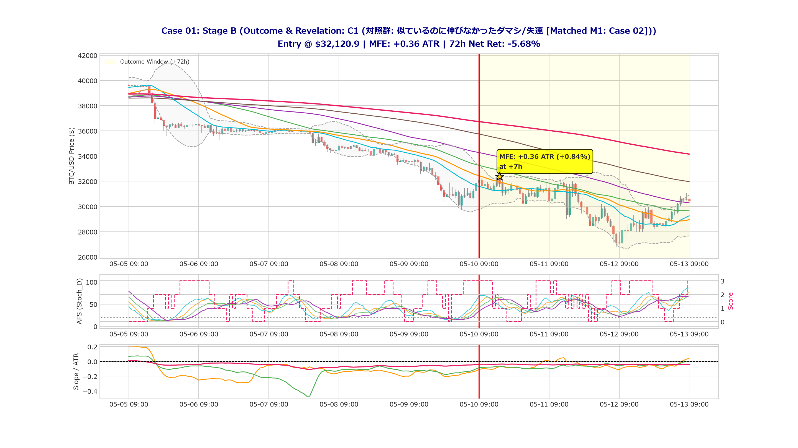
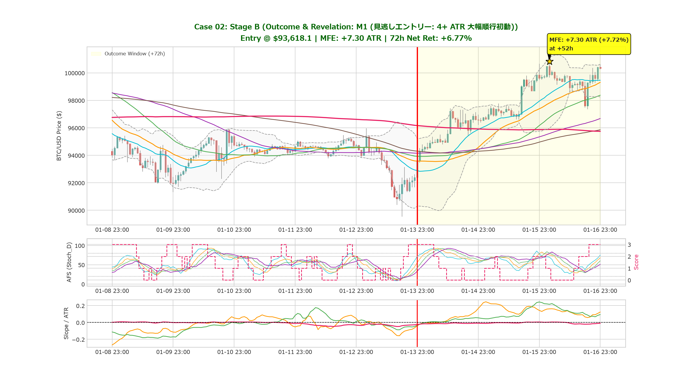
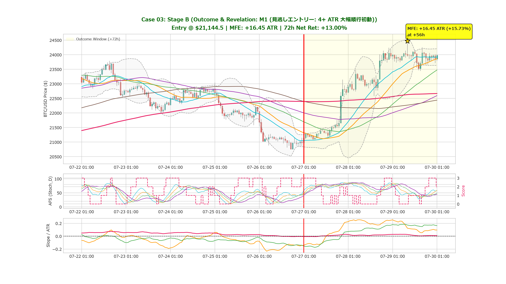
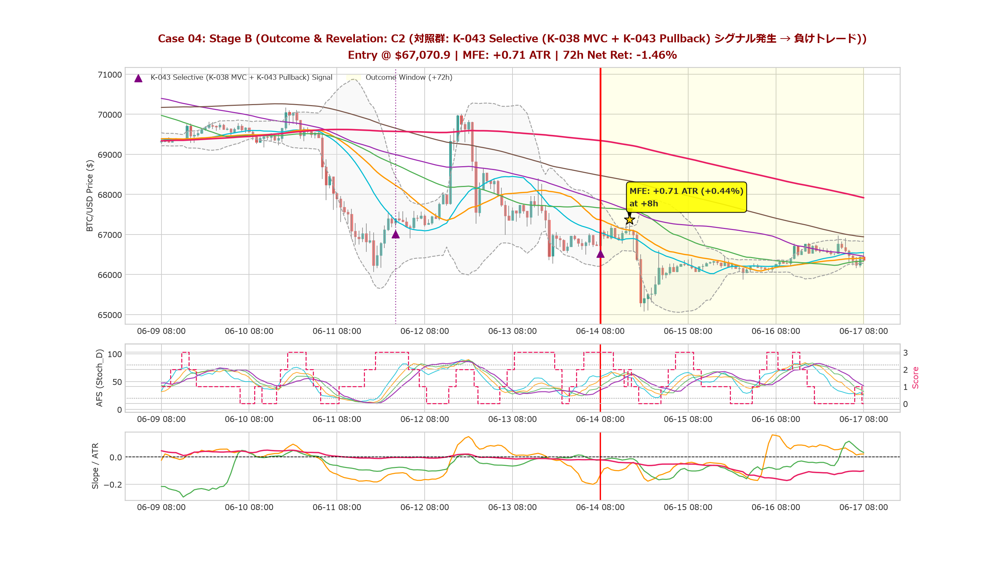
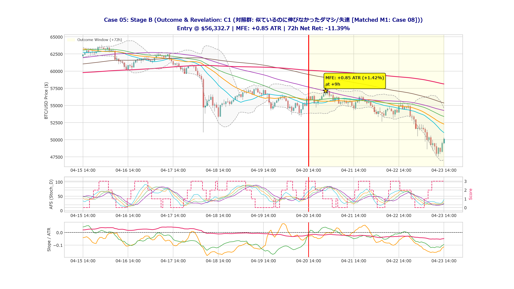
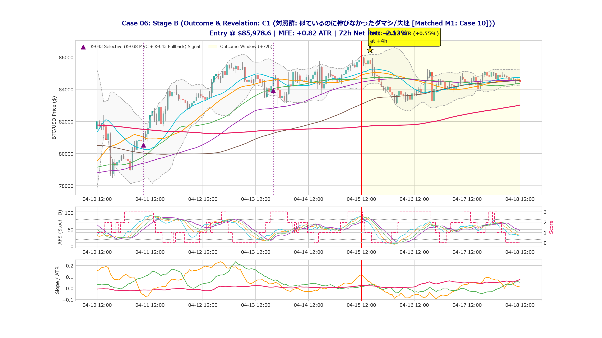
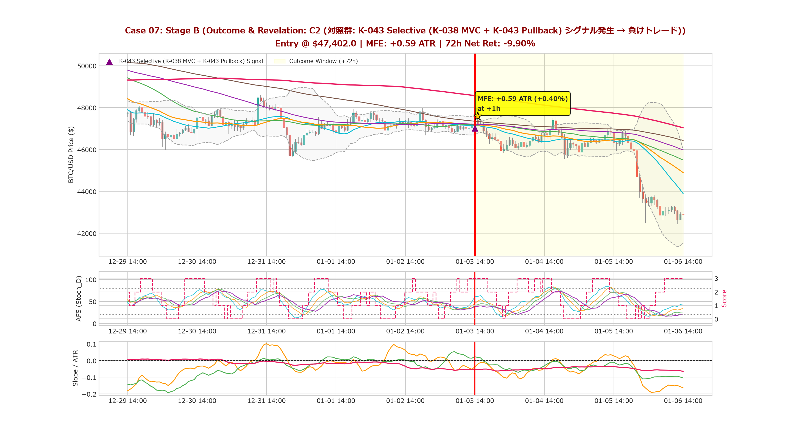
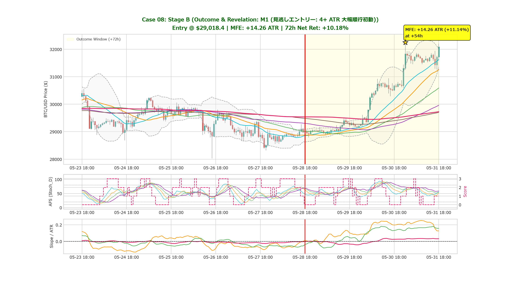
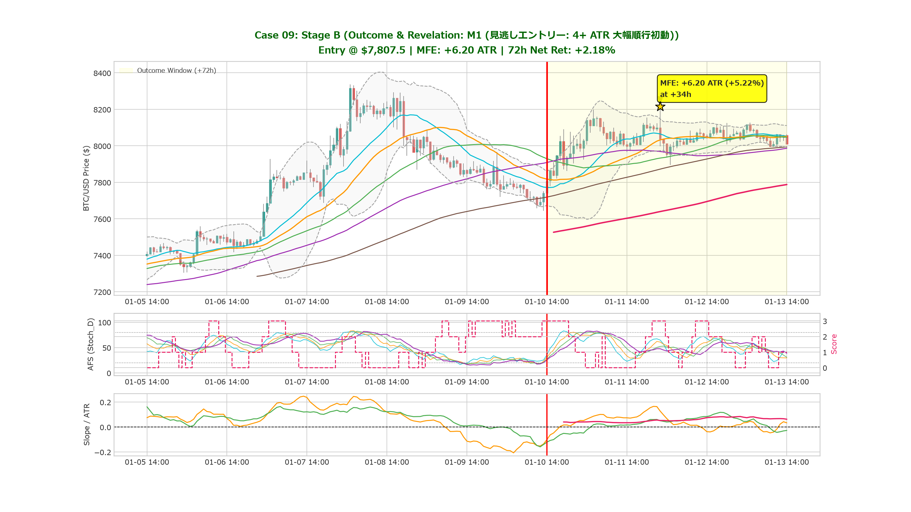
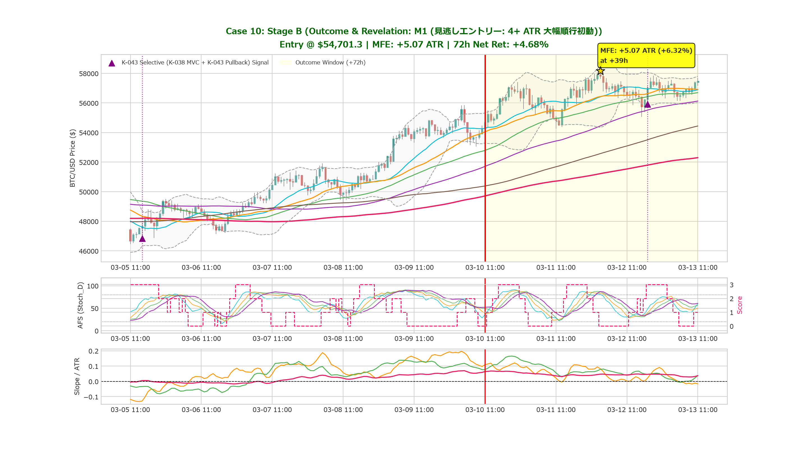

# Missed Opportunity Review: Stage B (結末開示ギャラリー - EXP-145)

**Review ID:** `MOR-145-01`  
**Experiment:** EXP-145 (K-043 Selective (K-038 MVC + K-043 Pullback))  
**開示日時:** 2026-10-30  

---

## 1. 結末開示とケース解剖 (Revealed Outcomes)

### Case 01: ✕ C1 (対照群: 似ているのに伸びなかった失速・ダマシ [Matched M1: Case 02])

- **真のラベル**: **`C1`**
- **対照マッチング元**: **Case 02 (M1)** と判断時点の指標群が最近傍
- **判定時点価格**: `$32,120.9`
- **72h 最大順行幅 (MFE)**: **`+0.36 ATR`** (`+0.84%`)
- **24h 順行幅 (MFE) / 逆行幅 (MAE)**: MFE `+0.36 ATR` / MAE `-2.63 ATR`
- **72h 最終 Net リターン**: **`-5.68%`**

#### 結末の解説・考察
> **失速・ダマシの実態**: 判断時点での指標の並びは M1 に酷似していましたが（Case 02 の M1 と類似した指標配置）、その後は伸び悩み、MFE はわずか `+0.36 ATR` に留まりました。M1 との間で何が決定的に異なっていたのか（上位足の環境、直前の戻り方、下位足プライスアクションなど）を比較観察してください。

---

### Case 02: ★ M1 (見逃しエントリー: 4+ ATR 大幅急伸初動)

- **真のラベル**: **`M1`**
- **判定時点価格**: `$93,618.1`
- **72h 最大順行幅 (MFE)**: **`+7.30 ATR`** (`+7.72%`)
- **24h 順行幅 (MFE) / 逆行幅 (MAE)**: MFE `+3.83 ATR` / MAE `-0.15 ATR`
- **72h 最終 Net リターン**: **`+6.77%`**

#### 結末の解説・考察
> **見逃しの実態**: 判断時点以降、短時間で初動が立ち上がり、72時間以内に最大 `+7.30 ATR`（`+7.72%`）に達しました。シグナル条件（AFS整流や傾き、ブレイクアウト定義）のどの要素がこの波を遮断してしまったのかを検証する重要な材料です。

---

### Case 03: ★ M1 (見逃しエントリー: 4+ ATR 大幅急伸初動)

- **真のラベル**: **`M1`**
- **判定時点価格**: `$21,144.5`
- **72h 最大順行幅 (MFE)**: **`+16.45 ATR`** (`+15.73%`)
- **24h 順行幅 (MFE) / 逆行幅 (MAE)**: MFE `+9.90 ATR` / MAE `-0.33 ATR`
- **72h 最終 Net リターン**: **`+13.00%`**

#### 結末の解説・考察
> **見逃しの実態**: 判断時点以降、短時間で初動が立ち上がり、72時間以内に最大 `+16.45 ATR`（`+15.73%`）に達しました。シグナル条件（AFS整流や傾き、ブレイクアウト定義）のどの要素がこの波を遮断してしまったのかを検証する重要な材料です。

---

### Case 04: ▲ C2 (対照群: K-043 Selective (K-038 MVC + K-043 Pullback) シグナル発生 → 負けトレード)

- **真のラベル**: **`C2`**
- **判定時点価格**: `$67,070.9`
- **72h 最大順行幅 (MFE)**: **`+0.71 ATR`** (`+0.44%`)
- **24h 順行幅 (MFE) / 逆行幅 (MAE)**: MFE `+0.71 ATR` / MAE `-4.78 ATR`
- **72h 最終 Net リターン**: **`-1.46%`**

#### 結末の解説・考察
> **シグナル負けの実態**: K-043 Selective (K-038 MVC + K-043 Pullback) の基準を完全に満たしてエントリーしたものの、72時間の最終リターンは `-1.46%` と損失に終わりました。S3 動的不可侵撤退の作動有無や、エントリー直後の逆行兆候を確認してください。

---

### Case 05: ✕ C1 (対照群: 似ているのに伸びなかった失速・ダマシ [Matched M1: Case 08])

- **真のラベル**: **`C1`**
- **対照マッチング元**: **Case 08 (M1)** と判断時点の指標群が最近傍
- **判定時点価格**: `$56,332.7`
- **72h 最大順行幅 (MFE)**: **`+0.85 ATR`** (`+1.42%`)
- **24h 順行幅 (MFE) / 逆行幅 (MAE)**: MFE `+0.85 ATR` / MAE `-2.17 ATR`
- **72h 最終 Net リターン**: **`-11.39%`**

#### 結末の解説・考察
> **失速・ダマシの実態**: 判断時点での指標の並びは M1 に酷似していましたが（Case 08 の M1 と類似した指標配置）、その後は伸び悩み、MFE はわずか `+0.85 ATR` に留まりました。M1 との間で何が決定的に異なっていたのか（上位足の環境、直前の戻り方、下位足プライスアクションなど）を比較観察してください。

---

### Case 06: ✕ C1 (対照群: 似ているのに伸びなかった失速・ダマシ [Matched M1: Case 10])

- **真のラベル**: **`C1`**
- **対照マッチング元**: **Case 10 (M1)** と判断時点の指標群が最近傍
- **判定時点価格**: `$85,978.6`
- **72h 最大順行幅 (MFE)**: **`+0.82 ATR`** (`+0.55%`)
- **24h 順行幅 (MFE) / 逆行幅 (MAE)**: MFE `+0.82 ATR` / MAE `-5.00 ATR`
- **72h 最終 Net リターン**: **`-2.13%`**

#### 結末の解説・考察
> **失速・ダマシの実態**: 判断時点での指標の並びは M1 に酷似していましたが（Case 10 の M1 と類似した指標配置）、その後は伸び悩み、MFE はわずか `+0.82 ATR` に留まりました。M1 との間で何が決定的に異なっていたのか（上位足の環境、直前の戻り方、下位足プライスアクションなど）を比較観察してください。

---

### Case 07: ▲ C2 (対照群: K-043 Selective (K-038 MVC + K-043 Pullback) シグナル発生 → 負けトレード)

- **真のラベル**: **`C2`**
- **判定時点価格**: `$47,402.0`
- **72h 最大順行幅 (MFE)**: **`+0.59 ATR`** (`+0.40%`)
- **24h 順行幅 (MFE) / 逆行幅 (MAE)**: MFE `+0.59 ATR` / MAE `-5.22 ATR`
- **72h 最終 Net リターン**: **`-9.90%`**

#### 結末の解説・考察
> **シグナル負けの実態**: K-043 Selective (K-038 MVC + K-043 Pullback) の基準を完全に満たしてエントリーしたものの、72時間の最終リターンは `-9.90%` と損失に終わりました。S3 動的不可侵撤退の作動有無や、エントリー直後の逆行兆候を確認してください。

---

### Case 08: ★ M1 (見逃しエントリー: 4+ ATR 大幅急伸初動)

- **真のラベル**: **`M1`**
- **判定時点価格**: `$29,018.4`
- **72h 最大順行幅 (MFE)**: **`+14.26 ATR`** (`+11.14%`)
- **24h 順行幅 (MFE) / 逆行幅 (MAE)**: MFE `+2.08 ATR` / MAE `-1.00 ATR`
- **72h 最終 Net リターン**: **`+10.18%`**

#### 結末の解説・考察
> **見逃しの実態**: 判断時点以降、短時間で初動が立ち上がり、72時間以内に最大 `+14.26 ATR`（`+11.14%`）に達しました。シグナル条件（AFS整流や傾き、ブレイクアウト定義）のどの要素がこの波を遮断してしまったのかを検証する重要な材料です。

---

### Case 09: ★ M1 (見逃しエントリー: 4+ ATR 大幅急伸初動)

- **真のラベル**: **`M1`**
- **判定時点価格**: `$7,807.5`
- **72h 最大順行幅 (MFE)**: **`+6.20 ATR`** (`+5.22%`)
- **24h 順行幅 (MFE) / 逆行幅 (MAE)**: MFE `+5.95 ATR` / MAE `-0.44 ATR`
- **72h 最終 Net リターン**: **`+2.18%`**

#### 結末の解説・考察
> **見逃しの実態**: 判断時点以降、短時間で初動が立ち上がり、72時間以内に最大 `+6.20 ATR`（`+5.22%`）に達しました。シグナル条件（AFS整流や傾き、ブレイクアウト定義）のどの要素がこの波を遮断してしまったのかを検証する重要な材料です。

---

### Case 10: ★ M1 (見逃しエントリー: 4+ ATR 大幅急伸初動)

- **真のラベル**: **`M1`**
- **判定時点価格**: `$54,701.3`
- **72h 最大順行幅 (MFE)**: **`+5.07 ATR`** (`+6.32%`)
- **24h 順行幅 (MFE) / 逆行幅 (MAE)**: MFE `+3.98 ATR` / MAE `-0.65 ATR`
- **72h 最終 Net リターン**: **`+4.68%`**

#### 結末の解説・考察
> **見逃しの実態**: 判断時点以降、短時間で初動が立ち上がり、72時間以内に最大 `+5.07 ATR`（`+6.32%`）に達しました。シグナル条件（AFS整流や傾き、ブレイクアウト定義）のどの要素がこの波を遮断してしまったのかを検証する重要な材料です。

---
