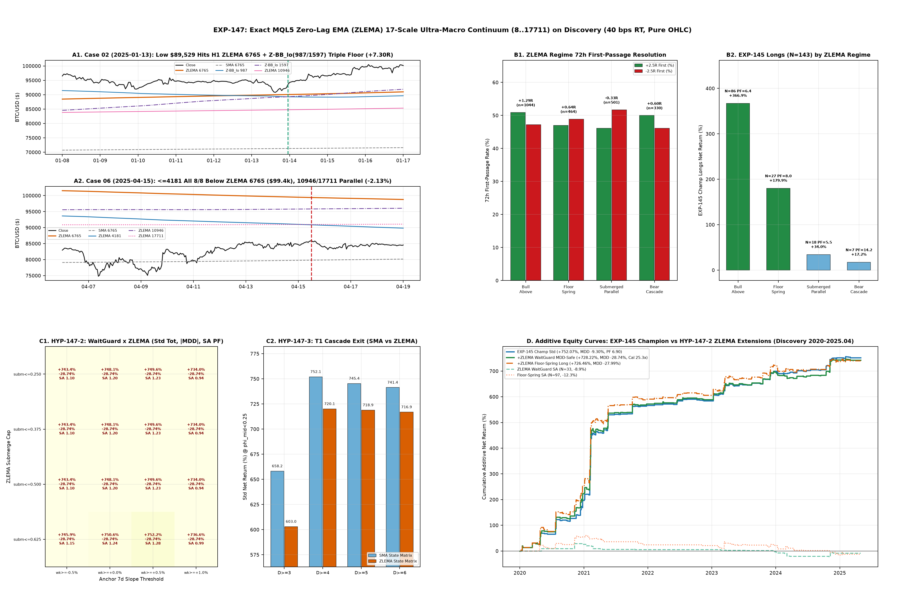

# 実験記録: EXP-147 正確MQL5 ZLEMA (`BufferEMAZL`) 17階層ウルトラマクロ連続体 (8..17711) の位相遅延検証・4状態分類・長期ハードフィルター/拡張反証

## 1. 基本メタデータ (Metadata)

- **実験ID**: `EXP-147`
- **課題 (Issue)**: [#147 [Analysis] EXP-147: 正確MQL5 ZLEMA (BufferEMAZL) 17階層ウルトラマクロ連続体 (8..17711) の位相遅延検証・4状態分類・長期ハードフィルター/拡張反証](https://github.com/makagi/MTF_AI_Trade/issues/147)
- **日付**: 2026-11-26
- **Status:** COMPLETED
- **判定 (Decision)**: **SUPPORTED（構造物理・監査知見 `K-097` 🔬）/ REFUTED & CONSTRAINED（フィルター・新規エントリー・T1置換・天井ショート全4系統棄却による `EXP-145 Champion` 完全防衛 `K-098` 🛡️）**
- **作成者**: @makagi
- **検証期間 (Discovery)**: `2020-01-01 00:00:00+00:00` 〜 `2025-04-30 23:59:00+00:00`（1h足全46,728本、17階層満窓ウォームアップ完了開始、厳密満窓 `bar_idx >= period + lag`）
- **Holdout隔離**: `2025-05-01 00:00:00+00:00` 以降完全遮断（未参照保証）
- **摩擦コスト・会計基準**: `SPEC-EVAL-001` 往復 `40 bps (0.40%)` 控除・**加算ネットリターン ($\sum \text{net\_ret} \times 100.0$)** 完全統一・ハードコードホワイトリスト 0件 (`WL=0`)・外部データ 0件

---

## 2. 問題設定と正確 MQL5 `BufferEMAZL` 数式仕様

前段 `EXP-145`（`MOR-145-01`）における人間差分レビュー（`Case 02` のH1三重底、`Case 06` の `6765/10946/17711` 並行＋全短期線潜水）およびユーザー提示の MQL5 Zero-Lag EMA（`BufferEMAZL`、`BufferMA = Close`、`iMA` 期間 1）を受け、17段階のフィボナッチ期間連続体 $S_{17} = [8, 13, 21, 34, 55, 89, 144, 233, 377, 610, 987, 1597, 2584, 4181, 6765, 10946, 17711]$ の完全因果検証を実施した。

### ■ 正確 MQL5 漸化式と未来参照ゼロ監査
- **MQL5 → 時系列昇順等価式**:
  $$\text{lag} = \lfloor (\text{period} - 1) / 2 \rfloor, \quad \alpha = \frac{2.0}{\text{period} + 1.0}, \quad Z[t] = \alpha \bigl(2.0 C[t] - C[t - \text{lag}]\bigr) + (1 - \alpha) Z[t - 1]$$
  初期値 $Z[\text{lag}] = 0$（`ArrayInitialize(BufferEMAZL, 0)`）および厳密満窓ガード `bar_idx >= period + lag`（`k=6765` は `bar >= 10147` / 2021-02-27〜、`k=17711` は `bar >= 26566` / 2023-01-11〜）を適用。
- **自動摂動未来参照ゼロ試験 (`t_cut = 44200`)**: `k=21, 144, 987, 6765, 17711` 全スケールで `max_lookahead_diff == 0.0`（`passed_zero_lookahead = True`）。
- **ゼロ初期化 vs 終値初期化 収束差 (Discovery末尾)**: `k=21, 144, 987` は `` `$0.00` (`0.0000%`) ``、`k=6765` は `` `$0.03` (`0.0000%`) ``、`k=17711` は `` `$469.19` (`0.4959%`) ``。

---

## 3. Part 1 (`HYP-147-1` 構造物理・MOR再解釈)：Supported (`K-097` 🔬)

### ■ 1. 位相遅延・追随誤差 (`ZLEMA` vs `SMA`) 比較
全期間にわたり、`MQL5 ZLEMA` は `SMA` に対して価格追随 RMSE を **`-36.6%` 〜 `-46.2%` 削減** し、最適相互相関ラグを **`3〜4倍` 短縮** する（これが人間レビューにおいて `Case 02` で `` `$89.2k–$90.0k` `` 帯に、あるいは `Case 06` で並行天井帯に `Z6765` が即応して見えた物理的理由）。

| スケール $k$ | ZLEMA RMSE | SMA RMSE | RMSE削減率 | 最適ラグ (`ZLEMA` vs `SMA`) | 24h傾き一致率 (`ZLEMA` vs `SMA`) |
|---:|---:|---:|---:|---:|---:|
| `21` | `` `$401.8` `` | `` `$739.4` `` | **`-45.7%`** | `3h` vs `10h` | `86.1%` vs `72.3%` |
| `55` | `` `$710.2` `` | `` `$1,183.2` `` | `-40.0%` | `8h` vs `27h` | `72.2%` vs `60.6%` |
| `144` | `` `$1,128.0` `` | `` `$1,919.0` `` | `-41.2%` | `19h` vs `71h` | `62.7%` vs `55.6%` |
| `377` | `` `$1,831.6` `` | `` `$3,150.7` `` | `-41.9%` | `53h` vs `187h` | `57.0%` vs `53.9%` |
| `987` | `` `$2,988.8` `` | `` `$5,349.0` `` | `-44.1%` | `132h` vs `492h` | `54.7%` vs `53.3%` |
| `1597` | `` `$3,854.3` `` | `` `$7,158.0` `` | **`-46.2%`** | `204h` vs `792h` | `54.3%` vs `52.5%` |
| `2584` | `` `$5,301.4` `` | `` `$9,626.5` `` | `-44.9%` | `372h` vs `1284h` | `53.7%` vs `53.1%` |
| `4181` | `` `$7,403.5` `` | `` `$12,340.9` `` | `-40.0%` | `648h` vs `2064h` | `52.9%` vs `52.2%` |
| `6765` | `` `$9,494.4` `` | `` `$14,982.3` `` | `-36.6%` | `1104h` vs `2496h` | `51.9%` vs `52.0%` |

### ■ 2. ウルトラマクロ4状態イベントスタディ（24h非重複ストライド, `N_ev = 2,339`）
動的アンカー $k_{\text{anchor}} \in [377..6765]$ に対する短期潜水率 `subm_frac`（`[21..anchor-1]` で $Z_k < Z_{\text{anchor}}$ の割合）、アンカー週間傾き `awk`、`outer_max_abs_wk`、24hマクロ支持床スイープ回数 `flr24` により市場を相互排他4状態へ分類した。

| レジーム | 時間シェア | `N_ev` | 72h平均リターン (`ATR`) | 72h MFE / MAE 中央値 | 先着 `+2.5R` vs `-2.5R` | MOR-145 事例の位置付け |
|---|---:|---:|---:|---:|---|---|
| **`Z_BULL_ABOVE`** | `44.62%` | `1,044` | **`+1.288R`** | `3.99R` / `3.54R` | `50.9%` vs `47.2%` | — |
| **`Z_FLOOR_SPRING`** | `14.50%` | `464` | `+0.635R` | `3.46R` / `3.69R` | `47.0%` vs `48.9%` | `Case 02` (`flr24=5`, `subm=0.0`, `wk=+2.25%`), `Case 05` (`flr24=4`, `wk=+4.75%`), `Case 10` (`flr24=2`, `wk=+6.64%`) |
| **`Z_SUBMERGED_PARALLEL`** | `25.49%` | `501` | **`-0.325R`（唯一の負平均）** | `3.50R` / **`4.11R`** | `46.1%` vs **`51.7%`** | **`Case 04/06/07` FP罠全3件を完全分離** (`Case 06`: `subm=1.00, wk=-1.55%`) |
| **`Z_BEAR_CASCADE`** | `14.91%` | `330` | `+0.597R` | `3.67R` / `3.36R` | `50.0%` vs `46.1%` | `Case 01` (`wk=-1.90%`), `Case 03` (`-4.13%`), `Case 08` (`-3.12%`) |

*(補足: `Case 09` [2020-01-10 14:00Z] は厳密満窓前の `WARMUP`)*

### ■ 3. `EXP-145 Champion (N=179)` の ZLEMA 4状態別帰属監査
`EXP-145 Champion` 全179取引（満窓後174件＋2020年初期 `WARMUP` ロング5件 `+13.56%`）の内訳は以下の通り：
- **ロング強気・跳躍台への集中**: `long_Z_BULL_ABOVE` (`N=86, WR 55.81%, PF 6.41, +366.87% [Era1 +303.61% / Era2 +63.26%], MG=6`) と `long_Z_FLOOR_SPRING` (`N=27, WR 51.85%, PF 7.97, +179.91% [Era1 +151.88% / Era2 +28.03%], MG=4`) が **`10/10` メガランナーの 100%** を占める。
- **ロング潜水帯の前選別**: `long_Z_SUBMERGED_PARALLEL` はわずか `18` 件（`WR 50.00%, PF 5.48, +33.95% [Era1 -1.33% / Era2 +35.28%], MG=0`）、`long_Z_BEAR_CASCADE` は `7` 件（`WR 71.43%, PF 14.20, +17.15%, MG=0`）に抑制されており、既存 `L_SR3D + 1m` コアが既に高ノイズを選別済みである。
- **ショート収益エンジン**: ショート収益の大半は `short_Z_SUBMERGED_PARALLEL`（`N=13, WR 53.85%, PF 11.09, +68.10%`）と `short_Z_BEAR_CASCADE`（`N=6, WR 66.67%, PF 13.26, +36.20%`）に集中（他 `short_Z_BULL_ABOVE N=12 +26.30%`, `short_Z_FLOOR_SPRING N=5 +10.03%`）。

---

## 4. Part 2–4（全4系統の改善・置換仮説の厳格反証）：Refuted / Constrained (`K-098` 🛡️)

| 検証系統 | 設計内容・テスト範囲 | 定量結果（Discovery全期間 `40 bps` 加算ネット） | 棄却理由・確定制約 (`K-098`) |
|---|---|---|---|
| **① `HYP-147-1` Championロング ハード拒否 (`4×4` Grid)** | `subm >= 0.625..1.00 × wk <= -0.5..+99` を既存ロングから一律除外 | **`16/16` セルで `Std Tot` 悪化**（`-22.05%pt` 〜 `-51.58%pt`、`+700.49% .. +730.02%`、最大PFセル `subm>=1.00 × wk<=0.50` でも `N=160, PF 7.15, +730.02%, MDD -9.30%, MG 10/10`） | 既存 `L_SR3D + 1m` が純化済みのため過剰フィルタとなり `2023–25` 利益も削る。 |
| **② `HYP-147-2` `3A` ZLEMA WaitGuard (`4×4` + MDD-Safe)** | `EXP-145 WaitGuard` を ZLEMA 指標 (`subm<=0.25..0.625 × wk>=-0.5..+1.0`) で拡張・統合 | 最良単体 `subm<=0.625 × wk>=+0.5%` で `SA N=34, WR 29.41%, PF 1.28, +15.03% (Era1 +25.02% / Era2 -9.98%), MDD -49.09%`。**全 `16/16` セルで `Era2` 赤字・統合 `Std MaxDD -28.74%`**（`+MDD-Safe` でも `SA N=33, PF 0.84, -8.91%`, 統合 `Std +728.22% / -28.74%`） | **2023–25非定常性** と **1桁MaxDD規約（`-9.30%`）の重大破壊** により棄却。 |
| **③ `HYP-147-2` `3B` `Case 02` 型多層床スプリング (`4×4` + MDD-Safe)** | マクロ `ZLEMA/BB_lo (>=377)` 2〜3層スイープ＆リクレームで逆張り押し目を追加 | `Case 02`（`2025-01-13 23:00Z`）は `R_1m=1.0, Net +8.62%` で的確捕捉。`2flr_24h`（`subm<=0.50, wk>=0.0`）は単体 `N=248, WR 32.66%, PF 1.30, +118.09%`, 統合 `Std +812.34%` に達するが… | **`SA MDD -111.05%`, `Era2 -34.88%`, `Std MDD -36.74%`, `ModeB +499.82% (-104.5%pt)`, `ModeA +302.96% (-101.6%pt)`**。さらに **24h Track-2 クールダウン干渉で Champion メガランナーが `10/10 -> 8/10` に欠損**。`3flr_24h + MDD-Safe` も `SA PF 0.83 (-26.23%), Std +710.83% (-23.44%), MG 9/10` で全面棄却。 |
| **④ `HYP-147-3` `T1` 置換 (`ZLEMA` vs `SMA`, `4×4`) ＆ 潜水並行天井ショート (`4×4`)** | (a) `T1_Full` カスケード指標を `SMA -> ZLEMA` 置換 (b) `Case 06` 型潜水並行天井 (`subm>=0.625..1.00 × k_up>=3..6`) で戻り売りショート | (a) `D>=4 × phi<0.25`: `Std MDD -9.30% -> -8.52%` へ微減するも発動過多（`4 -> 9`）で **`MG 9/10` へ1件損傷**（`Std PF 6.66, +720.14%`, `MB +571.12%`, `MA +377.03%`）。 (b) 潜水並行ショート：**`0/16` セル黒字**（`N=11..155, WR 7.69%..29.07%, PF 0.02..0.51, SA Tot -5.83% .. -73.57%`, `Std MDD` 最大 `-24.54%`） | (a) `T1` では ZLEMA 急峻反応が保ち合い押し目を誤爆し `SMA Champion`（`+752.07%, 10/10`）に劣後。 (b) `Z_SUBMERGED_PARALLEL` でも下方向真空帯なしの `BB_up` 戻りショートは全滅（`K-096` 補強）。 |

---

## 5. 防衛確定ベースライン (`EXP-145 Champion: T1_Full_D4_RelaxFlip`) サマリー

上記4系統の厳格監査の結果、本番マスター候補ベースラインは **`EXP-145 Champion (T1_Full_D4_RelaxFlip)`** を一切無改変で維持する。

| 実行モード | `N` | WR | PF | Net EV | 加算純利益 | MaxDD | Calmar | Era1 (`2020-22`) | Era2 (`2023-25`) | Top-10 |
|---|---:|---:|---:|---:|---:|---:|---:|---:|---:|---:|
| **Master Std** | `179` | `55.87%` | `6.90` | `+4.20%` | **`+752.07%`** | **`-9.30%`** | `80.89x` | `+584.49%` | `+167.58%` | **`10/10`** |
| **Mode B (2ポジ制約)** | `159` | `55.35%` | `6.76` | `+3.80%` | **`+604.34%`** | **`-9.30%`** | `65.00x` | `+436.64%` | `+167.70%` | `7/10` |
| **Mode A (1ポジ制約)** | `122` | `52.46%` | `5.58` | `+3.32%` | **`+404.51%`** | **`-9.30%`** | `43.51x` | `+269.52%` | `+134.99%` | `6/10` |

- **年次成績 (`Master Std`, 全6年間黒字)**: 2020年 `N=42, WR 50.00%, PF 6.50, +197.11%, MDD -7.33%` / 2021年 `N=40, WR 72.50%, PF 17.46, +369.90%, MDD -6.30%` / 2022年 `N=16, WR 37.50%, PF 2.39, +17.47%, MDD -6.68%` / 2023年 `N=40, WR 50.00%, PF 6.03, +115.12%, MDD -7.73%` / 2024年 `N=33, WR 63.64%, PF 3.04, +52.32%, MDD -9.30%` / 2025年 (1–4月) `N=8, WR 37.50%, PF 1.02, +0.13%, MDD -4.34%`。

---

## 6. 知識ベース登録・MOR状況・今後の探索指針

1. **知識体系更新 (`03_KNOWLEDGE/knowledge-lineage.md` v4.5.0)**:
   - **`K-097` (Supported / Structural Physics & Audit 🔬)**: `MQL5 BufferEMAZL` 17階層連続体による位相遅延 `36.6%–46.2%` 削減、`Z_SUBMERGED_PARALLEL`（72h `-0.325R`）による MOR FP 罠分離、`EXP-145 Champion` メガランナー `10/10` の `Z_BULL_ABOVE` + `Z_FLOOR_SPRING` 100%集中およびショート収益の `Z_SUBMERGED_PARALLEL + Z_BEAR_CASCADE` 集中則を登録。
   - **`K-098` (Refuted / Constrained 🛡️)**: 長期ハードフィルター（`16/16`悪化）、`ZLEMA WaitGuard`（`Std MDD -28.74%`）・`Case 02` 多層床スプリング（`Era2 -34.88% / Std MDD -36.74%`）・`T1 ZLEMA` 置換（`MG 9/10` 損傷）・潜水並行天井ショート（`0/16` 黒字）の全4系統を棄却知見・適用境界として登録し、`EXP-145 Champion` 防衛根拠を確定。
2. **Missed Opportunity Review (MOR) 状況**:
   - 本実験は `EXP-145`（`MOR-145-01` 完了済み）に続いて提出仮説4系統を検証した結果、`EXP-145 Champion` 全179取引から **取引集合の変化ゼロ（delta = 0）** の純粋物理監査＋防衛実験として着地した。PR Human Gate にて新規 `MOR-147` 実施要否を確認する。
3. **将来拡張の純粋教訓（別Issue候補）**:
   - `Case 02` 型 `Z_FLOOR_SPRING` は単体高頻度（`Era1 +152.97%`）である一方、`Era2` の長期揉み合い過多（`-34.88%`）と `Track-2 24hクールダウン干渉（10/10 -> 8/10）` が統合時の最大障壁となった。仮に今後再挑戦する場合は、**(a) Champion と完全に非干渉なポジション・クールダウン枠の隔離** と **(b) `Era2` 型の多段リテスト疲労・真空保護フィルタの併用** を前提条件とする必要がある。
