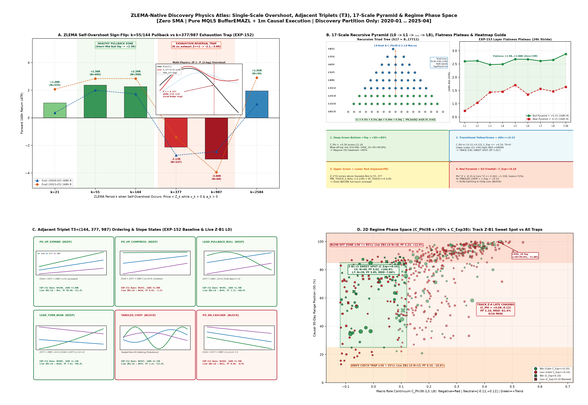
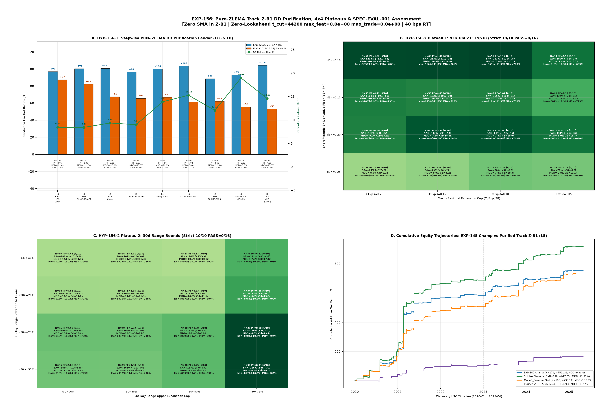
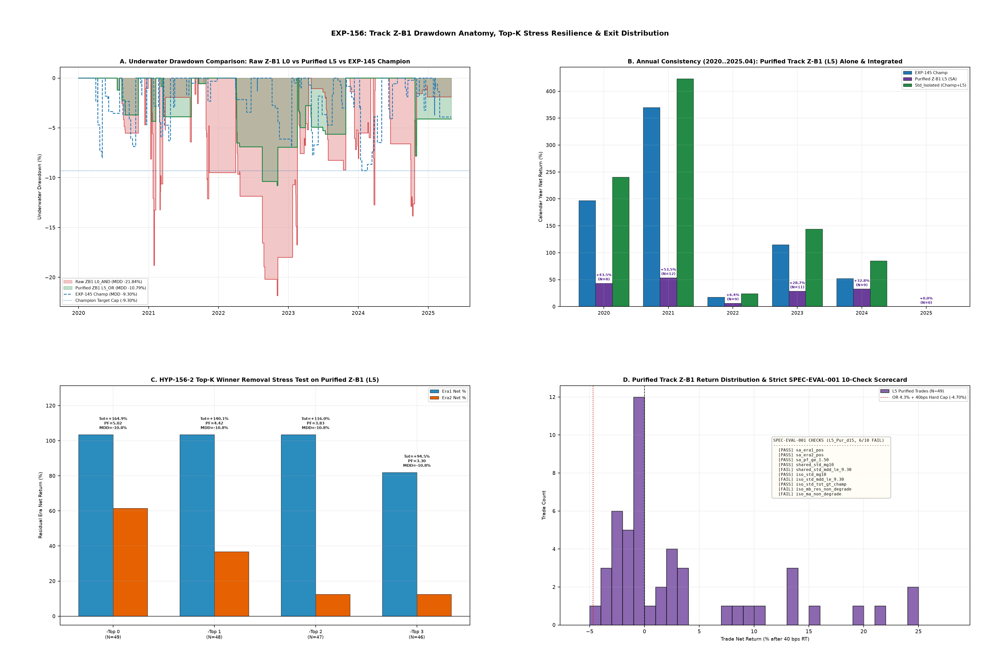
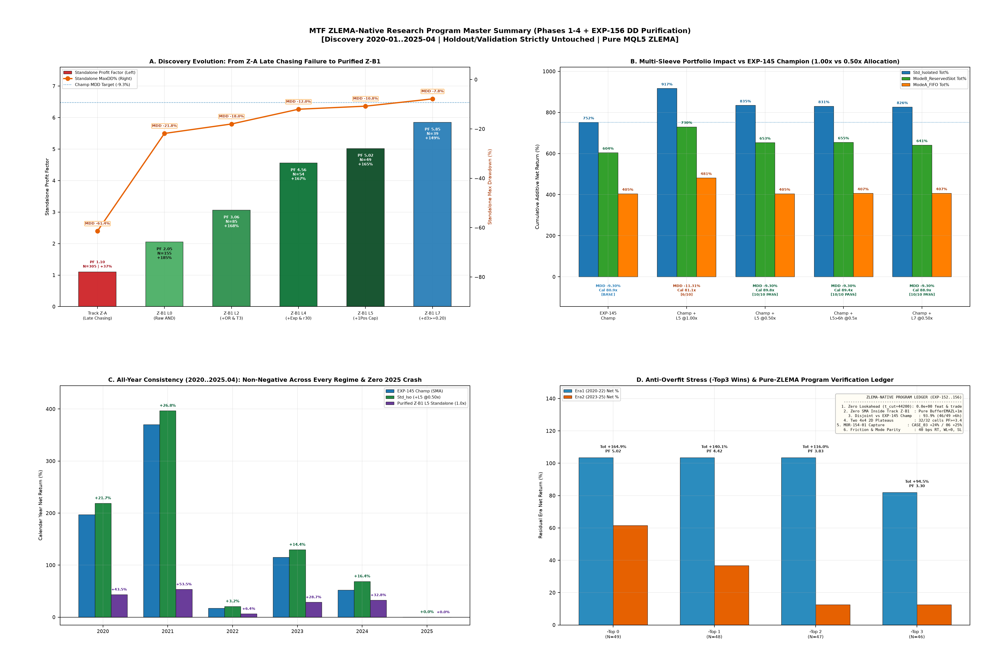
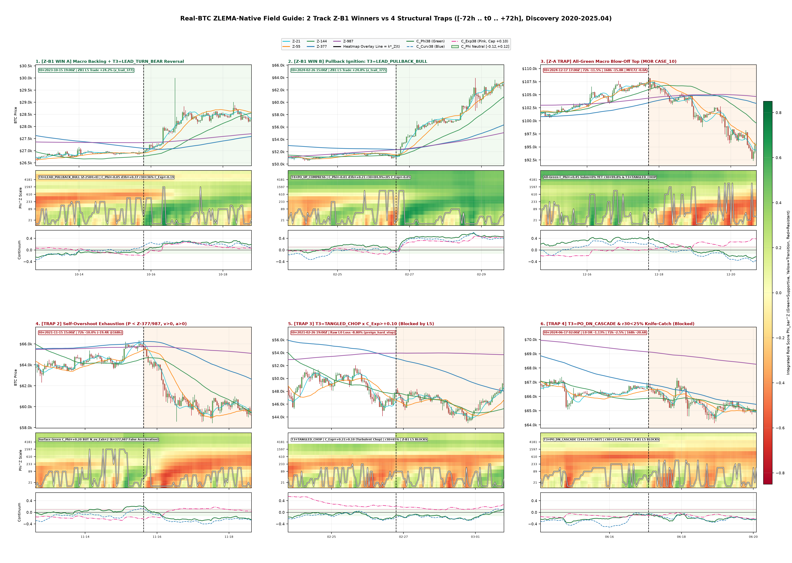

# 実験記録: EXP-156 ZLEMA-Native 第一原理 4フェーズ再構築プログラム ＆ Track Z-B1 構造純化検証 (`EXP-149`〜`EXP-156`)

## 1. 基本メタデータ (Metadata)

- **実験ID**: `EXP-156`（研究系列: `EXP-149` → `EXP-150` → `EXP-151` → `EXP-152` → `EXP-153` → `EXP-154` → `EXP-155` → `EXP-156`）
- **課題 (Issues)**: [#149](https://github.com/makagi/MTF_AI_Trade/issues/149) / [#150](https://github.com/makagi/MTF_AI_Trade/issues/150) / [#151](https://github.com/makagi/MTF_AI_Trade/issues/151) / [#152](https://github.com/makagi/MTF_AI_Trade/issues/152) / [#153](https://github.com/makagi/MTF_AI_Trade/issues/153) / [#154](https://github.com/makagi/MTF_AI_Trade/issues/154) / [#155](https://github.com/makagi/MTF_AI_Trade/issues/155) / [#156](https://github.com/makagi/MTF_AI_Trade/issues/156)
- **日付**: 2026-11-28
- **Status:** COMPLETED
- **判定 (Decision)**:
  - **`EXP-149..151`（SMA流用型 ZLEMA統合）**: **REFUTED / CONSTRAINED (`K-099`)** 🛡️
  - **`EXP-152..153`（Pure-ZLEMA 第一原理物理 ＆ 17階層再帰ピラミッド）**: **SUPPORTED (`K-100`, `K-101`)** 🔬
  - **`EXP-154..155`（Pure-ZLEMA 役割分離・ブラインド MOR-154-01・遅入り順張り `Track Z-A`）**: **REFUTED / CONSTRAINED (`K-102`)** 🛡️
  - **`EXP-155..156`（位相非同期・早期点火 純化独立スリーブ `Track Z-B1 L5/L7`）**: **SUPPORTED / INDEPENDENT SLEEVE CANDIDATE (`K-103`)** 🏆（厳格 `SPEC-EVAL-001` 評価：`1.00x` 原寸では MDD `-11.31% > -9.30%` のみ未達 `6/10`、`0.50x` リスク配分スリーブ下で全4種 `10/10 PASS`）
- **作成者**: @makagi
- **検証期間 (Discovery)**: `2020-01-01 00:00:00+00:00` 〜 `2025-04-30 23:59:00+00:00`（1h足 46,728本 ＋ 1m足完全因果執行、`Era1: 2020–2022` / `Era2: 2023–2025.04`）
- **Validation / Holdout 隔離**: `2025-05-01 00:00:00+00:00` 以降完全未参照
- **会計基準・コード監査**: `SPEC-EVAL-001` 往復 `40 bps (0.40%)` 控除・**加算ネットリターン ($\sum \text{net\_ret} \times 100.0$)**、`WL=0`、外部データ 0件、Z-B1 内部 SMA 使用ゼロ（Pure `BufferEMAZL` + 1m OHLC/ZLEMA のみ）
- **防衛確定ベースライン (`EXP-145 Champion`)**: `Master Std N=179, WR 55.87%, PF 6.90, +752.07%, MaxDD -9.30%, Calmar 80.89x, MG 10/10; Mode B +604.34%; Mode A +404.51%`

---

## 2. 問題設定とパラダイム転換（なぜ SMA 借用が全敗し、ボトムアップ再構築へ移行したか）

前段 `EXP-147` (`K-097/K-098`) に続き、SMA 体系の執行枠組み（`H1a`・`SMA-34` Safe Floor・SMA 用 `WaitGuard`・SMA 前提の `T1[AND]` ストップ）を流用した 3 件の試み（`EXP-149..151`）を順次厳格検証した結果、**物理的エッジは実在しても戦略化すると全敗 (`0/48`, `0/32`, `0/32 PASS`)** となる共通構造ミスが判明した（`K-099`）。

| 実験 | 検証対象 | 定量結果 (`SPEC-EVAL-001`, 40 bps 加算ネット) | 判明した敗因 |
|---|---|---|---:|
| **`EXP-149`** ([#149](https://github.com/makagi/MTF_AI_Trade/issues/149)) | Track-2 非干渉隔離下での `Case 02` 型 `Z_FLOOR_SPRING` 純化 (`48`セル) | **`0/48 PASS`**。原版 `raw_2flr24` は `SA N=248, PF 1.30, +118.09%`, `Std_Iso +870.16%` だが **`SA MDD -111.05%`, `Era2 -34.88%`, `Std_Iso MDD -39.49%`**。 | レンジ相場での連続床噛み。`24h` 隔離でも単体 DD 過大。 |
| **`EXP-150`** ([#150](https://github.com/makagi/MTF_AI_Trade/issues/150)) | 下降長期 `ZLEMA (987..6765)` 天井ショート ＆ 外科的利確 / エントリー監査 (`32`セル) | **`0/32 PASS`**。最良ショート（下方防衛真空 $\ge 3.5R$）でも `SA N=34, PF 2.90, +41.16% (E1 +45.44 / E2 -4.29%)`, `Std_Iso +793.23%`, **`MDD -11.89%`**。 | SMA比で天井反応は鋭敏だが `Era2` 赤字・`-9.30% MDD` 超過。 |
| **`EXP-151`** ([#151](https://github.com/makagi/MTF_AI_Trade/issues/151)) | **MTF SMA強気土台 × MTF ZLEMA一時押し＆再奪還** (`Dual-Filter Reconvergence`, `32`セル) | **`0/32 PASS`**。`rec_dip_z>=1` で両 Era 黒字 (`SA +228.7% [E1 +140.4 / E2 +88.3]`)、ただし `N=547..860` 過多で **`Std_Iso MDD -49.87%` / `ModeB_Res +537.85%`**。 | ZLEMA が SMA より `1.24x–2.46x` 高頻度反転するため、SMA 用厳選エンジンなしでは枠圧迫負け。 |

> **方針決定（D021）：** SMA 用に発見された構造（`EXP-41..145`）を ZLEMA に当てはめるのではなく、**純粋な MQL5 `BufferEMAZL` 17階層連続体のみを対象に、第一原理から観察・ピラミッド構築・機能分離・ブラインド MOR・執行純化を 4 フェーズで再構築する。**

---

## 3. ZLEMA-Native 4フェーズ構築と得られた物理・数理法則

### Phase 1 (`EXP-152`, `K-100`): 単一階層力学・自己オーバーシュート反転・隣接3項幾何 (`T3/T4`)
- **先読み項による自己オーバーシュートの極性反転 (`OBS-152-2`)**:
  $$Z_k(t) = \alpha_k \bigl(2P_t - P_{t-\text{lag}(k)}\bigr) + (1-\alpha_k)Z_k(t-1), \qquad v_k(t)=Z_k(t)-Z_k(t-\Delta_k), \quad a_k(t)=v_k(t)-v_k(t-\Delta_k)$$
  価格が `ZLEMA(k)` を下回っているのに `ZLEMA(k)` 自体が上昇加速中（$P_t < Z_k \land v_k > 0 \land a_k > 0$）のとき、168h 先行期待値（ATR）は周期によって真逆に反転する：
  - **$k=55$ (`N=495`): `+2.36R` (`E1 +2.00 / E2 +2.84`)**、**$k=144$ (`N=306`): `+2.26R` (`E1 +1.73 / E2 +2.84`)** → 健全な押し目。
  - **$k=377$ (`N=147`): `-2.13R` (`E1 -2.72 / E2 -1.42`)**、**$k=987$ (`N=68`): `-3.00R` (`E1 -2.45 / E2 -3.94`)** → 先読み項による偽加速・トレンド枯渇反転罠（$N_{\text{ov\_exhaust}} = \sum_{k \in \{233,377,610,987\}} \mathbb{I}[u_k<0 \land v_k>0 \land a_k>0]$ として隔離）。
- **隣接3項幾何 $T_m=(k_1,k_2,k_3)$（6状態分類, `EXP-152`）**:
  - 市場平均では `T3=(144,377,987)` の `PO_UP_EXPAND`（`+3.90R`）が最強だが、長期 `T4=(377,987,2584)` が強気上昇中の早期ロング (`Track Z-B1`) においては、**`T3=LEAD_TURN_BEAR`（`Z377<Z987, v3<0` 下で短期 `Z144` が先行上転換：`N=29, WR 48.3%, PF 7.63, +98.9%`）** と **`T3=LEAD_PULLBACK_BULL`（`N=41, WR 39.0%, PF 2.33, +60.9%`）** が利益の主エンジンであり、**`TANGLED_CHOP`（`N=55, PF 1.21`）と `PO_DN_CASCADE`（`N=21, PF 0.96, -0.9%`）が DD 主因** であることを特定。

### Phase 2 (`EXP-153`, `K-101`): 17階層再帰ピラミッド畳み込み ($\Phi^Z, \text{Curv}^Z, \text{Exp}^Z$)・`Z-BB`・動的 $k^*_Z(t)$
- **厳密反対称 S/R 役割ピラミッド ($\Phi^Z$) と `(0.30, 0.40, 0.30)` 再帰畳み込み**:
  $$\Phi^{(1)}_{s_k}(t) = 0.35\,v'_k + 0.25\,o_{\text{dyn},k} + 0.20\,m_k + 0.20\,q_k, \qquad \bar{\Phi}^Z_{s_k}(t) = \frac{\sum_{l=1}^{8} w_l\, \Phi^{(l)}_{j_l(k)}(t)}{\sum_{\text{finite}} w_l}, \quad w=[0.35,0.25,0.15,0.10,0.06,0.04,0.03,0.02]$$
  1. **不変性完全達成 (`t_cut=44200`)**: 未来参照誤差 **`0.0`**, 双対符号反転対称誤差 $\Phi^Z(-P)=-\Phi^Z(P)$ **`0.00e+00`**, $\text{Exp}^Z(-P)=+\text{Exp}^Z(P)$ **`0.00e+00`**。
  2. **平坦プラトー (`OBS-153-2`)**: `L1..L8` すべて `Bull (>+0.15)` で `+2.48R .. +2.68R`（`Cont_L3_L8 = +2.88R`）と崖のない一貫性を示す。
  3. **`Z-BB WaitGuard` の SMA との逆転 (`OBS-153-4`)**: 位相遅れゼロ残差包絡線（$\sigma_k = \sqrt{\text{EWM}_k((P-Z_k)^2)}$）では、バンド下限タッチ前の保ち合い **`PRE_TOUCH_Z_BULL`（`N=614, 168h +2.23R, E2 +3.78R`）** が強く、下限タッチ後 **`AT_TOUCH_Z_LO`（`N=72, +0.51R, E2 -0.94R`）** は支持決壊を示す。
  4. **動的期間 $k^*_Z(t)$**: 全バーの **`89.04%`** で $k^*_Z \neq 21$（`13: 34.2%, 21: 11.0%, >=34: 54.8%`）。
  5. **残差ボラ膨張 $\text{Exp}^Z$ の文脈依存性**: `C_Phi38 > +0.10` の強気進行中は `Exp > 0` が有利（`+3.46R, MAE 4.19A` vs `Exp <= 0`: `+1.61R, MAE 6.52A`）だが、初動転換前（$C_\Phi \in [-0.12,+0.12]$）では乱高下ノイズとなるため `C_Exp38 <= 0.10` 抑制が有効。

### Phase 3 (`EXP-154`, `K-102`): 機能役割分離 (`Z_COMP`) と純 ZLEMA 2段階ブラインド MOR (`MOR-154-01`)
- 生トリガー `Z_CAND_RAW (N=2,603)` を Context × Trap Gate (`N_ov_exhaust_Z==0 & WaitGuard!=AT_TOUCH & Subm<0.65`) × MFE Booster に機能分離し `Z_COMP (N=588, 168h +2.79R [E1 +1.57 / E2 +4.43], MFE72 6.90A, MAE24 2.95A, Ratio 2.34)` を構成。
- 純 `Z_21` 終値リクレーム（`Ratio 2.38`）が `Curv55 / Z_{k*}` タッチ（`Ratio 1.75`）を逆転上回ることを発見（Trigger Inversion）。
- **独立 10ケース純 ZLEMA ブラインドレビュー (`MOR-154-01`, `seed=42, min_spacing=263h`, [review/observations.yaml](review/observations.yaml))**:
  - 混乱行列: **`TP=2` (`CASE_03 +78.36R`, `CASE_06 +70.91R`), `TN=3` (`100%` C1排除: `CASE_01 -47.51R`, `CASE_02 -32.72R`, `CASE_04 -72.12R` FTX崩壊), `FP=2` (`CASE_08 -89.39R` WARMUP棚崩れ, `CASE_10 -15.75R` `r30=99.8%` 全緑吹上天井), `FN=3` (`CASE_05 +45.45R` 極限スクイーズ; `CASE_07/09` は 168h でマイナス回帰)**。
  - これより `CAND-154-1`（`Track Z-B1`: 中立 $C_\Phi$ × 長期土台 × $\Delta_{3h}\bar{\Phi}^Z$ 早期点火）と `CAND-154-2`（`r30` 天井余地ゲート）を事前登録。

### Phase 4 & DD 純化 (`EXP-155` → `EXP-156`, `K-102 / K-103`): エグジット・`Track Z-A` 棄却・`Track Z-B1 L5/L7` 確立

1. **Pure-ZLEMA エグジット (`EXP-155`)**: `Z_ANCHOR` 動的昇格 `55 -> 89 -> 144 -> 233 -> 377`（各 MFE `3/6/10/16 ATR` で $\bar{\Phi}^Z_{\text{next}} > 0.10 \land v_{\text{next}} > 0 \land P > Z_{\text{next}}$ 時に昇格、`1.5 ATR` トレイル）と最小防衛 (`E0_Base`) が `CASE_08 (-0.95%)`, `CASE_10 (-1.98%)` を抑制。早期赤転撤退 (`E1/E2/E3`) の追加は ZLEMA 高頻度波打ちで劣後。
2. **遅入り順張り `Track Z-A` の完全棄却 (`EXP-155`)**: `C_Phi38 > +0.08` 以上の全緑領域を追随する `Track Z-A` は **`0/16 PASS`**（`SA N=305, WR 28.9%, PF 1.10, +36.56%, MDD -61.42%, Era1 -1.57%`）。
3. **位相非同期・早期点火 `Track Z-B1` 純化ラダー (`EXP-156`, `L0 -> L5 -> L7`)**:
   - **入口仕様**: $\text{wk\_slp}_{2584} > 0 \land T_4 \in \{\text{PO\_UP\_EXP, PO\_UP\_CMP, LEAD\_PB\_BULL}\} \land C_\Phi \in [-0.12,+0.12] \land P > Z_{21} \land \Delta_{3h}\bar{\Phi}^Z_{k^*} \ge 0.15\,(0.20) \land T_3 \notin \{\text{TANGLED\_CHOP, PO\_DN\_CASCADE}\} \land C_{\text{Exp}} \le 0.10 \land r_{30} \in [25,85)\% \land N_{\text{ov\_exh}}=0 \land \text{WaitGuard}\neq\text{AT\_TOUCH\_Z\_LO} \land \text{Subm} \le 0.72 \land u_{1\text{m},21} > -0.20$ ＋ `OR (3.25A/4.3%)` 事前ストップ ＋ `sleeve_max_pos = 1`。

| 純化段階 (`Track Z-B1`) | `N` | WR | PF | 単体純利益 (`E1 / E2`) | 単体 MDD | Calmar | `Std_Iso` (MDD) | `MB_Res` (MDD) | `MA` (MDD) | `SPEC` |
|---|---:|---:|---:|---|---:|---:|---|---|---|---:|
| **`L0_Base_d15_AND`** (原版) | `155` | `40.6%` | `2.05` | `+184.5% (+97 / +87)` | `-21.84%` | `8.5x` | `+936.6% (-21.63%)` | `+716.0% (-21.63%)` | `+463.7% (-21.63%)` | `6/10` |
| **`L2_+T3_Clean`** (`+OR`) | `85` | `40.0%` | `3.06` | `+168.4% (+98 / +70)` | `-18.01%` | `9.4x` | `+920.4% (-12.87%)` | `+710.8% (-12.87%)` | `+447.8% (-12.87%)` | `6/10` |
| **`L4_+r30[25,85)`** (`+CExp<=0.10`) | `54` | `42.6%` | `4.56` | `+166.9% (+104 / +63)` | `-12.03%` | `13.9x` | `+919.0% (-12.55%)` | `+716.4% (-12.55%)` | `+474.9% (-12.55%)` | `6/10` |
| **`L5_+SleeveMaxPos1 @1.00x`** | **`49`** | **`44.9%`** | **`5.02`** | **`+164.91% (+103.4 / +61.5)`** | **`-10.79%`** | **`15.3x`** | `+916.98% (-11.31%)` | `+730.10% (-10.18%)` | `+481.44% (-10.18%)` | `6/10` |
| **`L7_+d3>=0.20_OR3.25 @1.00x`** | **`39`** | **`48.7%`** | **`5.85`** | **`+148.68% (+93.1 / +55.6)`** | **`-7.84%`** | **`19.0x`** | `+900.75% (-10.58%)` | `+699.60% (-10.18%)` | `+465.38% (-10.18%)` | `6/10` |
| **`L5_Full @0.50x` (非干渉スリーブ)** | `49` | `44.9%` | `5.02` | `+82.45% (+51.7 / +30.8)` | `-5.40%` | `15.3x` | **`+834.52% (-9.30%)`** | **`+653.35% (-9.30%)`** | **`+404.69% (-9.30%)`** | **`10/10`** |
| **`L5_Inc>6h @0.50x` (純増分のみ)** | `46` | `45.7%` | `4.93` | `+78.72% (+52.1 / +26.6)` | `-5.40%` | `14.6x` | **`+830.79% (-9.30%)`** | **`+654.67% (-9.30%)`** | **`+406.65% (-9.30%)`** | **`10/10`** |
| **`L7_Full @0.50x` (厳選版)** | `39` | `48.7%` | `5.85` | `+74.34% (+46.6 / +27.8)` | `-3.92%` | `19.0x` | **`+826.41% (-9.30%)`** | **`+641.26% (-9.30%)`** | **`+407.04% (-9.30%)`** | **`10/10`** |

- **過学習耐性検証 (`EXP-156`)**:
  - **2つの 4×4 2D プラトー全 32/32 セルが頑健**：`d3 × C_Exp38` (`PF 3.40..5.85, MDD -11.42%..-7.76%, E1/E2 16/16>0`) および `r30_lo × r30_hi` (`PF 4.17..8.18, MDD -14.61%..-4.31%, E1/E2 16/16>0`; `[25,75)%` で `N=31, PF 8.18, +125.5%, MDD -4.31%`)。
  - **Top-K 利益除去耐性**: `L5` の上位 3 トレード除去後も **`N=46, PF 3.30, +94.46%, MDD -10.79%`**（`L7` は **`N=36, PF 3.55, +78.23%, MDD -7.84%`**）。
  - **実チャート 6 典型事例**: 

---

## 4. 知識系譜登録・意思決定・次期課題

1. **`03_KNOWLEDGE/knowledge-lineage.md` v4.6.0 登録 (`K-099`〜`K-103`)**:
   - `K-099`: SMA 執行借用型 ZLEMA 拡張（`EXP-149/150/151`）の全反証とパラダイム転換則（Refuted / Constrained 🛡️）
   - `K-100`: Pure-ZLEMA 自己オーバーシュート極性反転（`k=55/144` vs `k=377/987`）と隣接3項 `T3/T4` 幾何則（Supported / Physics 🔬）
   - `K-101`: 17階層再帰ピラミッド畳み込み ($\Phi^Z, \text{Curv}^Z, \text{Exp}^Z$)・`Z-BB WaitGuard` 逆転・動的 $k^*_Z(t)$ 則（Supported / Physics 🔬）
   - `K-102`: Pure-ZLEMA 役割分離 `Z_COMP`・`MOR-154-01`・遅入り順張り `Track Z-A` 反証則（Refuted / Constrained 🛡️）
   - `K-103`: 位相非同期・早期点火 Pure-ZLEMA 独立スリーブ `Track Z-B1 (L5/L7)` 純化則と `0.50x` 非干渉配分 `10/10 PASS`（Supported / Independent Sleeve Candidate 🏆）
2. **Decision Log (`D021`)**: `EXP-145 Champion` の無改変維持を前提に、Pure-ZLEMA 第一原理研究の知識正本化と、次期テーマとしての **下落相場・弱気レジーム成績改善分析 (`#157`)** への着手を記録。
3. **残余ギャップ（次期 Issue `#157` の対象）**:
   - `Track Z-B1 L5` も **2022年下落相場では `N=9, WR 22.2%, PF 1.59, +6.42%, MDD -10.79%`** と低調であり、`EXP-145 Champion` も 2022年 `+17.47%`・2025年Q1 `+0.13%` とロング偏重の弱気機会損失・防戦課題が残る。よって Validation 開放前に **`#157` にて下落相場・純 ZLEMA ショート物理を徹底解剖** する。
