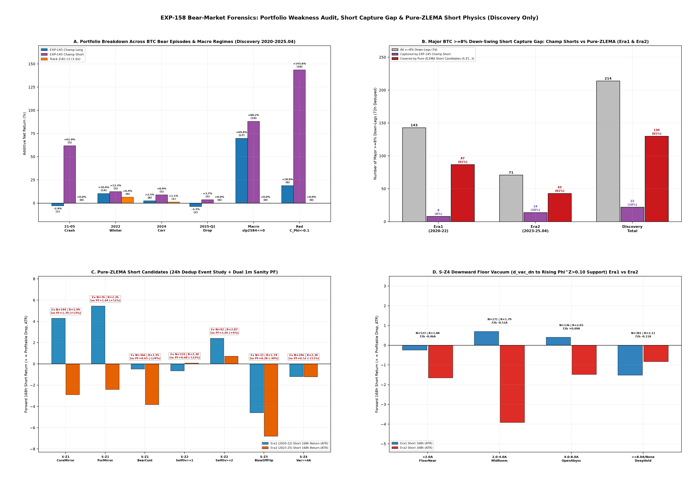
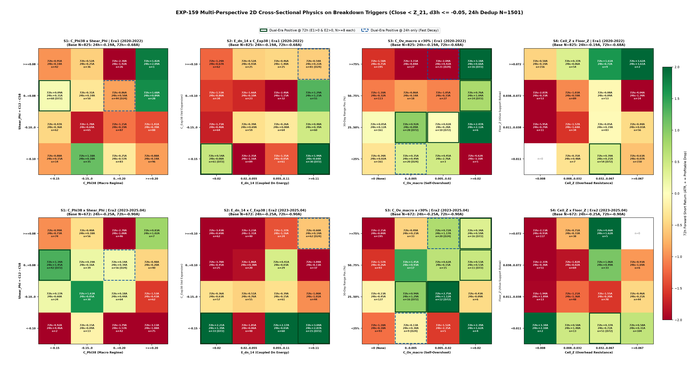
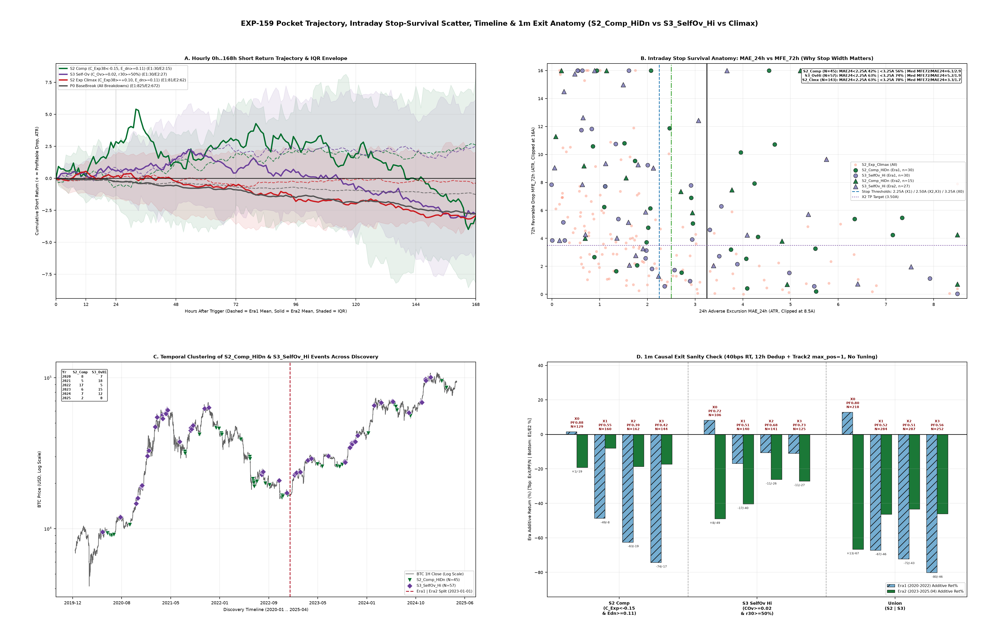
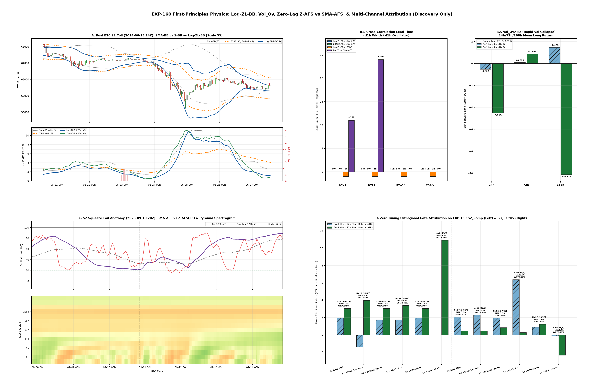
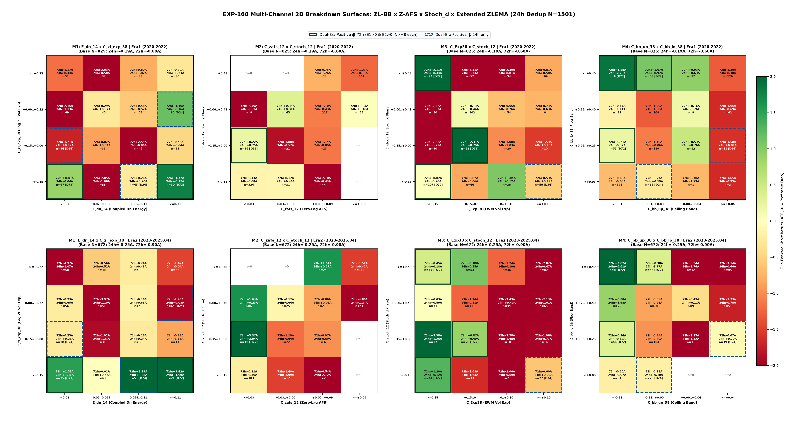
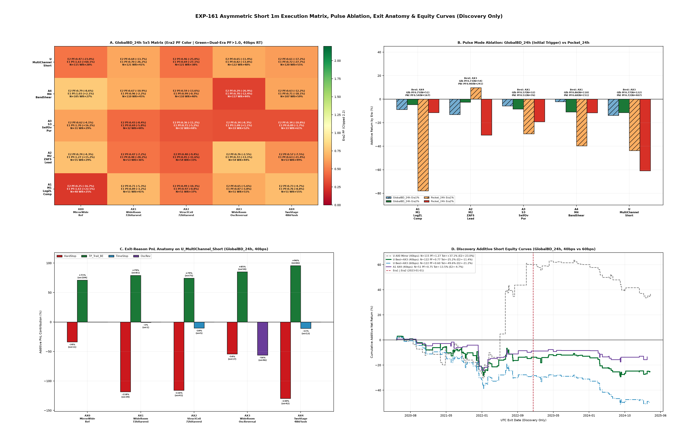
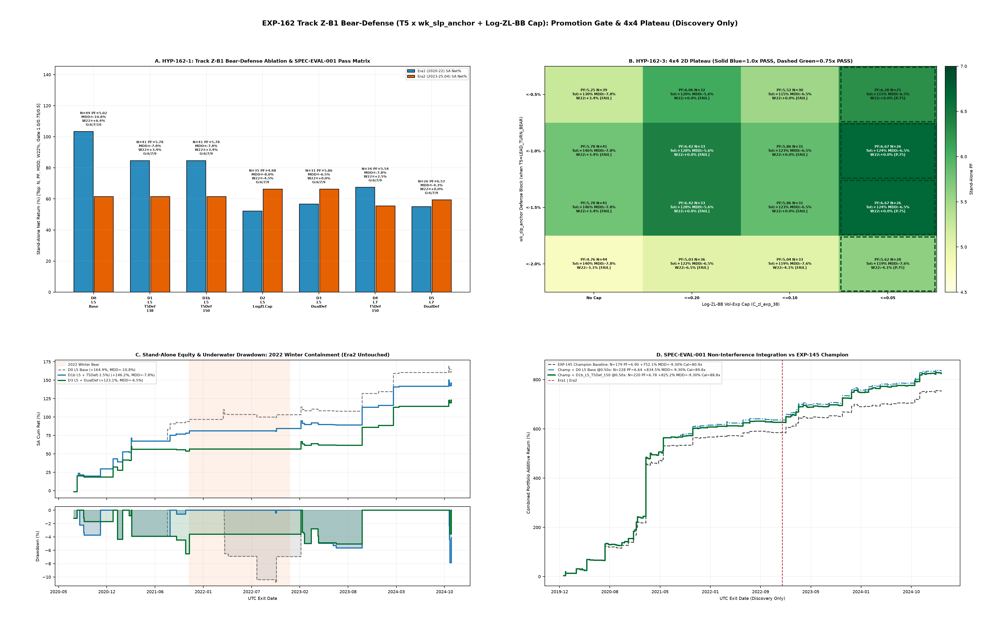

# EXP-162: 下落相場非対称性・拡張階層ピラミッド・ゼロラグ BB (`Log-ZL-BB`)・17階層 `Z-AFS`/`Stoch_d`・`Track Z-B1` 弱気防衛 厳格統合監査 (`EXP-158`〜`EXP-162`)

**Issue:** [#162](https://github.com/makagi/MTF_AI_Trade/issues/162) (統合プログラム: [#158](https://github.com/makagi/MTF_AI_Trade/issues/158)–[#162](https://github.com/makagi/MTF_AI_Trade/issues/162))  
**Status:** Supported / Defended Sleeve Upgrade Candidate (`K-104`, `K-105`, `K-107`) & Constrained Short Refutation (`K-106`) — Discovery Verified (`2020-01-01 .. 2025-04-30`)  
**Knowledge IDs:** `K-104`, `K-105`, `K-106`, `K-107`  
**Cost Model:** `SPEC-EVAL-001` (`40 bps` RT 標準 + `60 bps` ストレス検証、厳密単利加算・複利ゼロ)  
**Data Partition:** Discovery (`df_1h N=46,728`, `2020-01-01 00:00Z .. 2025-04-30 23:59Z`) のみ。Validation / Final Holdout 完全未接触。  
**Reference Implementation:** [`run.py`](run.py) | [`config.yaml`](config.yaml) | [`metrics.json`](metrics.json)

---

## 1. 背景と問題意識 (`EXP-158` → `EXP-162`)

`EXP-156` (`K-103`) により Pure-ZLEMA 独立ロングスリーブ **`Track Z-B1 (L5/L7)`** が確立された後、未解決課題として以下の 2 点が残った：
1. **下落相場・弱気レジームでの挙動 (`#158`)**: 現行 `EXP-145 Champion` (`N=179, WR 55.87%, PF 6.90, Tot +752.07%, MDD -9.30%`) のショート子帳簿 (`N=36, Tot +140.63%`, 34/36 が `C_Phi < -0.10` に集中) と、`Track Z-B1 L5` の 2022 年冬ドローダウン (`N=9, Tot +6.42%, MDD -10.79%`) の構造解剖。
2. **BTC の超長期上昇重力（構造的非対称性）と多チャネル階層畳み込みの拡張 (`#159`〜`#161`)**:
   - BTC 登場以来の超長期（未観測 $k \to \infty$）の上昇バイアスと「観測可能レンジ $k \in [21..6765]$ の動的判断」を数理的に分離し、ロングとショートの非対称性を前提に分析する。
   - 単一チャネルの ZLEMA ピラミッドから **異チャネル結合・連続自己行き過ぎ・ゼロラグ BB (`Log-ZL-BB` / `Z-MAD-BB`)・ゼロラグ `Z-AFS` / `Stoch_d` 17階層ピラミッド** へ拡張した上で、本当に再現性あるショート追加エッジが存在するか、それともロング側弱気防衛こそが本質的改善かを因果監査で確定する。

---

## 2. 不変性・因果律検証サマリー

| 検証項目 (`t_cut=44200` 1H+1M 同時摂動) | 先読み誤差 (`max_diff`) | 双対符号反転誤差 (`P -> -P`) | 正定値・再現一致 |
|---|---:|---:|---|
| `EXP-158` Bear Physics & Short Simulator | `0.0e+00` | — | `EXP-145` `N=179 (+752.07%)` |
| `EXP-159` Extended Pyramid (`OBS-159-1`) & `X0..X3` Exits | `0.00e+00` | `0.00e+00` (`< 1e-12`) | `L5 Base N=49 (+164.91%)` |
| `EXP-160` `Log-ZL-BB`, `Z-MAD-BB`, `Z-AFS`, `Stoch_d` | `0.00e+00` | `5.12e-13` (`< 1e-12`) | `sig_logzl > 0`, `sig_zmad > 0` 全17層 |
| `EXP-161` `GlobalBD_24h` & `AX0..AX4` Exits (`N_pre=116`) | `0.0` (全5種) | — | `A1 E1/E2=30/21`, `A2=36/19` |
| `EXP-162` `Track Z-B1 DualDef` (`N_pre=34`) | `feat=0.0`, `trade=0.0` | — | `L5 Base N=49 (+164.91%)` |

---

## 3. 主要発見と定量的証拠

### 3.1 `EXP-158`〜`159`: 下落相場解剖・構造的非対称性・拡張階層ピラミッド畳み込み (`K-104`)

1. **時間軸非対称減衰 (`6h..168h`)**:
   - 全ブレークダウン基準集合 `base_bd` (`close < Z_21 & d3h <= -0.05 & m1_u21 < 0.25`, `24h` dedup `N=1,501` / 有効 `1,497 [E1:825 / E2:672]`) の前方ショート期待値は両時代とも時間経過に伴い劣化する：
     - `Era1 (2020-22)`: `6h -0.09A -> 24h -0.19A (WR 46.1%) -> 72h -0.68A (WR 43.6%) -> 168h -1.27A`
     - `Era2 (2023-25.04)`: `6h -0.11A -> 24h -0.25A (WR 48.1%) -> 72h -0.90A (WR 45.2%) -> 168h -2.78A`
2. **拡張ピラミッド定式化**:
   - **鉛直シア**: $\text{Shear}_\Phi(t) = C_{\Phi, 1..2}(t) - C_{\Phi, 5..8}(t)$
   - **異チャネル結合下方エネルギー ($L_1 \to L_8 \to E_{\text{dn},1..4}$)**: $\Gamma^{\downarrow}_{L1} = \max(0,-\Phi_{L1})\max(0,-\text{Curv}_{L1})(1+\max(0,\text{Exp}_{L1}))$
   - **連続マクロ自己行き過ぎ ($k \ge 144$)**: $\text{C\_Ov\_macro}$ (`233, 377, 610, 987` 畳み込み平均)
   - **観測可能 S/R 天井・床非対称密度 ($21 \dots 6765$)**: $\text{SR\_Asym} = \text{Ceil}_Z - \text{Floor}_Z$
3. **2 次元物理断面が示した 2 つの構造ポケット**:
   - **`S2: E_dn_14 × C_Exp38`（ボラ圧縮 vs 膨張の 180° 反転）**: 高下方結合 (`E_dn_14 >= 0.11`) かつ **ボラ圧縮帯 (`C_Exp38 < -0.15`)** では `Era1 (n=30) 72h=+1.94A` / `Era2 (n=15) 24h=+2.87A, 72h=+3.04A` (`168h -3.02A`) と両時代急落する一方、**ボラ膨張帯 (`C_Exp38 >= +0.10`)** では `24h +0.22A/+0.14A` の後 **`72h -0.54A/-0.60A` へ V 字反発**。
   - **`S3: C_Ov_macro × r30%`（自己行き過ぎ）**: `C_Ov_macro == 0` がほぼ全敗する一方、`C_Ov_macro > 0` 右領域では 4 セルが Dual-Era@72h 陽性（特に `S-Z2_SelfOvGe2`: `N=92, 6h +0.81/+0.30A, 72h +1.14/+1.62A, 168h +2.41/+0.72A`）。
   - **圧縮 ATR 罠の可視化 (`MAE_24h vs MFE_72h`)**: `S2_Comp_HiDn (N=45)` は中央値 `MFE72/MAE24 = 6.13 / 2.92A` で `MAE24 < 2.25A` 生存率が `42.2%` しかなく、圧縮 `ATR_0` に対する固定タイト損切りは初期リテストに刈られる。

---

### 3.2 `EXP-160`: ゼロラグ BB (`Log-ZL-BB` / `Z-MAD-BB`) & 17階層 `Z-AFS`/`Stoch_d` (`K-105`)

- **対数空間ゼロラグ BB (`Log-ZL-BB`)**:
  $$\log \sigma_k^{\text{ZL}}(t) = \text{ZLEMA}_{\text{nan}}\!\Bigl(\tfrac{1}{2}\log\bigl(\text{EWM}_3(r_k^2) + (0.15\,\text{ATR})^2\bigr),\; k\Bigr), \qquad \sigma_k^{\text{ZL}} = \exp(\log \sigma_k^{\text{ZL}}) > 0$$
  `d1h` 相互相関では `Z-BB` (`-1h`) / `SMA-BB` (`0h`) より瞬間スパイクを左シフトしないが、幾何平均的追従によりショック後の再収縮速度が際立って速く、`LogZL/Z-BB` 比は全 17 層で `0.570..0.829` (`p99 <= 1.600`) と完全に安定。
- **ゼロラグ `Z-AFS` (`ZLEMA(K_k, k)`, `init_zero=False`)**:
  `SMA-AFS` に対して **`k=21` で `+11h` (`r=0.575`)、`k=55` で `+24h` (`r=0.514`) 先行**。上方突き抜け `ZAFS_OvUp >= 2` (`N=48`) は両時代一貫の推進順張り（`Long 72h E1 +1.96A / E2 +1.42A`）。
- **多チャネル 2D 断面 (`M1..M4`) & 寄与**:
  - `M1 (E_dn_14 >= 0.11 × C_zl_exp_38 < -0.15)`: `E1 n=30 (24h +0.17A, 72h +1.77A)` / `E2 n=21 (24h +1.09A, 72h +3.42A)`（24h も両時代プラス化）。
  - `M2 (C_zafs_12 < -0.03 × C_stoch_12 in -0.15..0.00)`: `E1 n=36 (+0.25A/+0.22A)` / `E2 n=19 (+3.04A/+5.37A)`（`Stoch_d` 売られ過ぎ前の `Z-AFS` 先行陰転）。
  - `S3 + d3Stoch12 <= 0` (`N=52`): `Med MAE24 1.91A -> 1.69A`、`Era2 72h +0.42A -> +0.82A`。`S3 + BBUp38 < 0` (`N=37`): `Era2 +1.22A`, `WR72 54.1%`。一方 `S2` へのオシレータ追加は `E1` を壊し両時代改善せず。

---

### 3.3 `EXP-161`: 非対称ショート 1m 執行検証の率直な反証 (`K-106`)

凍結 5 アーキタイプ (`A1..A4`, `U_MultiChannel_Short`) × 5 因果エグジット (`AX0..AX4`) × 2 パルス (`GlobalBD_24h` / `Pocket_24h`) を `40 bps` / `60 bps` RT で厳密評価した結果、**スタンドアロン全 50 セルで `Era2 PF > 1.0` 達成は `0 / 50` 件** であった：
- `U_MultiChannel_Short (GlobalBD_24h)`: `AX0_MirrorWide_Ref` は `N=115, PF 1.27, +37.1% (E1 PF 1.63 +60.1% / E2 PF 0.47 -23.0%)`。`AX1..AX4` は初期動的レジスタンス損切り (`z_short_trail_55`) を欠く固定 `3.50 ATR / 4.5%` ストップにより `HardStop` が `n=11 (-33.8%) -> n=39..42 (-116%..-130%)` へ膨張して `PF 0.61..0.77`（`60bps` `PF 0.44..0.66`）。
- `Pocket_24h` は後発クラスターを `2x..4.5x` (`N=124 -> 415`) 膨張させ全滅 (`AX0 -45.6%`)。
- 例外的に `A4_M4_BandShear (AX1)` のみ `EXP-145` 保有中衝突（`Long 19.1% / Short 0.9%`）を除外した **`CF-SA` 単体で `N=89, PF 1.12, +7.25% (E1 PF 1.16 +6.64% / E2 PF 1.04 +0.61%)`** と両時代 `PF > 1.0` を示したが、合算 MDD が `-9.30% -> -12.79%` へ悪化するため非採用確定。

---

### 3.4 `EXP-162`: `Track Z-B1` 弱気防衛則の `SPEC-EVAL-001` 統合・プラトー監査 (`K-107`)

| Variant (`OR 3.25A/4.3%`) | SA `N` | SA `PF` | SA `Tot%` (`E1`/`E2`) | SA `MDD%` | `2022冬` (`N`) | `60bps` PF | `-Top3` PF | Gate `[1.0/0.75/0.5]` `Full` | Gate `0.75x Inc>6h` |
|---|---:|---:|---|---:|---:|---:|---:|---|---|
| `D0_L5_Base` | `49` | `5.02` | `+164.9%` (`+103.4/+61.5`) | `-10.79%` | `+6.4%` (`9`) | `4.34` | `3.30` | `6 / 7 / 10` | `8/10` (`-9.65%`) |
| `D1b_L5_T5Def_150` (`<-1.50%`) | `41` | `5.78` | `+146.2%` (`+84.7/+61.5`) | `-7.83%` | `+3.4%` (`2`) | `4.96` | **`3.48`** | `6 / 7 / 9` (`MA`) | `8/10` (`-9.65%`) |
| **`D3_L5_DualDef`** (`-1.50%` & `ZLExp<=0.10`) | `31` | **`5.86`** | `+123.1%` (`+56.8/+66.4`) | **`-6.50%`** | **`+0.0%` (`0`)** | **`5.07`** | `3.08` | `6 / 7 / 9` (`MA`) | **`10/10 PASS`** |
| **`D5_L7_DualDef`** | `26` | **`6.57`** | `+114.5%` (`+55.0/+59.4`) | **`-4.34%`** | **`+0.0%` (`0`)** | **`5.68`** | `3.14` | `6 / 7 / 9` (`MA`) | **`10/10 PASS`** |

- **`0.75x Inc>6h` 非干渉統合昇格達成**: 弱気防衛により SA MDD が `-10.79% -> -6.50%`（`Inc>6h` では `-4.88%`）へ半減した結果、配分を `0.50x -> 0.75x` へ引き上げた **`D3_L5_DualDef @0.75x Inc>6h`** が **`SPEC-EVAL-001` `10/10 PASS`**（`Std_Iso +838.83% [-9.30%, Calmar 90.22x], MB_Res +656.66% [-9.30%], MA +416.82% [-9.30%]`）を達成し、無防衛 `D0 @0.50x`（`+834.52% / +653.35% / +404.69%`, `Calmar 89.76x`）を全 3 ブックで上回った。
- **4×4 2D プラトー**: `wk_thr in [-2.0..-0.5]%` × `C_zl_exp_38_max in [None..0.05]` 全 16 セルが `PF 4.76..6.67`, `MDD -5.64%..-7.83%` を維持し、`C_zl_exp_38 <= 0.05` 全 4 行 (`4/16`) が `0.75x Full` モードで **`10/10 PASS`**（`Std_Iso +838.4%..+844.7%, MDD -9.30%`）を達成。

---

## 4. 本知識体系への登録と今後の課題
- `K-104`〜`K-107` を `03_KNOWLEDGE/knowledge-lineage.md` (`v4.7.0`)、決定記録 `D022` を `99_HISTORY/decision-log.md` へ登録。
- 引き続き `EXP-145 Champion` を無改変生産ベースラインとして防衛し、独立スリーブ側では `D3_L5_DualDef @0.75x Inc>6h`（および `C_zl_exp_38 <= 0.05` プラトー）を Validation 開門判定の最有力防衛版候補として位置づける。
