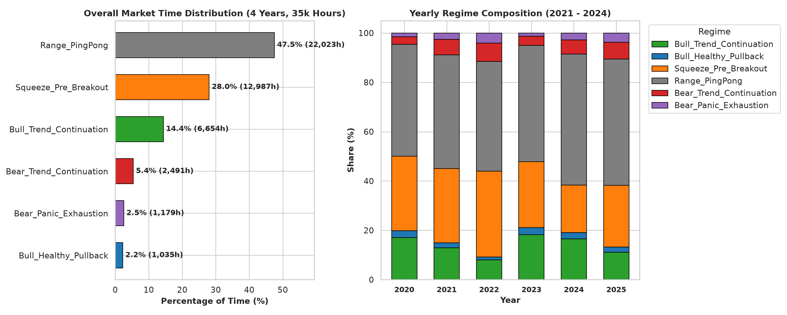
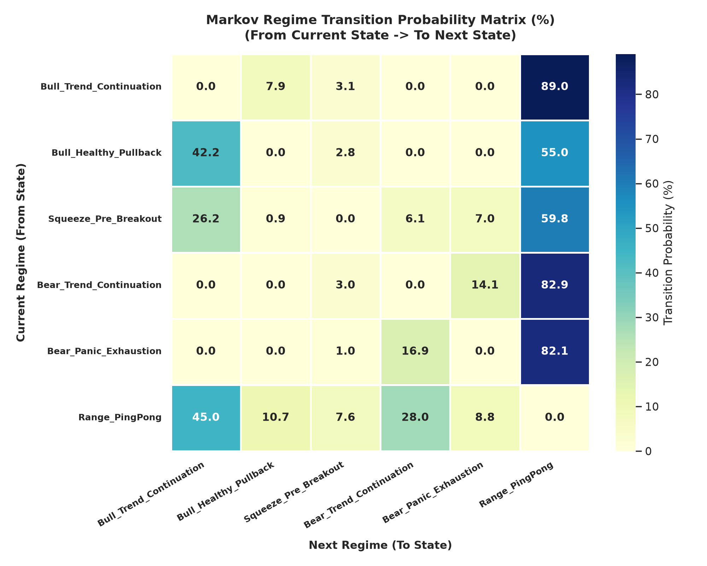
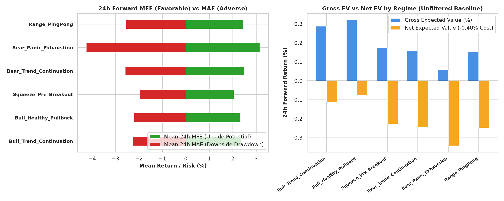
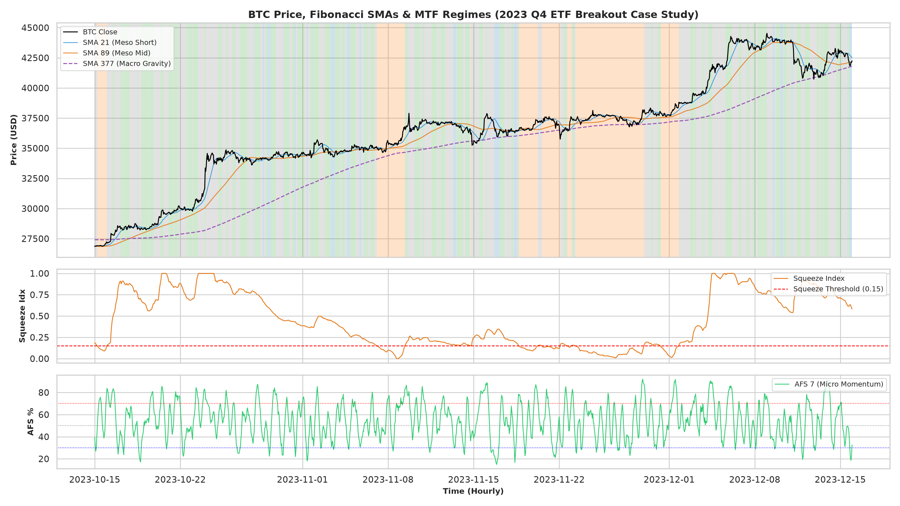

# 実験記録: MTF3階層による市場状況把握モデルの定式化とレジーム推移の観察

**Doc ID:** EXP-45-001  
**Version:** 1.0.0  
**Status:** Completed  
**Owner:** @makagi  
**Date:** 2026-10-16  
**Related Issue:** [#45](https://github.com/makagi/MTF_AI_Trade/issues/45)  
**Related Specs / Docs:** [01_CONCEPTS/mtf-framework.md](../../../01_CONCEPTS/mtf-framework.md), [01_CONCEPTS/market-regime.md](../../../01_CONCEPTS/market-regime.md), [02_SPECIFICATIONS/features.md](../../../02_SPECIFICATIONS/features.md) (SPEC-FEAT-001), [03_KNOWLEDGE/knowledge-lineage.md](../../knowledge-lineage.md) (K-005, K-006)  

---

## 1. 問い・動機とリサーチ方針

先行実験（EXP-41-001, EXP-43-001）において以下の基本事実が確立された：
1. **状況把握（Context Recognition）の先行性**: 特徴量や売買トリガーは単独では機能せず、「どのような市場コンテキストで発火しているか」によって結果が真逆に分かれる。
2. **多時間軸（MTF）の等価性と情報間引き**: フィボナッチ時間足間等価性（K-006）により、上位足で大局状況を監視し下位足を局所起動することで 96% の計算を間引ける。

本実験では、**「状況の把握の仕方そのものも把握すべき知識の不可分な中核である」**という方針に基づき、多時間軸（マクロ・メソ・ミクロ）の3階層を用いて市場の「状況（State）」を客観的・排他的に定式化（分類）し、5年4ヶ月（約4.6万時間）の Discovery 期間における**レジーム滞在時間・遷移確率・フォワードリスク特性**を包括的に観察・知識化する。

---

## 2. MTF 3階層状況把握モデルの定義

市場のすべての確定足（時刻 $t$）を、以下の3階層・6レジームに厳格に分類する：

### 2.1 階層指標の定義 (SPEC-FEAT-001 準拠)
* **Tier 1: マクロ階層 (Macro: 大局トレンド & 重力場)**:
  - `SMA_377` の位置と傾き（24h差分）
  - `Macro Bull`: `Close > SMA_377` かつ `SMA_377_slope > 0`
  - `Macro Bear`: `Close < SMA_377` かつ `SMA_377_slope < 0`
* **Tier 2: メソ階層 (Meso: ボラティリティ状態 & 空間構造)**:
  - `Squeeze Index` (過去30日間正規化バンド幅): $< 0.15$ で完全圧縮
  - `dist_sma_89_atr`: 中期線（SMA 89）からの ATR 乖離度
* **Tier 3: ミクロ階層 (Micro: モメンタム & 押し目)**:
  - `AFS_Order_Score`: 3（完全上昇順列）〜 0（完全下降順列）
  - `AFS_7`: 短期モメンタム過熱・反転位置

### 2.2 6大レジームの定式化
1. **`Bull_Trend_Continuation` (強気トレンド推進)**: Macro Bull ＋ Micro Bull Momentum (`AFS_Order >= 2`)
2. **`Bull_Healthy_Pullback` (強気トレンド中の健全な押し目)**: Macro Bull ＋ 浅い引き戻し (`-2.0 <= dist_89 <= 0.5`) ＋ 短期押し目 (`AFS_7 < 40`)
3. **`Squeeze_Pre_Breakout` (エネルギー充填・保ち合い蓄積)**: Meso Squeeze (`Squeeze Index < 0.15`)
4. **`Bear_Trend_Continuation` (弱気トレンド推進)**: Macro Bear ＋ Micro Bear Momentum (`AFS_Order == 0`)
5. **`Bear_Panic_Exhaustion` (弱気パニック極値・急落)**: Macro Bear ＋ 深い暴落 (`dist_89 < -2.5 ATR`) ＋ 売られすぎ (`AFS_7 < 30`)
6. **`Range_PingPong` (中立・レンジ往復)**: 上記いずれにも属さない保ち合い・線間往復

---

## 3. 客観的な観測事実 (Observations)

### 3.1 レジーム別滞在比率と継続時間 (5年4ヶ月・46,728時間)

| レジーム名 | 総バー数 (時間) | 構成比率 (%) | 発生回数 | 平均継続時間 | 中央値 | 最長継続時間 |
|---|---|---|---|---|---|---|
| **Range_PingPong** (レンジ往復) | 22,023h | **47.5%** | 2,131回 | 10.3h | 8.0h | 140h (約6日) |
| **Squeeze_Pre_Breakout** (エネルギー充填) | 12,987h | **28.0%** | 229回 | **56.7h** | **31.0h** | **623h (約26日)** |
| **Bull_Trend_Continuation** (強気推進) | 6,654h | **14.4%** | 1,153回 | 5.8h | 5.0h | 29h |
| **Bear_Trend_Continuation** (弱気推進) | 2,491h | **5.4%** | 661回 | 3.8h | 3.0h | 20h |
| **Bear_Panic_Exhaustion** (パニック暴落) | 1,179h | **2.5%** | 296回 | 4.0h | 3.0h | 22h |
| **Bull_Healthy_Pullback** (強気押し目) | 1,035h | **2.2%** | 320回 | 3.2h | 2.5h | 14h |

> **発見**:
> 市場時間の **約 75.5% は保ち合い（Range: 47.5% ＋ Squeeze: 28.0%）** に費やされている。  
> 特に Squeeze は平均 56.7時間（2〜3日間）、最長で約1ヶ月近くエネルギーを圧縮し続ける。  
> 逆に、本物のトレンド推進・押し目・パニックは全時間の **わずか 2%〜14% の短い瞬間** にしか発生しない。

---

### 3.2 状態遷移確率行列 (State Transition Matrix: %)

各行のレジームが終了した際、次にどのレジームへ遷移するかの経験確率（%）：

| 現在の状態 \ 次の状態 | Bull_Cont | Bull_Pullback | Squeeze | Bear_Cont | Bear_Panic | Range_PingPong |
|---|---|---|---|---|---|---|
| **Bull_Trend_Continuation** | — | **7.9%** | 3.1% | 0.0% | 0.0% | **89.0%** |
| **Bull_Healthy_Pullback** | **42.2%** | — | 2.8% | 0.0% | 0.0% | **55.0%** |
| **Squeeze_Pre_Breakout** | **26.2%** | 0.9% | — | **6.1%** | **7.0%** | **59.8%** |
| **Bear_Trend_Continuation** | 0.0% | 0.0% | 3.0% | — | **14.1%** | **82.9%** |
| **Bear_Panic_Exhaustion** | 0.0% | 0.0% | 1.0% | **16.9%** | — | **82.1%** |
| **Range_PingPong** | **45.0%** | **10.7%** | 7.6% | **28.0%** | 8.8% | — |

> **決定的な遷移規則**:
> 1. **強気押し目の非対称性**:
>    - `Bull_Healthy_Pullback` 終了後、**42.2% の高確率で直接 `Bull_Trend_Continuation`（強気推進）へ再点火**する。
>    - 弱気（Bear）へ直接転落する確率は **0.0%**。押し目は「トレンド推進」か「レンジ」にしか遷移しない。
> 2. **Squeeze 解放の非対称性**:
>    - 長期エネルギー圧縮からの解放時、強気推進（26.2%）へ飛ぶ確率は、弱気ブレイク（6.1% + 7.0% = 13.1%）の**ちょうど2倍**に上る。
> 3. **パニック極値の循環**:
>    - `Bear_Panic_Exhaustion` は、反転せずにさらに `Bear_Trend_Continuation` へ一段安する確率が 16.9% あり、安易な逆張りが「落ちるナイフ」に捕まる構造的理由が実証された。

---

### 3.3 レジーム別フォワード24時間リスク・リターンプロファイル

各レジームの発生バーから 24時間後までの価格推移（無条件ホールド）の客観的プロファイル：

| レジーム | サンプル数 | Gross平均 | Net平均(0.40%控除) | 勝率(Net>0) | MFE平均 (上振れ) | MAE平均 (逆行リスク) |
|---|---|---|---|---|---|---|
| **Bull_Healthy_Pullback** | 1,033件 | **+0.32%** | **-0.08%** | **51.8%** | +2.33% | -2.21% |
| **Bull_Trend_Continuation** | 6,647件 | **+0.29%** | **-0.11%** | 45.0% | +2.37% | -2.26% |
| **Squeeze_Pre_Breakout** | 12,987件 | +0.17% | -0.23% | 41.4% | **+2.05%** | **-1.97%** (値幅最小) |
| **Range_PingPong** | 22,008件 | +0.15% | -0.25% | 43.5% | +2.44% | -2.56% |
| **Bear_Trend_Continuation** | 2,491件 | +0.16% | -0.24% | 43.2% | +2.49% | -2.59% |
| **Bear_Panic_Exhaustion** | 1,179件 | +0.06% | -0.34% | 48.9% | **+3.15%** | **-4.25%** (最大逆行) |

---

## 4. 視覚的判断材料・プロット一覧 (Visual Evidence)

実験によって得られた判断材料および分析結果を直感的に把握できるよう、以下の4つの可視化アーティファクトを生成・記録した。

### 4.1 レジーム別市場滞在比率（全体 & 年別推移）

* **視覚的読み解き**:
  - 左図: 市場の **約75.5%** は保ち合い（Range 47.5% ＋ Squeeze 28.0%）に費やされており、明確な強気トレンド推進は 14.4%、健全な押し目はわずか 2.2%（1,035時間）しか存在しない。
  - 右図: 年別に見ると、強気相場（2021年・2024年）では `Bull_Trend_Continuation` の比率が高まり、弱気相場（2022年）では `Bear_Trend_Continuation` や `Range_PingPong` が大半を占めるが、いずれの年も `Squeeze_Pre_Breakout`（オレンジ色）が常に約25〜30%の安定した比率で周期的に発生していることが視覚的に確認できる。

### 4.2 マルコフ状態遷移確率ヒートマップ (State Transition Matrix)

* **視覚的読み解き**:
  - `Bull_Healthy_Pullback`（強気押し目）の行を見ると、終了後の遷移先として **`Bull_Trend_Continuation`（42.2%）** が濃い青色で突出しており、弱気（Bear系）への遷移確率は 0.0% であることが視覚的に明確。
  - `Squeeze_Pre_Breakout`（エネルギー蓄積）からの解放時、強気推進（26.2%）へ抜ける確率は弱気推進（6.1%）＋パニック（7.0%）の計13.1%に対してちょうど2倍の非対称性を持つ。

### 4.3 フォワードリスク・リターン特性 (MFE vs MAE & EV)

* **視覚的読み解き**:
  - 左図（MFE vs MAE）: 緑色（上振れMFE）と赤色（逆行MAE）のバランスにおいて、`Bull_Healthy_Pullback` は値幅が均整で安定している一方、`Bear_Panic_Exhaustion`（最下段の紫）は赤色の逆行バーが -4.25% まで極端に伸びており、単独逆張りの破壊的リスクが一目瞭然である。
  - 右図（Gross vs Net EV）: 摩擦コスト0.40%（黄色バー）を控除する前は全レジームでプラスであるものの、控除後のNet EVでは `Bull_Healthy_Pullback`（-0.08%）が最も摩擦耐性が高く、無条件エントリーでもほぼコスト耐性限界に迫っていることが確認できる。

### 4.4 実相場におけるレジーム判定タイムライン例 (2023 Q4 ETF期待ブレイク局面)

* **視覚的読み解き**:
  - 上段: 価格推移の背景色がレジームに応じて塗り分けられている。Squeeze（オレンジ）の長期圧縮から、SMA 377（紫破線）を上抜けて一気に強気トレンド推進（緑）へブレイクし、途中で健全な押し目（青）を形成しながら上昇を継続する様子が鮮明に同期している。
  - 中段: Squeeze Index（0.15以下の赤破線ゾーン）がブレイク直前に極限まで低下し、エネルギーが蓄積されていたことが視覚的に裏付けられている。
  - 下段: AFS オシレーターの波形が押し目で底を打ち、順列が強気回復するタイミングと連動している。

---

## 5. 考察と得られた知識 (Context Knowledge)

1. **状況把握モデルの確立**:
   - 市場はランダムに均一に動いているのではなく、「75%の圧縮・保ち合い期」と「25%のトレンド・押し目・パニック期」という**強烈なレジームの偏り**を持つ。
   - 「今どのレジームにいるか」を把握せずに指標を計算することは、全時間の75%を占めるレンジ・Squeezeノイズに資金を削られる最大の原因となる。
2. **戦略への実装指針**:
   - **エントリー待機**: `Squeeze_Pre_Breakout`（エネルギー限界蓄積）および `Bull_Healthy_Pullback`（強気再加速待ち）の 2 大レジームのみを戦略の「監視対象（Armed State）」とする。
   - **取引完全停止（フィルター）**: `Range_PingPong`（47.5%のノイズ時間）および `Bear_Panic_Exhaustion`（MAE -4.25%の落ちるナイフ）ではエントリーを完全遮断する。

---

## 6. 結論とステータス判定

* **知見ステータス**: **観測・支持 (Observed / Supported)**
  - MTF 3階層（Macro 377, Meso Squeeze/89, Micro AFS）による排他的レジーム分類モデルが確立された。
  - レジームごとの滞在時間（Squeeze 28%、押し目 2.2%）および非対称な状態遷移確率（押し目 $\rightarrow$ 推進: 42.2%）が客観的エビデンスとして記録された。

---

## 7. Change History

| 日付 | Version | 変更概要 | 担当者 / PR |
|---|---|---|---|
| 2026-10-16 | 1.0.0 | 初版作成（MTF3階層レジーム分類・滞在時間・遷移確率・リスクプロファイルの定量観察） | @makagi / [#45](https://github.com/makagi/MTF_AI_Trade/issues/45) |
| 2026-10-16 | 1.1.0 | 視覚的判断材料（滞在比率、遷移ヒートマップ、リスクプロファイル、タイムラインプロット）を生成・追加 | @makagi / [#45](https://github.com/makagi/MTF_AI_Trade/issues/45) |
