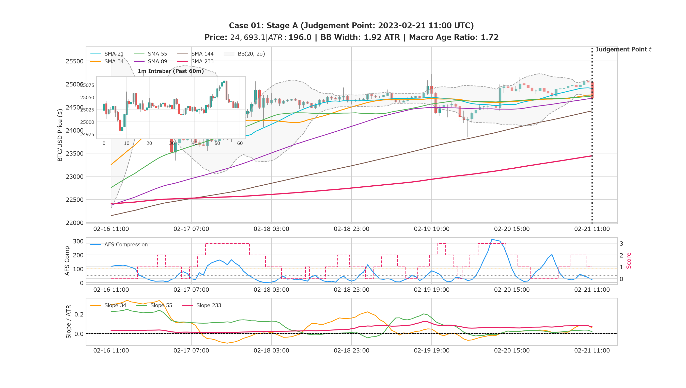
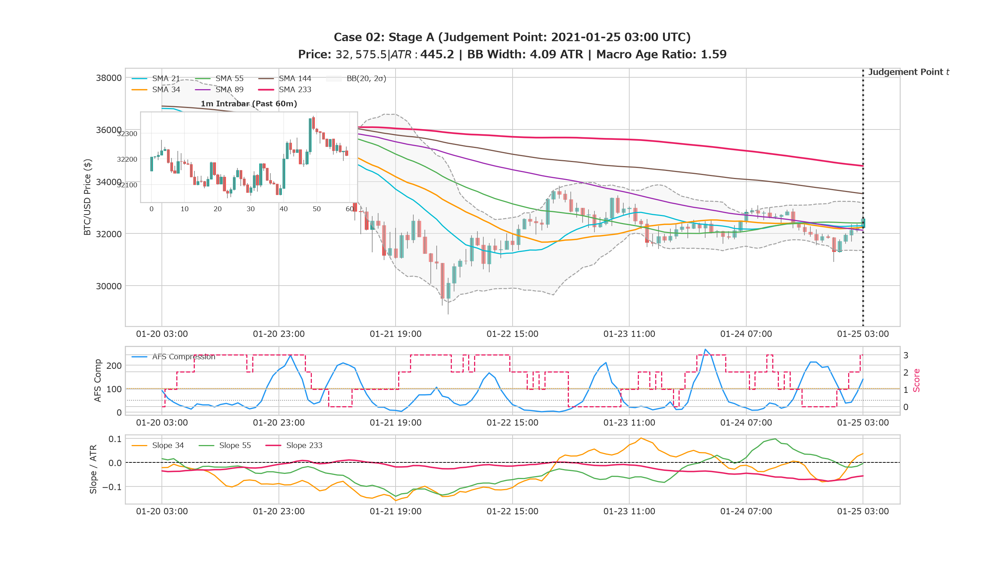
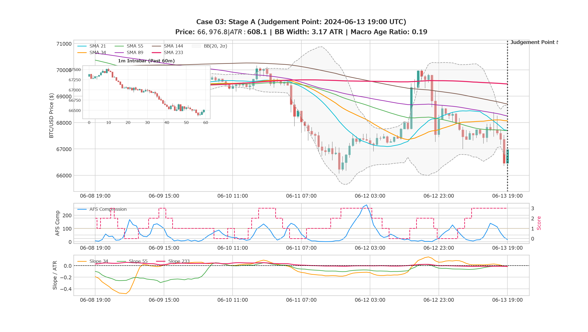
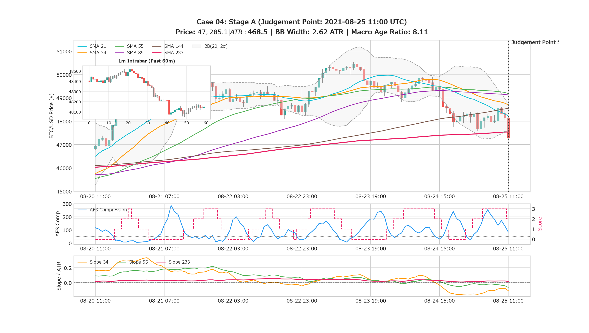
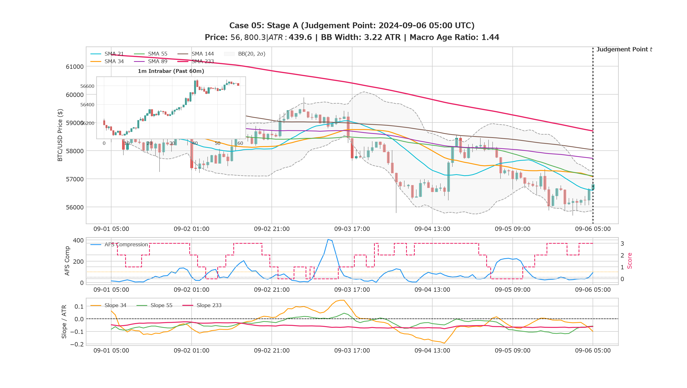
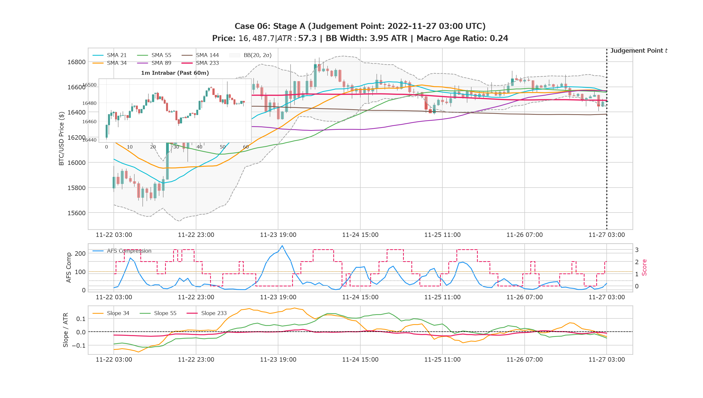
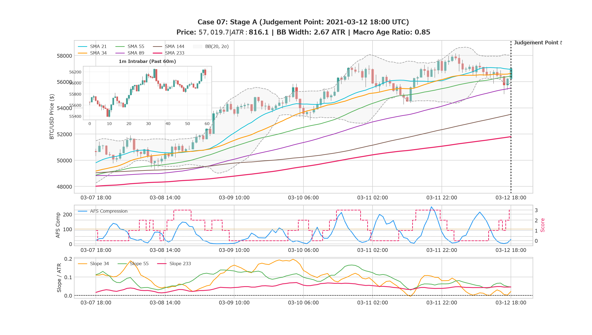
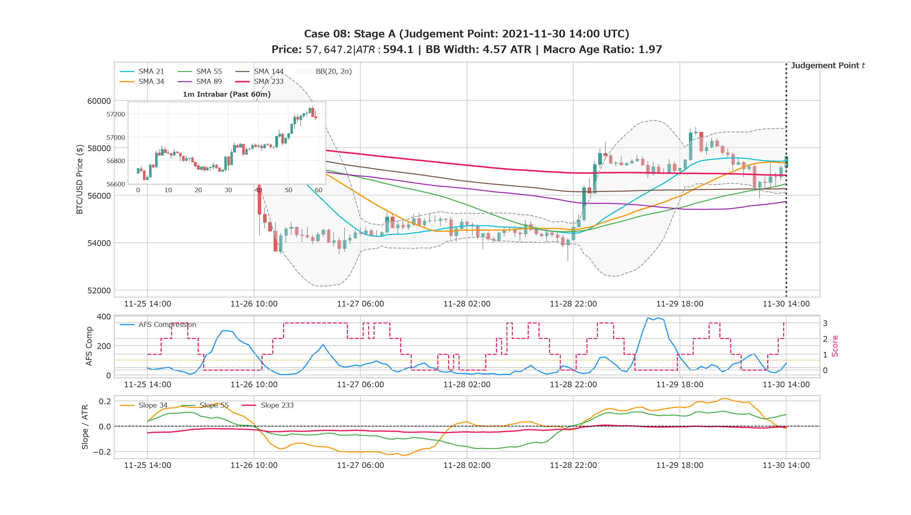
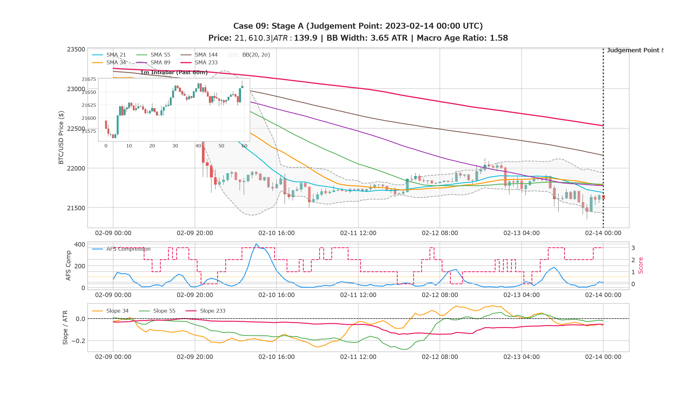
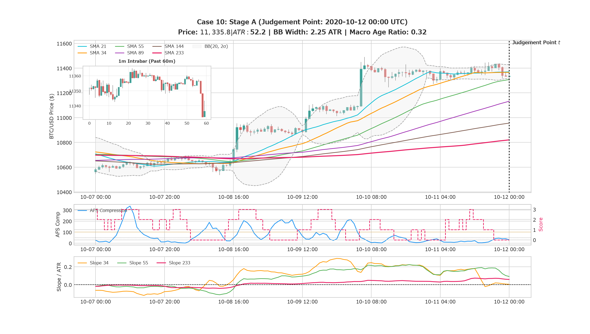

# Missed Opportunity Review: Stage A (判断質問票 - EXP-77)

**Review ID:** `MOR-77-01`  
**Experiment:** EXP-77 (K-038 MVC)  
**実施日:** 2026-10-25  
**レビュアー:** @makagi  

---

## 1. 概要と回答手順 (Instructions)

本レビューは、定量的バックテストでは拾いきれなかった「急騰の取りこぼし（見逃し）」と「対照群（伸びなかった場面・負けトレード）」をブラインドで混在させ、人間の視点を仮説生成のインプットとして取り込む工程（Human-in-the-Loop Review）です。

### 回答ルール
1. 各ケースの **Stage A チャート（判断時点 $t$ までの過去 120時間ローソク足および指標）** を観察してください（未来の情報は一切含まれていません）。
2. あなた自身がこの瞬間にチャートの前に立っていたとして、以下の3択から直感・判断を選択してください：
   - **`long`**: 買いでエントリーしたい（上値余地があり、勢い・構造が良好）
   - **`skip`**: 見送り・見送るべき（頭上抵抗がある、ダマシっぽい、勢いが鈍い）
   - **`unsure`**: 迷う・どちらとも言えない
3. **判断の根拠（何を見てそう感じたか）** を簡潔に記入してください（例：「SMA 34 の下値支持が強固」「頭上 SMA 89 に抑え込まれそう」「直前で急伸しすぎていて過熱感」など）。
4. 全 10 ケースの回答完了後、エージェントが Stage B（72時間の結末チャートと正解ラベル）を開示します。

---

## 2. ケース別 Stage A チャートと質問票

### Case 01

- **観測時刻**: `2023-02-21T11:00:00+00:00`
- **客観状況**: 価格 `$24,691.7` | ATR `$196.0` | BB 幅 `1.92 ATR` | Macro Age Ratio `1.72` | AFS Comp `20.8` (Score `1`)

#### 【あなたの判断】
- [ ] **`long`**（エントリー推奨）
- [ ] **`skip`**（見送り推奨）
- [ ] **`unsure`**（判断保留）
- **判断理由・着目したポイント**:
  > （ここに理由を記入）

---

### Case 02

- **観測時刻**: `2021-01-25T03:00:00+00:00`
- **客観状況**: 価格 `$32,575.5` | ATR `$445.2` | BB 幅 `4.09 ATR` | Macro Age Ratio `1.59` | AFS Comp `140.3` (Score `3`)

#### 【あなたの判断】
- [ ] **`long`**（エントリー推奨）
- [ ] **`skip`**（見送り推奨）
- [ ] **`unsure`**（判断保留）
- **判断理由・着目したポイント**:
  > （ここに理由を記入）

---

### Case 03

- **観測時刻**: `2024-06-13T19:00:00+00:00`
- **客観状況**: 価格 `$66,973.8` | ATR `$608.1` | BB 幅 `3.17 ATR` | Macro Age Ratio `0.19` | AFS Comp `15.8` (Score `3`)

#### 【あなたの判断】
- [ ] **`long`**（エントリー推奨）
- [ ] **`skip`**（見送り推奨）
- [ ] **`unsure`**（判断保留）
- **判断理由・着目したポイント**:
  > （ここに理由を記入）

---

### Case 04

- **観測時刻**: `2021-08-25T11:00:00+00:00`
- **客観状況**: 価格 `$47,285.2` | ATR `$468.5` | BB 幅 `2.62 ATR` | Macro Age Ratio `8.11` | AFS Comp `83.8` (Score `2`)

#### 【あなたの判断】
- [ ] **`long`**（エントリー推奨）
- [ ] **`skip`**（見送り推奨）
- [ ] **`unsure`**（判断保留）
- **判断理由・着目したポイント**:
  > （ここに理由を記入）

---

### Case 05

- **観測時刻**: `2024-09-06T05:00:00+00:00`
- **客観状況**: 価格 `$56,800.3` | ATR `$439.6` | BB 幅 `3.22 ATR` | Macro Age Ratio `1.44` | AFS Comp `92.8` (Score `3`)

#### 【あなたの判断】
- [ ] **`long`**（エントリー推奨）
- [ ] **`skip`**（見送り推奨）
- [ ] **`unsure`**（判断保留）
- **判断理由・着目したポイント**:
  > （ここに理由を記入）

---

### Case 06

- **観測時刻**: `2022-11-27T03:00:00+00:00`
- **客観状況**: 価格 `$16,487.7` | ATR `$57.3` | BB 幅 `3.95 ATR` | Macro Age Ratio `0.24` | AFS Comp `35.1` (Score `2`)

#### 【あなたの判断】
- [ ] **`long`**（エントリー推奨）
- [ ] **`skip`**（見送り推奨）
- [ ] **`unsure`**（判断保留）
- **判断理由・着目したポイント**:
  > （ここに理由を記入）

---

### Case 07

- **観測時刻**: `2021-03-12T18:00:00+00:00`
- **客観状況**: 価格 `$57,019.8` | ATR `$816.1` | BB 幅 `2.67 ATR` | Macro Age Ratio `0.85` | AFS Comp `30.0` (Score `3`)

#### 【あなたの判断】
- [ ] **`long`**（エントリー推奨）
- [ ] **`skip`**（見送り推奨）
- [ ] **`unsure`**（判断保留）
- **判断理由・着目したポイント**:
  > （ここに理由を記入）

---

### Case 08

- **観測時刻**: `2021-11-30T14:00:00+00:00`
- **客観状況**: 価格 `$57,646.9` | ATR `$594.1` | BB 幅 `4.57 ATR` | Macro Age Ratio `1.97` | AFS Comp `79.9` (Score `3`)

#### 【あなたの判断】
- [ ] **`long`**（エントリー推奨）
- [ ] **`skip`**（見送り推奨）
- [ ] **`unsure`**（判断保留）
- **判断理由・着目したポイント**:
  > （ここに理由を記入）

---

### Case 09

- **観測時刻**: `2023-02-14T00:00:00+00:00`
- **客観状況**: 価格 `$21,610.4` | ATR `$139.9` | BB 幅 `3.65 ATR` | Macro Age Ratio `1.58` | AFS Comp `45.3` (Score `3`)

#### 【あなたの判断】
- [ ] **`long`**（エントリー推奨）
- [ ] **`skip`**（見送り推奨）
- [ ] **`unsure`**（判断保留）
- **判断理由・着目したポイント**:
  > （ここに理由を記入）

---

### Case 10

- **観測時刻**: `2020-10-12T00:00:00+00:00`
- **客観状況**: 価格 `$11,335.8` | ATR `$52.2` | BB 幅 `2.25 ATR` | Macro Age Ratio `0.32` | AFS Comp `29.9` (Score `0`)

#### 【あなたの判断】
- [ ] **`long`**（エントリー推奨）
- [ ] **`skip`**（見送り推奨）
- [ ] **`unsure`**（判断保留）
- **判断理由・着目したポイント**:
  > （ここに理由を記入）

---
