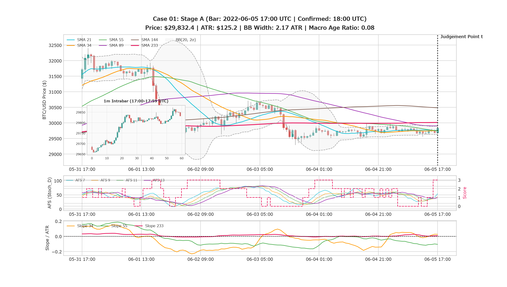
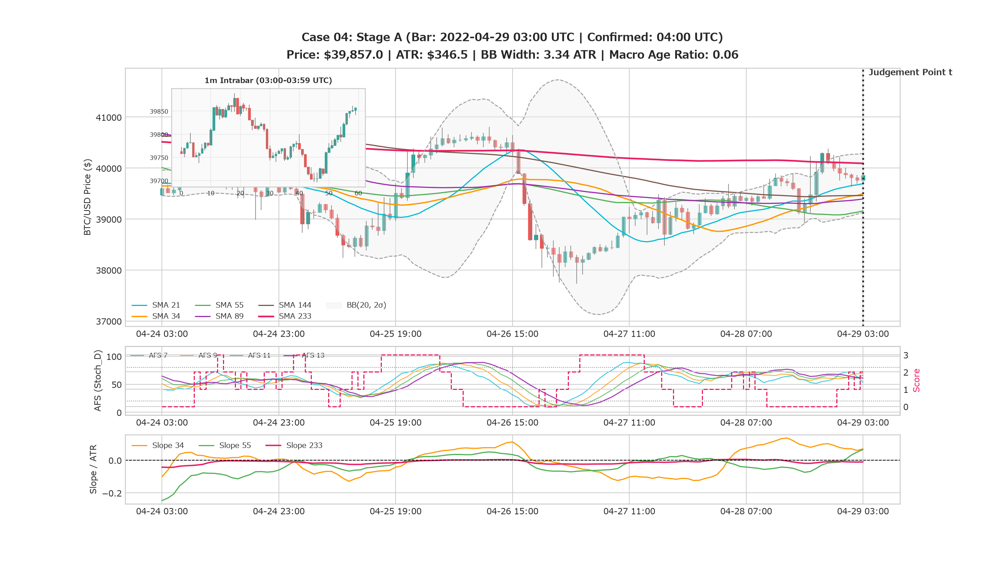
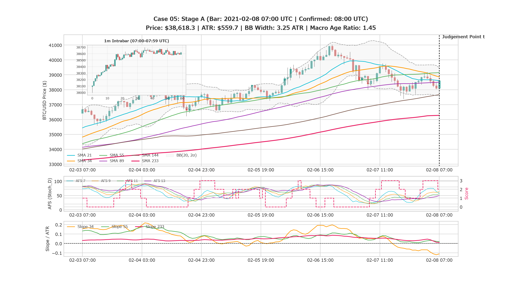
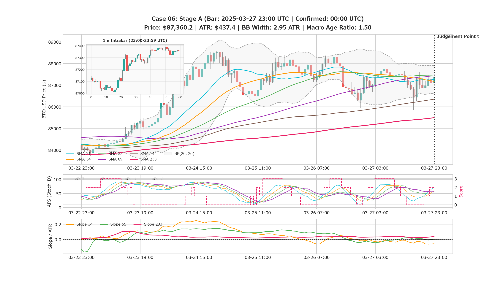
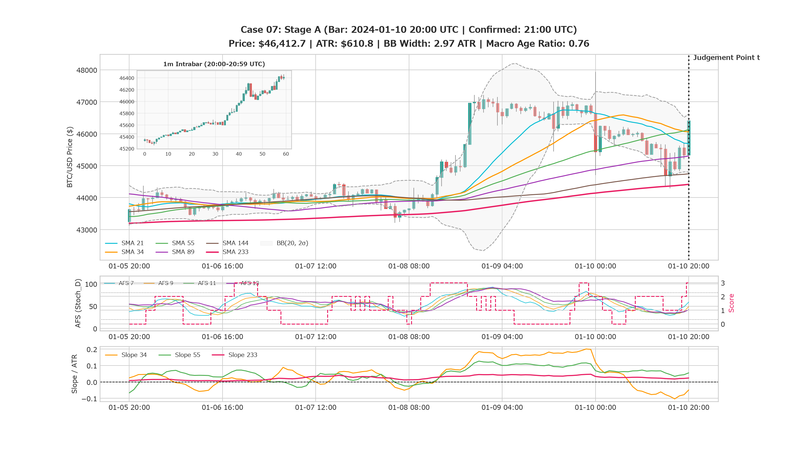
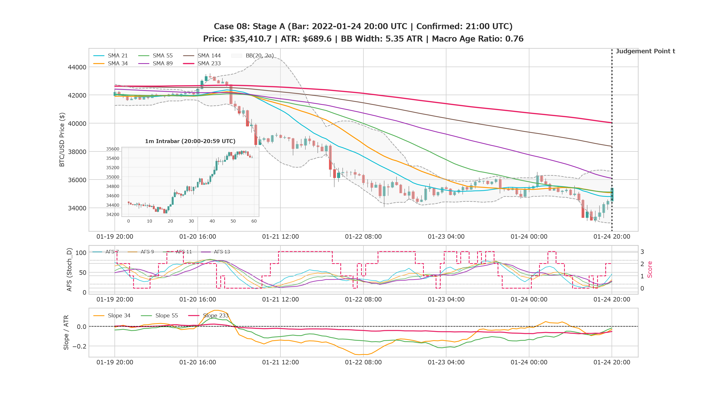
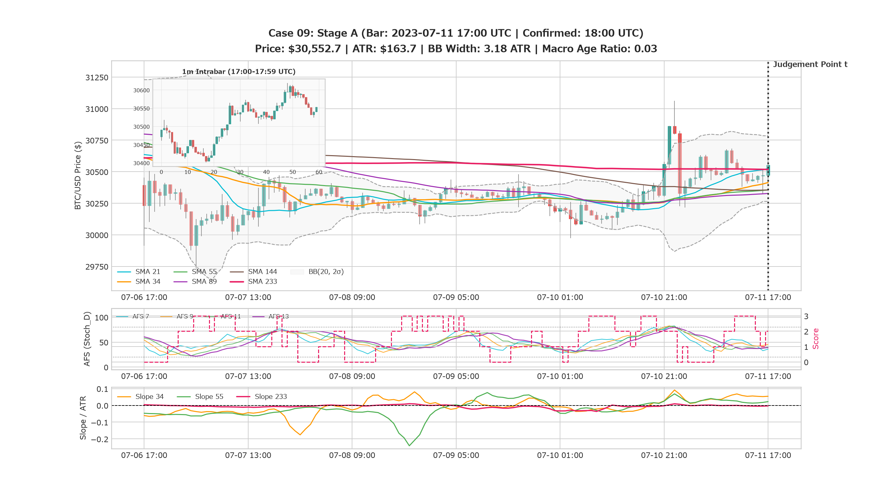
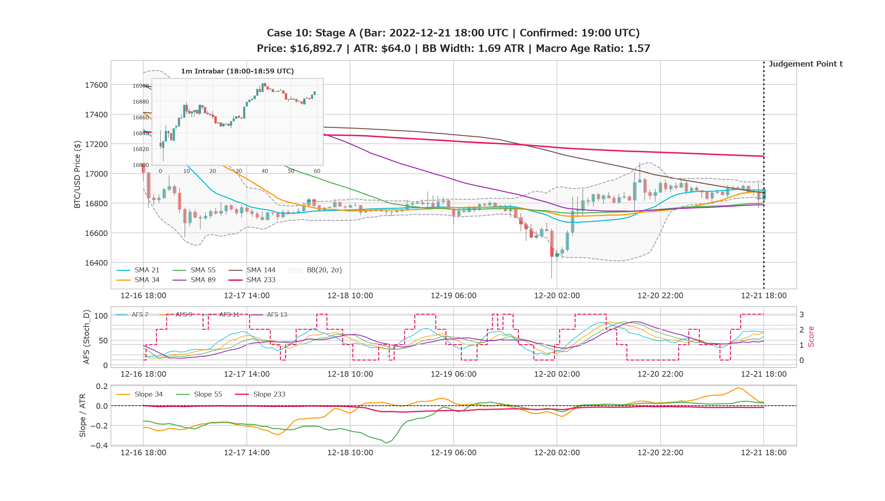

# Missed Opportunity Review: Stage A (判断質問票 - EXP-86)

**Review ID:** `MOR-86-01`  
**Experiment:** EXP-86 (K-043 Selective (K-038 MVC + K-043 Pullback))  
**実施日:** 2026-10-30  
**レビュアー:** @makagi  

---

## 1. 概要と回答手順 (Instructions)

本レビューは、定量的バックテストでは拾いきれなかった「急騰の取りこぼし（見逃し）」と「対照群（伸びなかった場面・負けトレード）」をブラインドで混在させ、人間の視点を仮説生成のインプットとして取り込む工程（Human-in-the-Loop Review）です。

### 回答ルール
1. 各ケースの **Stage A チャート（判断時点 $t$ までの過去 120時間ローソク足および指標）** を観察してください（未来の情報は一切含まれていません）。
2. **個別回答（1件ずつ）に対応**: 全10件を一度に回答する必要はありません。多角的に分析するため外部ツール等を参照しながら、1ケースずつ判断を進めることができます。
3. あなた自身がこの瞬間にチャートの前に立っていたとして、以下の3択から直感・判断を選択してください：
   - **`long`**: 買いでエントリーしたい（上値余地があり、勢い・構造が良好）
   - **`skip`**: 見送り・見送るべき（頭上抵抗がある、ダマシっぽい、勢いが鈍い）
   - **`unsure`**: 迷う・どちらとも言えない
4. **判断の根拠（何を見てそう感じたか）** を簡潔に記入してください（例：「SMA 34 の下値支持が強固」「頭上 SMA 89 に抑え込まれそう」「直前で急伸しすぎていて過熱感」など）。
5. 回答完了後、エージェントが Stage B（72時間の結末チャートと正解ラベル）を開示します（ケースごとの即時開示も可能です）。

---

## 2. ケース別 Stage A チャートと質問票

### Case 01

- **日時**: 始値 `2022-06-05 17:00 UTC` → 確定 `2022-06-05 18:00 UTC` (`2022-06-06 03:00 JST` BTC/USDT 1h足確定)
- **価格・OHLCV**: Open: `$29,683.7` | High: `$29,872.5` | Low: `$29,656.2` | Close: `$29,832.4` | Volume: `0.0`
- **価格レンジ**: 過去24h: `$29,554.0` 〜 `$29,995.0` | 過去120h: `$29,293.2` 〜 `$32,399.7`
- **テクニカル指標**: ATR(24): `$125.2` | BB 幅: `2.17 ATR` | Macro Age Ratio: `0.08` | AFS (7/9/11/13): `53.7/42.4/41.0/40.3` (Score: `3`)
- **主要 SMA**: SMA 21: `$29,763.6` | SMA 34: `$29,753.2` | SMA 55: `$29,743.6` | SMA 89: `$29,907.6` | SMA 144: `$30,486.2` | SMA 233: `$30,015.2`

#### 【あなたの判断】
- [ ] **long**（エントリー推奨）
- [x] **skip**（見送り推奨）
- [ ] **unsure**（判断保留）
- **判断理由・着目したポイント**:
  > 直上に SMA 89/233 が密集し上値を蓋。負のモメンタムとボラティリティ枯渇で上値余地が狭く R:R 不良と判断。

---

### Case 02

- **日時**: 始値 `2025-04-19 05:00 UTC` → 確定 `2025-04-19 06:00 UTC` (`2025-04-19 15:00 JST` BTC/USDT 1h足確定)
- **価格・OHLCV**: Open: `$84,486.1` | High: `$84,745.0` | Low: `$84,465.1` | Close: `$84,726.2` | Volume: `0.0`
- **価格レンジ**: 過去24h: `$84,254.0` 〜 `$84,858.0` | 過去120h: `$83,110.6` 〜 `$86,448.1`
- **テクニカル指標**: ATR(24): `$184.8` | BB 幅: `1.98 ATR` | Macro Age Ratio: `0.48` | AFS (7/9/11/13): `54.8/58.9/55.8/48.5` (Score: `2`)
- **主要 SMA**: SMA 21: `$84,518.1` | SMA 34: `$84,642.6` | SMA 55: `$84,551.1` | SMA 89: `$84,420.1` | SMA 144: `$84,509.6` | SMA 233: `$83,588.3`

#### 【あなたの判断】
- [x] **long**（エントリー推奨）
- [ ] **skip**（見送り推奨）
- [ ] **unsure**（判断保留）
- **判断理由・着目したポイント**:
  > 上昇 SMA 233 上で全中間SMA（21〜144）が極小スクイーズ（BB幅 1.98 ATR）後に大陽線で実体ブレイク。1m足も高値引けで R:R 7.6:1 と極めて優秀。

---

### Case 03

- **日時**: 始値 `2020-12-07 06:00 UTC` → 確定 `2020-12-07 07:00 UTC` (`2020-12-07 16:00 JST` BTC/USDT 1h足確定)
- **価格・OHLCV**: Open: `$19,232.2` | High: `$19,318.4` | Low: `$19,191.8` | Close: `$19,313.9` | Volume: `0.0`
- **価格レンジ**: 過去24h: `$18,882.6` 〜 `$19,457.8` | 過去120h: `$18,365.2` 〜 `$19,641.0`
- **テクニカル指標**: ATR(24): `$138.8` | BB 幅: `3.30 ATR` | Macro Age Ratio: `0.22` | AFS (7/9/11/13): `68.0/73.0/74.7/74.0` (Score: `1`)
- **主要 SMA**: SMA 21: `$19,177.5` | SMA 34: `$19,176.8` | SMA 55: `$19,093.9` | SMA 89: `$19,160.1` | SMA 144: `$19,142.4` | SMA 233: `$18,704.7`

#### 【あなたの判断】
- [x] **long**（エントリー推奨）
- [ ] **skip**（見送り推奨）
- [ ] **unsure**（判断保留）
- **判断理由・着目したポイント**:
  > 上昇 SMA 233 上で SMA 21〜144 を土台とした押し目完了。1m足が終盤で強烈に高値引けしたため青天井ブレイクと判断。

---

### Case 04

- **日時**: 始値 `2022-04-29 03:00 UTC` → 確定 `2022-04-29 04:00 UTC` (`2022-04-29 13:00 JST` BTC/USDT 1h足確定)
- **価格・OHLCV**: Open: `$39,762.6` | High: `$39,888.8` | Low: `$39,695.9` | Close: `$39,857.0` | Volume: `0.0`
- **価格レンジ**: 過去24h: `$38,912.4` 〜 `$40,380.9` | 過去120h: `$37,730.9` 〜 `$40,810.8`
- **テクニカル指標**: ATR(24): `$346.5` | BB 幅: `3.34 ATR` | Macro Age Ratio: `0.06` | AFS (7/9/11/13): `53.5/69.4/66.3/61.0` (Score: `2`)
- **主要 SMA**: SMA 21: `$39,693.6` | SMA 34: `$39,496.7` | SMA 55: `$39,159.4` | SMA 89: `$39,393.3` | SMA 144: `$39,461.5` | SMA 233: `$40,092.3`

#### 【あなたの判断】
- [ ] **long**（エントリー推奨）
- [x] **skip**（見送り推奨）
- [ ] **unsure**（判断保留）
- **判断理由・着目したポイント**:
  > 下降する SMA 233 が頭上 0.68 ATR に迫り上値余地なし。短期GCに釣られた買いが頭上の壁に激突する典型罠とみて見送り。

---

### Case 05

- **日時**: 始値 `2021-02-08 07:00 UTC` → 確定 `2021-02-08 08:00 UTC` (`2021-02-08 17:00 JST` BTC/USDT 1h足確定)
- **価格・OHLCV**: Open: `$38,090.1` | High: `$38,697.0` | Low: `$37,995.7` | Close: `$38,618.3` | Volume: `0.0`
- **価格レンジ**: 過去24h: `$37,380.3` 〜 `$39,762.2` | 過去120h: `$35,573.7` 〜 `$41,022.3`
- **テクニカル指標**: ATR(24): `$559.7` | BB 幅: `3.25 ATR` | Macro Age Ratio: `1.45` | AFS (7/9/11/13): `58.2/63.5/56.0/50.3` (Score: `2`)
- **主要 SMA**: SMA 21: `$38,609.6` | SMA 34: `$38,863.7` | SMA 55: `$39,147.9` | SMA 89: `$38,505.5` | SMA 144: `$37,668.3` | SMA 233: `$36,276.2`

#### 【あなたの判断】
- [x] **long**（エントリー推奨）
- [ ] **skip**（見送り推奨）
- [ ] **unsure**（判断保留）
- **判断理由・着目したポイント**:
  > 主軸 SMA 233/144 急上昇下の SMA 89 順張り押し目。1h足大陽線＋1m足天井張り付きで R:R 3.86:1 と極めて優秀。

---

### Case 06

- **日時**: 始値 `2025-03-27 23:00 UTC` → 確定 `2025-03-28 00:00 UTC` (`2025-03-28 09:00 JST` BTC/USDT 1h足確定)
- **価格・OHLCV**: Open: `$87,113.3` | High: `$87,390.1` | Low: `$87,011.8` | Close: `$87,360.2` | Volume: `0.0`
- **価格レンジ**: 過去24h: `$85,853.7` 〜 `$87,842.8` | 過去120h: `$83,720.1` 〜 `$88,810.1`
- **テクニカル指標**: ATR(24): `$437.4` | BB 幅: `2.95 ATR` | Macro Age Ratio: `1.50` | AFS (7/9/11/13): `71.6/59.6/52.6/56.4` (Score: `2`)
- **主要 SMA**: SMA 21: `$87,264.3` | SMA 34: `$87,170.9` | SMA 55: `$87,425.0` | SMA 89: `$87,427.4` | SMA 144: `$86,350.5` | SMA 233: `$85,496.0`

#### 【あなたの判断】
- [ ] **long**（エントリー推奨）
- [x] **skip**（見送り推奨）
- [ ] **unsure**（判断保留）
- **判断理由・着目したポイント**:
  > 4日間の天井圏揉み合い、高値切り下げ。Macro Age 1.50 と成熟し、1m足も上ヒゲ失速。SMA 89 反発に見せかけたダマシとみて見送り。

---

### Case 07

- **日時**: 始値 `2024-01-10 20:00 UTC` → 確定 `2024-01-10 21:00 UTC` (`2024-01-11 06:00 JST` BTC/USDT 1h足確定)
- **価格・OHLCV**: Open: `$45,334.6` | High: `$46,461.1` | Low: `$45,253.5` | Close: `$46,412.7` | Volume: `0.0`
- **価格レンジ**: 過去24h: `$44,291.2` 〜 `$47,934.8` | 過去120h: `$43,118.7` 〜 `$47,934.8`
- **テクニカル指標**: ATR(24): `$610.8` | BB 幅: `2.97 ATR` | Macro Age Ratio: `0.76` | AFS (7/9/11/13): `59.0/49.0/42.1/41.9` (Score: `3`)
- **主要 SMA**: SMA 21: `$45,694.7` | SMA 34: `$46,059.7` | SMA 55: `$46,128.4` | SMA 89: `$45,303.7` | SMA 144: `$44,747.4` | SMA 233: `$44,416.7`

#### 【あなたの判断】
- [x] **long**（エントリー推奨）
- [ ] **skip**（見送り推奨）
- [ ] **unsure**（判断保留）
- **判断理由・着目したポイント**:
  > SMA 89/144/233 支持帯からの超強力なV字反発大陽線。1m足も終始買い優勢で R:R 3.6〜5.4:1 と評価。

---

### Case 08

- **日時**: 始値 `2022-01-24 20:00 UTC` → 確定 `2022-01-24 21:00 UTC` (`2022-01-25 06:00 JST` BTC/USDT 1h足確定)
- **価格・OHLCV**: Open: `$34,471.1` | High: `$35,566.5` | Low: `$34,216.3` | Close: `$35,410.7` | Volume: `0.0`
- **価格レンジ**: 過去24h: `$32,974.1` 〜 `$36,542.1` | 過去120h: `$32,974.1` 〜 `$43,541.8`
- **テクニカル指標**: ATR(24): `$689.6` | BB 幅: `5.35 ATR` | Macro Age Ratio: `0.76` | AFS (7/9/11/13): `45.2/31.0/26.0/27.3` (Score: `2`)
- **主要 SMA**: SMA 21: `$34,802.8` | SMA 34: `$35,075.3` | SMA 55: `$35,117.3` | SMA 89: `$36,089.2` | SMA 144: `$38,364.7` | SMA 233: `$40,033.7`

#### 【あなたの判断】
- [ ] **long**（エントリー推奨）
- [x] **skip**（見送り推奨）
- [ ] **unsure**（判断保留）
- **判断理由・着目したポイント**:
  > 4.28 ATR の真空はあるが、Stage A2 データにより SMA 377/610/987 が急降下する完全な構造的ベア相場と判明。K-044 鉄則に基づき見送り。

---

### Case 09

- **日時**: 始値 `2023-07-11 17:00 UTC` → 確定 `2023-07-11 18:00 UTC` (`2023-07-12 03:00 JST` BTC/USDT 1h足確定)
- **価格・OHLCV**: Open: `$30,472.1` | High: `$30,619.5` | Low: `$30,401.3` | Close: `$30,552.7` | Volume: `0.0`
- **価格レンジ**: 過去24h: `$30,217.1` 〜 `$31,061.7` | 過去120h: `$29,731.5` 〜 `$31,061.7`
- **テクニカル指標**: ATR(24): `$163.7` | BB 幅: `3.18 ATR` | Macro Age Ratio: `0.03` | AFS (7/9/11/13): `36.0/45.3/40.3/39.1` (Score: `2`)
- **主要 SMA**: SMA 21: `$30,526.2` | SMA 34: `$30,414.5` | SMA 55: `$30,356.5` | SMA 89: `$30,327.5` | SMA 144: `$30,355.0` | SMA 233: `$30,518.3`

#### 【あなたの判断】
- [ ] **long**（エントリー推奨）
- [x] **skip**（見送り推奨）
- [ ] **unsure**（判断保留）
- **判断理由・着目したポイント**:
  > 直前の巨大上ヒゲ失速（$31,061 rejection）のしこり。全SMA膠着、AFS全期間 50 未満のため見送り。

---

### Case 10

- **日時**: 始値 `2022-12-21 18:00 UTC` → 確定 `2022-12-21 19:00 UTC` (`2022-12-22 04:00 JST` BTC/USDT 1h足確定)
- **価格・OHLCV**: Open: `$16,827.6` | High: `$16,903.9` | Low: `$16,804.0` | Close: `$16,892.7` | Volume: `0.0`
- **価格レンジ**: 過去24h: `$16,764.8` 〜 `$16,970.0` | 過去120h: `$16,291.5` 〜 `$17,077.3`
- **テクニカル指標**: ATR(24): `$64.0` | BB 幅: `1.69 ATR` | Macro Age Ratio: `1.57` | AFS (7/9/11/13): `66.3/64.8/57.1/48.5` (Score: `3`)
- **主要 SMA**: SMA 21: `$16,888.9` | SMA 34: `$16,877.9` | SMA 55: `$16,799.9` | SMA 89: `$16,789.1` | SMA 144: `$16,869.8` | SMA 233: `$17,116.1`

#### 【あなたの判断】
- [x] **long**（エントリー推奨）
- [ ] **skip**（見送り推奨）
- [ ] **unsure**（判断保留）
- **判断理由・着目したポイント**:
  > 極小スクイーズ＆AFSスコア3。価格直下に上向き SMA 987 支持線があり、SMA 610 も上向き。上位潮流に後押しされた Vacuum Pullback と判断。

---
