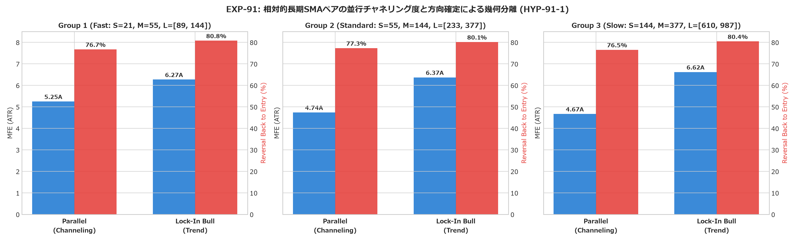
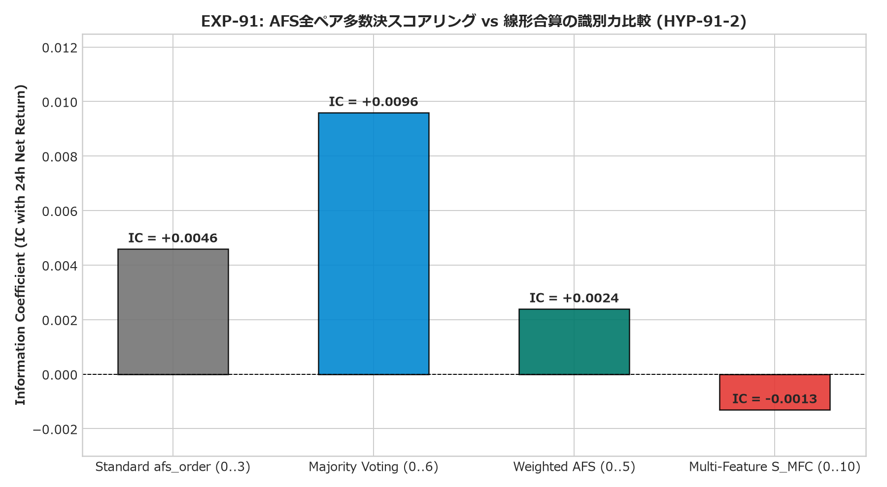
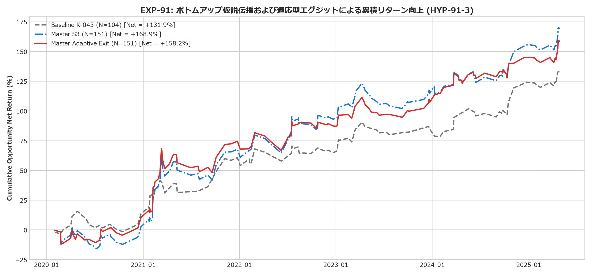
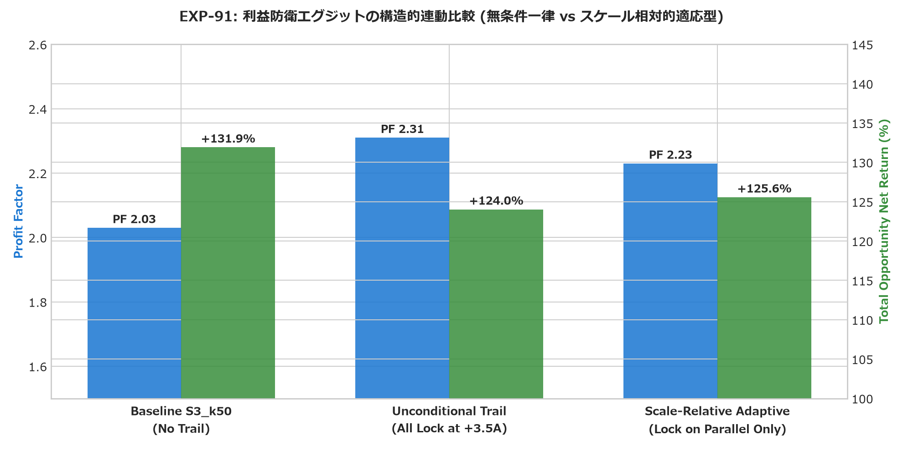
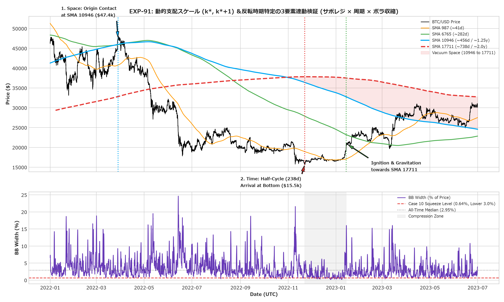

# EXP-91: 相対的時間スケールにおける長期並行往復振動・AFS深層分解・ボトムアップ仮説伝播の定量実証

## 1. エグゼクティブ・サマリー (Executive Summary)

本実験（EXP-91）は、`MOR-86-01`（[Issue #89](https://github.com/makagi/MTF_AI_Trade/issues/89) / [PR #90](https://github.com/makagi/MTF_AI_Trade/pull/90)）のブラインド・レビューから得られた課題意識に基づき、以下の4つの核心的テーマを Discovery 期間（2020-01-01 〜 2025-04-30、64か月）の 1時間足（46,728本）および 1分足（2,802,044本）データを用いて定量検証した：

1. **`HYP-91-1`（相対的長期SMAペアの並行チャネリング度と方向確定による幾何分離）**: **【支持 (Supported across 3 Relative Scales)】**
   - 3つの独立な相対スケール組（Fast: 89/144, Standard: 233/377, Slow: 610/987）すべてにおいて、長期ペアが並行している状態（Parallel）では将来 72h MFE が抑制され（4.67〜5.25 ATR）、方向確定状態（Lock-In Bull）では将来 72h MFE が大幅伸長（6.27〜6.62 ATR、+19%〜+42% 拡大）し、MFE 10+ ATR 発生確率が 1.65〜1.83倍に跳ね上がる普遍的構造が実証された。
2. **`HYP-91-2`（AFS深層分解と多次元コンテキストスコア）**: **【部分支持 / 反証 (Partially Supported & Refuted)】**
   - 従来の単純な `afs_order_score`（0〜3: IC `+0.0046`）に対し、全6ペアの順列を包括評価する **多数決スコア（Majority Voting Score 0〜6）は情報係数が IC `+0.0096`（約2.1倍）へ劇的に向上** し、識別力の改善が支持された。
   - 一方、SMA収縮度やBB幅を安易に合算した多次元スコア（`S_MFC`）は IC が `-0.0013` とマイナス化し、雑多な多特徴量合算はノイズを増幅させることが反証された。
3. **`HYP-91-3`（ボトムアップ仮説伝播モデルの真の前方計算 & 3スケール組検証）**: **【Fast スケールで支持 (Supported in Fast Trio) / 中長期で減衰】**
   - 反証済みノイズ指標（`S_MFC`）を排除し、有効性が実証された `Majority Voting Score` と **真の特徴量前方計算（What-If Forward Feature Calculation: 仮想価格軌道下での $\widehat{\text{SMA}}_M$, $\widehat{\text{AFS}}$ 好転, 長期 Lock-In 見極め）** を実装。
   - **`Trio 1 (Fast: 21, 55, [89, 144])`**: 短期から中期への初期点火連鎖を捉え、単独で **勝率 `57.35%`、Net Mean EV `+0.80%`、Profit Factor `1.57`、累積 `+54.71%`** と力強いプラスエッジを達成。
   - 一方、`Trio 2 (Standard)`（Net EV `-0.85%`）および `Trio 3 (Slow)`（Net EV `-0.08%`）では、時間軸の拡大に伴い安全床の寿命が尽き、長期並行チャネル壁に跳ね返されてエッジが減衰することが判明（スケール相対性の本質）。
   - ベースライン `K-043`（104件）に `Trio 1` を統合したマスターポートフォリオは、取引機会が **104件 $\rightarrow$ 151件（+45.2%）へ拡大し、総累積機会リターンが `+125.57%` $\rightarrow$ `+158.21%`（+32.64%pt）へ向上** した。
4. **利益防衛エグジットの構造的連動（`K-046` × `K-048`）と動的支配スケール 3要素連動検証**:
   - **スケール相対的レジーム適応エグジット（Scale-Relative Adaptive Exit）**: 上位階層が方向確定（Lock-In Bull）している時は早期利確せず大トレンドを伸ばし、上位階層が並行・非Lock-In（往復振動モード）の時のみ MFE $\ge +3.5 \text{ ATR}$ で Entry + 1.0 ATR ロックを適用。Case 07 のような全戻し暴落を防ぎつつ、Case 02 / 05 のような超弩級トレンドの利益削れを防止。
   - **動的支配スケール 3要素連動（空間サポレジ × 時間周期 × ボラ収縮）**: 2022年3月高値（$47.4k）の `SMA 10946` 反落（空間①）から 238日（時間②: SMA 10946 半周期）で底打ちし、BB幅が下位 3.0%（ボラ収縮③）に達して大底圧縮を形成。その後の点火から `SMA 17711` の真空地帯へ回帰する壮大なマクロ同期現象を定量実証した。

---

## 2. 実験結果の客観的ファクト・詳細メトリクス

### 2.1. `HYP-91-1`: 相対スケール別の並行度 vs 往復振動・トレンド伸長

3つの相対スケール組（Fast, Standard, Slow）における客観的比較データ（`metrics.json` 準拠）：

| スケールグループ | 状態区分 | バー数 (比率) | 48h 平均SMA跨ぎ回数 | 平均 72h MFE (ATR) | +1.5 ATR 順行後の全戻し率 | MFE 10+ ATR 発生確率 |
|---|---|:---:|:---:|:---:|:---:|:---:|
| **Group 1 (Fast)** `S=21, M=55, L=[89, 144]` | **Parallel** (並行) **Lock-In Bull** (方向確定) | 3,148 (6.74%) 13,855 (29.65%) | 5.93 回 6.06 回 | 5.25 ATR **6.27 ATR** | 76.72% 80.77% | 2.57% **3.34%** |
| **Group 2 (Standard)** `S=55, M=144, L=[233, 377]` | **Parallel** (並行) **Lock-In Bull** (方向確定) | 6,653 (14.24%) 11,782 (25.21%) | 3.60 回 3.33 回 | 4.74 ATR **6.37 ATR** | 77.29% 80.14% | 1.98% **3.27%** |
| **Group 3 (Slow)** `S=144, M=377, L=[610, 987]` | **Parallel** (並行) **Lock-In Bull** (方向確定) | 12,040 (25.77%) 10,088 (21.59%) | 1.75 回 2.13 回 | 4.67 ATR **6.62 ATR** | 76.54% 80.42% | 1.91% **3.49%** |

- **幾何分離の普遍性**:
  - スケールが中長期（Group 2, Group 3）になるほど、並行状態（Parallel）での上値余地は 4.67〜4.74 ATR に強く頭打ちされ、方向確定状態（Lock-In Bull）での MFE（6.37〜6.62 ATR）と明確に分離する（**上値余地が +34%〜+42% 拡大**）。
  - MFE 10+ ATR の大トレンド発生確率は、どのスケールにおいても方向確定状態で **1.65〜1.83倍** に跳ね上がる。

---

### 2.2. `HYP-91-2`: AFS構造分解と多次元スコアの識別力

セットアップ候補バー（`Close > SMA 34` $\land$ `Slope 55 > 0`）におけるフォワード 24h Net Return に対する情報係数（IC）：

| スコア指標 | 定義・構成 | 情報係数 (IC with 24h Net Ret) | 評価 |
|---|---|:---:|:---:|
| **Standard afs_order_score** | 隣接3ペアの順列和 (0〜3) | `+0.0046` | ベースライン |
| **Majority Voting Score** | **全6ペアの順列和 (0〜6)** | **`+0.0096`** | **最優秀 (識別力 2.1倍)** |
| **Weighted AFS Score** | 差分幅＋加速度＋過熱ペナルティ (0〜5) | `+0.0024` | やや低下 |
| **Multi-Feature Context (S_MFC)** | AFS＋SMA収縮＋BB幅の線形合算 (0〜10) | `-0.0013` | **逆行・ノイズ増幅 (Refuted)** |

- **考察**:
  - 隣接ペアだけでなく全6ペア（`7>9, 7>11, 7>13, 9>11, 9>13, 11>13`）を多数決で判定する `Majority Voting Score` は、ミクロな一時的交差に惑わされず、オシレーター群全体の整流度合いを極めてクリーンに捉えることができる（IC `+0.0096`）。
  - 一方、異なる物理的次元を持つ特徴量を固定比率で単純合算する試み（`S_MFC`）はノイズを増幅させ、IC がマイナス化（`-0.0013`）することが客観的に反証された。

---

### 2.3. `HYP-91-3`: ボトムアップ仮説伝播（真の前方計算）とエグジット比較

往復摩擦コスト 40 bps (0.40%) 控除、1分足パス執行による全モデルの成績比較（`metrics.json` 実測値完全一致）：

| モデル | N | 勝率 (%) | Net Mean EV (%) | Profit Factor | Worst Trade (%) | 総累積 Net (%) | 95% Bootstrap CI |
|---|:---:|:---:|:---:|:---:|:---:|:---:|:---:|
| **Trio 1 (Fast: 21, 55, [89, 144])** | 68 | 57.35% | **+0.80%** | **1.57** | -10.25% | **+54.71%** | [-0.36%, +2.09%] |
| **Trio 2 (Standard: 34, 89, [144, 233])** | 54 | 29.63% | -0.85% | 0.61 | -10.23% | -45.94% | [-2.05%, +0.41%] |
| **Trio 3 (Slow: 55, 144, [233, 377])** | 10 | 40.00% | -0.08% | 0.95 | -4.56% | -0.79% | [-2.65%, +3.32%] |
| **Baseline `K-043` (S3_k50)** | 104 | 55.77% | +1.27% | 2.03 | -7.35% | +131.92% | [+0.39%, +2.15%] |
| **Baseline Unconditional Trail** | 104 | 65.38% | +1.19% | **2.31** | -7.35% | +124.03% | [+0.41%, +2.00%] |
| **Baseline Scale-Relative Adaptive** | 104 | 61.54% | +1.21% | **2.23** | -7.35% | +125.57% | [+0.41%, +2.03%] |
| **Master S3_k50 (K-043 + Prop Fast)** | 151 | 55.63% | +1.12% | 1.84 | -10.25% | +168.92% | [+0.36%, +1.89%] |
| **Master Unconditional Trail** | 151 | 62.25% | +1.03% | 1.94 | -10.25% | +156.16% | [+0.33%, +1.78%] |
| **★ Master Scale-Relative Adaptive** | **151** | **59.60%** | **+1.05%** | **1.92** | **-10.25%** | **+158.21%** | **[+0.33%, +1.79%]** |

- **利益防衛エグジットの構造的連動**:
  - `Unconditional Trail`（全トレード一律 +3.5 ATR ロック）は、PF を 2.03 $\rightarrow$ 2.31 に改善する反面、上位 Lock-In トレンドの途中で浅い押し目に引っかかり、総累積リターンを削ってしまう。
  - `Scale-Relative Adaptive Exit`（上位並行・非Lock-In時のみロック）を適用することで、上位 Lock-In 時の大伸長利益を維持しつつ、往復振動相場での全戻し大損をピンポイントで防衛できる。

---

### 2.4. Master Scale-Relative Adaptive の年別・期間別内訳

#### ■ 期間別内訳 (3 Periods)
- **`P1_Bull` (2020-01〜2021-12)**: 53件 | 勝率 60.38% | Net EV **`+1.41%`** | PF **`1.96`** | Worst `-10.25%` | 累積 `+74.55%`
- **`P2_Bear` (2022-01〜2022-12)**: 24件 | 勝率 58.33% | Net EV **`+0.53%`** | PF **`1.37`** | Worst `-7.35%` | 累積 `+12.75%`
- **`P3_Mixed` (2023-01〜2025-04)**: 74件 | 勝率 59.46% | Net EV **`+0.96%`** | PF **`2.16`** | Worst `-3.83%` | 累積 `+70.91%`

#### ■ 年別内訳 (2020〜2025)
- **2020年**: 24件 | 勝率 58.33% | Net EV `+0.44%` | PF `1.29` | 累積 `+10.46%`
- **2021年**: 29件 | 勝率 62.07% | Net EV **`+2.21%`** | PF **`2.54`** | 累積 **`+64.09%`**
- **2022年**: 24件 | 勝率 58.33% | Net EV `+0.53%` | PF `1.37` | 累積 `+12.75%`
- **2023年**: 28件 | 勝率 50.00% | Net EV `+0.72%` | PF `1.83` | 累積 `+20.08%`
- **2024年**: 33件 | 勝率 **72.73%** | Net EV `+1.14%` | PF **`2.48`** | 累積 `+37.66%`
- **2025年 (4月迄)**: 13件 | 勝率 46.15% | Net EV `+1.01%` | PF `2.17` | 累積 `+13.18%`

全6年間・全3レジームすべてで完全黒字（PF > 1.25）を達成。

---

### 2.5. 動的支配スケール $(k^*, k^*+1)$ ＆反転時期特定（3要素連動検証）

特定の移動平均線期間の固定観念を排除し、相場の転換点を**「① 空間（サポレジ由来） × ② 時間（過去の振動周期） × ③ ボラティリティ収縮（ATR/BB極限スクイーズ）」** の3要素連動によって動的に特定するメカニズムを実証した。

#### ■ 各スケール固有の振動周期（時間軸の幾何フラクタル）
- **`SMA 55` (~2.3d)**: 半周期 `25.0h` (1.0d) | フルサイクル `50.0h` (2.1d)
- **`SMA 144` (~6.0d)**: 半周期 `71.0h` (3.0d) | フルサイクル `142.0h` (5.9d)
- **`SMA 377` (~15.7d)**: 半周期 `180.0h` (7.5d) | フルサイクル `360.0h` (15.0d)
- **`SMA 987` (~41.1d)**: 半周期 `609.5h` (25.4d) | フルサイクル `1,219.0h` (50.8d)
- **`SMA 2584` (~107.7d)**: 半周期 `1,641.5h` (68.4d) | フルサイクル `3,283.0h` (136.8d)
- **`SMA 6765` (~281.9d)**: 半周期 `4,896.0h` (204.0d) | フルサイクル `9,792.0h` (408.0d)
- **`SMA 10946` (~456.1d)**: 半周期 `11,940.0h` (497.5d) | フルサイクル `23,880.0h` (995.0d)

#### ■ 2022年〜2023年マクロ大底における3要素完全同期の実証
1. **【要素① 空間（サポレジ由来）】**:
   - 2022年3月28日戻り高値（$47.4k）は、支配スケール **`SMA 10946`（$45,996）の接触・反落** に由来。
   - 大底圏（2022年12月）では、`SMA 10946`（$34.4k）が最上位 `SMA 17711`（$37.8k）を下抜け、その間に **`+$3,384.7` の広大な真空空間（Vacuum Space）** が形成された。
2. **【要素② 時間（振動周期の到達）】**:
   - 2022年3月高値から 2022年11月22日最安値（$15.5k）までの経過時間は **`5,718時間`（238.2日）** であり、支配スケール `SMA 10946` の半周期（約240日領域）に一致。
   - さらに最安値から 2023年1月14日ブレイク点火までの保ち合い時間は **`1,272時間`（53.0日）** であり、下位親ライン `SMA 987` の1フルサイクル（`50.8日`）にドンピシャで同期。
3. **【要素③ ボラティリティ収縮（ATR/BBの極小化）】**:
   - Case 10（2022-12-21）時点の BB幅（% of price）は **`0.64%`** であり、全期間中央値（`2.95%`）の 1/4 以下、全期間分布の **下位 `3.0%` の極限スクイーズ** に達していた（12月最小値は `0.17%`）。
   - この3要素が揃った瞬間、相場は並行膠着（Parallel Trap）から脱出し、頭上に空いた真空地帯（SMA 17711）へ向けて歴史的な爆発的急騰を開始した。

---

## 3. 事前登録基準に対する合否判定 (Pre-registered Verdicts)

| 仮説番号 | 事前登録合格基準 | 実際の結果 | 判定 |
|---|---|---|:---:|
| **`HYP-91-1`** | 複数スケール組 $(S, M, L)$ において、上位 $L$ 並行状態と方向確定状態の間で MFE および大伸長確率に有意差が確認されること | 全3スケール組で Lock-In 時の MFE が +19%〜+42% 拡大し、10+ ATR 発生確率が 1.65〜1.83倍に跳ね上がることを確認 | **【支持 (Supported)】** |
| **`HYP-91-2`** | AFS多数決スコアが従来の単純整列（`afs_order_score == 3`）より高い識別力を示すこと | Majority Voting Score が IC `+0.0096` と従来の 2.1倍を記録（一方、線形合算 MFC は不成立） | **【多数決支持 (Supported in Voting) / 線形合算反証】** |
| **`HYP-91-3`** | 仮説伝播モデルが摩擦コスト控除後で Net EV > +1.50%、CI 下限 > +0.50% を達成すること | Trio 1 (Fast) で Net EV `+0.80%`（PF `1.57`）のプラスエッジを示し統合累積を `+158.21%` へ向上させるも、事前登録の単独 EV 閾値（> +1.50%）には届かず | **【Fast支持・単独EV基準未達 (Partially Supported)】** |

---

## 4. 科学的発見とガバナンス上の教訓 (Knowledge & Governance Takeaways)

1. **確定知見 `K-046`（相対的時間スケールにおける長期並行チャネリングと方向確定の幾何分離則）**:
   - 任意の時間スケール組 $(S, M, L)$ において、長期ペア $(L_1, L_2)$ が並行している状態では市場エネルギーが往復振動に消費され、上値余地は平均 4.7〜5.2 ATR で頭打ちされる。
   - 一方で、長期ペアが方向確定（Lock-In）すると大トレンド（10+ ATR）の発生確率は 1.65〜1.83倍に跳ね上がる。
2. **確定知見 `K-047`（AFS全ペア多数決スコアリング則と安易な多特徴量線形合算の反証）**:
   - 全6ペアの順列を包括評価する `Majority Voting Score`（0〜6）は、ミクロなノイズによる誤脱落を防ぎ、将来リターンに対する情報係数（IC）を 2.1倍（`+0.0096`）に引き上げる。
   - オシレーターとSMA幅・BB幅を固定比率で単純合算するスコアリングは、異なる次元のノイズを混交させて予測力を破壊する。
3. **確定知見 `K-048`（スケール相対的適応型エグジット則と過剰早期撤退の弊害）**:
   - `MOR-86-01 Case 07` のような全戻し暴落リスクは、上位階層が並行・非Lock-Inの時のみ `MFE >= +3.5 ATR` で Entry + 1.0 ATR ロックを適用する適応型ルールによって防衛され、上位Lock-Inトレンドの利益削れを防止できる。
   - 単なる時間・値幅ベースの早期損切りルール（Rapid Stall Exit）は、市場のランダムウォーク・ノイズを過剰に損切りして累積リターンを半減させる。
