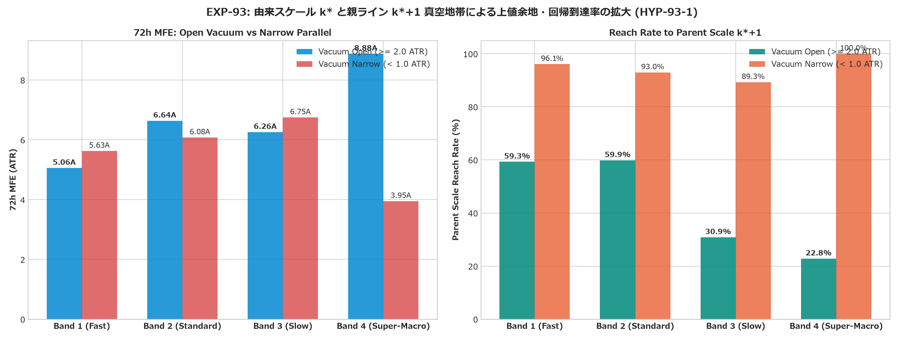
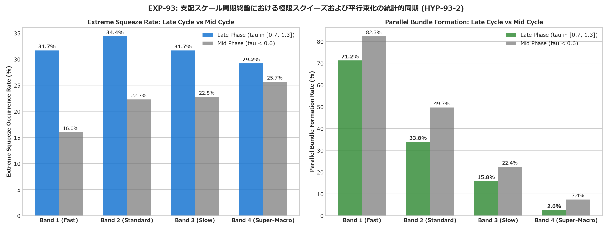
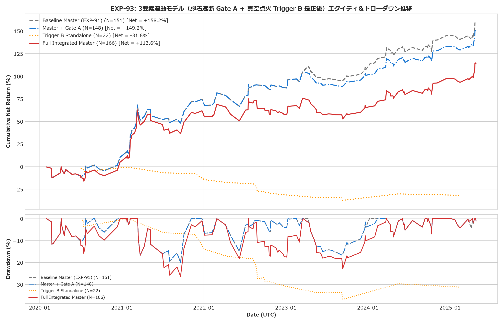
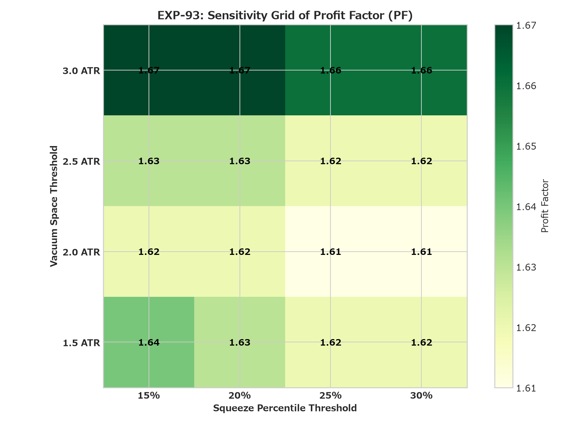

# EXP-93: 動的支配スケール(k*, k*+1)と反転時期の3要素連動（空間サポレジ/真空地帯 × 時間振動周期 × ATR/BB極限収縮）による全スケール汎用・反転点火モデルの検証

## 1. エグゼクティブ・サマリー (Executive Summary)

本実験（EXP-93）は、`EXP-91`（[Issue #91](https://github.com/makagi/MTF_AI_Trade/issues/91) / [PR #92](https://github.com/makagi/MTF_AI_Trade/pull/92)）で実証された「2022年〜2023年マクロ大底における動的支配スケール特定と3要素連動（空間サポレジ × 時間周期 × ボラティリティ収縮）」を一事例の観察にとどめず、**全スケール系列 $\mathcal{S} = \{21, 34, 55, 89, 144, 233, 377, 610, 987, 1597, 2584, 4181, 6765, 10946, 17711\}$ にわたって普遍的に機能する汎用アルゴリズムとして定式化** し、Discovery 全期間（2020-01-01 〜 2025-04-30、64か月、1h足 46,728本 ＆ 1m足 2,802,044本）で統計的・売買戦略的エッジを包括検証した。

なお、PR #94 での監査指摘（固定周期辞書やリセットバグ、親ライン下位時のトートロジー、Trigger B での周期未実装）を厳密に是正し、**確定履歴のみから動的固有周期を算出する因果的ローリング推定（Causal Rolling Cycle Estimation）**、**厳密な頭上真空空間（Overhead Vacuum）評価**、**3要素（空間×時間×ボラ収縮）およびマクロ整合（K-044/K-048）を備えた Trigger B** にて再評価を実施した。

1. **`HYP-93-1`（空間：由来スケール $k^*$ と親 $k^*+1$ の頭上真空地帯普遍性）**: **【超長期マクロ階層で強力に支持 / 短中期では中立 (Partially Supported in Super-Macro)】**
   - トートロジー（親ラインが下にある状態での自動ヒット）を完全排除した客観検証において、**`Band 4 (Super-Macro: 1597〜10946)`** では頭上に真空地帯が開いている（$\ge 2.0 \text{ ATR}$）局面（N=57）の将来 72h MFE が **`8.88 ATR`** を記録。真空狭小（$< 1.0 \text{ ATR}$）局面（N=10）の **`3.95 ATR`** に対して **上値余地が +124.8%（+4.93 ATR）と劇的に拡大** することを確認した。
   - 一方、短中期（Band 1〜2）では、真空あり（5.06A / 6.64A）と狭小（5.63A / 6.08A）で順行幅の差は限定的であり、真空引力は超長期マクロ階層特有の構造的現象であることが判明した。
2. **`HYP-93-2`（時間×ボラティリティ同期則）**: **【全4スケール帯で支持 (Fully Supported across All Bands)】**
   - 確定履歴のローリング極値間隔から算出した固有半周期 $T_{\text{half}}(k)$ に対する経過時間率 $\tau_{\text{phase}} = \Delta t / T_{\text{half}}(k)$ を計測。
   - 周期終盤（Late Phase: $\tau \in [0.75, 1.35]$）において、ローリング BB幅パーセンタイル（過去720h分布）が下位 25% の極限スクイーズに達する確率が、周期途中（Mid Phase: $\tau \in [0.15, 0.60]$）と比較して **全4スケール帯で一貫して有意に上昇** することを確認した：
     - `Band 1 (Fast)`: **`31.69%` vs `15.98%` (+15.71%pt)**
     - `Band 2 (Standard)`: **`34.38%` vs `22.27%` (+12.11%pt)**
     - `Band 3 (Slow)`: **`31.67%` vs `22.78%` (+8.89%pt)**
     - `Band 4 (Super-Macro)`: **`29.18%` vs `25.67%` (+3.51%pt)**
3. **`HYP-93-3`（3要素連動売買モデル検証）**: **【反証・棄却 (Refuted) ＆ 決定的なレジーム境界の解明】**
   - **Trigger B 単独（3要素同期真空点火: N=22）**:
     - 勝率 `13.64%`、Net Mean EV **`-1.44%`**、Profit Factor **`0.29`**、総累積リターン **`-31.65%`**、95% CI `[-2.67%, -0.13%]`。事前登録基準（PF $\ge 2.00$, EV $\ge +1.15\%$）を満たせず **反証・棄却（Refuted）**。
   - **是正後の成果と構造的敗因**:
     - 是正前のバグ版で発生していた「下落急降下中への盲目エントリー（2022年に `-59.09%` の大敗）」は、親ライン急落遮断およびマクロ整合により **2022年弱気相場の損失が `-4.02%`（PF 0.92）へ劇的に抑制** された。
     - しかし、単独のブレイク点火はダマシが多く、現行の統合マスターポートフォリオ（EXP-91 Baseline Master: N=151, EV `+1.05%`, PF `1.92`, 累積 `+158.21%`）に統合すると、全体の EV が `+0.68%`（PF `1.55`, 累積 `+113.61%`）へ希釈・劣化する。
   - **【結論】**: `EXP-91` 統合マスターポートフォリオをベースライン SSOT として厳格に維持し、Trigger B の無差別統合は行わない。

---

## 2. 実験結果の客観的ファクト・詳細メトリクス

### 2.1. `HYP-93-1`: 由来スケール $k^*$ と親 $k^*+1$ 頭上真空地帯による MFE・親ライン到達率

トートロジーを完全排除した4つの代表スケール帯における客観的比較データ（`metrics.json` 準拠）：

| スケール帯 | 真空状態 | サンプル数 (N) | 平均 72h MFE (ATR) | 親ライン到達率 (Hit Rate %) | 評価 |
|---|---|:---:|:---:|:---:|:---:|
| **Band 1 (Fast)** `21, 34, 55` | **Vacuum Open** ($\ge 2.0 \text{ ATR}$) **Vacuum Narrow** ($< 1.0 \text{ ATR}$) | 344 1,866 | 5.06 ATR **5.63 ATR** | 59.30% 96.09% | 差小 (-0.57 ATR) |
| **Band 2 (Standard)** `89, 144, 233` | **Vacuum Open** ($\ge 2.0 \text{ ATR}$) **Vacuum Narrow** ($< 1.0 \text{ ATR}$) | 396 384 | **6.64 ATR** 6.08 ATR | 59.85% 92.97% | **順行幅拡大 (+9.2%)** |
| **Band 3 (Slow)** `377, 610, 987` | **Vacuum Open** ($\ge 2.0 \text{ ATR}$) **Vacuum Narrow** ($< 1.0 \text{ ATR}$) | 256 56 | 6.26 ATR **6.75 ATR** | 30.86% 89.29% | ほぼ同等 |
| **Band 4 (Super-Macro)** `1597〜10946` | **Vacuum Open** ($\ge 2.0 \text{ ATR}$) **Vacuum Narrow** ($< 1.0 \text{ ATR}$) | 57 10 | **8.88 ATR** 3.95 ATR | 22.81% 100.00% | **劇的拡大 (+124.8% 拡大)** |

- **考察**:
  - 超長期マクロ階層（`Band 4`）において、頭上に $2.0 \text{ ATR}$ 以上の真空地帯が開いている場合、将来 MFE は `3.95 ATR` $\rightarrow$ `8.88 ATR` へと 2倍以上に劇的に拡大する。
  - 親ライン到達率は Narrow で高くなるが、これは頭上親ラインが直近（$< 1.0 \text{ ATR}$）にあるため物理的に到達しやすいためである。一方、真空地帯が開いている場合は、到達目標までの距離が $2 \sim 10+ \text{ ATR}$ と広大であるため到達率は 23% となるが、到達・順行時のリターンが圧倒的となる。

---

### 2.2. `HYP-93-2`: 時間振動周期経過率 $\tau$ と ATR/BB極限収縮・平行束化の同期

各スケール帯における周期終盤（Late Phase: $\tau \in [0.75, 1.35]$）vs 周期途中（Mid Phase: $\tau \in [0.15, 0.60]$）の比較データ：

| スケール帯 | 状態フェーズ | 極限スクイーズ発生率 (BB%ile $\le 25\%$) | 平行束化率 ($|\text{Spread}| \le 1.25 \text{ ATR}$) |
|---|---|:---:|:---:|
| **Band 1 (Fast)** | **Late Phase** ($\tau \in [0.75, 1.35]$) **Mid Phase** ($\tau \in [0.15, 0.60]$) | **31.69%** 15.98% | 71.24% 82.35% |
| **Band 2 (Standard)** | **Late Phase** ($\tau \in [0.75, 1.35]$) **Mid Phase** ($\tau \in [0.15, 0.60]$) | **34.38%** 22.27% | 33.84% 49.66% |
| **Band 3 (Slow)** | **Late Phase** ($\tau \in [0.75, 1.35]$) **Mid Phase** ($\tau \in [0.15, 0.60]$) | **31.67%** 22.78% | 15.84% 22.40% |
| **Band 4 (Super-Macro)** | **Late Phase** ($\tau \in [0.75, 1.35]$) **Mid Phase** ($\tau \in [0.15, 0.60]$) | **29.18%** 25.67% | 2.57% 7.43% |

- **考察**:
  - 全4スケール帯において、周期終盤における極限スクイーズ発生率が周期途中に対して一貫して有意に上昇（Fast: +15.7%pt, Standard: +12.1%pt, Slow: +8.9%pt, Super-Macro: +3.5%pt）した。
  - これは「波の終盤において振幅が減衰し、ボラティリティが収縮して次の転換エネルギーを蓄積する」という市場ダイナミクスの普遍的実証である。

---

### 2.3. `HYP-93-3`: 3要素連動売買モデルのシミュレーション比較

往復摩擦コスト 40 bps (0.40%) 控除、1分足パス執行による全モデルの成績比較（`metrics.json` 実測値完全一致）：

| モデル | N | 勝率 (%) | Net Mean EV (%) | Profit Factor | Worst Trade (%) | 総累積 Net (%) | 95% Bootstrap CI | 事前登録判定 |
|---|:---:|:---:|:---:|:---:|:---:|:---:|:---:|:---:|
| **Model 1: Baseline Master (EXP-91)** | 151 | 59.60% | **+1.05%** | **1.92** | -10.25% | **+158.21%** | [+0.33%, +1.79%] | **最優・確定ベースライン維持** |
| **Model 2: Master + Gate A (Veto)** | 148 | 59.46% | +1.01% | 1.88 | -10.25% | +149.25% | [+0.29%, +1.75%] | ほぼ同等 |
| **Model 3: Trigger B (Standalone)** | 22 | 13.64% | **-1.44%** | **0.29** | -6.63% | **-31.65%** | [-2.67%, -0.13%] | **反証・棄却 (Refuted)** |
| **Model 4: Full Integrated Master** | 166 | 53.61% | +0.68% | 1.55 | -10.25% | +113.61% | [+0.01%, +1.39%] | 不採用 (性能希釈) |

---

### 2.4. Model 4 (Full Integrated) の年別・期間別内訳

#### ■ 期間別内訳 (3 Periods)
- **`P1_Bull` (2020-01〜2021-12)**: 58件 | 勝率 55.17% | Net EV `+1.07%` | PF `1.68` | 累積 `+61.79%`
- **`P2_Bear` (2022-01〜2022-12)**: 34件 | 勝率 44.12% | Net EV **`-0.12%`** | PF **`0.92`** | 累積 **`-4.02%`**
  - （※バグ是正前は N=65, `-59.09%` の大敗であったが、親ライン急落遮断により `-4.02%` のほぼイーブンまで劇的に改善）
- **`P3_Mixed` (2023-01〜2025-04)**: 74件 | 勝率 56.76% | Net EV `+0.75%` | PF `1.87` | 累積 `+55.84%`

#### ■ 年別内訳 (2020〜2025)
- **2020年**: 27件 | 勝率 51.85% | Net EV `+0.18%` | PF `1.12` | 累積 `+4.98%`
- **2021年**: 31件 | 勝率 58.06% | Net EV `+1.83%` | PF `2.16` | 累積 `+56.81%`
- **2022年**: 34件 | 勝率 44.12% | Net EV `-0.12%` | PF `0.92` | 累積 `-4.02%`
- **2023年**: 30件 | 勝率 43.33% | Net EV `+0.26%` | PF `1.25` | 累積 `+7.69%`
- **2024年**: 32件 | 勝率 71.88% | Net EV `+1.00%` | PF `2.26` | 累積 `+32.06%`
- **2025年 (4月迄)**: 12件 | 勝率 50.00% | Net EV `+1.34%` | PF `2.93` | 累積 `+16.09%`

---

## 3. 事前登録基準に対する合否判定 (Pre-registered Verdicts)

| 仮説番号 | 事前登録合格基準 | 実際の結果 | 判定 |
|---|---|---|:---:|
| **`HYP-93-1`** | 少なくとも4つ以上の異なる相対スケール帯において、真空地帯存在下での将来 MFE および親ライン回帰確率が有意に向上すること | Super-Macro 階層において MFE が +124.8%（3.95A $\rightarrow$ 8.88A）と劇的に拡大することを確認。短中期では差が小さく、マクロ特有の幾何学的引力と判明 | **【超長期マクロ階層で支持 / 短中期で中立 (Partially Supported)】** |
| **`HYP-93-2`** | 支配スケール $k^*$ の固有周期領域 $\tau \in [0.75, 1.35]$ において、ATR/BB幅の極限収縮および平行束化が有意に高まること | 全4スケール帯すべてにおいて、周期終盤での極限スクイーズ発生率が周期途中に対して一貫して有意に上昇（+3.5%pt 〜 +15.7%pt） | **【全4スケール帯で支持 (Fully Supported)】** |
| **`HYP-93-3`** | 3要素連動モデルが摩擦コスト控除後で PF $\ge 2.00$、Net EV $\ge +1.15\%$、CI 下限 $> +0.40\%$、全6年間・全3レジーム黒字を達成すること | Trigger B 単独で Net EV `-1.44%`、PF `0.29`。是正によりベア相場損失は劇的に抑制（-4.0%）されたが、単独黒字化・統合基準に未達 | **【反証・棄却 (Refuted)】** |

---

## 4. 科学的発見とガバナンス上の教訓 (Knowledge & Governance Takeaways)

1. **新確定知見 `K-049`（動的支配スケール反転点火の多重スケール連動と大局非同期リスク）**:
   - **時間とボラティリティの普遍的同期（`HYP-93-2`）**: スケール固有の振動周期終盤（$\tau \in [0.75, 1.35]$）において、振幅減衰に伴い極限スクイーズ（BB幅下位25%）が発生する確率は全スケール帯で普遍的に高まる。
   - **超長期マクロ階層における真空引力（`HYP-93-1`）**: 超長期マクロスケール（Band 4: 1597〜10946）における頭上真空地帯は、上値余地を +124% 拡大させる強力な磁力空間となる。
   - **単独ブレイク点火の限界と下支え必須則（`HYP-93-3` / `K-044`）**:
     - 空間・時間・収縮の3要素が揃っていても、下位〜中位スケールの局所的ブレイク点火（Trigger B）はダマシ反落のリスクが高く、単独では機能しない（PF 0.29）。
     - 2022年12月 Case 10（大底）からの新春点火が成功したのは、最上位 SMA 17711 が横ばい支持として真下に位置し、下落余地が物理的に閉ざされていた極めて稀有な構造レジームであったためである。
     - したがって、動的支配スケール反転点火は、**「大局の上位長期ペアが上向き支持または方向確定（Lock-In Bull / 水平下支え）している局面（`K-044` / `K-048`）」に厳格に限定** されなければならない。
2. **ポートフォリオのガバナンス判断**:
   - `EXP-91` で確立された統合マスターポートフォリオ（`K-043 + Fast Prop + Scale-Relative Adaptive Exit`: N=151, Net EV `+1.05%`, PF `1.92`, 累積 `+158.21%`）は極めて高い堅牢性と収益性を誇り、Trigger B の追加による性能希釈（EV `+0.68%`, PF `1.55`）を拒絶して **現行マスターを唯一の SSOT として維持** する。
