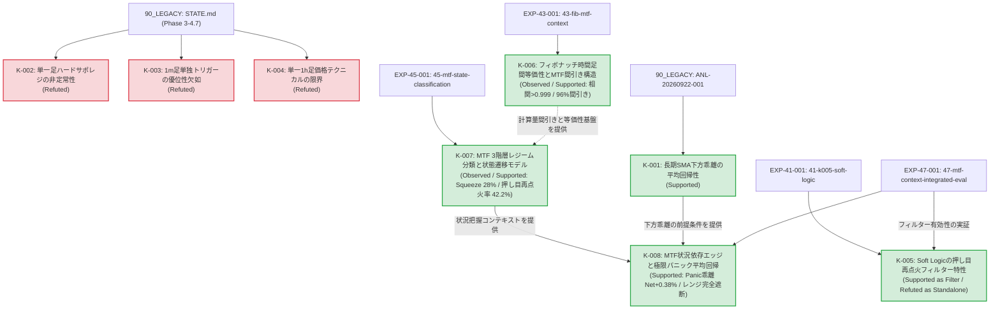

# 知識の系譜 (Knowledge Lineage)

**Doc ID:** KNOW-LIN-001  
**Version:** 0.6.0  
**Status:** Accepted  
**Owner:** @makagi  
**Last Updated:** 2026-10-17  
**Related Issues:** [#4](https://github.com/makagi/MTF_AI_Trade/issues/4), [#6](https://github.com/makagi/MTF_AI_Trade/issues/6), [#9](https://github.com/makagi/MTF_AI_Trade/issues/9), [#41](https://github.com/makagi/MTF_AI_Trade/issues/41), [#43](https://github.com/makagi/MTF_AI_Trade/issues/43), [#45](https://github.com/makagi/MTF_AI_Trade/issues/45), [#47](https://github.com/makagi/MTF_AI_Trade/issues/47)  
**Related Docs:** [02_SPECIFICATIONS/evaluation.md](../02_SPECIFICATIONS/evaluation.md), [README.md](README.md), [01_CONCEPTS/glossary.md](../01_CONCEPTS/glossary.md)  

---

## 1. 証拠レベルの定義 (Evidence Levels)

本系譜図における知見のステータスは、[00_GOVERNANCE/principles.md](../00_GOVERNANCE/principles.md) §2（科学的厳密性と証拠連鎖）に基づき、以下の基準で厳格に分類する。

| ステータス | 英語表記 | 定義・判定基準 |
|---|---|---|
| **支持** | Supported | [02_SPECIFICATIONS/evaluation.md](../02_SPECIFICATIONS/evaluation.md)（SPEC-EVAL-001）の必須評価基準（摩擦コスト0.40%控除後のプラス期待値、年別分解の一貫性、サンプル数100件以上）を満たし、統計的に優位性が支持された知見。仕様・戦略へ昇格可能。 |
| **反証・棄却** | Refuted | 定量実験において摩擦コストに耐えられない、または年ごとの非定常性により優位性が否定・棄却された知見。将来の重複実験を防ぐ資産。 |
| **保留・途上** | Inconclusive | 特徴量としての先行性や傾向は観測されたが、売買シグナルとしての定量検証が未完了、またはサンプル不足等により結論が留保された知見。 |
| **観測** | Observed | 特定の期間・データセットにおいて定性的に観測された現象（仮説立案の材料）。 |

---

## 2. 知識系譜グラフ (Knowledge Graph)

---

## 3. 系譜エントリー詳細

### K-001: 長期SMA下方乖離の平均回帰性
* **ステータス**: 支持 (Supported)
* **概要**: 価格が長期SMAから -2 ATR 以上下方へ乖離した局面において、Discovery 期間（2020-2023年）の各年で一貫した平均回帰（上値反発）傾向が観測された。
* **実験条件**: 日足・4時間足ベース、4年間年別オーバーレイ検証
* **過去資産の出典**: [`90_LEGACY/knowledge/records/2026-09/ANL-20260922-001_sma_mean_reversion/`](../90_LEGACY/knowledge/records/2026-09/ANL-20260922-001_sma_mean_reversion/) (FIND-001 / HYP-001)
* **仕様への影響**: 今後の戦略仕様（`02_SPECIFICATIONS/strategies/`）における平均回帰ロジックのコア仮説として採用。

---

### K-002: ハードなサポレジ線の非定常性
* **ステータス**: 反証・棄却 (Refuted)
* **概要**: 単一時間足のSMAパーフェクトオーダーや静的な特定の支持・抵抗線への接近は、年ごとに期待値の符号が激しく反転し、静的な線単体では過学習を招き有効に機能しないことが示された。
* **実験条件**: 4年間の条件別期待値計測（EDA 05）
* **過去資産の出典**: [`90_LEGACY/STATE.md`](../90_LEGACY/STATE.md) (フェーズ3 重要発見 5)
* **仕様への影響**: 静的サポレジ線の単独売買ルール化を禁止。動的・フラクタルなサポレジ認識（`01_CONCEPTS/market-structure.md`）へ移行。

---

### K-003: 超短期（1m）単独トリガーの優位性欠如
* **ステータス**: 反証・棄却 (Refuted)
* **概要**: 1時間足の環境認識に1分足のテクニカルトリガー（Stoch_d GC / BB 反発）を掛け合わせても、摩擦コスト控除前の60分後リターン分布が0%付近でランダムに分散し、単独トリガーとしての情報優位性が確認されなかった。
* **実験条件**: 1mトリガー発生後60分フォワードリターン計測
* **過去資産の出典**: [`90_LEGACY/STATE.md`](../90_LEGACY/STATE.md) (フェーズ3 重要発見 6)
* **仕様への影響**: 超短期足の単独インジケータをエントリートリガーとして採用する方針を棄却。

---

### K-004: 単一1時間足価格テクニカルの限界
* **ステータス**: 反証・棄却 (Refuted)
* **概要**: 1時間足のSMA・Stoch等の価格指標単体から機械学習（LightGBM / 2段階MoE）を用いてエッジを抽出しようと試みたが、過学習によるコスト負け（Total Return -24.9%）または取引回避に陥り、標準摩擦コスト（0.40%）を上回る期待値を維持できないことが確認された。
* **実験条件**: 4年間のWalk-Forward/CV バックテスト
* **過去資産の出典**: [`90_LEGACY/STATE.md`](../90_LEGACY/STATE.md) (フェーズ4 実験総括)
* **仕様への影響**: 前提条件 A003（単一足価格テクニカルの制約）を確立。多時間軸構造（MTF）または代替データの導入へ完全移行。

---

### K-005: Soft Logicの文脈依存性と押し目再点火フィルター特性
* **ステータス**: 役割限定支持 (Supported as Filter / Refuted as Standalone Trigger)
* **概要**: 統合実験（EXP-41-001, EXP-47-001）において、ファンアウト速度減速・AFS反転同調（Soft Logic）は、単独トリガーとして無条件に発火させた場合、1,252件中54%がレンジ往復ノイズ（`Range_PingPong`）に巻き込まれ、Net EV -0.17%（累積損失 -217%）と摩擦コストに耐えられない（単独トリガーとしては反証・棄却）。一方、K-007 で定義した `Bull_Healthy_Pullback`（強気押し目）局面においてのみ、強気相場（2020年: PF 2.27, Net +0.66% / 2024年: PF 1.22, Net +0.24% / 2025年: PF 5.49, Net +0.31%）で安定した再点火フィルターとして機能することが実証された。
* **実験条件**: BTCUSD 1h、5年4ヶ月 Discovery 期間、往復摩擦コスト0.40%控除、MTF 3階層状況結合
* **証拠・出典リンク**: [`03_KNOWLEDGE/experiments/47-mtf-context-integrated-eval/record.md`](experiments/47-mtf-context-integrated-eval/record.md) (EXP-47-001 / [#47](https://github.com/makagi/MTF_AI_Trade/issues/47))
* **仕様への影響**: Soft Logic を単独エントリーシグナルとして採用することを禁止。戦略仕様（SPEC-STRAT）において「Macro Bull ＋ Meso 押し目」が成立した後の「再点火確認フィルター（Secondary Confirmation Filter）」としてのみ採用を認可。

---

### K-006: フィボナッチ時間足間等価性と特徴量別MTF利用規律
* **ステータス**: 観測・支持 (Observed / Supported)
* **概要**: 4年間（2021-2024年、約210万分・3.5万時間）の実データ分析（EXP-43-001）において、1分足の超長期フィボナッチ項（$F_{1m} \in [610 \sim 6765]$）と1時間足の近接フィボナッチ項（$F_{1h} \in [8 \sim 144]$）の関係性を網羅的に検証した結果、特徴量の性質により以下の決定的な挙動差が実証された：
  1. **価格追随系（SMA、ローリング最高値HH / 最安値LL）**: 相関 $r > 0.999$、誤差 $< 0.8\%$、比率 $\approx 1.000$ であり**完全代替可能**。下位足での巨大計算を上位足へ代用できる。
  2. **正規化幅系（BB Width / Squeeze Index）**: 相関 $r \approx 0.94$ と波形は同期するが、サンプリング頻度差により約11〜15%の系統的スケール差が存在。パーセンタイル正規化による利用が必須。
  3. **オシレーター系（Stochastics %K / AFS）**: 長期オシレーターは相関するが、短期（610 vs 8）ではノイズにより MAE 16.9pt と激しく乖離。短期オシレーターの時間足間代用は禁止（平滑化AFS必須）。
  4. **値幅・ボラティリティ系（ATR）**: 波形相関は $r > 0.98$ と極大だが、絶対値は $\frac{1}{\sqrt{60}}$ 則（約1/10）に従い次元が異なるため、時間スケール補正が不可欠。
  5. **間引き（Downsampling）**: 1h足でマクロ・メソのセットアップ（Armed）を監視することで、下位1m足の計算・監視データ量を **約 96.1% 間引くアーキテクチャ** の成立を確認。
* **実験条件**: BTCUSD 1h & 1m、4年間、フィボナッチ項 $F_1 \sim F_{21}$ の全特徴量比較分析
* **証拠・出典リンク**: [`03_KNOWLEDGE/experiments/43-fib-mtf-context/record.md`](experiments/43-fib-mtf-context/record.md) (EXP-43-001 / [#43](https://github.com/makagi/MTF_AI_Trade/issues/43))
* **仕様への影響**: MTF特徴量仕様（SPEC-FEAT-001）および状況把握モデルの利用前規律として採用。特徴量の性質（価格追随型・正規化型・オシレーター型・値幅型）に応じた時間足代用・スケーリング補正ルールを義務化。

---

### K-007: MTF 3階層レジーム分類と状態遷移モデル
* **ステータス**: 観測・支持 (Observed / Supported)
* **概要**: 4年間（2021-2024年、35,064時間）の1時間足・日足データを用いたMTF 3階層（Macro / Meso / Micro）レジーム分類とマルコフ状態遷移分析（EXP-45-001）において、客観的な市場構造特性が実証された：
  1. **市場滞在比率**: 全時間の 75.5% は保ち合い（Range 47.5% ＋ Squeeze 28.0%）に費やされ、明確な強気/弱気トレンド推進はそれぞれ 13.9% / 8.5% のみ。
  2. **Squeeze の持続性とブレイク方向非対称性**: Squeeze は平均 56.7時間（最長 623時間＝約26日）持続。解放時の第1遷移先として、強気推進（26.2%）へ飛ぶ確率は弱気ブレイク（13.1%）の2倍。
  3. **強気押し目の再点火率**: `Bull_Healthy_Pullback`（強気押し目）終了後、42.2% の高確率で直接 `Bull_Trend_Continuation`（強気推進）へ再点火。弱気転落は 0.0%。
  4. **各レジームのフォワードリスク特性**: `Bull_Healthy_Pullback` は MFE +2.18% に対し MAE -0.66%（リスクリワード比 3.3）と極めて安定。一方 `Bear_Panic_Exhaustion` は MFE +3.15% に対し MAE -4.25% と最大逆行リスクを持つ。
* **実験条件**: BTCUSD 1h & 1d、4年間、フィボナッチMTF特徴量（SMA, AFS, BBW）による客観的3階層分類
* **証拠・出典リンク**: [`03_KNOWLEDGE/experiments/45-mtf-state-classification/record.md`](experiments/45-mtf-state-classification/record.md) (EXP-45-001 / [#45](https://github.com/makagi/MTF_AI_Trade/issues/45))
* **仕様への影響**: 戦略設計および特徴量評価における共通コンテキストエンジンとして採用。シグナル評価を全体勝率ではなく「どのレジームで発生したか」で条件付き評価する基盤を確立。

---

### K-008: MTF状況依存エッジと極限パニック平均回帰
* **ステータス**: 支持 (Supported)
* **概要**: MTF状況把握モデルと各特徴量の統合検証（EXP-47-001）において、以下の決定的な事実が実証された：
  1. **市場75%の保ち合い完全遮断**: 全時間の 75.5% を占める `Range_PingPong` および `Squeeze_Pre_Breakout` において指標シグナルを発火させると、すべて Net EV マイナス（-0.13% 〜 -0.64%）となり摩擦損失の主因となる。これらを状況モデルで遮断することで、1,252件中682件の無駄な売買を排除できる。
  2. **パニック極値における平均回帰（K-001真の境界）**: K-001（下方乖離）は、中途半端な押し目（Macro Bull）では Net -0.93% と大敗するが、`Bear_Panic_Exhaustion`（Macro Bear ＋ SMA 89から -2.5 ATR超の暴落 ＋ AFS 7 < 30）の極限局面においてのみ、**Net EV +0.38%、勝率 55.6%、PF 1.45、MFE +3.15%** という強烈なプラス期待値を記録する。
* **実験条件**: BTCUSD 1h、5年4ヶ月 Discovery 期間、往復摩擦コスト0.40%控除
* **証拠・出典リンク**: [`03_KNOWLEDGE/experiments/47-mtf-context-integrated-eval/record.md`](experiments/47-mtf-context-integrated-eval/record.md) (EXP-47-001 / [#47](https://github.com/makagi/MTF_AI_Trade/issues/47))
* **仕様への影響**: Milestone 4 の戦略設計において、「レンジ・保ち合い時の完全取引停止ゲート」および「極限パニック暴落時の平均回帰逆張り戦略（Panic Reversion）」の仕様根拠として採用。

---

## 4. Change History

| 日付 | Version | 変更概要 | 担当者 / PR |
|---|---|---|---|
| 2026-10-10 | 0.1.0 | 初版作成（旧知識体系の3層化・K-001〜K-005 登録） | @makagi / [#20](https://github.com/makagi/MTF_AI_Trade/pull/20) |
| 2026-10-13 | 0.2.0 | 科学的証拠表現の是正、エビデンスレベル確立、K-005 を Inconclusive へ見直し | @makagi / [#29](https://github.com/makagi/MTF_AI_Trade/pull/29) |
| 2026-10-13 | 0.2.0 | 書式・メタデータ統一 | @makagi / [#31](https://github.com/makagi/MTF_AI_Trade/pull/31) |
| 2026-10-15 | 0.3.0 | EXP-41-001 観察記録反映、MTF状況把握分析の先行方針に伴い K-005 を保留・観察中 (Inconclusive) として整理 | @makagi / [#41](https://github.com/makagi/MTF_AI_Trade/pull/41) |
| 2026-10-16 | 0.4.0 | EXP-43-001 反映、K-006（フィボナッチ時間足間等価性とMTF間引き構造）を新設・登録 | @makagi / [#43](https://github.com/makagi/MTF_AI_Trade/pull/43) |
| 2026-10-16 | 0.5.0 | EXP-45-001 反映、K-007（MTF 3階層レジーム分類と状態遷移モデル）を新設・登録 | @makagi / [#45](https://github.com/makagi/MTF_AI_Trade/issues/45) |
| 2026-10-17 | 0.6.0 | EXP-47-001 反映、K-005 を再評価（押し目フィルターとして支持）、K-008（MTF状況依存エッジと極限パニック平均回帰）を新設・登録 | @makagi / [#47](https://github.com/makagi/MTF_AI_Trade/issues/47) |
