# 知識の系譜 (Knowledge Lineage)

**Doc ID:** KNOW-LIN-001  
**Version:** 1.8.0  
**Status:** Accepted  
**Owner:** @makagi  
**Last Updated:** 2026-10-29  
**Related Issues:** [#4](https://github.com/makagi/MTF_AI_Trade/issues/4), [#6](https://github.com/makagi/MTF_AI_Trade/issues/6), [#9](https://github.com/makagi/MTF_AI_Trade/issues/9), [#41](https://github.com/makagi/MTF_AI_Trade/issues/41), [#43](https://github.com/makagi/MTF_AI_Trade/issues/43), [#45](https://github.com/makagi/MTF_AI_Trade/issues/45), [#47](https://github.com/makagi/MTF_AI_Trade/issues/47), [#49](https://github.com/makagi/MTF_AI_Trade/issues/49), [#51](https://github.com/makagi/MTF_AI_Trade/issues/51), [#53](https://github.com/makagi/MTF_AI_Trade/issues/53), [#55](https://github.com/makagi/MTF_AI_Trade/issues/55), [#58](https://github.com/makagi/MTF_AI_Trade/issues/58), [#61](https://github.com/makagi/MTF_AI_Trade/issues/61), [#65](https://github.com/makagi/MTF_AI_Trade/issues/65), [#68](https://github.com/makagi/MTF_AI_Trade/issues/68), [#69](https://github.com/makagi/MTF_AI_Trade/issues/69), [#71](https://github.com/makagi/MTF_AI_Trade/issues/71), [#73](https://github.com/makagi/MTF_AI_Trade/issues/73), [#74](https://github.com/makagi/MTF_AI_Trade/issues/74), [#76](https://github.com/makagi/MTF_AI_Trade/issues/76), [#77](https://github.com/makagi/MTF_AI_Trade/issues/77), [#81](https://github.com/makagi/MTF_AI_Trade/issues/81), [#84](https://github.com/makagi/MTF_AI_Trade/issues/84), [#86](https://github.com/makagi/MTF_AI_Trade/issues/86)  
**Related Docs:** [02_SPECIFICATIONS/evaluation.md](../02_SPECIFICATIONS/evaluation.md), [02_SPECIFICATIONS/features.md](../02_SPECIFICATIONS/features.md), [01_CONCEPTS/market-structure.md](../01_CONCEPTS/market-structure.md), [README.md](README.md), [01_CONCEPTS/glossary.md](../01_CONCEPTS/glossary.md)  

---

## 1. 証拠レベルの定義 (Evidence Levels)

本系譜図における知見のステータスは、[00_GOVERNANCE/principles.md](../00_GOVERNANCE/principles.md) §2（科学的厳密性と証拠連鎖）に基づき、以下の基準で厳格に分類する。

| ステータス | 英語表記 | 定義・判定基準 |
|---|---|---|
| **支持** | Supported | [02_SPECIFICATIONS/evaluation.md](../02_SPECIFICATIONS/evaluation.md)（SPEC-EVAL-001）の必須評価基準（摩擦コスト0.40%控除後のプラス期待値、年別分解の一貫性、サンプル数100件以上）を満たし、統計的に優位性が支持された知見。仕様・戦略へ昇格可能。 |
| **反証・棄却** | Refuted | 定量実験において摩擦コストに耐えられない、または年ごとの非定常性により優位性が否定・棄却された知見。将来の重複実験を防ぐ資産。 |
| **保留・途上** | Inconclusive | 特徴量としての先行性や傾向は観測されたが、売買シグナルとしての定量検証が未完了、またはサンプル不足等により結論が留保された知見。 |
| **観測** | Observed | 特定の期間・データセットにおいて定性的に観測された現象（仮説立案の材料）。 |

---

## 2. 知識系譜グラフ (Knowledge Graph)

```mermaid
graph TD
    classDef supported fill:#d4edda,stroke:#28a745,stroke-width:2px;
    classDef refuted fill:#f8d7da,stroke:#dc3545,stroke-width:2px;
    classDef inconclusive fill:#fff3cd,stroke:#ffc107,stroke-width:2px;
    classDef observed fill:#e2e3e5,stroke:#6c757d,stroke-width:2px;

    K001["K-001: 長期SMA下方乖離の平均回帰性<br/>(Supported)"]:::supported
    K002["K-002: 単一足ハードサポレジの非定常性<br/>(Refuted)"]:::refuted
    K003["K-003: 1m足単独トリガーの優位性欠如<br/>(Refuted)"]:::refuted
    K004["K-004: 単一1h足価格テクニカルの限界<br/>(Refuted)"]:::refuted
    K005["K-005: Soft Logicの押し目再点火フィルター特性<br/>(Supported as Filter)"]:::supported
    K006["K-006: フィボナッチ時間足間等価性とMTF間引き構造<br/>(Supported)"]:::supported
    K007["K-007: MTF 3階層レジーム分類と状態遷移モデル<br/>(Supported)"]:::supported
    K008["K-008: MTF状況依存エッジとパニック平均回帰<br/>(Supported as Context: N=18要追試)"]:::supported
    K009["K-009: 極限Squeezeブレイクの評価保留<br/>(Inconclusive: N=33不足・P1偏重)"]:::inconclusive
    K010["K-010: クラッシュ1番底棄却と2番底リスク抑制<br/>(Refuted as Signal / Observed)"]:::inconclusive
    K011["K-011: クライマックスピンバー単独の優位性欠如<br/>(Refuted: MAE -3.74%)"]:::refuted
    K012["K-012: 上位足抵抗帯モメンタム過熱の時代依存性<br/>(Inconclusive)"]:::inconclusive
    K013["K-013: 清算カスケード後のボラティリティ枯渇<br/>(Observed)"]:::observed
    K014["K-014: 乖離逆張りにおける厳格MTF防壁の必須性<br/>(Supported)"]:::supported
    K015["K-015: フィボナッチVoid通過速度仮説の反証<br/>(Refuted: 速度比1.01)"]:::refuted
    K016["K-016: マクロ重力場傾斜時の押し目深度特性<br/>(Observed: Net +0.08%)"]:::observed
    K017["K-017: 日足Expansion×1hブレイク階層同期<br/>(Supported: Net +0.50% / Squeeze棄却)"]:::supported
    K018["K-018: 4本フィボナッチConfluence反発<br/>(Inconclusive: N=83不足)"]:::inconclusive
    K019["K-019: フラクタルブレイクの方向非対称性とショート欠陥<br/>(Supported: LLショート全期赤)"]:::supported
    K020["K-020: 上位足PO崩壊初動ショートの優位性欠如<br/>(Refuted: Net -0.17%)"]:::refuted
    K021["K-021: 3階層フィボナッチトリプレット全同期の順行エッジ<br/>(Supported: Net +0.34% / P3 PF 1.65)"]:::supported
    K022["K-022: メソ隣接線間ボトルネック反発の時代依存性<br/>(Observed: P1強気偏重)"]:::observed
    K023["K-023: メソ傾き反転初動の摩擦負け<br/>(Refuted: Net -0.12%)"]:::refuted
    K024["K-024: 外側過熱逆張りショートの破綻<br/>(Refuted: Net -0.54% 全期赤)"]:::refuted
    K025["K-025: マクロ下降下メソ強気反落ショート<br/>(Inconclusive: N=59不足 / P2観察)"]:::inconclusive
    K026["K-026: マクロ強気下メソ急落Gravity反発<br/>(Refuted: Net -0.16%)"]:::refuted
    K027["K-027: レジーム持続時間フラクタルスケーリング則<br/>(Supported: 比率3.7〜4.2倍)"]:::supported
    K028["K-028: マクロRange下の下位足順行の摩擦損失<br/>(Supported: Range完全遮断)"]:::supported
    K029["K-029: 階層的ボラティリティ圧縮連鎖ブレイク<br/>(Refuted: Net -0.14%)"]:::refuted
    K030["K-030: 多時間軸統合客観スコア総合モデル<br/>(Supported: M4戦略アーキテクチャ)"]:::supported
    K031["K-031: メソ・マクロ同期ブレイク過熱無効化境界<br/>(Inconclusive: 72h逆転・成熟度要分離)"]:::inconclusive
    K032["K-032: マクロ重力壁への突入速度と突破・反落分岐点<br/>(Supported as Hard Negative Trap)"]:::supported
    K033["K-033: ボトルネック拡散初動と未成熟レンジ内トラップ<br/>(Supported as Confirmation Filter)"]:::supported
    K034["K-034: 類似状況における非成立の負の再現性原則<br/>(Supported as Governance/Methodology)"]:::supported
    K035["K-035: 動的サポレジ・アタック回数境界モデル<br/>(Inconclusive / Trap Gate支持)"]:::inconclusive
    K036["K-036: レジーム成熟度による高乖離ブレイクの二面性<br/>(Inconclusive / 24h Trap Gate支持)"]:::inconclusive
    K037["K-037: MTFコア特徴量の機能役割分離体系<br/>(Supported: Trap Gate/MAE Damper/MFE Booster)"]:::supported
    K038["K-038: 複合ロール統合とミニマル・コンポジット<br/>(Supported: Trap Gate×MFE Boosterで全期プラス突破)"]:::supported
    K039["K-039: 動的不可侵エンベロープ則と階層的撤退基準<br/>(Supported: 動的Safe Floor 5.79 ATR / 非トートロジー事後評価)"]:::supported
    K040["K-040: 1mイントラバー軌跡統合と動的早期撤退・執行機会損失則<br/>(Supported: S3_k50 Net EV+1.13% Worst-7.35% / 成行即時E0必須)"]:::supported
    K041["K-041: SMAピーク動態3相幾何分離則と共鳴先行連鎖則<br/>(Supported: 3相幾何分離・共鳴オシレータ5-6h先行・S6動的利確)"]:::supported
    K042["K-042: 1mミクロ早期利確の期待値毀損・分割執行の限界と予備探索不再現<br/>(Refuted: 1mノイズ利確のEV毀損/分割指値の無効性)"]:::refuted
    K043["K-043: 上位親ラインSMA610/987上向き半値押し目救出とK-038統合<br/>(Supported in Composite N=104: EV+1.27% PF2.03 / 単独N=22 Borderline)"]:::supported
    K044["K-044: 頭上長期SMA下での空白地帯回帰ラリーのレジーム脆弱性<br/>(Refuted: P1/P2で戻り売り大敗・通期EV+0.01% PF1.00)"]:::refuted
    K045["K-045: 高値圏空中浮遊一律除外の機会損失と極小スクイーズ単独救出の限界<br/>(Refuted: 除外群EV+1.14%黒字・スクイーズ単独EV-0.34%)"]:::refuted

    K017 --> K021
    K021 --> K030
    K021 --> K031
    K022 --> K033
    K025 --> K032
    K031 --> K034
    K032 --> K034
    K033 --> K034
    K032 --> K035
    K031 --> K036
    K035 --> K037
    K036 --> K037
    K037 --> K038
    K038 --> K039
    K038 --> K040
    K039 --> K040
    K038 --> K041
    K040 --> K041
    K040 --> K042
    K041 --> K042
    K038 --> K043
    K040 --> K043
    K041 --> K044
    K038 --> K045

    LEG_ANL1["90_LEGACY: ANL-20260922-001"] --> K001
    LEG_STATE["90_LEGACY: STATE.md (Phase 3-4.7)"] --> K002
    LEG_STATE --> K003
    LEG_STATE --> K004
    EXP041["EXP-41-001: 41-k005-soft-logic"] --> K005
    EXP043["EXP-43-001: 43-fib-mtf-context"] --> K006
    EXP045["EXP-45-001: 45-mtf-state-classification"] --> K007
    K006 -.->|計算量間引きと等価性基盤| K007
    K007 -->|状況把握コンテキスト| K008
    K001 -->|下方乖離の前提条件| K008
    EXP047["EXP-47-001: 47-mtf-context-integrated-eval"] --> K008
    EXP047 -->|フィルター有効性の実証| K005
    EXP049["EXP-49-001: 49-shock-dynamics-cross-period"] --> K009
    EXP049 --> K010
    EXP049 --> K011
    EXP049 --> K012
    EXP049 --> K013
    EXP049 --> K014
    EXP051["EXP-51-001: 51-fibonacci-mtf-space"] --> K015
    EXP051 --> K016
    EXP051 --> K017
    EXP051 --> K018
    EXP051 --> K019
    EXP051 --> K020
    EXP053["EXP-53-001: 53-fibonacci-adjacent-triplets"] --> K021
    EXP053 --> K022
    EXP053 --> K023
    EXP053 --> K024
    EXP055["EXP-55-001: 55-multi-scale-mtf-states"] --> K025
    EXP055 --> K026
    EXP055 --> K027
    EXP055 --> K028
    EXP055 --> K029
    EXP055 --> K030
    EXP058["EXP-58: 58-differential-and-negative-robustness"] --> K031
    EXP058 --> K032
    EXP058 --> K033
    EXP058 --> K034
    EXP061["EXP-61: 61-multidimensional-context"] --> K035
    EXP061 --> K036
    EXP061 --> K037
    EXP065["EXP-65: 65-composite-feature-gating"] --> K038
    EXP068["EXP-68: 68-unreachable-envelope-and-breach"] --> K039
    EXP069["EXP-69: 69-1m-path-and-invalidation-exit"] --> K040
    EXP074["EXP-74: 74-sma-peak-dynamics"] --> K041
    EXP077["EXP-77: 77-1m-microstructure-and-rapid-exit"] --> K042
    EXP086["EXP-86: 86-hierarchical-vacuum-pullback"] --> K043
    EXP086 --> K044
    EXP086 --> K045
```

---

## 3. 系譜エントリー詳細

### K-001: 長期SMA下方乖離の平均回帰性
* **ステータス**: 支持 (Supported)
* **概要**: 価格が長期SMAから -2 ATR 以上下方へ乖離した局面において、Discovery 期間（2020-2023年）の各年で一貫した平均回帰（上値反発）傾向が観測された。
* **実験条件**: 日足・4時間足ベース、4年間年別オーバーレイ検証
* **過去資産の出典**: [`90_LEGACY/knowledge/records/2026-09/ANL-20260922-001_sma_mean_reversion/`](../90_LEGACY/knowledge/records/2026-09/ANL-20260922-001_sma_mean_reversion/) (FIND-001 / HYP-001)
* **仕様への影響**: 今後の戦略仕様（`02_SPECIFICATIONS/strategies/`）における平均回帰ロジックのコア仮説として採用。

---

### K-002: ハードなサポレジ線の非定常性
* **ステータス**: 反証・棄却 (Refuted)
* **概要**: 単一時間足のSMAパーフェクトオーダーや静的な特定の支持・抵抗線への接近は、年ごとに期待値の符号が激しく反転し、静的な線単体では過学習を招き有効に機能しないことが示された。
* **実験条件**: 4年間の条件別期待値計測（EDA 05）
* **過去資産の出典**: [`90_LEGACY/STATE.md`](../90_LEGACY/STATE.md) (フェーズ3 重要発見 5)
* **仕様への影響**: 静的サポレジ線の単独売買ルール化を禁止。動的・フラクタルなサポレジ認識（`01_CONCEPTS/market-structure.md`）へ移行。

---

### K-003: 超短期（1m）単独トリガーの優位性欠如
* **ステータス**: 反証・棄却 (Refuted)
* **概要**: 1時間足の環境認識に1分足のテクニカルトリガー（Stoch_d GC / BB 反発）を掛け合わせても、摩擦コスト控除前の60分後リターン分布が0%付近でランダムに分散し、単独トリガーとしての情報優位性が確認されなかった。
* **実験条件**: 1mトリガー発生後60分フォワードリターン計測
* **過去資産の出典**: [`90_LEGACY/STATE.md`](../90_LEGACY/STATE.md) (フェーズ3 重要発見 6)
* **仕様への影響**: 超短期足の単独インジケータをエントリートリガーとして採用する方針を棄却。

---

### K-004: 単一1時間足価格テクニカルの限界
* **ステータス**: 反証・棄却 (Refuted)
* **概要**: 1時間足のSMA・Stoch等の価格指標単体から機械学習（LightGBM / 2段階MoE）を用いてエッジを抽出しようと試みたが、過学習によるコスト負け（Total Return -24.9%）または取引回避に陥り、標準摩擦コスト（0.40%）を上回る期待値を維持できないことが確認された。
* **実験条件**: 4年間のWalk-Forward/CV バックテスト
* **過去資産の出典**: [`90_LEGACY/STATE.md`](../90_LEGACY/STATE.md) (フェーズ4 実験総括)
* **仕様への影響**: 前提条件 A003（単一足価格テクニカルの制約）を確立。多時間軸構造（MTF）または代替データの導入へ完全移行。

---

### K-005: Soft Logicの文脈依存性と押し目再点火フィルター特性
* **ステータス**: 役割限定支持 (Supported as Filter / Refuted as Standalone Trigger)
* **概要**: 統合実験（EXP-41-001, EXP-47-001）において、ファンアウト速度減速・AFS反転同調（Soft Logic）は、単独トリガーとして無条件に発火させた場合、1,252件中54%がレンジ往復ノイズ（`Range_PingPong`）に巻き込まれ、Net EV -0.17%（累積損失 -217%）と摩擦コストに耐えられない（単独トリガーとしては反証・棄却）。一方、K-007 で定義した `Bull_Healthy_Pullback`（強気押し目）局面においてのみ、強気相場（2020年: PF 2.27, Net +0.66% / 2024年: PF 1.22, Net +0.24% / 2025年: PF 5.49, Net +0.31%）で安定した再点火フィルターとして機能することが実証された。
* **実験条件**: BTCUSD 1h、5年4ヶ月 Discovery 期間、往復摩擦コスト0.40%控除、MTF 3階層状況結合
* **証拠・出典リンク**: [`03_KNOWLEDGE/experiments/47-mtf-context-integrated-eval/record.md`](experiments/47-mtf-context-integrated-eval/record.md) (EXP-47-001 / [#47](https://github.com/makagi/MTF_AI_Trade/issues/47))
* **仕様への影響**: Soft Logic を単独エントリーシグナルとして採用することを禁止。戦略仕様（SPEC-STRAT）において「Macro Bull ＋ Meso 押し目」が成立した後の「再点火確認フィルター（Secondary Confirmation Filter）」としてのみ採用を認可。

---

### K-006: フィボナッチ時間足間等価性と特徴量別MTF利用規律
* **ステータス**: 観測・支持 (Observed / Supported)
* **概要**: 4年間（2021-2024年、約210万分・3.5万時間）の実データ分析（EXP-43-001）において、1分足の超長期フィボナッチ項（$F_{1m} \in [610 \sim 6765]$）と1時間足の近接フィボナッチ項（$F_{1h} \in [8 \sim 144]$）の関係性を網羅的に検証した結果、特徴量の性質により以下の決定的な挙動差が実証された：
  1. **価格追随系（SMA、ローリング最高値HH / 最安値LL）**: 相関 $r > 0.999$、誤差 $< 0.8\%$、比率 $\approx 1.000$ であり**完全代替可能**。下位足での巨大計算を上位足へ代用できる。
  2. **正規化幅系（BB Width / Squeeze Index）**: 相関 $r \approx 0.94$ と波形は同期するが、サンプリング頻度差により約11〜15%の系統的スケール差が存在。パーセンタイル正規化による利用が必須。
  3. **オシレーター系（Stochastics %K / AFS）**: 長期オシレーターは相関するが、短期（610 vs 8）ではノイズにより MAE 16.9pt と激しく乖離。短期オシレーターの時間足間代用は禁止（平滑化AFS必須）。
  4. **値幅・ボラティリティ系（ATR）**: 波形相関は $r > 0.98$ と極大だが、絶対値は $\frac{1}{\sqrt{60}}$ 則（約1/10）に従い次元が異なるため、時間スケール補正が不可欠。
  5. **間引き（Downsampling）**: 1h足でマクロ・メソのセットアップ（Armed）を監視することで、下位1m足の計算・監視データ量を **約 96.1% 間引くアーキテクチャ** の成立を確認。
* **実験条件**: BTCUSD 1h & 1m、4年間、フィボナッチ項 $F_1 \sim F_{21}$ の全特徴量比較分析
* **証拠・出典リンク**: [`03_KNOWLEDGE/experiments/43-fib-mtf-context/record.md`](experiments/43-fib-mtf-context/record.md) (EXP-43-001 / [#43](https://github.com/makagi/MTF_AI_Trade/issues/43))
* **仕様への影響**: MTF特徴量仕様（SPEC-FEAT-001）および状況把握モデルの利用前規律として採用。特徴量の性質（価格追随型・正規化型・オシレーター型・値幅型）に応じた時間足代用・スケーリング補正ルールを義務化。

---

### K-007: MTF 3階層レジーム分類と状態遷移モデル
* **ステータス**: 観測・支持 (Observed / Supported)
* **概要**: 4年間（2021-2024年、35,064時間）の1時間足・日足データを用いたMTF 3階層（Macro / Meso / Micro）レジーム分類とマルコフ状態遷移分析（EXP-45-001）において、客観的な市場構造特性が実証された：
  1. **市場滞在比率**: 全時間の 75.5% は保ち合い（Range 47.5% ＋ Squeeze 28.0%）に費やされ、明確な強気/弱気トレンド推進はそれぞれ 13.9% / 8.5% のみ。
  2. **Squeeze の持続性とブレイク方向非対称性**: Squeeze は平均 56.7時間（最長 623時間＝約26日）持続。解放時の第1遷移先として、強気推進（26.2%）へ飛ぶ確率は弱気ブレイク（13.1%）の2倍。
  3. **強気押し目の再点火率**: `Bull_Healthy_Pullback`（強気押し目）終了後、42.2% の高確率で直接 `Bull_Trend_Continuation`（強気推進）へ再点火。弱気転落は 0.0%。
  4. **各レジームのフォワードリスク特性**: `Bull_Healthy_Pullback` は MFE +2.18% に対し MAE -0.66%（リスクリワード比 3.3）と極めて安定。一方 `Bear_Panic_Exhaustion` は MFE +3.15% に対し MAE -4.25% と最大逆行リスクを持つ。
* **実験条件**: BTCUSD 1h & 1d、4年間、フィボナッチMTF特徴量（SMA, AFS, BBW）による客観的3階層分類
* **証拠・出典リンク**: [`03_KNOWLEDGE/experiments/45-mtf-state-classification/record.md`](experiments/45-mtf-state-classification/record.md) (EXP-45-001 / [#45](https://github.com/makagi/MTF_AI_Trade/issues/45))
* **仕様への影響**: 戦略設計および特徴量評価における共通コンテキストエンジンとして採用。シグナル評価を全体勝率ではなく「どのレジームで発生したか」で条件付き評価する基盤を確立。

---

### K-008: MTF状況依存エッジとパニック平均回帰
* **ステータス**: 支持 (Supported as Context / N=18要追試)
* **概要**: MTF状況把握モデルと各特徴量の統合検証（EXP-47-001）において、以下の客観的事実が観測された：
  1. **市場75%の保ち合い遮断**: 全時間の 75.5% を占める `Range_PingPong` および `Squeeze_Pre_Breakout` において指標シグナルを発火させると、すべて Net EV マイナス（-0.13% 〜 -0.64%）となり摩擦損失の主因となる。これらを状況モデルで遮断することで、1,252件中682件の無駄な売買を排除できる。
  2. **パニック極値における平均回帰（K-001の境界条件）**: K-001（下方乖離）は、通常時（Macro Bull）では Net -0.93% とコスト負けするが、`Bear_Panic_Exhaustion`（Macro Bear ＋ SMA 89から -2.5 ATR超の暴落 ＋ AFS 7 < 30）の極限局面においてのみ、**Net EV +0.38%、勝率 55.6%、PF 1.45、MFE +3.15%** を記録した。ただし**サンプル数は18件と極小**であり、統計的有意性の確立には今後の継続的なサンプル蓄積・追試が不可欠である。
* **実験条件**: BTCUSD 1h、5年4ヶ月 Discovery 期間、往復摩擦コスト0.40%控除
* **証拠・出典リンク**: [`03_KNOWLEDGE/experiments/47-mtf-context-integrated-eval/record.md`](experiments/47-mtf-context-integrated-eval/record.md) (EXP-47-001 / [#47](https://github.com/makagi/MTF_AI_Trade/issues/47))
* **仕様への影響**: Milestone 4 の戦略設計において、「レンジ・保ち合い時の取引停止ゲート」の仕様根拠として採用。パニック逆張りについては厳格なリスク管理枠内で限定採用。

---

### K-009: 極限Squeezeブレイクアウトの評価保留
* **ステータス**: 保留 (Inconclusive / Sample Size Deficit)
* **概要**: バンド幅が過去下位8%まで収縮した極限エネルギー蓄積（Extreme Squeeze）から、アクティビティ急増（>1.6倍）を伴ってSMA 21をブレイクした初動は、Discovery 期間全体で Net EV +0.42%、PF 1.38 を記録した。しかし、**5年間の総サンプル数はわずか 33 件（年平均6回）** であり、SPEC-EVAL-001 のサンプル基準（N>=100）を満たさない。また期間別内訳では P1（2020-21バブル期）のわずか11件（Net +2.57%）が全体を引き上げているのみで、P2（2022年: Net -0.22%）および P3（2023-25年: Net -0.13%）では摩擦コスト負けしている。バブル相場依存の非定常な現象である疑いが強く、現段階での「支持」判定は時期尚早として保留（Inconclusive）とする。
* **実験条件**: BTCUSD 1h、5年4ヶ月 Discovery 期間、往復摩擦コスト0.40%控除
* **証拠・出典リンク**: [`03_KNOWLEDGE/experiments/49-shock-dynamics-cross-period/record.md`](experiments/49-shock-dynamics-cross-period/record.md) (EXP-49-001 / [#49](https://github.com/makagi/MTF_AI_Trade/issues/49))
* **仕様への影響**: ブレイクアウト戦略の単独売買ルール化を保留。サンプル蓄積および環境適応ロジックの追加検証を要件とする。

---

### K-010: フラッシュクラッシュ「1番底単独の棄却」と「2番底のリスク低減効果」
* **ステータス**: 単独反証・観察 (Refuted as Signal / Observed as Risk Reduction)
* **概要**: 6時間で 3 ATR超の暴落直後において、最初の反発（1番底）に即時逆張りした場合は **Net EV -0.41%、MAE -3.23%** と深いドローダウンに巻き込まれて摩擦負けする（単独売買シグナルとしては反証・棄却）。一方、12〜48時間後に再度安値を試し、オシレーター（AFS 7）の強気ダイバージェンスを確認した「2番底」でエントリーした場合、**MAEは -2.15% へと約 33% 抑制** される。ただし 2番底単体でも全期間 Net EV は **-0.17%** と依然としてマイナスであり、単独で利益を生むシグナルではない。
* **実験条件**: BTCUSD 1h、急落後12〜48時間追跡、往復摩擦コスト0.40%控除
* **証拠・出典リンク**: [`03_KNOWLEDGE/experiments/49-shock-dynamics-cross-period/record.md`](experiments/49-shock-dynamics-cross-period/record.md) (EXP-49-001 / [#49](https://github.com/makagi/MTF_AI_Trade/issues/49))
* **仕様への影響**: パニック逆張り戦略において「急落直後の1番足での即時買いを禁止」し、「2番底ダイバージェンス形成待ち」を必須リスク管理規律として義務化。単独エントリートリガーとしては採用しない。

---

### K-011: クライマックスピンバー単独の優位性欠如
* **ステータス**: 反証・棄却 (Refuted)
* **概要**: 2.8倍超のアクティビティ急変を伴う長い下ヒゲピンバー（下ヒゲ45%超）の発生は、一見反発のサインに見えるが、無条件フォワードでは **Net EV -0.51%、PF 0.67、MAE -3.74%** と惨敗した。単足のヒゲ単体では相場の勢いを止められず、単独シグナルとしての優位性は否定された。
* **実験条件**: BTCUSD 1h、全76件、往復摩擦コスト0.40%控除
* **証拠・出典リンク**: [`03_KNOWLEDGE/experiments/49-shock-dynamics-cross-period/record.md`](experiments/49-shock-dynamics-cross-period/record.md) (EXP-49-001 / [#49](https://github.com/makagi/MTF_AI_Trade/issues/49))
* **仕様への影響**: 単一足のローソク足ヒゲ・ピンバー単体に基づくエントリーシグナルの採用を禁止。

---

### K-012: 上位足抵抗帯モメンタム過熱の時代依存性
* **ステータス**: 保留・時代依存 (Inconclusive / Regime-Dependent)
* **概要**: 日足SMA 377付近到達 ＋ 1h AFS過熱（>80）からの反転売りは、強気相場初期（P1: Net +0.18%）や弱気相場（P2: Net -0.03%）では機能する一方、近年の本格回復・最高値更新相場（P3）では強力な踏み上げにより **Net EV -1.06%** と大敗した。相場のトレンド強度によって結果が激しく非定常である。
* **実験条件**: BTCUSD 1h、全242件、3時代別Cross-Period比較
* **証拠・出典リンク**: [`03_KNOWLEDGE/experiments/49-shock-dynamics-cross-period/record.md`](experiments/49-shock-dynamics-cross-period/record.md) (EXP-49-001 / [#49](https://github.com/makagi/MTF_AI_Trade/issues/49))
* **仕様への影響**: 上位足抵抗線での過熱逆張りを単独ルール化することを保留。マクロトレンド推進度合いの定量判定を必須とする。

---

### K-013: 清算カスケード後のボラティリティ枯渇特性
* **ステータス**: 観測 (Observed)
* **概要**: 単足で 2.8 ATR超の巨大レンジ足（清算カスケード）が発生した直後の 24〜48時間は、市場参加者のエネルギー消費とポジション解消により、極端なボラティリティから一転して保ち合い・レンジ相場へ移行する傾向が観測された。
* **実験条件**: BTCUSD 1h、大急変足発生後のフォワードボラティリティ計測
* **証拠・出典リンク**: [`03_KNOWLEDGE/experiments/49-shock-dynamics-cross-period/record.md`](experiments/49-shock-dynamics-cross-period/record.md) (EXP-49-001 / [#49](https://github.com/makagi/MTF_AI_Trade/issues/49))
* **仕様への影響**: 急変発生直後の追随順張りを禁止し、ボラティリティ沈静化を待つクールダウン期間（Cool-off Period）設計の基礎として活用。

---

### K-014: 乖離逆張りにおける厳格MTF防壁の必須性
* **ステータス**: 支持 (Supported)
* **概要**: SMA 89乖離 < -2.5 ATR 単体で緩い条件の逆張りを行うと、4,036件と取引が過多になり **Net EV -0.47%、PF 0.67、MAE -2.99%** と大敗する。K-008 で実証されたように、「Macro Bear ＋ 極限パニック（Bear_Panic_Exhaustion）」という厳格な二重防壁を通過した少数精鋭のセットアップ（Net +0.38%）に限定しない限り、平均回帰エッジは発現しないことが再確認された。
* **実験条件**: BTCUSD 1h、全4,036件、往復摩擦コスト0.40%控除
* **証拠・出典リンク**: [`03_KNOWLEDGE/experiments/49-shock-dynamics-cross-period/record.md`](experiments/49-shock-dynamics-cross-period/record.md) (EXP-49-001 / [#49](https://github.com/makagi/MTF_AI_Trade/issues/49))
* **仕様への影響**: 逆張り戦略において緩い閾値による過剰売買を禁止。厳格なMTFレジーム条件を必須防壁とする。

---

### K-015: フィボナッチ線間「真空地帯（The Void）」通過速度仮説の反証
* **ステータス**: 反証・棄却 (Refuted)
* **概要**: フィボナッチSMA（89と233）の間隔が広いゾーン（Void: $\ge 1.5$ ATR）において価格通過速度が加速しトレンド順行性が高まるという仮説を定量検証（EXP-51-001）した結果、通過速度は Void 空間で 0.479 ATR/h、Dense 空間で 0.476 ATR/h と**速度比 1.01 倍（差はわずか 0.6%）** に留まり、速度加速は確認されなかった。またトレンド順行ロングの期待値も全期間で **Net EV -0.427%（N=1,806）** と摩擦コスト負けした。
* **実験条件**: BTCUSD 1h、全1,806件、往復摩擦コスト0.40%控除
* **証拠・出典リンク**: [`03_KNOWLEDGE/experiments/51-fibonacci-mtf-space/record.md`](experiments/51-fibonacci-mtf-space/record.md) (EXP-51-001 / [#51](https://github.com/makagi/MTF_AI_Trade/issues/51))
* **仕様への影響**: 「線間の広狭（Void）」単独に基づく加速追随ロジックの採用を棄却。

---

### K-016: マクロ重力場（SMA 377）の傾斜と押し目深度特性
* **ステータス**: 観測 (Observed as Weak Edge)
* **概要**: マクロSMA 377 の傾きが上向き（$> 0.02$ ATR/bar）の強トレンド時において短期SMA 55 を割り込む押し目買いは、全期間で **Net EV +0.083%（N=545）**、PF 1.082、勝率 51.74% を記録した。P1（強気相場）では Net +0.319% とプラス化するが、P2（弱気相場）の一時的な偽の上昇マクロ局面では Net -0.740% とマイナス。エッジとしては薄く単独売買ルールには不適である。
* **実験条件**: BTCUSD 1h、全545件、往復摩擦コスト0.40%控除
* **証拠・出典リンク**: [`03_KNOWLEDGE/experiments/51-fibonacci-mtf-space/record.md`](experiments/51-fibonacci-mtf-space/record.md) (EXP-51-001 / [#51](https://github.com/makagi/MTF_AI_Trade/issues/51))
* **仕様への影響**: 単独エントリーとしては不採用。上位足トレンドフィルターとしての補助的文脈に留める。

---

### K-017: 上位足（日足）圧縮 vs 拡散における1hブレイクアウトの階層同期
* **ステータス**: 支持 (Supported)
* **概要**: 日足のボラティリティ環境が下位足（1h）高値ブレイクアウトに与える影響を検証（EXP-51-001）した結果、以下の客観的事実が実証された：
  1. **日足Squeeze下の1hブレイク棄却**: 日足保ち合い（Squeeze Index < 25%）下での1h高値ブレイクは、全期間で **Net EV -0.343%（N=839）**、全3期間（P1: -0.25%, P2: -0.45%, P3: -0.39%）すべてで摩擦負け。レンジ上限の逆風を受けて騙し（False Breakout）が多発する。
  2. **日足Expansion下の1hブレイク支持**: 日足が既にトレンド推進中（Expansion Index > 75%）における1h高値ブレイクは、全期間で **Net EV +0.498%（N=515）**、PF 1.427、MFE +3.28% vs MAE -2.66% を記録。P1（Net +1.032%）および P3（Net +0.332%）で一貫して正の優位性を示す。ただしP2（弱気相場）では Net -1.546% と大敗するため、マクロ方向性との一致が前提となる。
* **実験条件**: BTCUSD 1h & 日足換算（480h BB）、往復摩擦コスト0.40%控除
* **証拠・出典リンク**: [`03_KNOWLEDGE/experiments/51-fibonacci-mtf-space/record.md`](experiments/51-fibonacci-mtf-space/record.md) (EXP-51-001 / [#51](https://github.com/makagi/MTF_AI_Trade/issues/51))
* **仕様への影響**: ブレイクアウト戦略において「日足Squeeze中のブレイクを完全排除」し、「日足トレンド推進中のブレイクのみを採用」する階層同期フィルターを必須化。

---

### K-018: 4本フィボナッチSMA収束点（Confluence Zone）の反発力保留
* **ステータス**: 保留 (Inconclusive / Sample Size Deficit)
* **概要**: 4本（21, 55, 89, 144）のSMAが 0.8 ATR 以内に密集した Confluence Zone からの反発買いは、全期間で Net EV +0.382%、PF 1.603、MAE -1.201% と良好な逆行リスク抑制特性を示した。しかし、**5年4ヶ月間の総サンプル数はわずか 83件（年16回）** であり、クオンツ基準（N >= 100）を満たさない。P2 はわずか 4件に留まるため、統計的信頼性の確立には追試が必要であり評価保留とする。
* **実験条件**: BTCUSD 1h、全83件、往復摩擦コスト0.40%控除
* **証拠・出典リンク**: [`03_KNOWLEDGE/experiments/51-fibonacci-mtf-space/record.md`](experiments/51-fibonacci-mtf-space/record.md) (EXP-51-001 / [#51](https://github.com/makagi/MTF_AI_Trade/issues/51))
* **仕様への影響**: 単独ルール化を保留。ゾーン形成判定の補助特徴量としてプール。

---

### K-019: フラクタル高安値（Rolling 72h HH/LL）更新の方向非対称性とショート構造欠陥
* **ステータス**: 支持 (Supported)
* **概要**: 暗号資産（BTC）市場において直近3日（72h）の高安値ブレイクの方向非対称性を検証（EXP-51-001）した結果、以下の構造的欠陥が実証された：
  1. **高値更新ロング（N=1,125）**: 全期間 Net EV **+0.110%**（P1: +0.328%, P3: +0.216%）。
  2. **安値更新ショート（N=672）**: 全期間 Net EV **-0.640%**。特筆すべきは、**大弱気相場（2022年 P2）においてすら安値割れの順張りショートは Net -0.134% とマイナス**であり、全3期間すべてで摩擦負けした。
  3. 安値割れは急激なショートカバーとピンバー反発を誘発しやすく、ブレイクアウトショートは構造的に極めて不利である。
* **実験条件**: BTCUSD 1h、全1,797件、往復摩擦コスト0.40%控除
* **証拠・出典リンク**: [`03_KNOWLEDGE/experiments/51-fibonacci-mtf-space/record.md`](experiments/51-fibonacci-mtf-space/record.md) (EXP-51-001 / [#51](https://github.com/makagi/MTF_AI_Trade/issues/51))
* **仕様への影響**: 戦略仕様において「安値割れ追随ショート」の採用を全面禁止。ショート戦略は過熱圏からの平均回帰・反落（Mean Reversion）に限定する。

---

### K-020: 上位足パーフェクトオーダー崩壊初動ショートの優位性欠如
* **ステータス**: 反証・棄却 (Refuted as Standalone Signal)
* **概要**: 上昇パーフェクトオーダー（SMA 55 > 89 > 233）が48時間以上継続した後、SMA 55 が 89 を割り込んだデッドクロス初動でのショートは、全期間で **Net EV -0.175%（N=130）**、PF 0.845 と摩擦負けした。特に強気相場（P1）では Net -0.667%（N=54）と踏み上げ損失となり、崩壊初動は単なる「深い押し目」となって急反発する性質が強い。
* **実験条件**: BTCUSD 1h、全130件、往復摩擦コスト0.40%控除
* **証拠・出典リンク**: [`03_KNOWLEDGE/experiments/51-fibonacci-mtf-space/record.md`](experiments/51-fibonacci-mtf-space/record.md) (EXP-51-001 / [#51](https://github.com/makagi/MTF_AI_Trade/issues/51))
* **仕様への影響**: 上昇トレンド中の移動平均線デッドクロス初動での単独ショートシグナルを禁止。

---

### K-021: 3階層フィボナッチトリプレット全同期の強力な順行エッジ
* **ステータス**: 支持 (Supported)
* **概要**: ミクロ(8-13-21)・メソ(34-55-89)・マクロ(233-377-610)の3階層全9本が、同時に完全順行配列（$A>B>C$）かつ全傾き正（$\text{Slope}>0$）となった初動状態を検証（EXP-53-001）した結果、全期間で **Net EV +0.344%（N=2,870）、PF 1.308、MFE +3.03% vs MAE -2.46%** と強固な摩擦耐性を実証。特に P3（直近回復相場, N=1,292）では **Net EV +0.551%、PF 1.645** と極めて高い再現性を示した。
* **実験条件**: BTCUSD 1h、全2,870件、往復摩擦コスト0.40%控除
* **証拠・出典リンク**: [`03_KNOWLEDGE/experiments/53-fibonacci-adjacent-triplets/record.md`](experiments/53-fibonacci-adjacent-triplets/record.md) (EXP-53-001 / [#53](https://github.com/makagi/MTF_AI_Trade/issues/53))
* **仕様への影響**: トレンド順張り戦略における最上位のエントリー認可条件（Triple Triplet Full Alignment）として仕様化。

---

### K-022: メソ隣接線間ボトルネック反発の時代依存性
* **ステータス**: 観測・時代依存 (Observed / Regime Dependent)
* **概要**: メソトリプレット (34-55-89) において、34と55の間隔が外側（55と89）の 25% 以下に圧縮されたボトルネック（$\text{Curvature Ratio} < 0.25$）からの反発買いは、全期間で Net EV +0.156%（N=245）、MAE -1.84% と逆行リスクが小さい。P1（バブル期, N=104）では **Net EV +0.843%、勝率 63.5%、PF 2.057** と極大化したが、P3 では Net -0.439% とマイナスに転落した。
* **実験条件**: BTCUSD 1h、全245件、往復摩擦コスト0.40%控除
* **証拠・出典リンク**: [`03_KNOWLEDGE/experiments/53-fibonacci-adjacent-triplets/record.md`](experiments/53-fibonacci-adjacent-triplets/record.md) (EXP-53-001 / [#53](https://github.com/makagi/MTF_AI_Trade/issues/53))
* **仕様への影響**: 単独売買ルールではなく、強気レジーム限定の押し目リスク抑制フィルターとして位置づける。

---

### K-023: メソ傾き反転初動（Meso Re-acceleration）の摩擦負け
* **ステータス**: 反証・棄却 (Refuted as Standalone Signal)
* **概要**: マクロ上昇トレンド下において、メソトリプレットの押し目減速（Slope 34 < 0）から 34 の傾きがプラスに転じた初動単体での買いは、全期間で **Net EV -0.119%（N=207）**、PF 0.900 と往復摩擦コストに負けてマイナスとなった。単一の傾き反転だけではノイズが多く、全階層の同調（K-021）を伴わない単独シグナルとしては優位性を欠く。
* **実験条件**: BTCUSD 1h、全207件、往復摩擦コスト0.40%控除
* **証拠・出典リンク**: [`03_KNOWLEDGE/experiments/53-fibonacci-adjacent-triplets/record.md`](experiments/53-fibonacci-adjacent-triplets/record.md) (EXP-53-001 / [#53](https://github.com/makagi/MTF_AI_Trade/issues/53))
* **仕様への影響**: 単一フィボナッチ項の傾き反転のみに基づく即時エントリーを禁止。

---

### K-024: 外側ボトルネック過熱逆張りショートの破綻
* **ステータス**: 反証・棄却 (Refuted: Trend Flaw)
* **概要**: メソ (55-89) が凝縮しているのに 34 だけが急拡大して突出した過熱状態（$\text{Curvature Ratio} > 2.5$）からの反落ショートは、全期間で **Net EV -0.538%（N=1,417）**、PF 0.586、勝率 38.88% と惨敗。全3期間（P1: -0.76%, P2: -0.26%, P3: -0.49%）すべてで大幅なマイナスを記録し、幾何学的過熱を理由とする逆張り売りは踏み上げリスクが極めて高い。
* **実験条件**: BTCUSD 1h、全1,417件、往復摩擦コスト0.40%控除
* **証拠・出典リンク**: [`03_KNOWLEDGE/experiments/53-fibonacci-adjacent-triplets/record.md`](experiments/53-fibonacci-adjacent-triplets/record.md) (EXP-53-001 / [#53](https://github.com/makagi/MTF_AI_Trade/issues/53))
* **仕様への影響**: 線間乖離過熱を理由とする逆張りショートシグナルを全面禁止。

---

### K-025: マクロ下降視点におけるメソ強気反落ショートの評価保留
* **ステータス**: 保留・特定環境観察 (Inconclusive / Observed in P2)
* **概要**: マクロ下降（233-377-610 Bear）の中で一時的に発生するメソ上昇スイング（ベアマーケットラリー）がマクロ抵抗帯に接触して反落するショートは、P2（2022年弱気相場, N=17）において **Net EV +0.812%、勝率 82.35%、PF 2.422** と極めて高い反落精度を示した。しかし、5年4ヶ月間の総サンプル数は **59件（年12回）** と少なくクオンツ基準（N >= 100）を満たさず、P3（Net -0.457%）では踏み上げ損失となったため評価保留とする。
* **実験条件**: BTCUSD 1h、全59件、往復摩擦コスト0.40%控除
* **証拠・出典リンク**: [`03_KNOWLEDGE/experiments/55-multi-scale-mtf-states/record.md`](experiments/55-multi-scale-mtf-states/record.md) (EXP-55-001 / [#55](https://github.com/makagi/MTF_AI_Trade/issues/55))
* **仕様への影響**: 単独ルール化を保留。大弱気相場（マクロBear）における反落文脈として蓄積。

---

### K-026: マクロ強気視点におけるメソ急落Gravity反発の優位性欠如
* **ステータス**: 反証・棄却 (Refuted as Standalone Signal)
* **概要**: マクロ上昇トレンド下においてメソが急落し、価格がマクロSMA（233〜377）帯に突入した局面での逆張り買いは、全期間で **Net EV -0.159%（N=203）**、PF 0.873、勝率 45.81% と往復摩擦コストに負けてマイナスとなった。マクロが強気であっても、メソ下降の勢い（落ちるナイフ）が止まる前に拾う逆張りは優位性を欠く。
* **実験条件**: BTCUSD 1h、全203件、往復摩擦コスト0.40%控除
* **証拠・出典リンク**: [`03_KNOWLEDGE/experiments/55-multi-scale-mtf-states/record.md`](experiments/55-multi-scale-mtf-states/record.md) (EXP-55-001 / [#55](https://github.com/makagi/MTF_AI_Trade/issues/55))
* **仕様への影響**: マクロ重力帯への突入のみに基づく即時逆張りエントリーを禁止。

---

### K-027: 各時間階層レジーム持続時間のフラクタルスケーリング則
* **ステータス**: 支持 (Supported as Fractal Architecture)
* **概要**: マクロ（233-377-610）、メソ（34-55-89）、ミクロ（8-13-21）の各レジーム（Bull/Bear/Range）の1回あたり持続時間を計測（EXP-55-001）した結果、中央値は **マクロ 78.5時間（約3.3日）、メソ 21.0時間（約0.9日）、ミクロ 5.0時間** となり、階層間スケーリング比率は **Meso/Micro = 4.20倍、Macro/Meso = 3.74倍** を記録。フィボナッチ項比（$55/13 \approx 4.23$、$377/89 \approx 4.24$）に極めて近い幾何学的自己相似性が実証された。
* **実験条件**: BTCUSD 1h、全46,728時間、3階層状態遷移解析
* **証拠・出典リンク**: [`03_KNOWLEDGE/experiments/55-multi-scale-mtf-states/record.md`](experiments/55-multi-scale-mtf-states/record.md) (EXP-55-001 / [#55](https://github.com/makagi/MTF_AI_Trade/issues/55))
* **仕様への影響**: 時間階層間のシグナル寿命・クールダウン期間および状態遷移判定の時間窓の数学的根拠として採用。

---

### K-028: 上位足レンジ視点における下位足順行シグナルのフラクタル摩擦損失
* **ステータス**: 支持 (Supported: Range Drag Elimination)
* **概要**: マクロが保ち合い（Macro Range: 233-377-610が交差・平坦）の環境において、メソおよびミクロで発生するトレンド追随買いシグナルは、全期間で **Net EV -0.371%（N=1,374）**、PF 0.696、勝率 38.50% と大敗し、全3期間（P1: -0.30%, P2: -0.73%, P3: -0.30%）すべてで一貫して摩擦コスト負けすることが実証された。
* **実験条件**: BTCUSD 1h、全1,374件、往復摩擦コスト0.40%控除
* **証拠・出典リンク**: [`03_KNOWLEDGE/experiments/55-multi-scale-mtf-states/record.md`](experiments/55-multi-scale-mtf-states/record.md) (EXP-55-001 / [#55](https://github.com/makagi/MTF_AI_Trade/issues/55))
* **仕様への影響**: 上位足レンジ時における下位足トレンド追随シグナルの取引を完全遮断するハードゲートとして仕様化（1,374件の無駄な売買を排除）。

---

### K-029: 階層的ボラティリティ圧縮連鎖ブレイクの方向優位性欠如
* **ステータス**: 反証・棄却 (Refuted as Signal)
* **概要**: 日足Squeeze（<25%）と1h足Squeeze（<15%）が同時に発生した後のボラティリティ急拡大ブレイクは、全期間で **Net EV -0.144%（N=5,608）**、PF 0.865 と摩擦負けした。ボラティリティ圧縮という「値幅の狭さ」単体では方向エッジは生じず、上位足トレンド推進方向への階層同期（K-017）やトリプレット同期（K-021）を伴わない純粋なボラティリティブレイクは優位性を持たない。
* **実験条件**: BTCUSD 1h、全5,608件、往復摩擦コスト0.40%控除
* **証拠・出典リンク**: [`03_KNOWLEDGE/experiments/55-multi-scale-mtf-states/record.md`](experiments/55-multi-scale-mtf-states/record.md) (EXP-55-001 / [#55](https://github.com/makagi/MTF_AI_Trade/issues/55))
* **仕様への影響**: 単なるSqueezeからの出来高急増ブレイク単体をエントリーシグナルとすることを禁止。

---

### K-030: 多時間軸統合客観スコア総合モデルと戦略昇格基準
* **ステータス**: 支持 (Supported as Milestone 4 Architecture)
* **概要**: マクロ(+2.0)、メソ(+1.5)、ミクロ(+1.0)の幾何学的レジームを統合した多時間軸客観スコア（Composite Alignment Score $\in [-4.5, +4.5]$）を検証（EXP-55-001）した結果、方向性が衝突・交差する **中立領域（|Score| <= 1.0, N=793）は全期間 Net EV -0.382%** と一貫してマイナスであり、完全取引停止領域（No-Trade Filter）として機能することが実証された。また強気同期（Score >= 3.5）をベースに K-021（全9本の完全順行＋全傾き正）を組み合わせることで、Net EV +0.344%、PF 1.308（P3 PF 1.645）の高摩擦耐性エッジが確立される。
* **実験条件**: BTCUSD 1h、全46,728時間、往復摩擦コスト0.40%控除
* **証拠・出典リンク**: [`03_KNOWLEDGE/experiments/55-multi-scale-mtf-states/record.md`](experiments/55-multi-scale-mtf-states/record.md) (EXP-55-001 / [#55](https://github.com/makagi/MTF_AI_Trade/issues/55))
* **仕様への影響**: Milestone 4 における多時間軸戦略（MTF Strategy Engine）の統制アーキテクチャ（共通ゲートウェイ）として正式採用。

---

### K-031: メソ・マクロ同期ブレイクの過熱無効化境界とホライズン依存性
* **ステータス**: 保留・途上 (Inconclusive as Filter / Supported as Multi-Horizon Dynamics)
* **概要**: メソ（34-55-89）が強気同調してブレイクする局面（K-021）において、デクラスタリング後の独立279イベントを検証。24hホライズンでは過熱に見える領域（`dist_sma_610 > 5.0` または `squeeze_index > 0.50`）が、72hスイングホライズンでは Net EV +0.569%（40bps控除後、PF 1.307, 勝率 50.5%）とValid群（+0.181%）の3倍以上の大勝を記録した。断面の乖離・ボラ単体での単純遮断は強トレンド推進（Parabolic Expansion）を取りこぼすため、レジーム成熟度（Regime Age）や空間トポロジーによる多次元分離（Issue #61）を要する。
* **実験条件**: BTCUSD 1h、独立279件（24hクールダウン適用）、Discovery全期間（2020-01〜2025-04）、往復摩擦コスト0.40%控除（0.06%参考併記）
* **証拠・出典リンク**: [`03_KNOWLEDGE/experiments/58-differential-and-negative-robustness/record.md`](experiments/58-differential-and-negative-robustness/record.md) (EXP-58 / [#58](https://github.com/makagi/MTF_AI_Trade/issues/58), [#60](https://github.com/makagi/MTF_AI_Trade/issues/60))
* **仕様への影響**: 単純な乖離上限フィルターとしての採用は保留とし、72hスイング追随および多次元状況空間（Issue #61）での再分離へ昇格。

---

### K-032: マクロ重力壁への突入速度と突破・反落分岐点
* **ステータス**: 支持 (Supported as Hard Negative Trap)
* **概要**: マクロ下降トレンド（233-377-610下降）下での戻りがマクロ重力線（SMA233）に衝突した際、デクラスタリング後の独立123イベントを検証。発火時点の断面 `meso_slope` 単体の有意差は消失（$p = 0.8876$）したが、メソ加速中突入（`slope_34 > 0.035` または Squeeze > 0.35）の複合トラップ条件におけるショートは、P1（Net EV -0.395%）、P2（Net EV -1.077%）、P3（Net EV -0.855%）と全期間一貫してE-Ratio < 1.0（0.73〜0.90）の激しい損失（負のエッジ）を完全に再現した。
* **実験条件**: BTCUSD 1h、独立123件（24hクールダウン適用）、Discovery全期間、往復摩擦コスト0.40%控除
* **証拠・出典リンク**: [`03_KNOWLEDGE/experiments/58-differential-and-negative-robustness/record.md`](experiments/58-differential-and-negative-robustness/record.md) (EXP-58 / [#58](https://github.com/makagi/MTF_AI_Trade/issues/58), [#60](https://github.com/makagi/MTF_AI_Trade/issues/60))
* **仕様への影響**: 上位足抵抗帯逆張りショートにおいて、下位足モメンタム加速中（`slope_34 > 0.035` または Squeeze > 0.35）のエントリーを完全禁止するハードネガティブゲートとして仕様化。

---

### K-033: ボトルネック拡散初動と未成熟レンジ内トラップ
* **ステータス**: 支持 (Supported as Confirmation Filter)
* **概要**: メソ隣接線間ボトルネック（SMA34-55-89密集）からのブレイクにおいて、デクラスタリング後の独立165イベントを検証。実体拡散初動（`Squeeze Index >= 0.30` かつ `Macro Slope >= 0.0`）を確認したエントリーは、P1において40bps控除後でもNet EV +1.00%、E-Ratio 1.31を記録。極小収縮内部（Index < 0.30 または Macro Slope < 0.0）の飛び乗りは偽ブレイク（False Breakout）となりやすく、P1（-0.77%）・P2（-0.87%）と大敗する。
* **実験条件**: BTCUSD 1h、独立165件（24hクールダウン適用）、Discovery全期間、往復摩擦コスト0.40%控除
* **証拠・出典リンク**: [`03_KNOWLEDGE/experiments/58-differential-and-negative-robustness/record.md`](experiments/58-differential-and-negative-robustness/record.md) (EXP-58 / [#58](https://github.com/makagi/MTF_AI_Trade/issues/58), [#60](https://github.com/makagi/MTF_AI_Trade/issues/60))
* **仕様への影響**: ボトルネックブレイクにおける実体拡散確認（Squeeze Index >= 0.30 かつ Macro Slope >= 0.0）をエントリー要件として追加。

---

### K-034: 類似状況における非成立の負の再現性原則
* **ステータス**: 支持 (Supported as Governance/Methodology)
* **概要**: ある市場環境で失敗（損失・騙し）となったパターンを無効化フィルターとして採用する際、その失敗要因仮説が真に市場構造的トラップ（負のエッジ）であるためには、「デクラスタリング後の独立サンプルにおいて、異なる市場局面（P1, P2, P3）を横断して一貫して非成立（マイナス期待値・低E-Ratio）を再現すること」を必須要件とする。単一時点の断面テクニカル値の有意差がデクラスタリングにより偽陽性と判明した教訓を踏まえ、時間経過・空間構造を含めた多次元状況下での全期間一貫性検証を義務化。
* **実験条件**: BTCUSD 1h、全実験データセット横断比較（EXP-58）
* **証拠・出典リンク**: [`03_KNOWLEDGE/experiments/58-differential-and-negative-robustness/record.md`](experiments/58-differential-and-negative-robustness/record.md) (EXP-58 / [#58](https://github.com/makagi/MTF_AI_Trade/issues/58), [#60](https://github.com/makagi/MTF_AI_Trade/issues/60))
* **仕様への影響**: ガバナンス（principles.md §2.4）および評価仕様（SPEC-EVAL-001 §5.3）の定量的裏付けとして確立。

---

### K-035: 動的サポレジ・アタック回数境界モデル
* **ステータス**: 保留・途上 (Inconclusive as Independent Trigger / Supported as Invalidation Gate)
* **概要**: 上位足動的サポレジ水準（SMA 233/610等）への到達において、最小離脱期間（`min_departure_bars=3`）を適用した累積接触回数（`Level_Test_Count`）が成否（反発 vs 貫通）を決定的に分岐する。独立120件の検証において、**1〜2回目の接触（Fresh Wall: n=60）は3回目以降（Exhausted Wall: n=60）比で 24h Net EV が +0.70%（-0.23% vs -0.93%）、勝率が +15.0%（48.3% vs 33.3%）、PF が 0.84 vs 0.39、E-Ratio が 1.02 vs 0.73 優位** である。3回目以降の接触は流動性消費による貫通（ブレイク）が支配的であり、取引禁止ゲートとして支持。ただし単独でのプラス期待値達成には至らず、$N=60 < 100$ であるため独立トリガーとしては保留（Inconclusive）。
* **実験条件**: BTCUSD 1h、独立120件（分割前デクラスタリング適用）、Discovery全期間（2020-01〜2025-04）、往復摩擦コスト0.40%控除
* **証拠・出典リンク**: [`03_KNOWLEDGE/experiments/61-multidimensional-context/record.md`](experiments/61-multidimensional-context/record.md) (EXP-61 / [#61](https://github.com/makagi/MTF_AI_Trade/issues/61), [#63](https://github.com/makagi/MTF_AI_Trade/issues/63))
* **仕様への影響**: SPEC-FEAT-001 §4.8（Level Test Count）および CONC-STR-001 §2 の定量的境界として確立。サポレジ到達時の3回目以降（Exhausted Wall）を取引禁止ゲート（Trap Gate）として採用。

---

### K-036: レジーム成熟度による高乖離ブレイクの二面性
* **ステータス**: 保留・途上 (Inconclusive as Directional Signal / Supported as 24h Trap Gate)
* **概要**: Signal A 高乖離ブレイク（独立335件）において、レジーム持続時間中央値（78.5時間: K-027）に対する経過比率 `Macro_Age_Ratio` を検証。**Mid-Stage（`1.2 < Age <= 2.0`, n=45）では 12h Net EV +0.23%、PF 1.36、24h E-Ratio 1.37、72h Net EV +0.48% (E-Ratio 1.29)** と順行が逆行を凌駕する一方、**中央値の2倍を超えた老朽期（`Age > 2.0`, n=194）では 24h E-Ratio が 0.88 へ低下し（24h Net EV -0.39%）、特に弱気相場（P2）では 24h Net EV -1.21%、72h Net EV -3.69%（E-Ratio 0.25）と大敗**を招く。72h ホライズン全体では成功群・失敗群間の成熟度比率に有意差はない（$d = 0.038, p = 0.7322$）ため、72h 方向予測としては保留とするが、24h 老朽過熱トラップ遮断ゲート（Trap Gate）として支持。
* **実験条件**: BTCUSD 1h、独立335件（分割前デクラスタリング適用）、Discovery全期間（2020-01〜2025-04）、往復摩擦コスト0.40%控除
* **証拠・出典リンク**: [`03_KNOWLEDGE/experiments/61-multidimensional-context/record.md`](experiments/61-multidimensional-context/record.md) (EXP-61 / [#61](https://github.com/makagi/MTF_AI_Trade/issues/61), [#63](https://github.com/makagi/MTF_AI_Trade/issues/63))
* **仕様への影響**: SPEC-FEAT-001 §4.7（Regime Age Ratio）の境界値として確立。順張りブレイクにおいて `Macro_Age_Ratio > 2.0` は過熱トラップ遮断ゲート（Trap Gate）として採用。

---

### K-037: MTFコア特徴量の機能役割分離体系
* **ステータス**: 支持 (Supported: 戦略設計アーキテクチャ)
* **概要**: MTF特徴量を単一の「売買トリガー」として一律評価するのではなく、4h/12h/24h/72hのマルチホライズン評価と相対変化量（$\Delta$）基準により、以下の機能役割として客観分離・配置するアーキテクチャを確立した：
  1. **MFE Booster**: `AFS_Order_Score == 3`（$\Delta\text{Net}_{24h} = +0.23\%$, $\Delta\text{ER} = +0.131$, $\Delta\text{MFE} = +0.44\%$）。
  2. **MAE Damper (Risk Filter)**: `AFS_Compression < Q25`（$\Delta\text{Net}_{24h} = +0.10\%$, $\Delta\text{ER} = +0.103$, $\Delta\text{MAE} = -0.37\%$）、`Macro_Age_Ratio <= 1.0`（$\Delta\text{Net}_{24h} = +0.18\%$, $\Delta\text{MAE} = -0.24\%$）。
  3. **Trap Gate (Invalidation Filter)**: `Macro_Age_Ratio > 2.0`（$\Delta\text{Net}_{24h} = -0.40\%$, $\Delta\text{ER} = -0.205$, $\Delta\text{MAE} = +0.47\%$）。
  4. **Neutral / Context-Dependent**: `Sandwich_Ratio`、`The Void Filter`、`Fanout_Velocity` 等（単体での一律効果は限定的であり、上位コンテキストとの複合条件として扱う）。
* **実験条件**: BTCUSD 1h、独立525件、Discovery全期間（2020-01〜2025-04）、SPEC-FEAT-001全コア特徴量
* **証拠・出典リンク**: [`03_KNOWLEDGE/experiments/61-multidimensional-context/record.md`](experiments/61-multidimensional-context/record.md) (EXP-61 / [#61](https://github.com/makagi/MTF_AI_Trade/issues/61), [#63](https://github.com/makagi/MTF_AI_Trade/issues/63))
* **仕様への影響**: `02_SPECIFICATIONS/features.md` の全特徴量に機能役割属性（Role Tag）を客観的データに基づき正式付与。

---

### K-038: 複合ロール統合（Sequential Role Gating）とミニマル・コンポジット
* **ステータス**: 支持 (Supported: 戦略複合アーキテクチャ)
* **概要**: 単一特徴量では突破できない 40 bps 摩擦コストを、直交する機能ロールの段階的統合により克服可能であることを実証した。特に、過剰フィルタリング（Over-filtering）を回避した **「Trap Gate (`Macro_Age_Ratio <= 2.0`)」×「MFE Booster (`AFS_Order == 3`)」の2層結合（Minimal Viable Composite: MVC, 独立86件）** は、サンプル枯渇を起こさずに以下の卓越した成績を達成した：
  - **24h Net EV**: **`+0.42%`**（40 bps 控除後、**PF `1.50`**, ER `1.30`, $t=1.40, p=0.1643$）
  - **72h Net EV**: **`+1.08%`**（**PF `1.85`**, **ER `1.62`**, **$t=2.10, p=0.0391$ (有意)**）
  - **全時代プラス再現（Robustness）**: P1 Bull (`+1.31%`, $n=29$)、**P2 Bear (`+0.27%`, $n=18$)**、P3 Mixed (`+1.29%`, $n=39$) と全期間で安定プラスを維持。
  - **レジーム層別分解（実態の解明）**: MVC の 65.1%（56/86件）は `Macro Range` ($n=35$, 72h `+1.19%`) および `Macro Bear` ($n=21$, 72h `+2.16%`) 下での発火であり、下位足から先行して強気転換する「ボトムアップ転換初動」が弱気相場耐性の源泉である（`Macro Bull` では $n=30$, 72h `+0.20%`）。
  - **実運用規律（Trigger Cooldown）**: 親トリガーに対するクールダウン（初回のクリーンなブレイク限定）で 72h Net `+1.08%` ($p=0.0391$) と有意になるのに対し、ゲート通過後のクールダウン（ウィップソー再交差を許容）では 72h Net `+0.57%` ($p=0.1661$) に半減する。初回のクリーンブレイク限定条件が必須要件となる。
* **実験条件**: BTCUSD 1h、独立525件母集団（分割前デクラスタリング適用）、Discovery全期間（2020-01〜2025-04）、往復摩擦コスト0.40%控除
* **証拠・出典リンク**: [`03_KNOWLEDGE/experiments/65-composite-feature-gating/record.md`](experiments/65-composite-feature-gating/record.md) (EXP-65 / [#65](https://github.com/makagi/MTF_AI_Trade/issues/65), [#67](https://github.com/makagi/MTF_AI_Trade/issues/67))
* **仕様への影響**: 戦略設計規範（CONC-STR-001）において、単体特徴量トリガーを禁止し、Trap Gate × MFE Booster の複合設計および初回クリーンブレイク限定規律を必須要件として採用。

---

### K-039: 動的不可侵エンベロープ則と階層的撤退基準
* **ステータス**: 支持 (Supported: 普遍幾何学則・動的リスク管理仕様)
* **概要**: 「価格がどこまで伸びるか（点予測）」の限界を克服し、「時間 $\tau$ 以内に統計的・構造的に行くはずがない領域（到達確率 $< 5\%$）」を定量化する **動的不可侵エンベロープ（Dynamic Unreachable Envelope）** を確立した：
  1. **フラクタル・スケーリング則（Fractal Scaling Power-Law）**:
     - 15分（0.25h）から 72時間までの全 8 ホライズンにおいて、95% 到達限界 $B_{95}(\tau)$ は決定係数 **$R^2 = 1.000$** で普遍的べき乗則 $B_{95}(\tau) = 0.0137 \cdot \tau^{0.5169}$ に完全合致した（1m 240m と 1h 4h はともに `+2.81%` で完全一致）。
     - 構造要塞下では上位足スケーリング指数が **$\alpha = 0.3804$** へと急激に劣拡散化（Sub-diffusion）し、時間経過に伴う上方伸長が頭打ち（ロック）される。
  2. **K-038 MVC における「時間経過に伴う動的不可侵ライン（Dynamic Safe Floor）」**:
     - 正規 K-038 MVC（独立 86件: 勝ち 53件, 負け 33件）において、経過時間 $\Delta t$ に伴う下方逆行境界を解剖：
       - **エントリーからの最大逆行（Drawdown from Entry 95th）**: $\Delta t = 4\text{h}$ で `2.68 ATR`、$\Delta t = 12\text{h}$ で `3.63 ATR`、$\Delta t = 24\text{h}$ で `5.49 ATR`、$\Delta t = 72\text{h}$ で **`5.79 ATR`**（約 $-2.05\%$）。負けトレードは 72h で **`20.15 ATR`** まで沈む。
       - **動的構造線（$\text{SMA}_{34, t}$）からの最悪下方乖離（5th Percentile）**: 勝ちトレードは時間経過で $\text{SMA}_{34}$ が切り上がり、全期間を通じて一度も **`SMA_34 - 4.43 ATR`** を下回らない（負けトレードは `-8.99 ATR` まで脱落）。
       - **含み益到達ピークからの最大トレーリングプルバック（Peak Pullback 95th）**: 勝ちトレードの 95% はピークから **`8.49 ATR`** 以内の押し目に収まる（負けトレードは `15.23 ATR` 崩壊）。
  3. **境界突破（Boundary Breach）の非トートロジー事後動態**:
     - 24h 高値ブレイク（独立 742件）を突破時点 $t_{\text{breach}}$ として検出し、事後ホライズン $\tau_{\text{post}} \in \{4\text{h}, 12\text{h}, 24\text{h}\}$ の動態を追跡。
     - $+24\text{h}$ 事後推移において Cascade 46.63%（346件）vs Sweep 52.43%（389件）となり、Cascade の 60.12% がマクロ順行（`Slope_233 > 0`）であるのに対し、Sweep はマクロ逆行（`Slope_233 <= 0`）が 45.24% を占める。
  4. **1m スケールにおける独立不可侵境界（60m クールダウン適用）**:
     - 1m Fortress Cap（独立 10,730件）では 15m 95th が `7.11 ATR`（Base `7.76 ATR` から圧縮）。
     - 1m Bullish Alignment（独立 12,240件）では 15m 95th が **`9.99 ATR`**、60m **`22.41 ATR`**、240m **`47.26 ATR`** へ爆発的伸長。
* **実験条件**: BTCUSD 1h（46,728行）& 1m（2,802,044行）、Discovery全期間（2020-01〜2025-04）、P1/P2/P3 時代別安定性検証
* **証拠・出典リンク**: [`03_KNOWLEDGE/experiments/68-unreachable-envelope-and-breach/record.md`](experiments/68-unreachable-envelope-and-breach/record.md) (EXP-68 / [#68](https://github.com/makagi/MTF_AI_Trade/issues/68), [#71](https://github.com/makagi/MTF_AI_Trade/issues/71))
* **仕様への影響**: リスク管理仕様およびエグジット仕様において、固定時間保有を廃止し、経過時間型 Safe Floor（12h: `-3.63 ATR`, 24h: `-5.49 ATR`, 72h: `-5.79 ATR`）、動的構造ライン割れ（$\text{SMA}_{34} - 4.43 \text{ ATR}$）、およびトレーリングプルバック（ピークから `-8.49 ATR`）による3重複合動的エグジットを採用。

---

### K-040: 1m イントラバー軌跡統合と動的早期撤退・執行機会損失則
* **ステータス**: 支持 (Supported)
* **概要**: 1h 確定エッジシグナル（K-038 MVC 独立86件 ＆ Signal C Stage 2 独立15件）に 1分足全 4,320 ステップのイントラバー軌跡を完全統合し、動的不可侵ラインによる早期無効化撤退と 1m 執行精緻化を定量実証（Issue #73 監査是正完了）。
  1. **未来参照完全排除後の動的構造ライン撤退（S3）と $k=5.0$ の優位性**:
     - 直近確定1h足の厳格参照下で感度分析を実施。**$k=5.00$（$\text{SMA}_{34, t} - 5.0 \text{ ATR}_t$）** は、Baseline（S0）の Net EV `+1.07%` を凌駕する **Net EV `+1.13%`・PF `1.95`** を達成し、**ワーストトレード損失を $-15.86\% \to -7.35\%$ へ 54% 劇的に圧縮**、総累積リターンも **`+97.55%`（全戦略中最大）** を記録。
     - 固定 Safe Floor（S1: $-5.79 \text{ ATR}$）でもワースト損失は **`-8.02%`**、PF **`1.88`**。
  2. **`P2_Bear (2022)` 悪化要因の解明と Whipsaw 回避**:
     - S1 固定ストップは下落相場の瞬間的下ヒゲで底値損切り（Whipsaw）を招き赤字（`-0.32%`）に転落するが、**動的構造ライン（S3 $k=5.0$: EV `+0.40%`、S3 $k=4.43$: EV `+0.46%`, DD `6.92%`）** や **1h 確定足終値割れ判定（S3_1hClose: EV `+0.40%`）** により Whipsaw を完全回避し、全レジームで黒字を維持可能。
  3. **動的 Profit Ratchet（S4）による資金拘束の解除（28.5h）と元本保護**:
     - 含み益 $+2.0 \text{ ATR}$ 到達時に建値（$p_0$）へフロアを切り上げ、$+3.5 \text{ ATR}$ でトレーリング利確を行うことで、平均保有時間を `72.0h` から **`28.5h` に大幅短縮（資金拘束を 43.5h 解除）**、PF **`1.97`**、Worst **`-6.58%`**、Max DD **`14.11%`** を達成。
  4. **1m ミクロ構造確認（E3）でも機会損失ドラッグ（Opportunity Drag）が発生**:
     - 1m 足の「押し目 $\to$ SMA21 奪還＆上向き転換」を確認する E3 は約定率 `97.67%` を確保するが、初動から一気に急伸する最良トレードを取りこぼすため総累積リターンは `+88.48%` となり、**成行即時執行（E0: `+92.29%`）を上回れない**。
  5. **Signal C (Stage 2 Short, N=15) の 1m パス検証**:
      - マクロ下降下動的サポレジ衝突ショートでも、72h 固定保有で Net EV `+1.04%`（勝率 66.7%）を確認。不可侵ライン撤退（S1）により Max DD が `13.30% \to 10.66%` へ抑制される。
* **実験条件**: BTCUSD 1h（46,728行）& 1m（2,802,044行）、K-038 MVC 独立86件 ＆ Signal C 独立15件、Discovery全期間（2020-01〜2025-04）、往復 40 bps 摩擦コスト控除、因果律厳守（未来参照ゼロ）
* **証拠・出典リンク**: [`03_KNOWLEDGE/experiments/69-1m-path-and-invalidation-exit/record.md`](experiments/69-1m-path-and-invalidation-exit/record.md) (EXP-69 / [#69](https://github.com/makagi/MTF_AI_Trade/issues/69), [#73](https://github.com/makagi/MTF_AI_Trade/issues/73))
* **仕様への影響**: 戦略実装仕様（`SPEC-STRAT-001`）において、エントリー執行は成行即時執行（E0）を標準とし、エグジットは動的構造ライン（S3 $k=5.0$ / $k=4.43$）による 1m 早期無効化撤退 ＋ 72h タイムアウト決済を採用。高回転ポートフォリオには Profit Ratchet（S4）を選択可能とする。

---

### K-041: SMAピーク動態の3相幾何分離則と共鳴パートナー先行連鎖則
* **ステータス**: 支持 (Supported: 普遍幾何学則・動的利確仕様)
* **概要**: 各周期の移動平均線 $\text{SMA}_P$（$P \in \{21, 34, 55, 89\}$）が山（ピーク）および谷（トラフ）を形成する際、その「高さ（到達限界）」と「タイミング（反転先行時間）」を決定づける7要素の相互作用を定量解明した（Issue #76 監査是正完了）：
  1. **長期SMA幾何関係による3相ピーク高さ完全分離（HYP-SMA-PEAK-1）**:
     - $\text{SMA}_{34}$ の全スイングピーク（269件、ウォームアップ除外後）において、ピーク高さ $\Delta H_{\text{peak}} = (\text{SMA}_{34} - \text{SMA}_{233}) / \text{ATR}_{24}$ は長期構造線 $\text{SMA}_{233}$ との幾何関係によって3相へ完全分離した：
       - **Phase 1 (接近ピーク / Approach Peak, $N=79$)**: 長期SMA下側での急下降時（Steep Down, $n=25$）、ピーク高さの中央値は **`-4.58 ATR`（P90 `-0.89 ATR`）** であり、統計的に長期SMAを超えることが一度もなく手前で折れる。
       - **Phase 2 (またぎピーク / Straddle Peak, $N=41$)**: 下から長期SMAを跨ぐ場合、中央値 **`+1.23 ATR`（P90 `+2.82 ATR`）** とわずかに $+1.0 \sim +2.8 \text{ ATR}$ 顔を出したところで力尽きる（オーバーシュートトラップ）。
       - **Phase 3 (順行伸長ピーク / Expansion Peak, $N=149$)**: 長期SMA上側での急上昇時（Steep Up, $n=55$）、中央値 **`+8.04 ATR`（P90 `+14.57 ATR`）** へと爆発的に伸長する。
  2. **トートロジーを排除した客観的共鳴パートナー先行連鎖則（HYP-SMA-PEAK-2）**:
     - 1対1 ピークマッチングおよび傾き相互相関により、各対象 $\text{SMA}_P$ の真の共鳴パートナー三つ組（Triad）を特定：
       - $\text{SMA}_{21} \leftrightarrow \text{SMA}_{13}$（先行 6.0h, F1 0.501, $r=0.835$）$\times \text{Stoch\_D}_{34}$（先行 6.0h, F1 0.323, $r=0.845$）$\times \text{AFS}_{21}$（先行 9.0h, F1 0.370）
       - $\text{SMA}_{34} \leftrightarrow \text{SMA}_{21}$（先行 9.5h, F1 0.403, $r=0.791$）$\times \text{Stoch\_D}_{55}$（先行 6.0h, F1 0.181, $r=0.831$）$\times \text{AFS}_{34}$（先行 11.0h, F1 0.235）
       - $\text{SMA}_{55} \leftrightarrow \text{SMA}_{34}$（先行 18.0h, F1 0.252, $r=0.794$）$\times \text{Stoch\_D}_{55}$（先行 7.0h, F1 0.083, $r=0.801$）$\times \text{AFS}_{55}$（先行 10.0h, F1 0.114）
       - $\text{SMA}_{89} \leftrightarrow \text{SMA}_{55}$（先行 3.0h, F1 0.068, $r=0.762$）$\times \text{Stoch\_D}_{55}$（先行 7.0h, F1 0.024, $r=0.587$）
  3. **接近波（Approach Wave, $N=140$）の3相分岐と谷（Trough）の鏡像対称性**:
     - 接近進入時、急下降（Steep Down）下では手前反落・頭打ちが **73.4%** を占め、特に「急下降 $\times$ BB縮小」のトラップ条件（$N=7$）では **85.7% が頭打ち（Expansion はわずか 14.3%）** となる一方、「緩傾き $\times$ BB拡大」（$N=72$）では Expansion 突破率が **55.6%** に達する。
     - 谷（Trough）の深さ中央値は急下降時 **`-8.42 ATR`**、急上昇時 **`+4.50 ATR`** となり、ピークと完全な鏡像対称性を形成。
  4. **K-038 MVC 3相適応型動的利確（S6）による資本効率とPF最大化**:
     - `EXP-69` の確定ベースライン（S0 Net EV `+1.07%`, PF `1.84`, Worst `-15.86%`、S3_k50 Net EV `+1.13%`, PF `1.95`, Worst `-7.35%`）を完全再現。
     - 3相適応型動的利確（S6）により、平均保有時間を `72.0h` から **`54.8h`（17.2時間短縮）** に圧縮しながら、**Net EV `+1.05%`・PF `1.96`（全戦略中最上位）・Worst `-7.35%`** を達成。
* **実験条件**: BTCUSD 1h（46,728行）& 1m（2,802,044行）、K-038 MVC 独立86件、スイングピーク総数 970件（SMA 21: 532件, SMA 34: 270件, SMA 55: 121件, SMA 89: 47件）、Discovery全期間（2020-01〜2025-04）、往復 40 bps 摩擦コスト全額控除、因果律厳守
* **証拠・出典リンク**: [`03_KNOWLEDGE/experiments/74-sma-peak-dynamics/record.md`](experiments/74-sma-peak-dynamics/record.md) (EXP-74 / [#74](https://github.com/makagi/MTF_AI_Trade/issues/74), [#76](https://github.com/makagi/MTF_AI_Trade/issues/76))
* **仕様への影響**: 特徴量仕様（`SPEC-FEAT-001`）へ `sma_peak_phase_regime`（3相幾何分類）および `unified_peak_proximity_score`（7要素統合先行反転スコア）を新設候補として追加。エグジット仕様へ S6 3相適応型動的利確を追加。

---

### K-042: 1分足ミクロ構造による早期利確の期待値毀損・分割執行の限界および頭上疲弊トラップの検証
* **ステータス**: **反証・棄却 (Refuted / Negative Findings)**
* **概要**: 1h確定エッジシグナル（K-038 MVC 独立86件）に対し、1分足（1m）ミクロ構造を用いた早期利確・分割執行・頭上疲弊トラップ排除を事前登録基準に基づき厳格検証。予備探索値の不再現と、1mノイズによる早期決済が本波の期待値を大きく毀損する構造的欠陥を客観的に実証（Issue #77 / PR #78 監査是正）：
  1. **予備探索（O-1〜O-7）の大幅な不再現（Negative Finding）**:
     - 探索的プロトタイプで観測された過大評価値（O-5 EV `+1.19%`, PF `4.75` / O-6 EV `+1.53%`, PF `5.81`）は、確定終値判定 $\to$ 翌足始値成行約定という未来参照ゼロの厳格因果律下で**完全に不再現**となった（O-5 実測: EV **`+0.51%`**, PF **`1.76`** / O-6 実測: EV **`+0.89%`**, PF **`2.43`**）。
     - パラメータ感度グリッド（アーム 1.2〜2.6% $\times$ SMA 55〜377 の全25セル）においても、Net EV は `+0.25%` 〜 `+0.70%` に留まり、**例外なく全セルが S3_k50（`+1.13%`）を下回った**。
  2. **1m SMAトレーリング利確の反証・棄却（HYP-77-3: Refuted）**:
     - `S_Adaptive_1m` は平均保有時間を `63.6h` から `29.9h`（53.0%削減）へ短縮したものの、Net EV は `+1.13%` から **`+0.89%`（通常トレーリングでは `+0.51%`）へ 21%〜55% 毀損**。
     - ブートストラップ（5,000回）95%CI の Net EV 下限値は **`+0.35%`** であり、事前登録判定基準（`+0.83%`）を大幅に下回った。
     - MVC は月0.75回しか発生しないため保有短縮による資本回転効果は発現せず、総累積 Net Return は S3_k50 の **`+97.55%` から `+76.82%`（S_Trailing_144 では `+43.78%`）へと激減**した。
  3. **分割執行の反証・限界（HYP-77-2: Fill 棄却 / Skip 保留）**:
     - 180分成行補完（Fill）は Worst 損失が `-7.19%` から **`-7.77%` へ悪化**し棄却。
     - 未約定スキップ（Skip）の名目 Worst **`-3.59%`** は単に建玉が半分（0.5ロット）だったことによる機械的縮小であり、**投入資本あたり Worst は `-7.19%` で完全同一**。リスク圧縮エッジは確認されず保留。
  4. **頭上SMA×BB疲弊トラップ排除の保留（HYP-77-1: Inconclusive）**:
     - 事前登録主評価（頭上 `SMA_89` $\le 1.0\text{ ATR}$ かつ `BB_Width >= 1.6 ATR`）は 6件 に留まり、ランダム除外ベンチマーク（1,000回）の p値は `0.323`（上位 5% 未達）。小標本のため統計的有意差は認められず保留。
* **実験条件**: BTCUSD 1h（46,728行）& 1m（2,802,044行）、K-038 MVC 独立86件、Discovery全期間（2020-01〜2025-04）、往復 40 bps 摩擦コスト全額控除、因果律厳守（判定1m終値・約定翌足始値）
* **証拠・出典リンク**: [`03_KNOWLEDGE/experiments/77-1m-microstructure-and-rapid-exit/record.md`](experiments/77-1m-microstructure-and-rapid-exit/record.md) (EXP-77 / [#77](https://github.com/makagi/MTF_AI_Trade/issues/77), [#78](https://github.com/makagi/MTF_AI_Trade/pull/78))
* **仕様への影響**:
  - 1m SMA トレーリング早期利確および分割執行の採用は**不採用（見送り）**。
  - K-038 MVC の標準エグジットは **`S3_k50`（1m 動的構造ライン撤退 ＋ 72h タイムアウト）** または **`S6`（3相幾何適応型利確）** を維持し、執行は **`E0`（成行即時執行）** を標準仕様として固定する。

---

### K-043: 条件付き上位階層エスカレーションによる親ライン（SMA 610/987）半値押し目救出と K-038 MVC 統合ポートフォリオ
* **ステータス**: **支持 (Supported in Composite Portfolio $N=104$ / 単独 $N=22$ は CI Borderline 保留)**
* **概要**: `MOR-77-01`（[#81](https://github.com/makagi/MTF_AI_Trade/issues/81)）および判断に迷いがある場合の条件付き上位階層参照原則（[#84](https://github.com/makagi/MTF_AI_Trade/issues/84)）から導出された「主軸階層（`SMA 34/233`）割れ時の上位親ライン（`SMA 610/987`）上向き・30日レンジ半値押し目救出（`HYP-86-3: M_HigherOrder_Pullback`）」を Discovery 全期間で定量検証：
  1. **`HYP-86-3` 単独のパフォーマンスと統計的境界（Partially Supported / CI Borderline）**:
     - 主軸調整（`close < sma_34` $\land$ `close < sma_233`）下において、1〜2段上の親ライン `SMA 610`・`SMA 987` がともに上向き（`slope > 0`）で価格が `SMA 987` 上かつ 720h（30日）レンジの `35%〜65%`（半値押し圏）に位置する際の陽線 `SMA 21` 上抜け＋`AFS_Order == 3` は、独立 **22件** で **Net Mean EV `+2.03%`**（ベースライン `+1.13%` の 1.8倍）、**PF `2.58`**、**Worst `-3.95%`**、総累積 Net **`+44.56%`** を記録。
     - ただし単独ではサンプル数 $N=22$ の小標本性によりブートストラップ 95% CI が **`[-0.10%, +4.17%]`** となり、事前登録基準（CI 下限 `> 0.0%`）に `0.10%pt` 届かないため、単独シグナルとしては「条件付き支持 / 保留（CI Borderline）」と厳格判定。
     - 720h レンジ帯の感度分析において、`[0.35, 0.65]`（EV `+2.03%`, PF `2.58`, Worst `-3.95%`）および `[0.40, 0.60]`（EV `+1.98%`, PF `2.52`, Worst `-3.54%`）で安定した高期待値プラトーを確認（`[0.30, 0.70]` に広げると Worst が `-10.32%` に悪化）。
  2. **K-038 MVC との厳選統合ポートフォリオ（$N=104$）における `SPEC-EVAL-001` 完全達成**:
     - ベースライン `K-038 MVC`（86件）と `HYP-86-3`（22件）を 24h デクラスタリング統合したポートフォリオは、独立取引件数が **`104件`（`SPEC-EVAL-001` の必須基準 $N \ge 100$ を突破）** に到達。
     - 往復 40 bps 控除・`S3_k50` エグジット下で **Net Mean EV `+1.27%`**（`+0.14%pt` 向上）、**PF `2.03`**（`1.95` から向上）、**Worst `-7.35%`**（悪化ゼロ）、**総累積 Net Return `+131.92%`**（ベースライン `+97.55%` 比 **`+34.37%pt` 改善**、事前登録採択基準 `+15%pt` の 2.3倍）、**95% CI `[+0.39%, +2.17%]`** を達成。
     - **全3期間プラス一貫性**: `P1_Bull`（36件: EV `+1.69%`, PF `2.31`）、**`P2_Bear`（19件: EV `+0.23%`, PF `1.13`）**、`P3_Mixed`（49件: EV `+1.37%`, PF `2.41`）と全レジームで正の期待値を維持。
* **実験条件**: BTCUSD 1h（46,728行）& 1m（2,802,044行）、Discovery全期間（2020-01〜2025-04）、往復 40 bps 摩擦コスト控除、`S3_k50` 執行
* **証拠・出典リンク**: [`03_KNOWLEDGE/experiments/86-hierarchical-vacuum-pullback/record.md`](experiments/86-hierarchical-vacuum-pullback/record.md) (EXP-86 / [#86](https://github.com/makagi/MTF_AI_Trade/issues/86), [#88](https://github.com/makagi/MTF_AI_Trade/pull/88))
* **仕様への影響**: `K-038 MVC` の上位階層押し目補完モジュールとして統合採択候補に昇格（独立イベント数 $N=104 \ge 100$ を達成）。

---

### K-044: 頭上長期SMA下での空白地帯（Vacuum）回帰ラリーのレジーム脆弱性と反証
* **ステータス**: **反証・棄却 (Refuted / Negative Findings)**
* **概要**: `SMA 144 / 233` が頭上にある逆境下で、直上の `SMA 89` と長期 `SMA 144/233` の間に `2.5 ATR` 以上の「空白地帯（Vacuum）」が開いている局面での `SMA 21` 奪還ロング（`HYP-86-1: M_Vacuum`, 独立57件）を検証：
  - `P3_Mixed`（2023-2025, 29件）では Net EV `+1.96%`・PF `3.49` と機能したものの、**`P1_Bull`（14件: EV `-1.45%`, PF `0.59`, Worst `-16.63%`）および `P2_Bear`（14件: EV `-2.58%`, PF `0.12`）で大敗**し、通期では **Net Mean EV `+0.01%`・PF `1.00`**（`SMA 144` 到達利確では EV `-0.69%`, PF `0.58`）で完全に不成立となった。
  - Vacuum 幅閾値を `2.0〜3.0 ATR` で動かしてもプラトーは形成されず（`3.0 ATR` で EV `-1.15%`）、上位親ライン（`SMA 610/987`）の上向き支持を伴わない「長期SMA下での空白地帯逆張り」は、実は急激な下落モメンタムによる長期線からの乖離を拾ってしまい戻り売りに圧殺されることが実証された。
* **実験条件**: BTCUSD 1h & 1m、独立57件、Discovery全期間（2020-01〜2025-04）、往復 40 bps 摩擦コスト控除
* **証拠・出典リンク**: [`03_KNOWLEDGE/experiments/86-hierarchical-vacuum-pullback/record.md`](experiments/86-hierarchical-vacuum-pullback/record.md) (EXP-86 / [#86](https://github.com/makagi/MTF_AI_Trade/issues/86), [#88](https://github.com/makagi/MTF_AI_Trade/pull/88))
* **仕様への影響**: 頭上長期SMAへの空白地帯回帰ラリー（`M_Vacuum`）のエントリー採用は**棄却（不採用）**。

---

### K-045: 上位高値圏・空中浮遊の一律除外による機会損失および極小スクイーズ全突破単独救出の限界
* **ステータス**: **反証・棄却 (Refuted / Negative Findings)**
* **概要**: `K-038 MVC` に対する「720hレンジ高値圏（$\ge 88\%$）× 48h未押し目（空中浮遊）× 120h高値手前のトラップ除外（`HYP-86-2a`）」および「`Slope_55 <= 0` で漏れた極小スクイーズ全突破・48h押し目リセットの救出（`HYP-86-2b`）」を検証：
  1. **高値圏トラップ除外の反証（`HYP-86-2a`）**: 除外された 9件の Net Mean EV は **`+1.14%`（PF `2.28`）** とベースライン全体平均（`+1.13%`）並みの黒字であり、ランダム除外ベンチマーク $p = 0.5010$ で改善効果は皆無。強気相場では30日高値圏で深い押し目を作らず青天井へ踏み上げる本波が存在するため、高値圏位置による一律除外は重大な機会損失を招く。
  2. **極小スクイーズ全突破救出の反証（`HYP-86-2b`）**: 救出された 9件は勝率 `22.22%`・**Net Mean EV `-0.34%`（PF `0.72`）** と赤字化。ボラティリティ極小収縮時に `Slope_55 > 0` の中期モメンタム確認を免除すると、レンジ内のノイズ上ヒゲ・ダマシを高確率（77.8%）で掴むことが判明した。
* **実験条件**: BTCUSD 1h & 1m、K-038 MVC 86件中除外9件 ＆ 救出候補9件、Discovery全期間（2020-01〜2025-04）、往復 40 bps 摩擦コスト控除
* **証拠・出典リンク**: [`03_KNOWLEDGE/experiments/86-hierarchical-vacuum-pullback/record.md`](experiments/86-hierarchical-vacuum-pullback/record.md) (EXP-86 / [#86](https://github.com/makagi/MTF_AI_Trade/issues/86), [#88](https://github.com/makagi/MTF_AI_Trade/pull/88))
### K-046: 相対的時間スケールにおける長期並行チャネリングと方向確定の幾何分離則
* **ステータス**: **支持 (Supported across Multiple Relative Scales)**
* **概要**: ハードコードされた固定の移動平均線期間に依存せず、任意の時間スケール組 $(S, M, L)$（Fast: 89/144, Standard: 233/377, Slow: 610/987）において、長期ペア $(L_1, L_2)$ の並行度（$|\text{Slope}_{L_1} - \text{Slope}_{L_2}| \le 0.015 \text{ ATR/h}$ かつ双方の傾き絶対値 $\le 0.020 \text{ ATR/h}$）と方向確定（同符号かつ双方が閾値を超えて発散）の市場動態を検証（EXP-91）：
  - 長期ペアが並行している「チャネリング状態（Parallel）」では、相場エネルギーが往復振動に消費され、将来 72h MFE は平均 4.67〜5.25 ATR に強く頭打ちされる。
  - 一方、長期ペアが方向確定（Lock-In Bull）すると、上値余地が平均 6.27〜6.62 ATR（+19%〜+42%）へ大幅伸長し、MFE 10+ ATR の大トレンド発生確率は **1.65〜1.83倍** に跳ね上がる。
* **実験条件**: BTCUSD 1h、Discovery全期間（2020-01〜2025-04、46,728行）、3つの相対スケール組比較
* **証拠・出典リンク**: [`03_KNOWLEDGE/experiments/91-scale-relative-oscillation-and-hypothesis-propagation/record.md`](experiments/91-scale-relative-oscillation-and-hypothesis-propagation/record.md) (EXP-91 / [#91](https://github.com/makagi/MTF_AI_Trade/issues/91))
* **仕様への影響**: 上位長期ペアの並行チャネリング状態下での無条件トレンド順張りを禁止。並行時は往復振幅端利確、方向確定時はトレンド追従とするレジーム適応の基礎として採用。

---

### K-047: AFS全ペア多数決スコアリング則と安易な多特徴量線形合算の反証
* **ステータス**: **多数決支持 (Supported in Voting) / 線形合算反証 (Refuted in Linear Sum)**
* **概要**: AFS（7/9/11/13）の構造分解と多次元統合コンテキストスコアを検証（EXP-91）：
  - 隣接3ペアのみを評価する従来の単純和（`afs_order_score`: 0〜3）は、ミクロな一時的交差で誤脱落する脆弱性があった。これに対し全6ペアの順列を評価する **`Majority Voting Score`（0〜6）は、24h Net Return に対する情報係数が IC `+0.0096` と従来の 2.1倍に向上** し、優れた識別力を示した。
  - 一方、オシレーター、SMA収縮幅、BB幅を固定比率で単純合算した多次元スコア（`S_MFC`）は IC が `-0.0013` とマイナス化し、異なる次元の特徴量を安易に線形合算することはノイズを増幅させることが実証された。
* **実験条件**: BTCUSD 1h、K-038 セットアップ候補バー条件付き評価、Discovery全期間
* **証拠・出典リンク**: [`03_KNOWLEDGE/experiments/91-scale-relative-oscillation-and-hypothesis-propagation/record.md`](experiments/91-scale-relative-oscillation-and-hypothesis-propagation/record.md) (EXP-91 / [#91](https://github.com/makagi/MTF_AI_Trade/issues/91))
* **仕様への影響**: AFS の整流判定において `Majority Voting Score` を採用。多次元特徴量の安易な線形結合スコアの導入を禁止。

---

### K-048: MFE +3.5 ATR 利益防衛トレーリング則と早期撤退過剰介入の弊害
* **ステータス**: **防衛支持 (Supported in Trailing) / 過剰早期撤退反証 (Refuted in Rapid Stall)**
* **概要**: `MOR-86-01` の C2 負けトレード解剖（Case 07: +4.05 ATR からの -7.96% 全戻し、Case 10: 24h MFE 0.10 ATR の不発失速）から導出された2つの動的エグジットルールを 1分足パスで検証（EXP-91）：
  1. **利益防衛トレーリングの有効性**: エントリー後 1分足パスで **MFE $\ge +3.5 \text{ ATR}$ に到達した時点で、ストップを Entry + 1.0 ATR に動的ロック** するルールは、ベースライン `K-043`（104件）の **Profit Factor を `2.03` $\rightarrow$ `2.31` へ跳ね上げ**、Case 07 型の急反落大敗を完全遮断した。
  2. **過剰な早期撤退介入の有害性**: 「24h 以内で MFE < 0.75 ATR かつ SMA 21 割れで即時撤退（Rapid Stall Exit）」ルールは、一時的な押し目から 24h 以降に大きく伸びる本波（Whipsaw）を多数誤損切りし、累積リターンを `+131.92%` $\rightarrow$ `+72.78%` へ半減させた。
* **実験条件**: BTCUSD 1h & 1m、K-043 統合モデル 104件、Discovery全期間、往復 40 bps 摩擦コスト控除
* **証拠・出典リンク**: [`03_KNOWLEDGE/experiments/91-scale-relative-oscillation-and-hypothesis-propagation/record.md`](experiments/91-scale-relative-oscillation-and-hypothesis-propagation/record.md) (EXP-91 / [#91](https://github.com/makagi/MTF_AI_Trade/issues/91))
* **仕様への影響**: エグジット仕様（SPEC-STRAT）において、`S3_k50` に「MFE $\ge +3.5 \text{ ATR}$ 到達時の Entry + 1.0 ATR ロック」トレーリング防衛を正式採択。値幅・時間のみに基づく安易な早期撤退介入（Rapid Stall Exit）の導入を禁止。

---

## 4. Change History

| 日付 | Version | 変更概要 | 担当者 / PR |
|---|---|---|---|
| 2026-10-10 | 0.1.0 | 初版作成（旧知識体系の3層化・K-001〜K-005 登録） | @makagi / [#20](https://github.com/makagi/MTF_AI_Trade/pull/20) |
| 2026-10-13 | 0.2.0 | 科学的証拠表現の修正、エビデンスレベル確立、K-005 を Inconclusive へ見直し | @makagi / [#29](https://github.com/makagi/MTF_AI_Trade/pull/29) |
| 2026-10-13 | 0.2.0 | 書式・メタデータ統一 | @makagi / [#31](https://github.com/makagi/MTF_AI_Trade/pull/31) |
| 2026-10-15 | 0.3.0 | EXP-41-001 観察記録反映、MTF状況把握分析の先行方針に伴い K-005 を保留・観察中 (Inconclusive) として整理 | @makagi / [#41](https://github.com/makagi/MTF_AI_Trade/pull/41) |
| 2026-10-16 | 0.4.0 | EXP-43-001 反映、K-006（フィボナッチ時間足間等価性とMTF間引き構造）を新設・登録 | @makagi / [#43](https://github.com/makagi/MTF_AI_Trade/pull/43) |
| 2026-10-16 | 0.5.0 | EXP-45-001 反映、K-007（MTF 3階層レジーム分類と状態遷移モデル）を新設・登録 | @makagi / [#45](https://github.com/makagi/MTF_AI_Trade/issues/45) |
| 2026-10-17 | 0.6.0 | EXP-47-001 反映、K-005 を再評価（押し目フィルターとして支持）、K-008（MTF状況依存エッジと極限パニック平均回帰）を新設・登録 | @makagi / [#47](https://github.com/makagi/MTF_AI_Trade/issues/47) |
| 2026-10-17 | 0.7.0 | EXP-49-001 反映、急変前後の動態・ショック現象と期間別頑健性検証（K-009〜K-014）を新設・登録（計14知見へ拡充） | @makagi / [#49](https://github.com/makagi/MTF_AI_Trade/issues/49) |
| 2026-10-18 | 0.8.0 | EXP-51-001 反映、MTF複合空間・フィボナッチ流動性と階層同期（K-015〜K-020）を客観検証・登録（計20知見へ拡充） | @makagi / [#51](https://github.com/makagi/MTF_AI_Trade/issues/51) |
| 2026-10-18 | 0.9.0 | EXP-53-001 反映、フィボナッチ隣接項トリプレット幾何関係性と状態分類（K-021〜K-024）を客観検証・登録（計24知見へ拡充） | @makagi / [#53](https://github.com/makagi/MTF_AI_Trade/issues/53) |
| 2026-10-19 | 1.0.0 | EXP-55-001 反映、時間階層視点別MTF客観状態空間と階層間動態（K-025〜K-030）を客観検証・登録（計30知見の確立を達成） | @makagi / [#55](https://github.com/makagi/MTF_AI_Trade/issues/55) |
| 2026-10-19 | 1.1.0 | EXP-58 反映、デクラスタリング後の客観的証拠に基づき成否双方向分岐点・負のエッジ頑健性を検証（K-031〜K-034 登録・計34知見へ拡充） | @makagi / [#59](https://github.com/makagi/MTF_AI_Trade/pull/59) / [#60](https://github.com/makagi/MTF_AI_Trade/issues/60) |
| 2026-10-19 | 1.2.0 | EXP-61 反映、時間成熟度・空間アタック回数・内部構造によるコア特徴量の役割別効果検証（K-035〜K-037 登録・計37知見へ拡充） | @makagi / [#61](https://github.com/makagi/MTF_AI_Trade/issues/61) |
| 2026-10-20 | 1.2.1 | EXP-61 監査是正反映（分割前デクラスタリング、最小離脱期間、客観的役割分類、K-035/K-036エビデンスレベル是正） | @makagi / [#63](https://github.com/makagi/MTF_AI_Trade/issues/63) / [#64](https://github.com/makagi/MTF_AI_Trade/issues/64) |
| 2026-10-20 | 1.3.0 | EXP-65 反映、多層ロール統合（Sequential Role Gating）とミニマル・コンポジット（K-038 登録・計38知見へ拡充） | @makagi / [#65](https://github.com/makagi/MTF_AI_Trade/issues/65) |
| 2026-10-21 | 1.4.0 | EXP-68 反映、到達不可能エンベロープ則とSafe Floor早期撤退基準（K-039 登録・計39知見へ拡充） | @makagi / [#68](https://github.com/makagi/MTF_AI_Trade/issues/68) |
| 2026-10-21 | 1.4.1 | EXP-68 監査是正反映（動的Safe Floor/トレーリング定式化、非トートロジー事後突破評価、K-038 MVC N=86完全準拠、.bfill未来参照排除） | @makagi / [#71](https://github.com/makagi/MTF_AI_Trade/issues/71) |
| 2026-10-21 | 1.5.0 | EXP-69 反映、1m イントラバー軌跡統合による動的早期無効化撤退（S3）と執行機会損失則（E0/E1）（K-040 登録・計40知見へ拡充） | @makagi / [#69](https://github.com/makagi/MTF_AI_Trade/issues/69) |
| 2026-10-22 | 1.5.1 | EXP-69 監査是正反映（未来参照リーク排除、S3感度分析 k=5.0、P2_Bear Whipsaw解明、E3ミクロ構造検証、Signal C Short検証） | @makagi / [#73](https://github.com/makagi/MTF_AI_Trade/issues/73) |
| 2026-10-24 | 1.6.0 | EXP-74 反映、各期間SMAピーク動態の3相幾何分離則と共鳴パートナー先行連鎖則（K-041 登録・計41知見へ拡充） | @makagi / [#74](https://github.com/makagi/MTF_AI_Trade/issues/74) |
| 2026-10-24 | 1.6.1 | EXP-74 監査是正反映（トートロジー排除、相互相関客観導出、接近波分岐幾何、EXP-69ベースラインS0/S3完全整合、S6適応型利確PF1.96） | @makagi / [#76](https://github.com/makagi/MTF_AI_Trade/issues/76) |
| 2026-10-24 | 1.7.0 | EXP-77 是正反映、1分足ミクロ構造による早期利確・分割執行の限界と予備探索不再現（K-042 登録・Refuted、計42知見へ拡充） | @makagi / [#77](https://github.com/makagi/MTF_AI_Trade/issues/77) |
| 2026-10-29 | 1.8.0 | EXP-86 反映、条件付き上位階層エスカレーションによる親ライン半値押し目救出とK-038統合（N=104）、空白地帯回帰・高値圏一律除外の反証（K-043〜K-045 登録・計45知見へ拡充） | @makagi / [#86](https://github.com/makagi/MTF_AI_Trade/issues/86), [#88](https://github.com/makagi/MTF_AI_Trade/pull/88) |
| 2026-10-31 | 1.9.0 | EXP-91 反映、相対スケール長期並行チャネリング分離則（K-046）、AFS多数決スコアリング則（K-047）、MFE+3.5ATR利益防衛トレーリング則（K-048 登録・計48知見へ拡充） | @makagi / [#91](https://github.com/makagi/MTF_AI_Trade/issues/91) |

