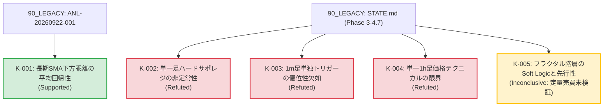

# 知識の系譜 (Knowledge Lineage)

**Doc ID:** KNOW-LIN-001  
**Version:** 0.2.0  
**Status:** Accepted  
**Owner:** @makagi  
**Last Updated:** 2026-10-13  
**Related Issues:** [#4](https://github.com/makagi/MTF_AI_Trade/issues/4), [#6](https://github.com/makagi/MTF_AI_Trade/issues/6), [#9](https://github.com/makagi/MTF_AI_Trade/issues/9)  
**Related Docs:** [02_SPECIFICATIONS/evaluation.md](../02_SPECIFICATIONS/evaluation.md), [README.md](README.md), [01_CONCEPTS/glossary.md](../01_CONCEPTS/glossary.md)  

---

## 1. 証拠レベルの定義 (Evidence Levels)

本系譜図における知見のステータスは、[00_GOVERNANCE/principles.md](../00_GOVERNANCE/principles.md) §2（科学的厳密性と証拠連鎖）に基づき、以下の基準で厳格に分類する。

| ステータス | 英語表記 | 定義・判定基準 |
|---|---|---|
| **支持** | Supported | [02_SPECIFICATIONS/evaluation.md](../02_SPECIFICATIONS/evaluation.md)（SPEC-EVAL-001）の必須評価基準（摩擦コスト0.40%控除後のプラス期待値、年別分解の一貫性、サンプル数100件以上）を満たし、統計的に優位性が支持された知見。仕様・戦略へ昇格可能。 |
| **反証・棄却** | Refuted | 定量実験において摩擦コストに耐えられない、または年ごとの非定常性により優位性が否定・棄却された知見。将来の重複実験を防ぐ資産。 |
| **保留・途上** | Inconclusive | 特徴量としての先行性や傾向は観測されたが、売買シグナルとしての定量検証が未完了、またはサンプル不足等により結論が留保された知見。 |
| **観測** | Observed | 特定の期間・データセットにおいて定性的に観測された現象（仮説立案の材料）。 |

---

## 2. 知識系譜グラフ (Knowledge Graph)

---

## 3. 系譜エントリー詳細

### K-001: 長期SMA下方乖離の平均回帰性
* **ステータス**: 支持 (Supported)
* **概要**: 価格が長期SMAから -2 ATR 以上下方へ乖離した局面において、Discovery 期間（2020-2023年）の各年で一貫した平均回帰（上値反発）傾向が観測された。
* **実験条件**: 日足・4時間足ベース、4年間年別オーバーレイ検証
* **過去資産の出典**: [`90_LEGACY/knowledge/records/2026-09/ANL-20260922-001_sma_mean_reversion/`](../90_LEGACY/knowledge/records/2026-09/ANL-20260922-001_sma_mean_reversion/) (FIND-001 / HYP-001)
* **仕様への影響**: 今後の戦略仕様（`02_SPECIFICATIONS/strategies/`）における平均回帰ロジックのコア仮説として採用。

---

### K-002: ハードなサポレジ線の非定常性
* **ステータス**: 反証・棄却 (Refuted)
* **概要**: 単一時間足のSMAパーフェクトオーダーや静的な特定の支持・抵抗線への接近は、年ごとに期待値の符号が激しく反転し、静的な線単体では過学習を招き有効に機能しないことが示された。
* **実験条件**: 4年間の条件別期待値計測（EDA 05）
* **過去資産の出典**: [`90_LEGACY/STATE.md`](../90_LEGACY/STATE.md) (フェーズ3 重要発見 5)
* **仕様への影響**: 静的サポレジ線の単独売買ルール化を禁止。動的・フラクタルなサポレジ認識（`01_CONCEPTS/market-structure.md`）へ移行。

---

### K-003: 超短期（1m）単独トリガーの優位性欠如
* **ステータス**: 反証・棄却 (Refuted)
* **概要**: 1時間足の環境認識に1分足のテクニカルトリガー（Stoch_d GC / BB 反発）を掛け合わせても、摩擦コスト控除前の60分後リターン分布が0%付近でランダムに分散し、単独トリガーとしての情報優位性が確認されなかった。
* **実験条件**: 1mトリガー発生後60分フォワードリターン計測
* **過去資産の出典**: [`90_LEGACY/STATE.md`](../90_LEGACY/STATE.md) (フェーズ3 重要発見 6)
* **仕様への影響**: 超短期足の単独インジケータをエントリートリガーとして採用する方針を棄却。

---

### K-004: 単一1時間足価格テクニカルの限界
* **ステータス**: 反証・棄却 (Refuted)
* **概要**: 1時間足のSMA・Stoch等の価格指標単体から機械学習（LightGBM / 2段階MoE）を用いてエッジを抽出しようと試みたが、過学習によるコスト負け（Total Return -24.9%）または取引回避に陥り、標準摩擦コスト（0.40%）を上回る期待値を維持できないことが確認された。
* **実験条件**: 4年間のWalk-Forward/CV バックテスト
* **過去資産の出典**: [`90_LEGACY/STATE.md`](../90_LEGACY/STATE.md) (フェーズ4 実験総括)
* **仕様への影響**: 前提条件 A003（単一足価格テクニカルの制約）を確立。多時間軸構造（MTF）または代替データの導入へ完全移行。

---

### K-005: フラクタル階層のSoft Logicと先行指標性
* **ステータス**: 保留・途上 (Inconclusive)
* **概要**: ハード閾値を廃止し、平滑化同調スコア、マクロ重力逆行スコア、ファンアウト速度を連続値（Soft Logic）化した特徴量において、ノイズが低減し、ファンアウト速度が価格反転に先行して減速する傾向が定性的に観測された。ただし、売買シグナルとしての定量バックテスト（SPEC-EVAL-001 準拠の摩擦コスト控除後評価）は未実施のため、知識ステータスとしては「保留（Inconclusive）」とする。
* **実験条件**: 1m足を含むv4.0特徴量の時系列安定性と先行性評価
* **過去資産の出典**: [`90_LEGACY/STATE.md`](../90_LEGACY/STATE.md) (フェーズ4.7 Soft Logic 検証)
* **仕様への影響**: 特徴量設計モデル（`01_CONCEPTS/mtf-framework.md`）として採用。売買戦略への昇格には新環境下での定量実験（M3）を要する。

---

## 4. Change History

| 日付 | Version | 変更概要 | 担当者 / PR |
|---|---|---|---|
| 2026-10-10 | 0.1.0 | 初版作成（旧知識体系の3層化・K-001〜K-005 登録） | @makagi / [#20](https://github.com/makagi/MTF_AI_Trade/pull/20) |
| 2026-10-13 | 0.2.0 | 科学的証拠表現の是正、エビデンスレベル確立、K-005 を Inconclusive へ見直し | @makagi / [#29](https://github.com/makagi/MTF_AI_Trade/pull/29) |
| 2026-10-13 | 0.2.0 | 書式・メタデータ統一 | @makagi / [#31](https://github.com/makagi/MTF_AI_Trade/pull/31) |
