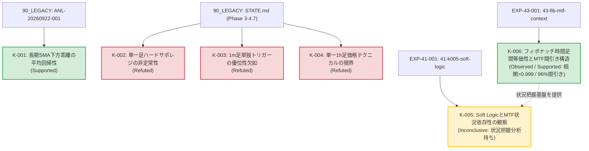

# 知識の系譜 (Knowledge Lineage)

**Doc ID:** KNOW-LIN-001  
**Version:** 0.2.0  
**Status:** Accepted  
**Owner:** @makagi  
**Last Updated:** 2026-10-16  
**Related Issues:** [#4](https://github.com/makagi/MTF_AI_Trade/issues/4), [#6](https://github.com/makagi/MTF_AI_Trade/issues/6), [#9](https://github.com/makagi/MTF_AI_Trade/issues/9), [#41](https://github.com/makagi/MTF_AI_Trade/issues/41), [#43](https://github.com/makagi/MTF_AI_Trade/issues/43)  
**Related Docs:** [02_SPECIFICATIONS/evaluation.md](../02_SPECIFICATIONS/evaluation.md), [README.md](README.md), [01_CONCEPTS/glossary.md](../01_CONCEPTS/glossary.md)  

---

## 1. 証拠レベルの定義 (Evidence Levels)

本系譜図における知見のステータスは、[00_GOVERNANCE/principles.md](../00_GOVERNANCE/principles.md) §2（科学的厳密性と証拠連鎖）に基づき、以下の基準で厳格に分類する。

| ステータス | 英語表記 | 定義・判定基準 |
|---|---|---|
| **支持** | Supported | [02_SPECIFICATIONS/evaluation.md](../02_SPECIFICATIONS/evaluation.md)（SPEC-EVAL-001）の必須評価基準（摩擦コスト0.40%控除後のプラス期待値、年別分解の一貫性、サンプル数100件以上）を満たし、統計的に優位性が支持された知見。仕様・戦略へ昇格可能。 |
| **反証・棄却** | Refuted | 定量実験において摩擦コストに耐えられない、または年ごとの非定常性により優位性が否定・棄却された知見。将来の重複実験を防ぐ資産。 |
| **保留・途上** | Inconclusive | 特徴量としての先行性や傾向は観測されたが、売買シグナルとしての定量検証が未完了、またはサンプル不足等により結論が留保された知見。 |
| **観測** | Observed | 特定の期間・データセットにおいて定性的に観測された現象（仮説立案の材料）。 |

---

## 2. 知識系譜グラフ (Knowledge Graph)

---

## 3. 系譜エントリー詳細

### K-001: 長期SMA下方乖離の平均回帰性
* **ステータス**: 支持 (Supported)
* **概要**: 価格が長期SMAから -2 ATR 以上下方へ乖離した局面において、Discovery 期間（2020-2023年）の各年で一貫した平均回帰（上値反発）傾向が観測された。
* **実験条件**: 日足・4時間足ベース、4年間年別オーバーレイ検証
* **過去資産の出典**: [`90_LEGACY/knowledge/records/2026-09/ANL-20260922-001_sma_mean_reversion/`](../90_LEGACY/knowledge/records/2026-09/ANL-20260922-001_sma_mean_reversion/) (FIND-001 / HYP-001)
* **仕様への影響**: 今後の戦略仕様（`02_SPECIFICATIONS/strategies/`）における平均回帰ロジックのコア仮説として採用。

---

### K-002: ハードなサポレジ線の非定常性
* **ステータス**: 反証・棄却 (Refuted)
* **概要**: 単一時間足のSMAパーフェクトオーダーや静的な特定の支持・抵抗線への接近は、年ごとに期待値の符号が激しく反転し、静的な線単体では過学習を招き有効に機能しないことが示された。
* **実験条件**: 4年間の条件別期待値計測（EDA 05）
* **過去資産の出典**: [`90_LEGACY/STATE.md`](../90_LEGACY/STATE.md) (フェーズ3 重要発見 5)
* **仕様への影響**: 静的サポレジ線の単独売買ルール化を禁止。動的・フラクタルなサポレジ認識（`01_CONCEPTS/market-structure.md`）へ移行。

---

### K-003: 超短期（1m）単独トリガーの優位性欠如
* **ステータス**: 反証・棄却 (Refuted)
* **概要**: 1時間足の環境認識に1分足のテクニカルトリガー（Stoch_d GC / BB 反発）を掛け合わせても、摩擦コスト控除前の60分後リターン分布が0%付近でランダムに分散し、単独トリガーとしての情報優位性が確認されなかった。
* **実験条件**: 1mトリガー発生後60分フォワードリターン計測
* **過去資産の出典**: [`90_LEGACY/STATE.md`](../90_LEGACY/STATE.md) (フェーズ3 重要発見 6)
* **仕様への影響**: 超短期足の単独インジケータをエントリートリガーとして採用する方針を棄却。

---

### K-004: 単一1時間足価格テクニカルの限界
* **ステータス**: 反証・棄却 (Refuted)
* **概要**: 1時間足のSMA・Stoch等の価格指標単体から機械学習（LightGBM / 2段階MoE）を用いてエッジを抽出しようと試みたが、過学習によるコスト負け（Total Return -24.9%）または取引回避に陥り、標準摩擦コスト（0.40%）を上回る期待値を維持できないことが確認された。
* **実験条件**: 4年間のWalk-Forward/CV バックテスト
* **過去資産の出典**: [`90_LEGACY/STATE.md`](../90_LEGACY/STATE.md) (フェーズ4 実験総括)
* **仕様への影響**: 前提条件 A003（単一足価格テクニカルの制約）を確立。多時間軸構造（MTF）または代替データの導入へ完全移行。

---

### K-005: Soft LogicとMTF状況依存性の観察
* **ステータス**: 保留・観察中 (Inconclusive / Observed)
* **概要**: Discovery 期間（2020-01-01 〜 2025-04-30）における定量実験（EXP-41-001）において、ファンアウト速度減速・AFS同調は、単独逆張りでは深い下落（-3.5 ATR超）に巻き込まれて摩擦負け（Net EV -0.588%）する一方、上位足マクロ強気（Close > SMA 377）を前提とした押し目局面では摩擦コストを突破する（Gross +0.42%, Net +0.02%, 直近PF > 1.8）という、市場状況・コンテキストに強く依存した振る舞いが観測された。
* **実験条件**: BTCUSD 1h、5年4ヶ月 Discovery 期間、往復摩擦コスト0.40%控除
* **証拠・出典リンク**: [`03_KNOWLEDGE/experiments/41-k005-soft-logic/record.md`](experiments/41-k005-soft-logic/record.md) (EXP-41-001 / [#41](https://github.com/makagi/MTF_AI_Trade/issues/41))
* **仕様への影響**: 状況把握の仕方も把握すべき知識の一部であり、特定の期間ではなくMTF（多時間軸）での状況把握が必要であるため、現時点では確定的な結論（Supported/Refuted）を下さず保留（Inconclusive）とする。MTFによる状況把握モデルの分析を先行させ、その後に合わせて総合評価する。

---

### K-006: フィボナッチ時間足間等価性と特徴量別MTF利用規律
* **ステータス**: 観測・支持 (Observed / Supported)
* **概要**: 4年間（2021-2024年、約210万分・3.5万時間）の実データ分析（EXP-43-001）において、1分足の超長期フィボナッチ項（$F_{1m} \in [610 \sim 6765]$）と1時間足の近接フィボナッチ項（$F_{1h} \in [8 \sim 144]$）の関係性を網羅的に検証した結果、特徴量の性質により以下の決定的な挙動差が実証された：
  1. **価格追随系（SMA、ローリング最高値HH / 最安値LL）**: 相関 $r > 0.999$、誤差 $< 0.8\%$、比率 $\approx 1.000$ であり**完全代替可能**。下位足での巨大計算を上位足へ代用できる。
  2. **正規化幅系（BB Width / Squeeze Index）**: 相関 $r \approx 0.94$ と波形は同期するが、サンプリング頻度差により約11〜15%の系統的スケール差が存在。パーセンタイル正規化による利用が必須。
  3. **オシレーター系（Stochastics %K / AFS）**: 長期オシレーターは相関するが、短期（610 vs 8）ではノイズにより MAE 16.9pt と激しく乖離。短期オシレーターの時間足間代用は禁止（平滑化AFS必須）。
  4. **値幅・ボラティリティ系（ATR）**: 波形相関は $r > 0.98$ と極大だが、絶対値は $\frac{1}{\sqrt{60}}$ 則（約1/10）に従い次元が異なるため、時間スケール補正が不可欠。
  5. **間引き（Downsampling）**: 1h足でマクロ・メソのセットアップ（Armed）を監視することで、下位1m足の計算・監視データ量を **約 96.1% 間引くアーキテクチャ** の成立を確認。
* **実験条件**: BTCUSD 1h & 1m、4年間、フィボナッチ項 $F_1 \sim F_{21}$ の全特徴量比較分析
* **証拠・出典リンク**: [`03_KNOWLEDGE/experiments/43-fib-mtf-context/record.md`](experiments/43-fib-mtf-context/record.md) (EXP-43-001 / [#43](https://github.com/makagi/MTF_AI_Trade/issues/43))
* **仕様への影響**: MTF特徴量仕様（SPEC-FEAT-001）および状況把握モデルの利用前規律として採用。特徴量の性質（価格追随型・正規化型・オシレーター型・値幅型）に応じた時間足代用・スケーリング補正ルールを義務化。

---

## 4. Change History

| 日付 | Version | 変更概要 | 担当者 / PR |
|---|---|---|---|
| 2026-10-10 | 0.1.0 | 初版作成（旧知識体系の3層化・K-001〜K-005 登録） | @makagi / [#20](https://github.com/makagi/MTF_AI_Trade/pull/20) |
| 2026-10-13 | 0.2.0 | 科学的証拠表現の是正、エビデンスレベル確立、K-005 を Inconclusive へ見直し | @makagi / [#29](https://github.com/makagi/MTF_AI_Trade/pull/29) |
| 2026-10-13 | 0.2.0 | 書式・メタデータ統一 | @makagi / [#31](https://github.com/makagi/MTF_AI_Trade/pull/31) |
| 2026-10-15 | 0.3.0 | EXP-41-001 観察記録反映、MTF状況把握分析の先行方針に伴い K-005 を保留・観察中 (Inconclusive) として整理 | @makagi / [#41](https://github.com/makagi/MTF_AI_Trade/pull/41) |
| 2026-10-16 | 0.4.0 | EXP-43-001 反映、K-006（フィボナッチ時間足間等価性とMTF間引き構造）を新設・登録 | @makagi / [#43](https://github.com/makagi/MTF_AI_Trade/pull/43) |
