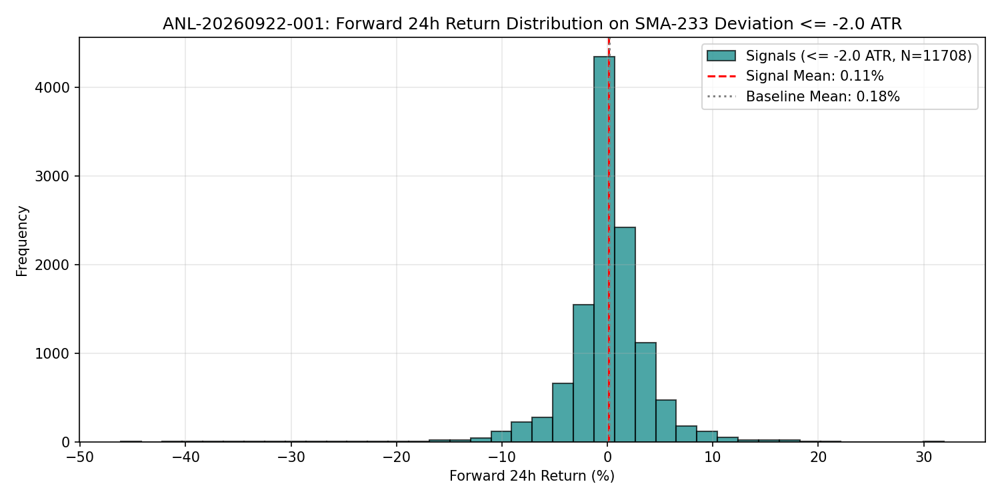

# SMA -2 ATR Mean Reversion

## 1. 目的と問い (Question)
価格が長期移動平均線（SMA 233）から -2 ATR 以上下方へ極端に乖離した局面において、24時間のフォワードリターンに反転（Mean Reversion）の優位性・歪みが生じるかを検証する。

## 2. 分析手法・数式 (Methodology)
乖離正規化スコア（ATR Normalized Deviation）：
$$Dev_t = \frac{Close_t - SMA(Close, 233)_t}{ATR(14)_t}$$

シグナル条件：
$$Signal_t = \mathbb{I}(Dev_t \le -2.0)$$

フォワード24時間リターン：
$$R_{t+24} = \frac{Close_{t+24} - Close_t}{Close_t}$$

## 3. 主な結果 (Key Results)
詳細は [metrics.json](metrics.json) を参照。

* **抽出サンプル数**: 11,708 bars
* **勝率 (Win Rate)**: 54.5% (ベースライン無条件: 52.4% に対して +2.1% の勝率向上)
* **平均リターン (24h)**: +0.11% (ベースライン +0.18%)
* **中央値 (Median Return)**: +0.17%

## 4. 解釈と考察 (Interpretation)
- **分かったこと**: 勝率としては 54.5% とベースライン（52.4%）を上回る上値回帰バイアスが観測される。
- **分からないこと / 課題**: 強烈な下落トレンド中（例: 2022年ベア相場）に -2 ATR を下回り続けたまま引きずられるテールリスクが存在し、平均リターンを押し下げている。
- **注意点 / バイアス**: 単なる乖離閾値だけでは、トレンドフォローと逆張りのレジーム識別が不十分。

## 5. 発見と次の仮説 (Findings & Hypotheses)
- **[FIND-001]**: 長期SMAからの -2 ATR 下方乖離は勝率54.5%の上値回帰傾向を示すが、トレンドの傾きを考慮しないとテールリスクを抑制できない。
- **[HYP-001]**: 長期SMAの傾き（Slope）が正（上昇トレンド中の押し目）に限定すれば、Mean Reversion の平均リターンと期待値が顕著に向上するのではないか？
  - $\rightarrow$ 次の派生分析: `ANL-20260922-002` (SMA Slope フィルター付き Mean Reversion)
