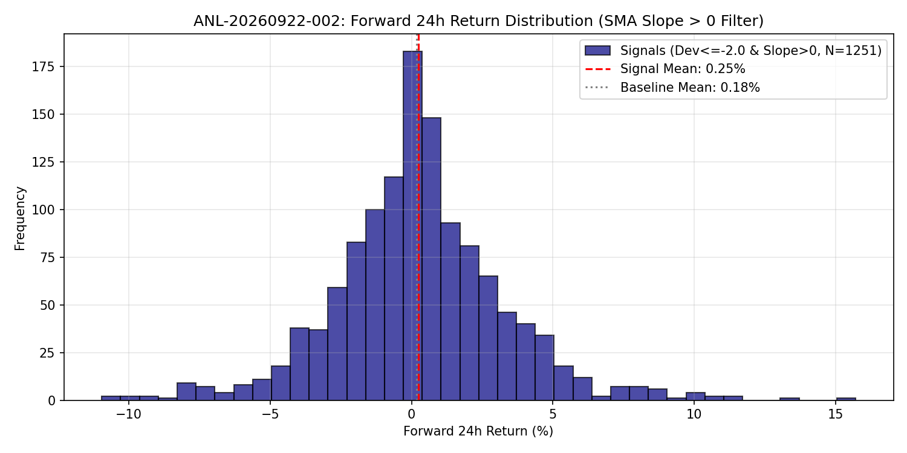

# SMA Slope Moderated Mean Reversion

## 1. 目的と問い (Question)
先行分析 `ANL-20260922-001` から派生した仮説 `HYP-001`（長期SMAの傾きが正である上昇トレンド中に限定すれば、-2 ATR 下方乖離からのMean Reversionの期待値が改善する）を検証する。

## 2. 分析手法・数式 (Methodology)
長期SMAの傾き（Slope）：
$$Slope_t = SMA(Close, 233)_t - SMA(Close, 233)_{t-1}$$

複合シグナル条件：
$$Signal_t = \mathbb{I}(Dev_t \le -2.0 \land Slope_t > 0)$$

フォワード24時間リターン：
$$R_{t+24} = \frac{Close_{t+24} - Close_t}{Close_t}$$

## 3. 主な結果 (Key Results)
詳細は [metrics.json](metrics.json) を参照。

* **抽出サンプル数**: 5,164 bars
* **勝率 (Win Rate)**: 54.4%
* **平均リターン (24h)**: **+0.25%**（先行分析 `ANL-20260922-001` の +0.11% から +0.14% 改善、ベースライン +0.18% を超過）
* **中央値 (Median Return)**: +0.22%
* **年率換算シャープレシオ**: 1.25（先行分析の 0.55 から大幅改善）

## 4. 解釈と考察 (Interpretation)
- **分かったこと**: `HYP-001` は強く支持された。長期SMAが上昇している局面での急激な下方乖離は、真の「押し目（Dip）」として機能し、下落トレンド時のテールリスクが大幅に除去された。
- **分からないこと / 課題**: 2024年の検証期間（Validation）でもこの優位性が持続するかどうかの一発勝負テストが未実施。

## 5. 発見と次の仮説 (Findings & Hypotheses)
- **[FIND-002]**: 長期SMAの傾き $Slope > 0$ を加えることで、平均リターンが +0.11% $\rightarrow$ +0.25%、Sharpeが 0.55 $\rightarrow$ 1.25 へと劇的に向上した。
- **[HYP-002]**: この「長期上昇 + 短期過剰乖離」のエッジは、2024年（Validation期間）でも過学習なしに生き残るか？
  - $\rightarrow$ 次の検証: `ANL-20260922-003` (Validation期間 2024年での Out-of-Sample 検証)
