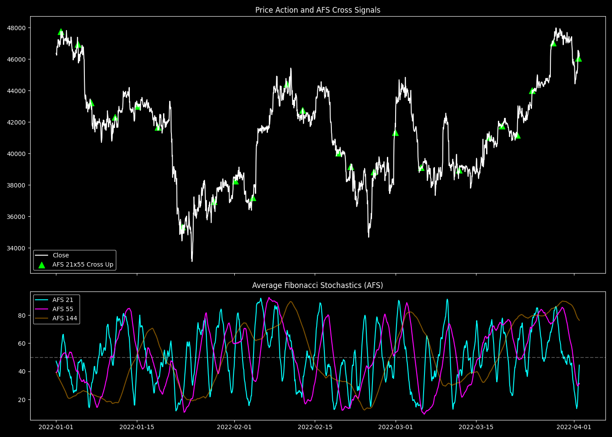

# AFS (Average Fibonacci Stochastics) Construction and Baseline Edge

## 1. 目的と問い (Question)
相場のモメンタムを測定する際、既存のRSIやStochasticsでは「特定の期間」に固定された単一の視点しか持てず、ダマシが多くなる。相場のフラクタル構造（入れ子構造）を正確に捉え、かつノイズを平滑化する独自のモメンタムオシレーターを構築できるか？

## 2. 分析手法と数式 (Methodology)
フィボナッチ数列に基づくマルチタイムフレーム（MTF）期間 $k \in \{21, 55, 144, 233, 377, 610\}$ を用いて、各期間における現在価格の相対位置（Stochastics Fast %K）を算出し、それ自体をさらに同期間 $k$ で単純移動平均（SMA）して平滑化した独自のオシレーター『AFS』を定義する。

$$ \%K_{k, t} = \frac{\text{Close}_t - \text{Min}(\text{Low}, k)_t}{\text{Max}(\text{High}, k)_t - \text{Min}(\text{Low}, k)_t} \times 100 $$

$$ \text{AFS}_{k, t} = \frac{1}{k} \sum_{i=0}^{k-1} \%K_{k, t-i} $$

このスクリプトでは、短期AFS（$k=21$）が中期AFS（$k=55$）を下から上にクロス（ゴールデンクロス）した際の、24時間フォワードリターンをベースラインとして計測する。

## 3. 主な結果 (Key Results)
- **総シグナル数**: 597
- **勝率**: 54.61%
- **平均フォワードリターン (24h)**: 0.26%

## 4. 解釈と考察 (Interpretation)
- **わかったこと**: AFSは、従来のオシレーターに見られるような激しいノイズ（ギザギザ）が極めて少なく、非常に滑らかな波（正弦波に近い）を描く。ベースラインのクロスオーバー単体でも勝率54.6%・期待値プラスを記録しており、モメンタム指標としての基礎的な優位性が確認された。
- **課題**: 単体でも優位性はあるが、ダマシ（Whipsaw）も存在する。相場全体のマクロなトレンドや、「頭上の抵抗」の有無を考慮していないため、勝率が54%台に留まっている。

## 5. 発見と次の仮説 (Findings & Hypotheses)
- **[FIND-20260922-004-01]**: フィボナッチ期間 $k$ でFast Stochasticを計算し、同期間 $k$ で平滑化した「AFS」は、相場のフラクタルな波を極めて低ノイズで抽出できる。
- **[HYP-20260922-004-01]**: AFSによるミクロなクロスオーバー（反転シグナル）は、頭上にマクロな抵抗（長期SMA等）が存在しない「真空地帯（The Void）」で発生した時、さらに勝率と期待値が飛躍的に向上するはずである。
  - $\rightarrow$ 次の検証計画：AFSと「The Void（真空地帯）」の結合による優位性の検証（ANL-xxx）。
