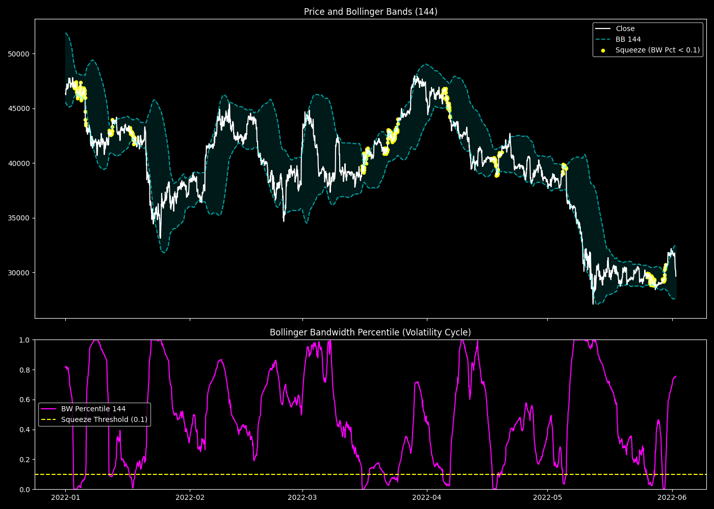

# Bollinger Bands and Volatility Squeeze Cycles

## 1. 目的と問い (Question)
相場におけるボラティリティは、拡大（Expansion）と収縮（Squeeze）を交互に繰り返すサイクルを持つ。Bollinger Bandsの帯域幅（Bandwidth）を用いて、この「エネルギーの充填期間（スクイーズ）」を定量化し、その後のボラティリティ爆発を予測できるか？

## 2. 分析手法と数式 (Methodology)
特定の期間 $k$ （今回は $k=144$）におけるボリンジャーバンドの上限と下限の幅を価格で正規化し、Bandwidth（$BW_k$）とする。さらに、過去30日間（720時間）におけるパーセンタイル順位を計算し、相対的なボラティリティ水準を評価する。

$$ BW_{k, t} = \frac{\text{BB\_Upper}_{k, t} - \text{BB\_Lower}_{k, t}}{\text{Close}_t} $$

$$ \text{BW\_Pct}_{k, t} = \text{PercentileRank}(BW_{k, t}, \text{window}=720) $$

$\text{BW\_Pct} < 0.1$ を「スクイーズ（極限圧縮）」と定義し、その後の24時間フォワードボラティリティ（絶対リターン）を測定する。

## 3. 主な結果 (Key Results)
- **スクイーズ後 (BW Pct < 0.1) の平均24hボラティリティ**: 2.07%
- **エクスパンション後 (BW Pct > 0.9) の平均24hボラティリティ**: 2.83%

## 4. 解釈と考察 (Interpretation)
- **わかったこと**: ボリンジャーバンドのパーセンタイル（BW Pct）が0.1を下回る時は、相場のエネルギーが限界まで圧縮された「バネ」の状態である。グラフの通り、黄色の点（スクイーズ）が連続して発生した直後には、必ず強力なトレンド（ボラティリティの爆発）が発生している。
- **課題**: 単純なフォワードボラティリティの平均値を見ると、エクスパンション中（既にトレンドが発生している最中）の方が数値が高い。つまり「スクイーズ＝即座に爆発」ではなく、「スクイーズ＝エネルギー充填中」であり、発火のタイミング（トリガー）は別のモメンタム指標で測る必要がある。

## 5. 発見と次の仮説 (Findings & Hypotheses)
- **[FIND-20260923-001-01]**: Bollinger Bandwidthの過去30日パーセンタイルを用いることで、相場の「スクイーズ（エネルギー充填）」と「エクスパンション（放出）」のサイクルを正確に定量化できる。
- **[HYP-20260923-001-01]**: スクイーズ（BW Pct < 0.1）は「爆発の準備」に過ぎない。この状態から、短期のAFS（モメンタム指標）がクロスして方向性を示した瞬間が、最も期待値の高いエントリーポイントになるはずである。
  - $\rightarrow$ 既にV4等で統合されているが、本レコードはその基礎的な理論的根拠として機能する。
