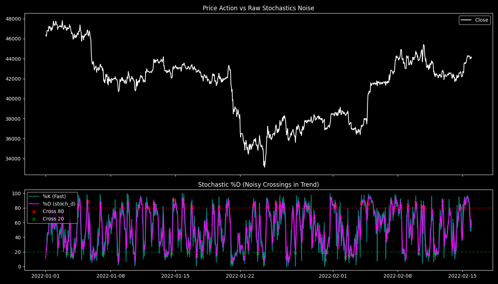

# Stochastic Oscillator (stoch_d) and Noise Limitations

## 1. 目的と問い (Question)
モメンタム指標のベースとして最も一般的な「Stochastic Oscillator（ストキャスティクス）」の生の挙動（Raw behavior）を確認する。なぜ単なるstoch_dのクロスオーバーではシステムトレードとして機能しないのか（ダマシが発生するのか）、そのノイズの限界を定量的に評価する。

## 2. 分析手法と数式 (Methodology)
標準的な期間 $p=14$ における現在価格の相対位置（%K）を求め、それを期間3で平滑化したものを %D（`stoch_d`）とする。

$$ \%K_{t} = \frac{\text{Close}_t - \text{Min}(\text{Low}, 14)_t}{\text{Max}(\text{High}, 14)_t - \text{Min}(\text{Low}, 14)_t} \times 100 $$

$$ \%D_{t} = \frac{1}{3} \sum_{i=0}^{2} \%K_{t-i} $$

買われすぎ（> 80）と売られすぎ（< 20）のラインを頻繁に跨ぐ回数をカウントし、強いトレンド相場における「ダマシ（Whipsaws）」の発生頻度を計測する。

## 3. 主な結果 (Key Results)
- **買われすぎ/売られすぎのクロス回数（ダマシ候補）**: 2822回

## 4. 解釈と考察 (Interpretation)
- **わかったこと**: 生のstoch_dは価格の微小な上下動に極めて敏感に反応する。特に一方向への強いトレンド（上昇または下落）が発生している最中、指標は20や80の境界線を「何度も往復してギザギザに動く」という致命的な欠陥（Whipsaw）を示す。これに従って逆張りをすると、トレンドに轢かれて確実に破産する。
- **課題**: 相場全体の「マクロな波（フラクタル構造）」を捉えるためには、単一期間（14）という視点と、短い平滑化（3）では全くノイズが取り切れない。

## 5. 発見と次の仮説 (Findings & Hypotheses)
- **[FIND-20260923-002-01]**: 生のストキャスティクス（stoch_d）は仮想通貨のようなボラティリティの高い市場において、トレンド発生時に深刻なノイズ（Whipsaw）を発生させる。
- **[HYP-20260923-002-01]**: モメンタムのノイズを完全に除去するためには、フィボナッチ期間によるMTF（マルチタイムフレーム）の視点と、算出期間と同値の長さによる強力な自己平滑化が必要である。
  - $\rightarrow$ この仮説は、すでに登録済みの「AFS (Average Fibonacci Stochastics)」への発展（ANL-20260922-004）に直接繋がる。
