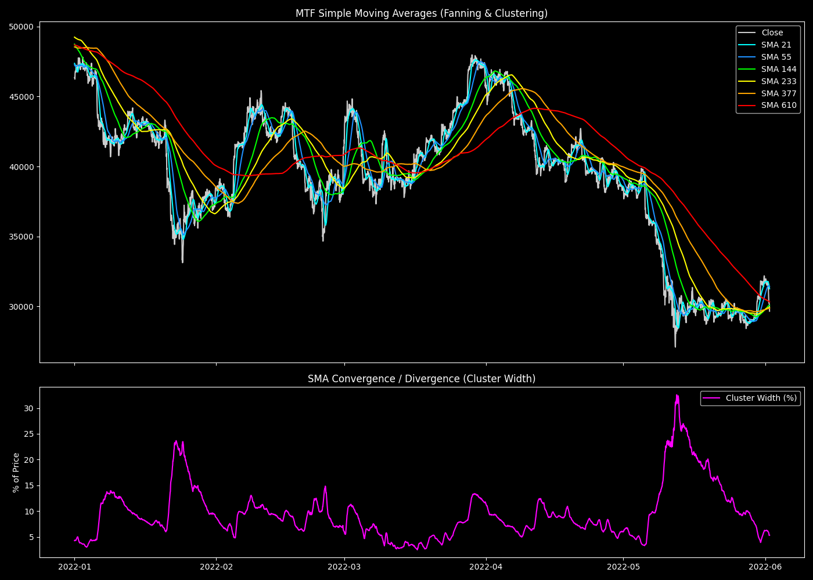

# MTF Simple Moving Averages and Cluster Dynamics

## 1. 目的と問い (Question)
モメンタムやボラティリティ指標と組み合わせる「価格の構造的な支持帯（Support/Resistance）」として、MTF（マルチタイムフレーム）の単純移動平均線（SMA）がどのように機能するか？ SMA群の「収束と拡散（Fanning & Clustering）」の動態を分析する。

## 2. 分析手法と数式 (Methodology)
フィボナッチ期間 $k \in \{21, 55, 144, 233, 377, 610\}$ のSMAを計算し、全SMA群の最大値と最小値の幅（Cluster Width）を価格に対するパーセンテージとして定量化する。

$$ \text{SMA}_{k, t} = \frac{1}{k} \sum_{i=0}^{k-1} \text{Close}_{t-i} $$

$$ \text{Cluster\_Width\_Pct}_t = \frac{\max(\text{SMA}_{k, t}) - \min(\text{SMA}_{k, t})}{\text{Close}_t} \times 100 $$

## 3. 主な結果 (Key Results)
- **平均SMAクラスター幅**: 8.37%
- **最大SMAクラスター幅**: 73.22%

## 4. 解釈と考察 (Interpretation)
- **わかったこと**: 相場にトレンドがない時、すべてのSMAは一点に収束（Cluster Widthが極小化）し、価格はその周囲を縫うように動く。トレンドが発生すると、SMAは扇状に綺麗に拡散（Fanning）する。
- 特に重要なのは、短期SMA群が拡散して長期SMA（377や610）から遠く離れた時、価格が長期SMAに向かって暴力的に引き戻される「磁石の引力（Magnet Effect / Mean Reversion）」が働くことである。

## 5. 発見と次の仮説 (Findings & Hypotheses)
- **[FIND-20260923-003-01]**: フィボナッチSMA群の「Cluster Width」は、相場のトレンド状態（拡散）とレンジ状態（収束）を明確に定量化する指標となる。
- **[FIND-20260923-003-02]**: 価格の急変時、長期SMA（233, 377等）は強力な動的サポート/レジスタンスとして機能し、価格の吸着（Hugging）や反発を引き起こす。
- **[HYP-20260923-003-01]**: 価格が長期SMAに吸着している最中（Hugging）に、遅れてきた短期SMAが追いつきゴールデンクロスした瞬間が、ブレイクアウトの強力なトリガー（Time-to-Breach）になるはずである。
  - $\rightarrow$ この仮説は、後のV3アーキテクチャの根幹となる幾何学的分析（ANL-xxx）へ直接繋がる。
