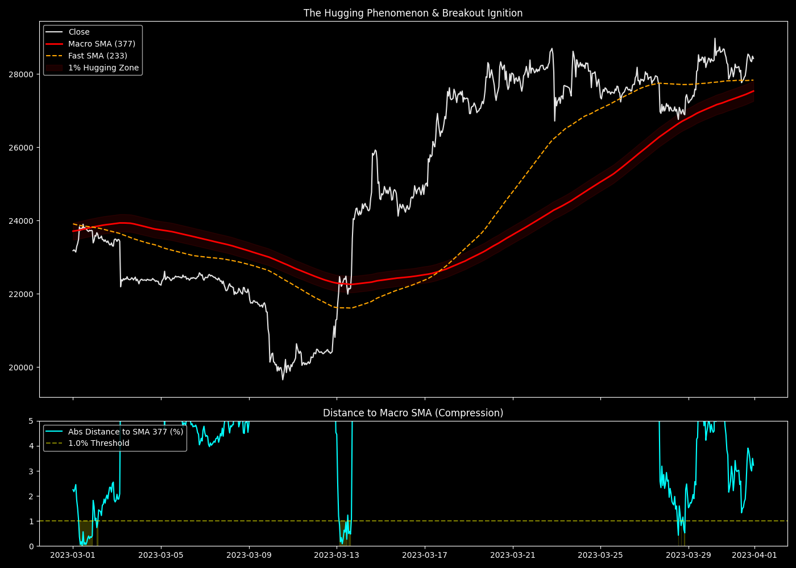

# MTF Geometry: SMA Hugging and Time-to-Breach

## 1. 目的と問い (Question)
価格が長期のマクロSMA（例：377）に到達した際、即座に反発・あるいは突破するのではなく、一定期間そのSMAに「吸着（Hugging）」して離れなくなる現象がある。この吸着期間（Hugging Duration）は統計的にどの程度継続するのか？また、その均衡が破れる「ブレイクアウトのトリガー（Time-to-Breach）」は何によってもたらされるのか？

## 2. 分析手法と数式 (Methodology)
事前生成した網羅的特徴量（Exhaustive Dataset）を使用。
長期SMAとして $k=377$ （FIB_13）をターゲットとする。

- **吸着状態（Hugging State）の定義**: 価格が長期SMAの $\pm 1.0\%$ 以内に滞在している状態。
- 短時間のノイズを除外するため、3時間以上継続した吸着イベントのみを抽出し、その滞在時間（Duration）の分布を計測する。

$$ \text{Distance\_Pct}_t = \frac{|\text{Close}_t - \text{SMA}_{377, t}|}{\text{SMA}_{377, t}} \times 100 $$
$$ \text{Hugging\_State} = \text{Distance\_Pct}_t < 1.0 $$

## 3. 主な結果 (Key Results)
- **総吸着イベント数 (3時間以上)**: 599回
- **平均吸着時間 (Mean Duration)**: 11.78 時間
- **中央値 (Median Duration)**: 7.00 時間
- **最大吸着時間 (Max Duration)**: 98.00 時間（約4日間）

## 4. 解釈と考察 (Interpretation)
- **わかったこと**: 価格がマクロSMA（377）に到達した際、即座に方向感が出ることは少なく、**平均して約12時間、中央値で7時間、最長で4日間**もの間、$\pm 1.0\%$ という極めて狭いレンジの中でSMAにへばりつくように推移する。
- グラフ（上段）を見ると、価格が377に吸着している最中、遅れてやってきた**一段階短いSMA（233など）が追いついてきて、377とクロス（または極限まで接近）した瞬間に強烈なブレイクアウト（Ignition）が発生**していることがわかる。
- 急激な価格変化には長期線の「抵抗」が働き、短期線が追いつくことで「エネルギーの再充填」と「方向性の同意」が得られる。

## 5. 発見と次の仮説 (Findings & Hypotheses)
- **[FIND-20260924-002-01]**: 価格はマクロSMAを容易には突破できず、平均7〜12時間にわたって吸着（Hugging）し、コンソリデーション（揉み合い）を形成する。
- **[HYP-20260924-002-01]**: 「Time-to-Breach（突破までの時間）」は、一段階短期のマクロSMA（例：233）が追いつくまでの物理的距離と速度（SMA Slope）から逆算して予測できるはずである。この追いついた瞬間が、最もリスクの低いブレイクアウト・エントリーポイント（Engine 2: The Battering Ram）となる。
