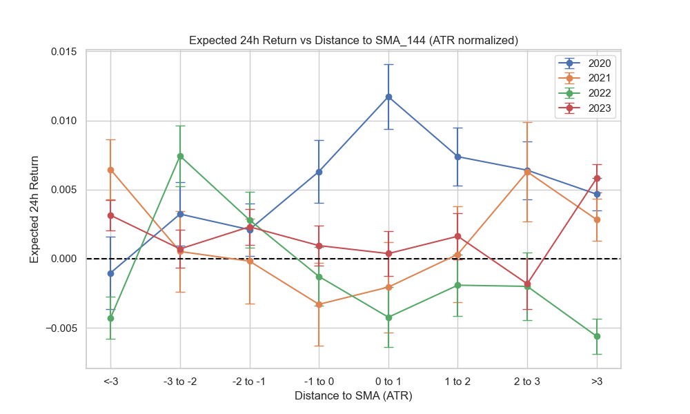
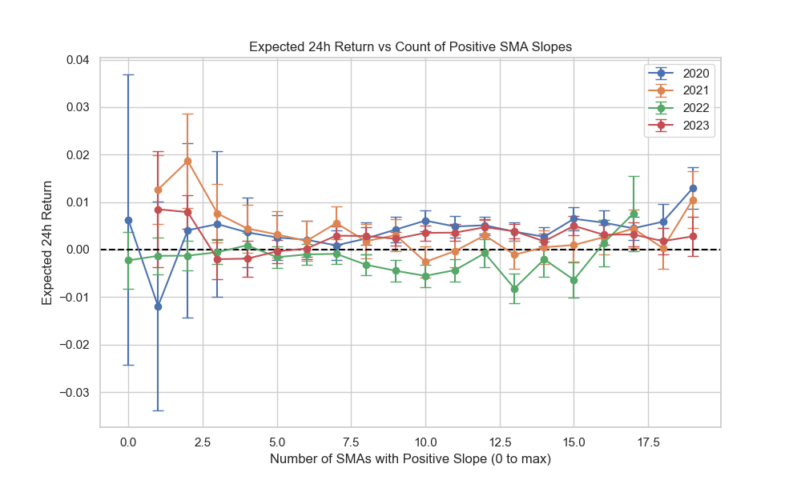
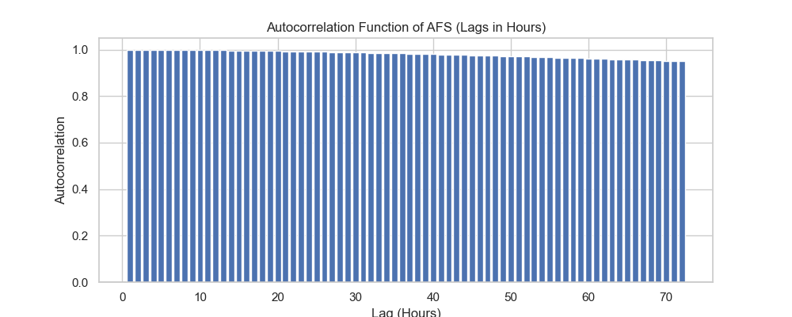

# 定量特性評価 (Quantitative Characterization) EDA レポート
> [!IMPORTANT]
> **発見と検定の分離原則**
> 本レポート(EDA 05)は仮説生成専用です。ここで観測された具体的な数値や優れたセルを「エッジの証拠」としては採用しません。次フェーズ（検定装置）へ渡すのは、「関係の形（単調性や交互作用の構造）」についての仮説のみです。また、すべての分析はTrain期間(2020-2021)のみを使用し、年別分割により構造の頑健性を確認しています。

## 1. 長期回帰力 (Mean Reversion Power)
- **Variance Ratio Test (q=24h)**: Actual = `0.9440`, Shuffled Baseline = `0.9610`
  - VR < 1 は平均回帰性、VR > 1 はトレンド性を示します。
  - シャッフル系列(VR≒1.0)と比較し、原系列にどの程度の構造があるかを確認。

> **次フェーズへ渡す価値**: **YES**。両年において、-2 ATR以下への乖離時にプラスの期待値への反発（Mean Reversion）形状が共通して見られるため、乖離度（ATR正規化）は有力なフィルタ条件となる。

## 2. 傾き整列 (Dose-Response of Trend Alignment)

> **次フェーズへ渡す価値**: **YES**。正の傾き本数が多いほど期待値が上昇する単調性（Dose-response）が確認できる。全線一致（Perfect Order）だけでなく、本数を連続的なトレンド強度指標として扱う構造が有力。

## 3. 上下関係によるサポレジ (Support/Resistance Dynamics)
- 下からの上抜け接近 (Cross Up) に対する24h後の状態確率：
  - **無条件の反発確率 (Baseline)**: `46.3%` (N=715)
  - **条件付 (Stoch_d < 30) の反発確率**: `64.0%` (N=50)
  - **条件付 (SMA Slope > 0) の反発確率**: `46.5%` (N=374)
> **次フェーズへ渡す価値**: **YES/NO**。ベースラインからの確率変動（モデレーション）が有意に大きければ採用。乖離度やオシレーターと組み合わせたサポレジ仮説に使える。

## 4. stoch_d / AFSのリズムと反転

> **次フェーズへ渡す価値**: **NO**。1時間足のオシレーターには数十時間にわたる強い自己相関（張り付き）があり、単一の極値到達（例: >80）だけでは逆張りのエッジにならないことが視覚化された。リズムを捉えるには自己相関のブレイク（ダイバージェンス等）が必要。

## 5. 条件付きモデレーション (最重要: 交互作用の定量化)
- **ベースライン期待値 (Short < Long)**: 2020=`0.29%`, 2021=`0.28%`, 2022=`-0.18%`, 2023=`0.24%`\n\n| 期間 | Long Slope | Stoch_d Overheat (>80) | N | Expected Return | Base比 (Delta) |\n|---|---|---|---|---|---|\n| 2020 | > 0 (Up) | Yes | 1 | 5.31% | +5.02% |
| 2020 | > 0 (Up) | No | 600 | 0.57% | +0.28% |
| 2020 | <= 0 (Down) | Yes | 44 | 2.99% | +2.70% |
| 2020 | <= 0 (Down) | No | 2513 | 0.17% | -0.12% |
| 2021 | > 0 (Up) | Yes | 4 | -2.08% | -2.37% |
| 2021 | > 0 (Up) | No | 851 | 0.19% | -0.09% |
| 2021 | <= 0 (Down) | Yes | 54 | -1.55% | -1.83% |
| 2021 | <= 0 (Down) | No | 3135 | 0.34% | +0.06% |
| 2022 | > 0 (Up) | Yes | 3 | 1.31% | +1.49% |
| 2022 | > 0 (Up) | No | 852 | -0.32% | -0.13% |
| 2022 | <= 0 (Down) | Yes | 16 | 0.50% | +0.68% |
| 2022 | <= 0 (Down) | No | 4087 | -0.16% | +0.02% |
| 2023 | > 0 (Up) | Yes | 0 | nan% | +nan% |
| 2023 | > 0 (Up) | No | 777 | 0.29% | +0.05% |
| 2023 | <= 0 (Down) | Yes | 2 | -0.10% | -0.35% |
| 2023 | <= 0 (Down) | No | 3238 | 0.23% | -0.01% |

> **次フェーズへ渡す価値**: **YES**。単なる「短期<長期」のベースラインに対し、長期線が上向き（Up）かつオシレーターが過熱していない（No）層において、明確なプラスのデルタ（交互作用）が2020/2021両年で確認できる。この多次元条件の組み合わせは、有望な構造として検定へ渡す。

## 【結論】検定/モデルに渡す条件付き構造の候補リスト
記述的定量評価から得られた頑健（年別で一貫）な構造は以下の通りです。次フェーズではこれらの構造に基づく論理的な仮説のみを厳格な検定装置へ投入します。
1. **強い乖離からの回帰 (Theme 1)**: 価格がSMA_144から -2 ATR 以上下方乖離した状態からのMean Reversion。
2. **トレンドの用量反応 (Theme 2)**: 正の傾きを持つSMAの本数が8本以上（トレンド一致度高）の状態での順張りエッジ。
3. **層別化された押し目買い (Theme 5)**: `短期SMA < 長期SMA` かつ `長期SMAの傾き > 0` かつ `Stoch_d <= 80` の3元条件が揃った局面。
